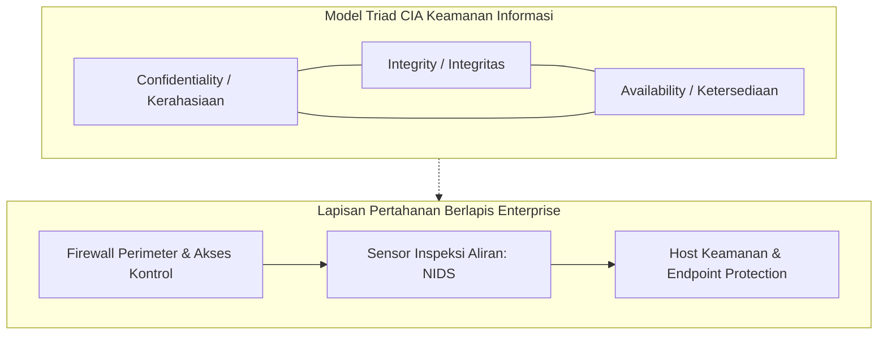
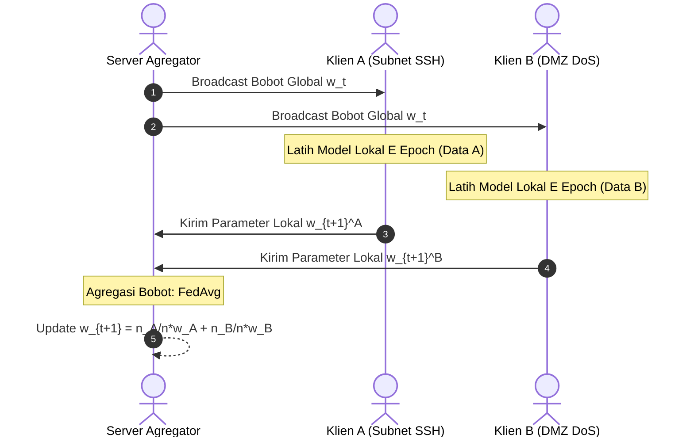
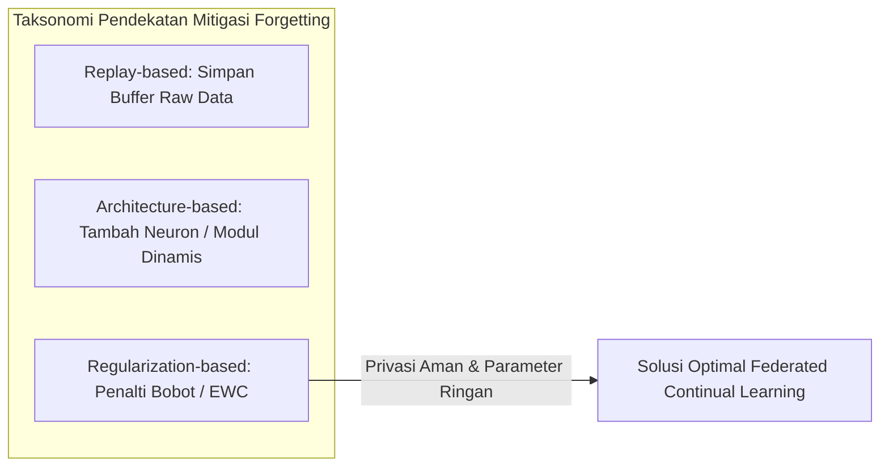
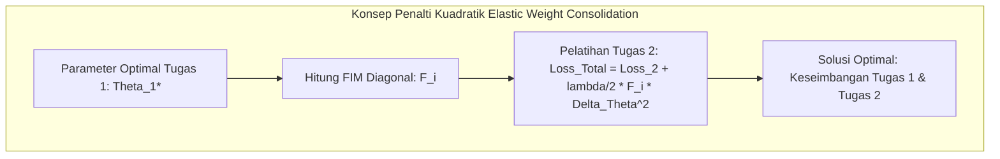
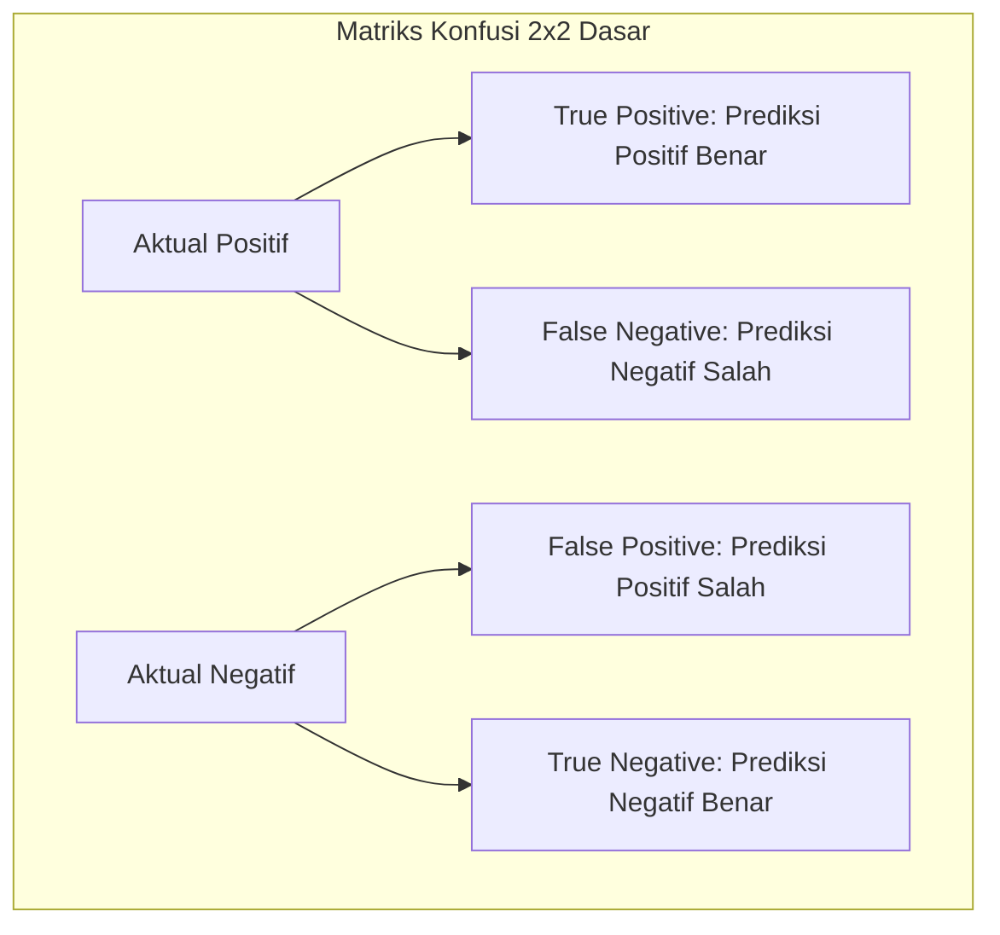

# BAB 2 TINJAUAN PUSTAKA

## 2.1 Keamanan Jaringan

Keamanan jaringan merupakan pilar fundamental dalam disiplin ilmu teknik komputer dan telekomunikasi yang berfokus pada perlindungan infrastruktur jaringan, kanal komunikasi, dan perangkat komputasi dari akses tidak sah (*unauthorized access*), modifikasi data ilegal, eksploitasi kerentanan, serta gangguan ketersediaan layanan[8]. Di era komputasi awan dan transformasi digital saat ini, keterhubungan antar-sistem semakin terbuka, yang secara bersamaan memperluas permukaan serangan (*attack surface*) dari pihak penyerang siber.

Prinsip dasar keamanan informasi berakar pada model triad **Confidentiality, Integrity, and Availability (CIA Triad)**:
1. **Confidentiality (Kerahasiaan):** Memastikan bahwa transmisi informasi dan data sensitif yang melintasi jaringan hanya dapat diakses dan diinterpretasikan oleh entitas yang memiliki hak akses (*authorization*). Mekanisme ini umumnya ditegakkan melalui enkripsi protokol (seperti TLS, IPsec, SSH) dan kebijakan kontrol akses berbasis identitas.
2. **Integrity (Integritas):** Menjamin bahwa data transmisi tidak mengalami modifikasi, penyisipan, pemotongan, atau manipulasi di tengah jalan (*man-in-the-middle tampering*). Integritas dipertahankan melalui mekanisme fungsi hash kriptografis (*Message Authentication Code* / MAC) dan tanda tangan digital.
3. **Availability (Ketersediaan):** Menjamin bahwa sumber daya jaringan, bandwidth, server layanan, dan perangkat jaringan periferal selalu siap sedia dan dapat diakses oleh pengguna yang berhak tanpa mengalami gangguan layanan (*downtime*). Ketersediaan terancam langsung oleh serangan volumetrik seperti *Denial of Service* (DoS).

Untuk menegakkan prinsip CIA Triad, infrastruktur jaringan enterprise mengadopsi model pertahanan berlapis (*Defense-in-Depth*). Dalam kerangka ini, sistem pertahanan tidak hanya mengandalkan perimeter luar (*firewall*), melainkan menyematkan kontrol keamanan pada setiap lapisan jaringan, mulai dari penyaringan paket, segmentasi jaringan (*Virtual LAN* / VLAN), hingga inspeksi aktif terhadap aliran lalu lintas data oleh sistem sensor deteksi intrusi[8].

*Gambar 2.1 Model CIA Triad dan Konsep Pertahanan Berlapis Jaringan.*

---

## 2.2 Klasifikasi Serangan Siber

Serangan siber terhadap jaringan komputer memiliki taksonomi yang luas berdasarkan tujuan penyerang, protokol yang dieksploitasi, dan mekanisme gangguan yang ditimbulkan. Dalam penelitian ini, analisis difokuskan pada tiga kategori utama perilaku lalu lintas data yang bersumber dari dataset tolok ukur CIC-IDS2017[9]:

### 2.2.1 Trafik Normal (BENIGN)
Trafik normal merepresentasikan seluruh aliran komunikasi data sah yang dihasilkan oleh pengguna dan aplikasi resmi di dalam jaringan[9]. Aliran ini mencakup protokol web (HTTP/HTTPS), kueri *Domain Name System* (DNS), pertukaran surat elektronik (SMTP, IMAP), sinkronisasi waktu jaringan (NTP), serta lalu lintas manajemen internal. Karakteristik statistik dari trafik normal ditandai oleh distribusi panjang paket (*packet length*) yang heterogen, interval waktu kedatangan antar-paket (*inter-arrival time* / IAT) yang bervariasi sesuai interaksi manusia, serta rasio dua arah (*forward/backward packets*) yang proporsional sesuai standar protokol TCP/IP.

### 2.2.2 Serangan Brute-Force SSH (SSH-Patator)
Protokol *Secure Shell* (SSH) yang beroperasi pada port standar 22 merupakan protokol de facto untuk administrasi jarak jauh pada server Linux dan perangkat jaringan. Serangan **SSH-Patator** adalah serangan audit penetrasi otomatis multi-utas (*multi-threaded brute force tool*) yang mencoba ratusan hingga ribuan kombinasi *username* dan *password* dari basis data kamus (*dictionary attack*) dalam upaya membobol akun administrator[9].  
Karakteristik statistik aliran (*flow statistics*) dari serangan SSH-Patator meliputi:
- Terjadinya lonjakan koneksi TCP ke port 22 dalam jendela waktu yang sangat singkat.
- Durasi aliran yang sangat pendek (*short flow duration*) karena server target segera memutus koneksi via flag TCP RST atau FIN setelah pertukaran *handshake* autentikasi gagal.
- Konsistensi ukuran paket forward dan backward pada fase negosiasi kunci kriptografi awal sebelum pemutusan sesi.

### 2.2.3 Serangan Penolakan Layanan (Denial of Service / DoS)
Serangan **Denial of Service (DoS)** bertujuan melumpuhkan ketersediaan (*availability*) sistem target dengan membanjiri sumber daya komputasi (CPU, memori, bandwidth, atau kapasitas antrean koneksi soket web server) sehingga server tidak mampu melayani permintaan pengguna yang sah[9]. Penelitian ini menganalisis empat subvarian serangan DoS lapisan aplikasi (*application-layer DoS*):
1. **DoS Hulk:** Melancarkan pembanjiran permintaan HTTP GET bervolume tinggi dengan memanipulasi *header User-Agent* dan penyisipan parameter acak pada URL untuk menggagalkan mekanisme *caching* server web, memaksa server mengalokasikan siklus CPU dan memori secara berulang.
2. **DoS GoldenEye:** Mengeksploitasi mekanisme koneksi persisten HTTP (*keep-alive*) dan perintah *Cache-Control: no-cache* secara simultan dalam jumlah besar untuk menahan *worker process* server web tetap terkunci hingga kapasitas *thread pool* habis.
3. **DoS slowloris:** Serangan tingkat rendah berkecepatan lambat (*low-and-slow*) yang mengirimkan fragmen *header* HTTP parsial secara berkala dengan interval lambat. Server target dipaksa menahan soket koneksi tetap terbuka sambil menunggu *header* selesai, menghabiskan batas konkurensi koneksi server tanpa menimbulkan lonjakan volume trafik yang mencurigakan.
4. **DoS Slowhttptest:** Mengeksploitasi protokol HTTP dengan mengirimkan muatan *body* permintaan POST secara sangat lambat (misalnya 1 bita per interval waktu tertentu), mengunci sumber daya penerimaan data server web secara berkepanjangan.

---

## 2.3 Hasil Penelitian Terdahulu

Penelitian terkait penerapan kecerdasan buatan untuk deteksi intrusi jaringan terdistribusi dan adaptif telah berkembang pesat dalam beberapa tahun terakhir. Tinjauan kritis terhadap literatur ilmiah berfokus pada tiga kelompok kajian utama:

Pertama, pada domain pembelajaran terdistribusi, *Federated Learning* (FL) yang diperkenalkan oleh McMahan *et al.*[3] melalui algoritma *Federated Averaging* (FedAvg) telah menjadi fondasi utama pelatihan kolaboratif lintas node tanpa transmisi data mentah. Penerapan FedAvg pada NIDS telah diteliti oleh Popoola *et al.*[10] untuk mendeteksi serangan *zero-day* pada jaringan IoT dan Ruzafa-Alcazar *et al.*[11] pada lingkungan *edge computing*. Namun, mayoritas studi FL-NIDS mengasumsikan data terdistribusi secara independen dan identik (IID). Pada kondisi nyata, data lalu lintas jaringan bersifat *non-Identical and Independently Distributed* (non-IID), yang secara teoretis dibuktikan oleh Zhao *et al.*[4] dapat memicu divergensi bobot (*weight divergence*) dan menurunkan akurasi model global secara signifikan.

Kedua, pada domain pembelajaran berkelanjutan (*Continual Learning* / CL), adaptasi model NIDS terhadap kelas serangan baru secara sekuensial menghadapi kendala berat berupa *catastrophic forgetting*[5]. Ketika model dilatih pada serangan baru, representasi bobot lama tertimpa sehingga kemampuan mendeteksi serangan terdahulu merosot drastis. Berbagai metode mitigasi telah diajukan, seperti *Experience Replay* dan *Gradient Episodic Memory* (GEM) oleh Lopez-Paz dan Ranzato[12], serta integrasi FL-CL oleh Chen *et al.*[13]. Namun, metode berbasis *replay* mengharuskan penyimpanan sampel data mentah di memori lokal, yang membebani kapasitas RAM perangkat *edge* dan berpotensi melanggar privasi pengguna. Sebaliknya, metode regularisasi parameter *Elastic Weight Consolidation* (EWC) yang dirumuskan oleh Kirkpatrick *et al.*[5] dan diuji pada ancaman infrastruktur kritis oleh Al-Abassi *et al.*[14] menawarkan keunggulan proteksi memori murni pada ruang bobot melalui Matriks Informasi Fisher tanpa menyimpan sampel data lama.

Ketiga, pada domain evaluasi dan integritas dataset tolok ukur CIC-IDS2017, studi audit mutakhir oleh Rosay *et al.*[6] dan Dube[7] membuktikan adanya cacat desinkronisasi pelabelan *timestamp* yang parah pada berkas hari Kamis serta kelangkaan sampel mikro ekstrem pada kelas tertentu. Di samping itu, Engelen *et al.*[15] mengidentifikasi fenomena *shortcut learning* (kebocoran fitur nomor port layanan), di mana model NIDS cenderung menghafal nomor port tujuan (*Destination Port*) daripada mempelajari dinamika perilaku statistik paket yang sebenarnya. Dalam konteks latensi operasional, penelitian skripsi terdahulu oleh Hafizh[8] menegaskan pentingnya pengukuran efisiensi inferensi tingkat mikrodetik per aliran data pada arsitektur pendeteksi anomali.

Berdasarkan kajian kritis tersebut, posisi ilmiah dan kebaruan (*novelty*) dari penelitian tugas akhir ini dirangkum dalam Tabel 2.1, yang mengintegrasikan paradigma FedAvg dan EWC di bawah distribusi non-IID dua klien, menerapkan pembersihan ketat bebas kebocoran fitur nomor port, serta mengukur ketahanan memori dan profil efisiensi komputasi model.

*Tabel 2.1 Perbandingan Penelitian Terdahulu dalam Domain FL, Continual Learning, dan NIDS.*
| No | Penulis & Tahun | Judul Penelitian | Metode / Algoritma | Dataset | Kontribusi Utama | Keterbatasan / Research Gap |
| :---: | :--- | :--- | :--- | :--- | :--- | :--- |
| 1 | Rosay *et al.*[6] | *Cost-effective Network Intrusion Detection* | Audit & ML Analysis | CIC-IDS2017 | Mengidentifikasi desinkronisasi timestamp hari Kamis pada CIC-IDS2017 | Hanya melakukan audit dataset, tidak merancang mitigasi continual learning. |
| 2 | Engelen *et al.*[15] | *Troubleshooting an Intrusion Detection Dataset* | Feature Importance Audit | CIC-IDS2017 | Membuktikan *shortcut learning* akibat penggunaan fitur `Destination Port` | Hanya fokus pada analisis fitur, tidak menguji arsitektur terdistribusi. |
| 3 | Dube[7] | *Data Leakage and Quality in IDS Datasets* | Audit Statistik | CIC-IDS2017 | Menemukan kelangkaan data ekstrem kelas Infiltration dan Sql Injection | Belum mengusulkan arsitektur model deteksi federasi. |
| 4 | Kirkpatrick *et al.*[5] | *Overcoming catastrophic forgetting in neural networks* | EWC & Fisher Information | Permuted MNIST | Merumuskan dasar matematis EWC menggunakan regularisasi Fisher diagonal | Diuji pada domain visi komputer sederhana, bukan lalu lintas jaringan. |
| 5 | McMahan *et al.*[3] | *Communication-Efficient Learning of Deep Networks* | Federated Averaging (FedAvg) | MNIST, CIFAR-10 | Menetapkan standar arsitektur Federated Learning terdistribusi | Mengasumsikan data seimbang dan tidak membahas *catastrophic forgetting*. |
| 6 | Zhao *et al.*[4] | *Federated Learning with Non-IID Data* | Analisis Divergensi Bobot | CIFAR-10 | Membuktikan secara teoretis degradasi FedAvg pada distribusi non-IID | Membutuhkan pembagian data publik sentral untuk menstabilkan model. |
| 7 | Lopez-Paz & Ranzato[12] | *Gradient Episodic Memory for Continual Learning* | GEM / BWT Metric | CIFAR-100 | Memperkenalkan formulasi metrik evaluasi *Backward Transfer* (BWT) | Solusi berbasis memori penyangga (*buffer*) yang rentan privasi. |
| 8 | Chen *et al.*[13] | *Federated Class-Incremental Learning* | FCL + Distilasi Pengetahuan | Visi Komputer | Mengintegrasikan FL dan CL untuk penambahan kelas sekuensial | Membutuhkan pertukaran representasi data sintetis antar-klien. |
| 9 | Ruzafa-Alcazar *et al.*[11] | *D-FLIDS: Decentralized Federated IDS* | FedAvg MLP | CIC-IDS2017 | Menerapkan federasi NIDS pada sensor edge | Mempertahankan `Destination Port` (rentan *shortcut learning*) dan data IID. |
| 10 | Popoola *et al.*[10] | *Federated Deep Learning for Zero-Day Attacks* | FedAvg DNN | BoT-IoT | Deteksi serangan baru pada jaringan IoT | Tidak menangani *catastrophic forgetting* saat kelas baru dilatih. |
| 11 | Hafizh[8] | *Deteksi Intrusi Jaringan Semi-Supervised GNN-AE* | Structemp GNN-AE | NF-UQ-NIDS-v2 | Implementasi deteksi anomali real-time dan evaluasi latensi $\mu\text{s}$ | Pembelajaran tersentralisasi statis, tidak mengkaji FL terdistribusi dan CL. |
| 12 | Sarhan *et al.*[16] | *Standard Feature Set for Network Intrusion Detection* | NetFlow Feature Engineering | NetFlow-V2 | Menstandardisasi ekstraksi fitur aliran berbasis flow | Menggunakan representasi fitur tergeneralisasi, bukan investigasi raw flow. |
| 13 | Al-Abassi *et al.*[14] | *Continual Learning for Cyber Threat Intelligence* | EWC & Replay | CSE-CIC-IDS2018 | Menerapkan continual learning pada IDS sentral | Beroperasi pada server tunggal, mengabaikan privasi data terdistribusi. |
| 14 | **Penelitian Ini (2026)** | **Analisis Kinerja Deteksi Network Traffic Intrusion via FCL** | **FedAvg + EWC + Weighted Loss (63 Fitur)** | **CIC-IDS2017** | **Mengintegrasikan FedAvg & EWC, mitigasi port leakage, mitigasi non-IID & imbalanced class, evaluasi BWT, RAM, payload, dan latensi $\mu\text{s}$** | **Memberikan solusi FCL terpadu yang adaptif, aman privasi, dan terverifikasi secara multi-seed.** |

---

## 2.4 Federated Learning (FL)

*Federated Learning* (FL) merupakan paradigma pembelajaran mesin terdistribusi yang memungkinkan sejumlah besar node klien (misalnya sensor jaringan, perangkat edge, atau server perimeter) untuk melatih model secara kolaboratif di bawah koordinasi server agregator terpusat tanpa harus memusatkan data pelatihan lokal ke server tersebut[3].

### 2.4.1 Arsitektur Federated Learning
Secara umum, arsitektur FL terdiri atas dua entitas utama:
1. **Server Agregator:** Menginisialisasi parameter bobot global $w_0$, menyiarkan parameter model ke klien yang berpartisipasi pada setiap ronde komunikasi, mengumpulkan pembaruan bobot lokal, serta menghitung parameter model global baru melalui fungsi agregasi.
2. **Klien Federasi ($K$ Klien):** Setiap klien menyimpan dataset lokal $\mathcal{D}_k$ secara privat. Pada setiap ronde komunikasi $t$, klien mengunduh bobot global $w_t$, melakukan optimasi lokal berbasis *Stochastic Gradient Descent* (SGD) atau AdamW selama $E$ epoch menggunakan data lokalnya, lalu mengirimkan bobot terlatih $w_{t+1}^k$ kembali ke server.

*Gambar 2.2 Siklus Pelatihan dan Agregasi Bobot pada Federated Learning (FedAvg).*

### 2.4.2 Algoritma Federated Averaging (FedAvg)
Algoritma standar paling populer dalam FL adalah *Federated Averaging* (FedAvg). Pada setiap ronde komunikasi $t \in \{1, 2, \dots, T\}$[3]:
$$w_{t+1} = \sum_{k=1}^{K} \frac{n_k}{n} w_{t+1}^k$$
di mana $n_k = |\mathcal{D}_k|$ adalah jumlah sampel lokal pada klien $k$, dan $n = \sum_{k=1}^K n_k$ adalah total seluruh sampel di seluruh klien.

### 2.4.3 Tantangan Heterogenitas Data Non-IID
Pada lingkungan jaringan komputer nyata, asumsi bahwa data terdistribusi secara independen dan identik (*Independent and Identically Distributed* / IID) hampir selalu dilanggar. Fenomena ini disebut **Non-IID Data**. Bentuk non-IID paling dominan pada NIDS adalah ketimpangan distribusi label (*label distribution skew*), di mana Klien A di subnet internal dominan menangani serangan autentikasi SSH, sedangkan Klien B di zona publik dominan menangani serangan DoS. Heterogenitas non-IID terbukti secara teoretis menyebabkan pembaruan gradien lokal mengarah pada titik minimum lokal yang saling bertolak belakang (*weight divergence*), yang memperlambat konvergensi dan menurunkan akurasi model global[4].

---

## 2.5 Continual Learning dan Catastrophic Forgetting

*Continual Learning* (CL) atau *Lifelong Learning* adalah cabang pembelajaran mesin yang berfokus pada kemampuan model kecerdasan buatan untuk mempelajari aliran tugas atau kelas data baru secara sekuensial dari waktu ke waktu tanpa melupakan representasi pengetahuan yang telah dipelajari dari tugas masa lalu.

### 2.5.1 Catastrophic Forgetting
Jaringan saraf tiruan (*Deep Neural Networks*) modern memiliki kecenderungan bawaan yang parah terhadap fenomena **catastrophic forgetting** saat mempelajari aliran tugas baru secara berurutan[5]. Ketika model dilatih pada tugas pertama $\mathcal{T}_1$, bobot sinaptik $\theta$ dioptimasi untuk meminimalkan fungsi kerugian $\mathcal{L}_1$. Ketika tugas baru $\mathcal{T}_2$ diberikan, proses *backpropagation* akan memperbarui bobot $\theta$ demi meminimalkan $\mathcal{L}_2$. Pembaruan bobot ini menimpa (*overwrite*) konfigurasi parameter yang bertanggung jawab atas pengenalan $\mathcal{T}_1$, menyebabkan akurasi model terhadap $\mathcal{T}_1$ runtuh seketika mendekati nol.

### 2.5.2 Taksonomi Skenario Continual Learning
Berdasarkan ketersediaan identitas tugas (*Task-ID*) saat inferensi, Continual Learning diklasifikasikan ke dalam tiga skenario operasional[17]:
1. **Task-Incremental Learning (Task-IL):** Model selalu diberikan informasi Task-ID saat pelatihan dan inferensi.
2. **Domain-Incremental Learning (Domain-IL):** Struktur kelas keluaran tetap sama, namun distribusi fitur masukan berubah seiring waktu.
3. **Class-Incremental Learning (Class-IL):** Model harus mengenali seluruh kelas dari semua tugas tanpa pernah diberikan Task-ID saat inferensi. Skenario ini adalah yang paling menantang dan paling realistis untuk sistem deteksi intrusi jaringan operasional.

### 2.5.3 Strategi Mitigasi Forgetting
Secara umum, terdapat tiga kelompok strategi mitigasi lupa dalam literatur continual learning:
- **Replay-based:** Menyimpan sebagian data mentah masa lalu dalam *replay buffer* (misal: *Experience Replay*). Kelemahan: membebani kapasitas RAM dan melanggar prinsip privasi data pada FL.
- **Architecture-based:** Menambah kapasitas neuron atau modul khusus untuk setiap tugas baru. Kelemahan: parameter model terus membengkak seiring bertambahnya tugas.
- **Regularization-based:** Menambahkan suku penalti pada fungsi kerugian untuk membatasi pergeseran bobot penting masa lalu tanpa memerlukan penyimpanan sampel data mentah.

*Gambar 2.3 Taksonomi Pendekatan Mitigasi Catastrophic Forgetting.*

---

## 2.6 Network Intrusion Detection System (NIDS)

*Network Intrusion Detection System* (NIDS) merupakan mekanisme pertahanan siber yang ditempatkan pada infrastruktur jaringan untuk menginspeksi lalu lintas data dan mendeteksi aktivitas mencurigakan yang mengindikasikan adanya intrusi, eksploitasi kerentanan, atau pelanggaran kebijakan keamanan[8].

### 2.6.1 NIDS vs HIDS
Berdasarkan lokasi penempatannya, IDS terbagi menjadi dua kategori utama:
1. **Host-Based IDS (HIDS):** Beroperasi langsung pada sistem operasi host individual untuk memantau log sistem, integritas berkas (*file integrity*), dan panggilan sistem (*system calls*).
2. **Network-Based IDS (NIDS):** Beroperasi secara tersentralisasi pada tautan jaringan (*network links*) untuk memantau seluruh paket yang melintasi subnet. Keunggulan NIDS adalah sifatnya yang tidak mengonsumsi sumber daya komputasi dari server aplikasi dan mampu memantau banyak perangkat secara simultan.

### 2.6.2 Signature-Based vs Anomaly-Based NIDS
Secara metodologis, NIDS terbagi menjadi:
- **Signature-Based (SIDS):** Bekerja dengan mencocokkan lalu lintas terhadap basis data tanda tangan serangan (*signatures*). SIDS sangat efektif untuk ancaman lama namun gagal mendeteksi serangan baru (*zero-day*)[10].
- **Anomaly-Based (ABDS):** Memodelkan perilaku lalu lintas normal dan menandai deviasi statistik sebagai potensi ancaman. ABDS modern menggunakan teknik pembelajaran mesin untuk memprediksi probabilitas anomali berdasarkan fitur aliran jaringan (*bidirectional flow features*)[8].

---

## 2.7 PyTorch dan Framework Flower

Pengembangan sistem NIDS adaptif terdistribusi dalam penelitian ini memanfaatkan integrasi dua kerangka kerja komputasi terbuka standar industri:

### 2.7.1 PyTorch
PyTorch merupakan pustaka komputasi ilmiah dan *deep learning* berbasis Python yang dikembangkan oleh Meta AI. Keunggulan fundamental PyTorch meliputi:
- **Dynamic Computational Graph (Autograd):** Menggunakan graf komputasi dinamis yang memungkinkan fleksibilitas penuh dalam modifikasi arsitektur jaringan saraf tiruan saat waktu eksekusi (*runtime*).
- **Akselerasi Perangkat Keras GPU:** Menyediakan integrasi mulus dengan *NVIDIA CUDA* dan pustaka *cuDNN* untuk mempercepat komputasi tensor bervolume masif.
- **Kustomisasi Fungsi Kerugian:** Memungkinkan formulasi rugi kustom secara langsung, seperti penggabungan *Weighted Cross-Entropy Loss* dengan penalti kuadratik EWC berbasis perkalian tensor elemen-per-elemen.

### 2.7.2 Flower Framework (`flwr`)
Flower merupakan kerangka kerja *Federated Learning* modular dan agnostik yang dirancang untuk riset serta implementasi industri berskala besar[18]. Keunggulan teknis Flower meliputi:
- **Arsitektur Klien-Server Berbasis gRPC:** Komunikasi antar-node memanfaatkan *Google Remote Procedure Call* (gRPC) yang beroperasi di atas protokol HTTP/2 pada port standar TCP 8080. Parameter bobot model PyTorch diekstraksi ke dalam array NumPy (*float32*), lalu diserialisasi ke dalam pesan biner *Protocol Buffers* (`Parameters` proto).
- **Efisiensi Payload Komunikasi Jaringan:** Dengan arsitektur MLP kompak (6.275 parameter *float32*), ukuran biner parameter model yang ditransmisikan per klien hanya sebesar $\approx 25,1$ KB. Total muatan pertukaran parameter untuk 2 klien per ronde federasi adalah $100,4$ KB, menghasilkan penghematan lebar pita jaringan sebesar $99,48\%$ dibandingkan transmisi data mentah terpusat.
- **Skalabilitas Heterogen:** Mendukung simulasi node klien terdistribusi menggunakan abstraksi *Virtual Client Engine* maupun komunikasi jaringan nyata antar-perangkat fisik (*cross-silo edge deployment*).

---

## 2.8 Multilayer Perceptron (MLP)

Untuk memenuhi batasan komputasi perangkat gerbang jaringan (*edge gateway*) dan menghindari latensi komputasi yang tinggi, arsitektur model klasifikasi dirancang menggunakan **Multilayer Perceptron (MLP)** kompak tiga lapis terhubung penuh (*Fully Connected Layers*).

### 2.8.1 Struktur Matematika MLP
Model menerima vektor fitur masukan $x \in \mathbb{R}^{63}$ yang merepresentasikan statistik aliran paket:
$$\begin{aligned}
h_1 &= f_1(W_1 x + b_1), \quad W_1 \in \mathbb{R}^{64 \times 63}, \ b_1 \in \mathbb{R}^{64} \\
h_2 &= f_2(W_2 h_1 + b_2), \quad W_2 \in \mathbb{R}^{32 \times 64}, \ b_2 \in \mathbb{R}^{32} \\
z &= W_3 h_2 + b_3, \quad W_3 \in \mathbb{R}^{3 \times 32}, \ b_3 \in \mathbb{R}^{3} \\
\hat{y} &= \text{Softmax}(z)
\end{aligned}$$
di mana $f_1$ dan $f_2$ adalah fungsi aktivasi non-linear ReLU.

### 2.8.2 Alasan Pemilihan Arsitektur Kompak
Model dengan 63 fitur masukan, 64 neuron pada lapisan tersembunyi pertama, 32 neuron pada lapisan tersembunyi kedua, dan 3 neuron keluaran memiliki total parameter:
$$|\theta| = (63 \times 64 + 64) + (64 \times 32 + 32) + (32 \times 3 + 3) = 4.096 + 2.080 + 99 = 6.275 \text{ parameter}$$
Dengan presisi angka mengambang 32-bit (*float32* / 4 bita), ukuran biner parameter model hanya sekitar **25,1 KB**. Ukuran yang sangat ringkas ini memungkinkan proses transfer bobot pada setiap ronde federasi selesai dalam hitungan milidetik dan memungkinkan inferensi lokal dieksekusi dalam skala waktu mikrodetik per aliran data.

---

## 2.9 Elastic Weight Consolidation (EWC)

*Elastic Weight Consolidation* (EWC) merupakan metode mitigasi *catastrophic forgetting* berbasis regularisasi parameter yang terinspirasi oleh fenomena konsolidasi memori sinaptik pada otak biologis[5].

### 2.9.1 Landasan Teoretis Bayes dan Matriks Fisher
Dari perspektif inferensi Bayesian, mempelajari tugas kedua $\mathcal{D}_2$ setelah menyelesaikan tugas pertama $\mathcal{D}_1$ dirumuskan melalui probabilitas posterior parameter $\theta$:
$$\log p(\theta \mid \mathcal{D}_1, \mathcal{D}_2) = \log p(\mathcal{D}_2 \mid \theta) + \log p(\theta \mid \mathcal{D}_1) - \log p(\mathcal{D}_2)$$
Distribusi posterior $\log p(\theta \mid \mathcal{D}_1)$ memuat seluruh informasi mengenai tugas pertama. Melalui aproksimasi deret Taylor orde kedua di sekitar parameter optimal tugas pertama $\theta_1^*$, fungsi ini dapat didekati sebagai distribusi Gaussian dengan presisi yang ditentukan oleh **Matriks Informasi Fisher (Fisher Information Matrix / FIM)**:
$$F = \mathbb{E}_{x \sim \mathcal{D}_1, y \sim p(y \mid x, \theta_1^*)} \left[ \nabla_\theta \log p(y \mid x, \theta_1^*) \nabla_\theta \log p(y \mid x, \theta_1^*)^T \right]$$

### 2.9.2 Matriks Fisher Diagonal dan Formulasi Kerugian EWC
Untuk menghindari komputasi inversi matriks kovariansi penuh yang berukuran $|\theta| \times |\theta|$, EWC mengasumsikan elemen-elemen Fisher saling independen dan hanya menghitung elemen diagonalnya ($F_i$). Dalam implementasi praktis *machine learning*, ekspektasi terhadap distribusi analitis didekati menggunakan **Empirical Fisher Information Matrix**, di mana gradien kuadratik dihitung terhadap label aktual (*ground truth*) tugas pertama:
$$F_i = \frac{1}{N} \sum_{n=1}^N \left( \left. \frac{\partial \mathcal{L}_{\text{CE}}(f(x_n; \theta), y_n)}{\partial \theta_i} \right|_{\theta = \theta_1^*} \right)^2$$
Ketika model dilatih pada tugas kedua, fungsi kerugian total lokal dimodifikasi menjadi:
$$\mathcal{L}_{\text{total}}(\theta) = \mathcal{L}_2(\theta) + \sum_{i} \frac{\lambda}{2} F_i (\theta_i - \theta_{1, i}^*)^2$$
di mana $\lambda$ adalah koefisien hiperparameter penalti EWC yang mengontrol seberapa kuat model mempertahankan memori tugas lama dibandingkan mempelajari tugas baru.

*Gambar 2.4 Mekanisme Regularisasi EWC Membatasi Pergeseran Bobot Kritis.*

### 2.9.3 Weighted Cross-Entropy dan Gradient Clipping
Untuk mengatasi ketimpangan kelas yang parah, fungsi kerugian dasar $\mathcal{L}_2(\theta)$ menggunakan pembobotan invers frekuensi kelas:
$$\mathcal{L}_{\text{CE}}(y, \hat{y}) = - \sum_{c=1}^{C} w_c \cdot y_c \log(\hat{y}_c), \quad \text{dengan } w_c = \frac{N_{\text{total}}}{C \cdot N_c}$$
Untuk mencegah lonjakan gradien akibat perkalian dengan bobot kelas minoritas yang besar dan penalti EWC, diterapkan pemotongan gradien (*Gradient Clipping*):
$$\text{jika } \|\mathbf{g}\|_2 > \gamma, \quad \text{maka } \mathbf{g} \leftarrow \frac{\gamma}{\|\mathbf{g}\|_2} \mathbf{g}, \quad \text{dengan } \gamma = 1.0$$

---

## 2.10 Karakteristik Dataset Tolok Ukur CIC-IDS2017

Dataset tolok ukur yang digunakan dalam penelitian ini adalah **CIC-IDS2017** (*Canadian Institute for Cybersecurity Intrusion Detection System 2017*). Dataset ini dibangun menggunakan topologi jaringan korban (*Victim Network*) dan jaringan penyerang (*Attack Network*) yang merekam lalu lintas paket nyata selama lima hari kerja (Senin s.d. Jumat)[9].

### 2.10.1 Karakteristik dan Komposisi Aliran Data
Lalu lintas jaringan mentah dalam bentuk *packet capture* (pcap) diekstraksi menggunakan perangkat lunak *CICFlowMeter* menjadi rekaman statistik aliran dua arah (*bidirectional flow features*). Berkas yang digunakan dalam penelitian ini mencakup[9]:
- **Senin (Monday):** Memuat lalu lintas operasional normal (BENIGN) secara eksklusif.
- **Selasa (Tuesday):** Memuat lalu lintas normal dan serangan penetrasi autentikasi SSH (*SSH-Patator*) serta FTP (*FTP-Patator*).
- **Rabu (Wednesday):** Memuat lalu lintas normal dan berbagai varian serangan *Denial of Service* (DoS Slowloris, Slowhttptest, Hulk, GoldenEye).

### 2.10.2 Audit Kritis dan Mitigasi Shortcut Learning (Port Leakage)
Berdasarkan telaah kritis terhadap literatur audit dataset IDS mutakhir, penelitian ini menerapkan protokol kurasi data yang ketat[6], [7], [15]:
1. **Eksklusi Berkas Hari Kamis dan Jumat:** Berkas hari Kamis dieksklusi karena menderita desinkronisasi timestamp pelabelan yang parah serta volume sampel kelas yang sangat langka (Infiltration hanya 36 baris, Sql Injection hanya 21 baris)[6], [7].
2. **Deduplikasi Baris Penuh:** Sebanyak 132.909 baris data duplikat identik dieliminasi dari dataset mentah untuk mencegah kebocoran data (*data snooping*) antar-partisi.
3. **Eliminasi 10 Fitur Zero-Variance:** Kolom yang bernilai konstan $0$ absolut di seluruh baris data dibuang karena tidak memberikan kontribusi entropi informasi.
4. **Eliminasi 5 Pasang Fitur Duplikat:** Kolom redundan yang identik 100% via hash (seperti `Fwd Header Length.1`) dibuang untuk menghilangkan multikolinearitas mutlak.
5. **Mitigasi Port Leakage:** Fitur `Destination Port` **secara sengaja dibuang**. Algoritma pembelajaran mesin terbukti cenderung mengambil jalan pintas (*shortcut learning*) dengan menghafal nomor port standar (port 22 untuk SSH dan port 80 untuk DoS), sehingga mencapai akurasi semu tanpa mempelajari dinamika aliran statistik paket[15]. Membuang `Destination Port` menjamin bahwa model dievaluasi secara otentik pada karakteristik statistik perilaku aliran.
6. **Hasil Reduksi:** Diperoleh tepat **63 fitur numerik bersih** ditambah 1 label kelas.

---

## 2.11 Evaluasi Metrik

Evaluasi sistem dilakukan secara komprehensif mencakup metrik kinerja deteksi kecerdasan buatan, metrik retensi continual learning, dan metrik profil komputasi perangkat.

### 2.11.1 Metrik Deteksi Pembelajaran Mesin
Dievaluasi berbasis matriks konfusi (*Confusion Matrix*) yang terdiri atas *True Positive* (TP), *True Negative* (TN), *False Positive* (FP), dan *False Negative* (FN) sebagaimana diilustrasikan pada Gambar 2.5:

*Gambar 2.5 Struktur Dasar Confusion Matrix untuk Evaluasi Deteksi Biner dan Multi-kelas.*

- **Accuracy:** Mengukur proporsi prediksi benar terhadap total seluruh sampel:
  $$\text{Accuracy} = \frac{TP + TN}{TP + TN + FP + FN}$$
- **Precision:** Mengukur ketepatan deteksi positif dari seluruh alarm yang dibunyikan:
  $$\text{Precision} = \frac{TP}{TP + FP}$$
- **Recall (Sensitivity):** Mengukur kemampuan sistem dalam menangkap seluruh kejadian serangan yang sebenarnya:
  $$\text{Recall} = \frac{TP}{TP + FN}$$
- **Macro-Averaged F1 (Macro-F1):** Rata-rata harmonik antara Precision dan Recall yang dihitung independen per kelas lalu dirata-rata secara unweighted:
  $$\text{Macro-F1} = \frac{1}{C} \sum_{c=1}^C \frac{2 \cdot \text{Precision}_c \cdot \text{Recall}_c}{\text{Precision}_c + \text{Recall}_c}$$
  Metrik Macro-F1 menjadi metrik objektif utama karena tidak terdistorsi oleh dominasi kelas mayoritas normal.

### 2.11.2 Metrik Continual Learning: Backward Transfer (BWT)
Metrik **Backward Transfer (BWT)** mengukur pengaruh pembelajaran tugas baru ($\mathcal{T}_2$) terhadap performa tugas lama ($\mathcal{T}_1$)[12]:
$$\text{BWT} = R_{2, 1} - R_{1, 1}$$
di mana $R_{1, 1}$ adalah skor Macro-F1 pada tugas pertama sesaat setelah fase 1 selesai, dan $R_{2, 1}$ adalah skor Macro-F1 pada tugas pertama setelah model selesai dilatih pada fase 2. Nilai $\text{BWT} < 0$ menunjukkan terjadinya *catastrophic forgetting*, sedangkan $\text{BWT} \ge 0$ menandakan retensi memori sempurna.

### 2.11.3 Metrik Profiling Komputasi dan Instance
Pengukuran efisiensi komputasi mengadopsi standar evaluasi performa NIDS waktu nyata yang dirumuskan pada literatur rujukan skripsi teknik elektro terdahulu[8]:
1. **Waktu Inferensi per Flow ($\mu\text{s}$):** Rata-rata waktu eksekusi komputasi yang dibutuhkan model untuk memproses dan mengklasifikasikan satu sampel aliran data masukan:
   $$\text{Inference Time} = \frac{T_{\text{total}}}{N_{\text{flows}}} \quad (\mu\text{s/flow})$$
2. **Memory Footprint (Alokasi RAM):** Konsumsi memori fisik lokal antara metode EWC (vektor diagonal Fisher $\approx 25$ KB) terhadap *Experience Replay* (buffer sampel data mentah $\approx$ puluhan MB).
3. **Communication Overhead (KB/round):** Total volume transmisi parameter bobot model yang dipertukarkan antara klien dan server agregator per putaran federasi:
   $$\text{Payload} = 2 \times |\theta| \times \text{sizeof}(\text{float32}) \quad (\text{KB})$$

---

## 2.12 Bayesian Hyperparameter Tuning

Penyetelan hiperparameter (*hyperparameter tuning*) merupakan tahapan kritis untuk menemukan kombinasi parameter optimal yang memaksimalkan kinerja model. Dibandingkan metode *Grid Search* yang tidak efisien atau *Random Search* yang acak, penelitian ini mengadopsi metode **Bayesian Optimization** menggunakan kerangka kerja **Optuna**.

### 2.12.1 Algoritma Tree-structured Parzen Estimator (TPE)
Optuna mengimplementasikan algoritma *Tree-structured Parzen Estimator* (TPE)[19]. TPE memodelkan probabilitas kondisional $p(x \mid y)$ dari konfigurasi hiperparameter $x$ terhadap hasil evaluasi $y$ dengan membagi riwayat percobaan sebelumnya ke dalam dua distribusi terpisah:
$$p(x \mid y) = \begin{cases} \ell(x), & \text{jika } y < y^* \\ g(x), & \text{jika } y \ge y^* \end{cases}$$
di mana $y^*$ adalah nilai ambang kuantil performa terbaik. Nilai *Expected Improvement* (EI) dimaksimalkan dengan memilih hiperparameter yang memaksimumkan rasio $\frac{\ell(x)}{g(x)}$.

---

## 2.13 Optimizer

Algoritma pengoptimalan (*optimizer*) bertugas memperbarui bobot parameter jaringan saraf tiruan guna meminimalkan fungsi kerugian selama proses pelatihan *backpropagation*.

### 2.13.1 Stochastic Gradient Descent (SGD)
Algoritma SGD memperbarui parameter $\theta$ ke arah yang berlawanan dengan gradien fungsi kerugian:
$$\theta_{t+1} = \theta_t - \eta \nabla_\theta \mathcal{L}(\theta_t)$$
di mana $\eta$ adalah laju pembelajaran (*learning rate*). Meskipun sederhana dan memiliki generalisasi akhir yang baik, SGD rentan terjebak pada dataran datar (*saddle points*) dan memiliki laju konvergensi yang lambat pada permukaan kerugian yang memiliki kelengkungan tidak seragam.

### 2.13.2 AdamW (Decoupled Weight Decay)
Untuk mengatasi kelemahan SGD dan kekurangan algoritma Adam standar, penelitian ini menggunakan algoritma optimasi **AdamW**[20]. AdamW menghitung momen pertama ($m_t$) dan momen kedua ($v_t$) dari gradien untuk menyesuaikan laju pembaruan parameter secara adaptif, seraya memisahkan (*decoupling*) penalti *weight decay* ($\lambda_{\text{wd}}$) dari pembaruan gradien adaptif:
$$\begin{aligned}
m_t &= \beta_1 m_{t-1} + (1 - \beta_1) g_t \\
v_t &= \beta_2 v_{t-1} + (1 - \beta_2) g_t^2 \\
\hat{m}_t &= \frac{m_t}{1 - \beta_1^t}, \quad \hat{v}_t = \frac{v_t}{1 - \beta_2^t} \\
\theta_t &= \theta_{t-1} - \eta \left( \frac{\hat{m}_t}{\sqrt{\hat{v}_t} + \epsilon} + \lambda_{\text{wd}} \theta_{t-1} \right)
\end{aligned}$$
Pemisahan penalti bobot ini mencegah distorsi regulasi L2 pada arah gradien adaptif, menghasilkan kestabilan pelatihan yang superior pada arsitektur MLP.

---

## 2.14 Fungsi Aktivasi

Fungsi aktivasi merupakan komponen esensial pada machine learning dan deep learning. Fungsinya adalah memperkenalkan sifat non-linearitas ke dalam sistem, yang memungkinkan model untuk mempelajari dan mengekspresikan hubungan kompleks antar-fitur dalam ruang aliran lalu lintas jaringan.

### 2.14.1 Rectified Linear Unit (ReLU)
Fungsi aktivasi utama yang digunakan pada lapisan tersembunyi model MLP adalah **ReLU**:
$$f(x) = \max(0, x)$$
Keunggulan fundamental ReLU meliputi:
- **Efisiensi Komputasi:** Hanya memerlukan operasi perbandingan ambang batas sederhana tanpa melibatkan operasi eksponensial yang mahal.
- **Mitigasi Vanishing Gradient:** Menghasilkan turunan konstan bernilai $1$ untuk seluruh nilai masukan positif ($x > 0$), memungkinkan perambatan gradien yang stabil melintasi lapisan-lapisan jaringan.

### 2.14.2 Softmax
Pada lapisan keluaran klasifikasi multi-kelas, fungsi **Softmax** digunakan untuk mengubah nilai logit mentah $z \in \mathbb{R}^C$ menjadi distribusi probabilitas ternormalisasi:
$$\text{Softmax}(z_i) = \frac{e^{z_i}}{\sum_{j=1}^C e^{z_j}}, \quad \text{untuk } i = 1, \dots, C$$
di mana setiap elemen keluaran memenuhi batas $0 \le \hat{y}_i \le 1$ dan $\sum_{i=1}^C \hat{y}_i = 1$, merepresentasikan tingkat keyakinan model terhadap kelas BENIGN, SSH-Patator, atau DoS.
