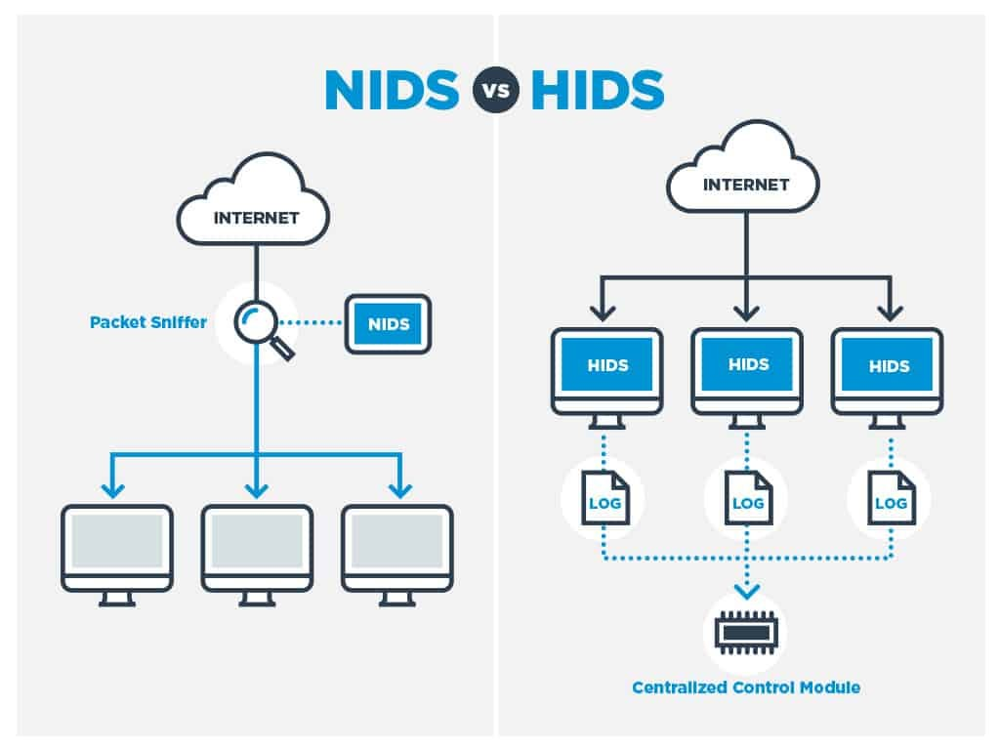

# BAB 2 TINJAUAN PUSTAKA

## 2.1 Keamanan Jaringan

Keamanan jaringan merupakan pilar fundamental dalam disiplin ilmu teknik komputer dan telekomunikasi yang berfokus pada perlindungan infrastruktur jaringan, kanal komunikasi, dan perangkat komputasi dari akses tidak sah (*unauthorized access*), modifikasi data ilegal, eksploitasi kerentanan, serta gangguan ketersediaan layanan[6]. Di era komputasi awan dan transformasi digital saat ini, keterhubungan antar-sistem semakin terbuka, yang secara bersamaan memperluas permukaan serangan (*attack surface*) dari pihak penyerang siber.

Dalam kerangka kerja keamanan jaringan, salah satu pilar konseptual paling fundamental yang dijadikan acuan perancangan sistem pertahanan adalah CIA Triad, yang mengintegrasikan tiga prinsip inti: kerahasiaan (*Confidentiality*), integritas (*Integrity*), dan ketersediaan [*Availability*](6). Prinsip kerahasiaan (*Confidentiality*) berfokus pada jaminan bahwa transmisi informasi serta rekaman data sensitif yang melintasi infrastruktur jaringan hanya dapat diakses dan diinterpretasikan oleh entitas yang memiliki hak akses (*authorization*). Perlindungan kerahasiaan ini umumnya ditegakkan melalui enkripsi protokol komunikasi *end-to-end* seperti TLS, IPsec, dan SSH, serta penerapan kebijakan kontrol akses berbasis identitas yang ketat, guna mencegah potensi intersepsi data ilegal seperti *packet sniffing* dan *eavesdropping*.

Selanjutnya, prinsip integritas (*Integrity*) menekankan pada keharusan menjaga keaslian dan konsistensi paket data agar tidak mengalami modifikasi, penyisipan muatan berbahaya, pemotongan, maupun manipulasi di tengah jalur transmisi (*man-in-the-middle tampering*). Integritas dipertahankan melalui mekanisme fungsi *hash* kriptografis, kode autentikasi pesan (*Message Authentication Code* / MAC), serta tanda tangan digital yang mampu memverifikasi keabsahan data secara presisi. Sementara itu, prinsip ketersediaan (*Availability*) menjamin bahwa seluruh sumber daya komputasi, kapasitas *bandwidth*, dan layanan aplikasi jaringan senantiasa siap sedia serta dapat diakses oleh pengguna yang berhak tanpa mengalami gangguan layanan (*downtime*). Aspek ketersediaan ini terancam secara langsung oleh serangan siber volumetrik seperti *Denial of Service* (DoS) yang berupaya menguras antrean soket dan kapasitas komputasi server.

Ketiga elemen dalam CIA Triad saling terikat secara sinergis dan tidak dapat dipisahkan satu sama lain. Untuk menegakkan prinsip tersebut secara holistik, infrastruktur jaringan enterprise mengadopsi model pertahanan berlapis (*Defense-in-Depth*). Dalam kerangka ini, sistem pertahanan tidak hanya mengandalkan perimeter luar (*firewall*), melainkan menyematkan kontrol keamanan pada setiap lapisan jaringan, mulai dari penyaringan paket, segmentasi jaringan (*Virtual LAN* / VLAN), hingga inspeksi aktif terhadap aliran lalu lintas data oleh sistem deteksi intrusi jaringan [*Network Intrusion Detection System*](6).

  
*Gambar 2.1 Model CIA Triad Keamanan Informasi.*

---

## 2.2 Serangan Siber

Serangan siber terhadap jaringan komputer memiliki taksonomi yang luas berdasarkan tujuan penyerang, protokol yang dieksploitasi, dan mekanisme gangguan yang ditimbulkan. Dalam penelitian ini, analisis difokuskan pada tiga kategori utama perilaku lalu lintas data yang bersumber dari dataset tolok ukur CIC-IDS2017[7]:

### 2.2.1 Trafik Normal

Trafik normal merepresentasikan seluruh aliran komunikasi data sah yang dihasilkan oleh pengguna dan aplikasi resmi di dalam jaringan[7]. Aliran ini mencakup protokol web (HTTP/HTTPS), kueri *Domain Name System* (DNS), pertukaran surat elektronik (SMTP, IMAP), sinkronisasi waktu jaringan (NTP), serta lalu lintas manajemen internal. Karakteristik statistik dari trafik normal ditandai oleh distribusi panjang paket (*packet length*) yang heterogen, interval waktu kedatangan antar-paket (*inter-arrival time* / IAT) yang bervariasi sesuai interaksi manusia, serta rasio dua arah (*forward/backward packets*) yang proporsional sesuai standar protokol TCP/IP.

### 2.2.2 SSH-Patator

Protokol *Secure Shell* (SSH) yang beroperasi pada port standar 22 merupakan protokol *de facto* untuk administrasi jarak jauh pada server Linux dan perangkat jaringan enterprise. Dalam lanskap ancaman siber, serangan **SSH-Patator** merupakan bentuk serangan audit penetrasi otomatis multi-utas (*multi-threaded brute force tool*) yang mengeksekusi ribuan kombinasi *username* dan *password* dari basis data kamus (*dictionary attack*) secara masif guna membobol akun administrator sistem[7].

Dari sudut pandang analisis statistik aliran lalu lintas (*flow statistics*), serangan SSH-Patator meninggalkan karakteristik pola yang sangat distingtif dibandingkan dengan sesi interaktif normal. Serangan ini ditandai oleh lonjakan frekuensi inisiasi koneksi TCP menuju nomor port layanan autentikasi dalam jendela waktu yang sangat sempit. Sebagian besar aliran memiliki durasi yang sangat singkat (*short flow duration*), mengingat server target segera memutus sesi koneksi melalui transmisi *flag* TCP RST atau FIN sesaat setelah pertukaran *handshake* kredensial dinyatakan gagal. Di samping itu, ukuran paket data arah maju (*forward*) dan arah mundur (*backward*) menunjukkan konsistensi volume muatan yang seragam pada fase negosiasi kunci kriptografi awal sebelum pemutusan sesi berlangsung, membedakannya secara tajam dari dinamika aliran sesi interaktif pengguna yang sah[7].

### 2.2.3 Serangan DoS

Serangan **Denial of Service (DoS)** bertujuan melumpuhkan pilar ketersediaan (*availability*) sistem target dengan membanjiri sumber daya komputasi seperti CPU, memori, *bandwidth*, atau batas antrean soket koneksi server web, sehingga server target gagal melayani permintaan pengguna yang sah[7]. Dalam penelitian ini, analisis difokuskan pada empat subvarian serangan DoS lapisan aplikasi (*application-layer DoS*) yang merepresentasikan spektrum ancaman volumetrik agresif dan ancaman berkecepatan lambat (*low-and-slow attacks*).

Pada kelompok serangan volumetrik agresif, subvarian pertama adalah **DoS Hulk**, yang melancarkan pembanjiran permintaan HTTP GET bervolume masif dengan memanipulasi *header User-Agent* serta menyisipkan parameter unik acak pada URL guna menggagalkan sistem *caching* server web, memaksa server mengalokasikan siklus komputasi CPU dan memori secara berulang. Subvarian kedua adalah **DoS GoldenEye**, yang mengeksploitasi mekanisme koneksi persisten HTTP (*keep-alive*) dan perintah *Cache-Control: no-cache* secara simultan dalam jumlah besar untuk menahan *worker process* server web tetap terkunci hingga kapasitas *thread pool* server habis terpakai.

Sebaliknya, pada kelompok serangan berkecepatan lambat (*low-and-slow*), subvarian **DoS Slowloris** beroperasi secara *stealthy* dengan mengirimkan fragmen *header* HTTP parsial secara berkala dengan interval lambat. Server target dipaksa menahan soket koneksi tetap terbuka sambil menunggu *header* selesai, menghabiskan batas konkurensi koneksi server tanpa menimbulkan lonjakan volume trafik yang mencurigakan. Serupa dengan Slowloris, subvarian **DoS Slowhttptest** mengeksploitasi spesifikasi protokol HTTP dengan mengirimkan muatan badan (*body*) permintaan POST secara sangat lambat (misalnya 1 bita per interval waktu tertentu), mengunci sumber daya penerimaan data server web secara berkepanjangan dan mencegah pengguna lain untuk menjalin komunikasi[7].

---

## 2.3 Penelitian Terdahulu

Penelitian terkait penerapan kecerdasan buatan untuk deteksi intrusi jaringan terdistribusi dan adaptif telah berkembang pesat dalam beberapa tahun terakhir. Tinjauan kritis terhadap literatur ilmiah berfokus pada tiga kelompok kajian utama:

Pertama, pada domain pembelajaran terdistribusi, *Federated Learning* (FL) yang diperkenalkan oleh McMahan *et al.*[3] melalui algoritma *Federated Averaging* (FedAvg) telah menjadi fondasi utama pelatihan kolaboratif lintas node tanpa transmisi data mentah. Penerapan FedAvg pada NIDS telah diteliti oleh Popoola *et al.*[8] untuk mendeteksi serangan *zero-day botnet* pada perangkat *edge* IoT dan Ruzafa-Alcázar *et al.*[9] pada lingkungan *Industrial IoT* (IIoT) dengan mekanisme privasi diferensial. Selain itu, survei komprehensif oleh Hernandez-Ramos *et al.*[31] dan Buyuktanir *et al.*[32] menegaskan potensi besar FL dalam mengamankan lalu lintas jaringan heterogen. Namun, mayoritas studi FL-NIDS beroperasi dalam paradigma pelatihan batch/statis, mengasumsikan distribusi data IID atau hanya menguji variasi non-IID kuantitas sederhana, serta mengabaikan fenomena pergeseran konsep (*concept drift*) saat varian serangan baru muncul di jaringan secara sekuensial. Pada kondisi nyata, data lalu lintas jaringan bersifat *non-Identical and Independently Distributed* (non-IID), yang secara teoretis dan empiris dibuktikan oleh Zhao *et al.*[4] dapat memicu divergensi bobot (*weight divergence*) dan menurunkan akurasi model global.

Kedua, pada domain pembelajaran berkelanjutan (*Continual Learning* / CL), adaptasi model NIDS terhadap kelas serangan baru secara sekuensial menghadapi kendala berat berupa *catastrophic forgetting*[5]. Ketika model dilatih pada serangan baru, representasi bobot lama tertimpa sehingga kemampuan mendeteksi serangan terdahulu merosot drastis. Tinjauan sistematis oleh Hamedi *et al.*[34] memetakan tantangan mendasar pada *Federated Continual Learning* (FCL), di mana kelupaan katastropik teramplifikasi oleh heterogenitas data antar-klien. Berbagai metode mitigasi telah diajukan, seperti *Experience Replay* dan *Gradient Episodic Memory* (GEM) oleh Lopez-Paz dan Ranzato[10], serta integrasi *Federated Class-Incremental Learning* (FCIL) oleh Dong *et al.*[11] pada domain visi komputer. Dalam domain keamanan jaringan, pendekatan *incremental learning* terfederasi seperti FL-IIDS oleh Jin *et al.*[12] dan deteksi anomali bertahap IoT oleh Rehman *et al.*[33] mulai mengeksplorasi adaptasi ancaman sekuensial. Namun, pendekatan seperti FL-IIDS masih mengandalkan mekanisme penyimpanan sampel data historis (*replay memory buffer*) pada memori lokal klien yang memicu potensi risiko kebocoran privasi jika data tersimpan berhasil diekstraksi penyerang. Sebaliknya, metode regularisasi parameter *Elastic Weight Consolidation* (EWC) yang dirumuskan oleh Kirkpatrick *et al.*[5] menawarkan keunggulan proteksi memori murni pada ruang bobot melalui penalti kelengkungan Matriks Informasi Fisher diagonal tanpa memerlukan penyimpanan sampel lalu lintas masa lalu.

Ketiga, pada domain evaluasi dan integritas dataset tolok ukur CIC-IDS2017, studi audit mutakhir oleh Rosay *et al.*[13] mengungkap keberadaan *bug* logika ekstraksi fitur pada perangkat CICFlowMeter, terminasi alur TCP prematur, dan kesalahan pelabelan alur serangan. Selain itu, investigasi oleh Dube[14] membuktikan bahwa data ringkasan alur CSV dari CIC-IDS2017 terlalu kasar dan rentan menghasilkan model deteksi yang tidak memadai untuk implementasi jaringan produksi nyata. Di samping itu, investigasi kritis oleh Engelen *et al.*[15] mengungkap kelemahan mendasar konstruksi alur trafik pada CICFlowMeter serta memperingatkan potensi terjadinya *shortcut learning* pada atribut metadata alur. Berdasarkan fenomena tersebut, penelitian ini melakukan evaluasi empiris mandiri yang mengonfirmasi bahwa penggunaan fitur nomor port tujuan (`Destination Port`) menghasilkan akurasi semu akibat kebocoran port layanan (Macro-F1 port-only mencapai 96,44%), sehingga fitur tersebut dieksklusi secara ketat. Dalam konteks latensi operasional, penelitian tugas akhir terdahulu oleh Rinandri[16] menegaskan pentingnya pengukuran efisiensi inferensi tingkat mikrodetik per aliran data pada arsitektur pendeteksi anomali.

Berdasarkan kajian kritis terhadap literatur di atas, perbandingan 15 penelitian terdahulu yang relevan dalam domain Federated Learning, Continual Learning, dan Network Intrusion Detection System disajikan dalam Tabel 2.1.

*Tabel 2.1 Perbandingan Penelitian Terdahulu dalam Domain FL, Continual Learning, dan NIDS.*

| No | Penulis & Tahun | Judul Penelitian | Metode / Algoritma | Dataset | Kontribusi Utama | Keterbatasan / Research Gap |
| :---: | :--- | :--- | :--- | :--- | :--- | :--- |
| 1 | Rosay *et al.* [2022](13) | *Network Intrusion Detection: A Comprehensive Analysis of CIC-IDS2017* | Audit & ML Analysis | CIC-IDS2017 | Mengidentifikasi *bug* logika penanganan *flag* TCP pada CICFlowMeter, durasi flow anomali, dan kesalahan pelabelan | Hanya mengevaluasi kelemahan dataset mentah, tidak merancang arsitektur model deteksi atau mitigasi kelupaan. |
| 2 | Engelen *et al.* [2021](15) | *Troubleshooting an Intrusion Detection Dataset: the CICIDS2017 Case Study* | Flow Construction & Feature Audit | CIC-IDS2017 | Mengidentifikasi kelemahan konstruksi alur TCP (FIN prematur, timeout 120s) dan memperingatkan bahaya *shortcut learning* | Hanya fokus pada analisis integritas flow, tidak menguji skenario terdistribusi atau pembelajaran kelas inkremental. |
| 3 | Dube [2024](14) | *Faulty use of the CIC-IDS 2017 dataset in information security research* | Audit Kritis & Analisis Fitur | CIC-IDS2017 | Membuktikan bahwa fitur ringkasan CSV CIC-IDS2017 terlalu kasar (*too coarse*) dan tidak memadai untuk deteksi produksi | Evaluasi bersifat kritis analitis dataset, belum mengusulkan arsitektur model pertahanan terdistribusi terfederasi. |
| 4 | Kirkpatrick *et al.* [2017](5) | *Overcoming catastrophic forgetting in neural networks* | EWC & Fisher Information | Permuted MNIST | Merumuskan fondasi matematis penalti kelengkungan kuadratik berbasis diagonal Matriks Informasi Fisher | Diuji terbatas pada domain visi komputer sederhana, belum diuji pada lalu lintas jaringan terdistribusi. |
| 5 | McMahan *et al.* [2017](3) | *Communication-Efficient Learning of Deep Networks from Decentralized Data* | Federated Averaging (FedAvg) | MNIST, CIFAR-10 | Menetapkan standar arsitektur Federated Learning terdistribusi dan menganalisis konvergensi pada partisi non-IID | Dirancang untuk skenario batch/statis, tanpa proteksi *catastrophic forgetting* saat kelas baru muncul secara sekuensial. |
| 6 | Zhao *et al.* [2018](4) | *Federated Learning with Non-IID Data* | Analisis Divergensi Bobot | CIFAR-10 | Membuktikan secara analitis dan empiris degradasi akurasi FedAvg akibat pergeseran distribusi data non-IID | Memerlukan penyebaran sebagian data publik ke seluruh klien untuk memitigasi divergensi bobot lokal. |
| 7 | Lopez-Paz & Ranzato [2017](10) | *Gradient Episodic Memory for Continual Learning* | GEM / BWT Metric | CIFAR-100 | Merumuskan metrik evaluasi *Backward Transfer* (BWT) untuk mengukur retensi memori terhadap tugas terdahulu | Mengandalkan *episodic replay buffer* penyimpanan data mentah yang rentan terhadap pelanggaran privasi data. |
| 8 | Dong *et al.* [2022](11) | *Federated Class-Incremental Learning* | FCIL & Model Consolidation | Visi Komputer | Mengintegrasikan federasi dan penambahan kelas inkremental tanpa akses terpusat pada data historis | Memerlukan pertukaran prototipe representasi data atau modul generator sintetis antar-klien dengan komputasi tinggi. |
| 9 | Ruzafa-Alcázar *et al.* [2023](9) | *Intrusion Detection Based on Privacy-Preserving Federated Learning for the Industrial IoT* | FedAvg & Differential Privacy | ToN_IoT | Mengimplementasikan FL dengan mekanisme *Differential Privacy* pada lingkungan Industrial IoT di bawah non-IID | Model dievaluasi pada tugas klasifikasi statis, tidak menangani *catastrophic forgetting* pada skenario alur sekuensial. |
| 10 | Popoola *et al.* [2022](8) | *Federated Deep Learning for Zero-Day Botnet Attack Detection in IoT-Edge Devices* | FedAvg DNN | BoT-IoT | Mendeteksi serangan *zero-day botnet* pada arsitektur terdistribusi perangkat *edge* tanpa agregasi trafik mentah | Tidak menyertakan mekanisme *continual learning*, sehingga performa rentan terdegradasi saat dilatih pada varian baru. |
| 11 | Jin *et al.* [2024](12) | *FL-IIDS: A novel federated learning-based incremental intrusion detection system* | FL + Replay-based Incremental Learning | CSE-CIC-IDS2018 | Mengusulkan sistem deteksi intrusi inkremental terfederasi untuk mengadaptasi serangan baru secara berkala | Mengandalkan *memory buffer* untuk *replay* data historis yang memicu risiko kebocoran privasi lokal. |
| 12 | Rehman *et al.* [2026](33) | *Incremental Federated Learning for Intrusion Detection in IoT Networks* | Incremental FL (IoV/IoT) | Edge-IIoTset | Mengembangkan pembelajaran terfederasi inkremental adaptif terhadap lanskap ancaman IoT yang berevolusi | Terbatas pada klasifikasi anomali biner perangkat bersumber daya mikro, belum mengkaji multi-kelas Class-IL komprehensif. |
| 13 | Hernandez-Ramos *et al.* [2025](31) | *Intrusion Detection Based on Federated Learning: A Systematic Review* | Systematic Review & Taxonomy | Ragam Dataset NIDS | Menyusun taksonomi komprehensif tantangan arsitektur, privasi, dan heterogenitas data pada FL-NIDS | Merupakan studi survei literatur, tidak mengusulkan implementasi empiris algoritma mitigasi kelupaan katastropik. |
| 14 | Hamedi *et al.* [2025](34) | *Federated Continual Learning: Concepts, Challenges, and Solutions* | Comprehensive Survey | Ragam Benchmark CL | Memetakan metodologi FCL dan membuktikan bahwa non-IID mengamplifikasi kelupaan katastropik terdistribusi | Merupakan tinjauan konseptual sistematis, belum menyajikan benchmark empiris NIDS pada trafik jaringan enterprise. |
| 15 | Sarhan *et al.* [2022](17) | *Towards a Standard Feature Set for Network Intrusion Detection System Datasets* | NetFlow Feature Engineering | NetFlow-V2 | Menstandardisasi ekstraksi representasi fitur aliran berbasis alur NetFlow standar industri | Menggunakan format representasi tergeneralisasi yang mengabaikan investigasi mendalam terhadap artefak raw flow. |

Investigasi ilmiah mutakhir mengidentifikasi kelemahan mendasar dalam dataset mentah CIC-IDS2017 yang berpotensi menghasilkan evaluasi model yang bias apabila digunakan tanpa kurasi yang ketat[13], [14], [15]. Audit komprehensif oleh Rosay *et al.*[13] mengungkap bahwa perangkat ekstraksi fitur CICFlowMeter mengandung *bug* logika penanganan *flag* TCP (mengakhiri rekaman alur secara prematur pada deteksi *flag* FIN/RST pertama tanpa memperhatikan *handshake* penutupan dua arah) yang memecah koneksi normal sah menjadi beberapa fragmen alur tak lengkap, serta menghasilkan anomali perhitungan durasi alur dan fitur inter-arrival time. Selain itu, investigasi kritis oleh Dube[14] membuktikan bahwa sebagian besar riset NIDS menggunakan CIC-IDS2017 secara keliru (*faulty use*) karena fitur-fitur ringkasan CSV CIC-IDS2017 terlalu kasar (*too coarse*) dan tidak memadai untuk deteksi intrusi di lingkungan produksi (Dube, 2024, hlm. 203, 210), serta mengevaluasi model pada CSV ringkasan tanpa verifikasi pada trafik paket PCAP mentah atau komparasi dengan performa sistem deteksi/pencegahan intrusi (IDS/IPS) produksi nyata (hlm. 204). Di samping itu, kelangkaan sampel mikro ekstrem pada kelas Infiltration (hanya 36 alur dari total 2,8 juta) dan Sql Injection (hanya 21 alur) secara statistik tidak memadai untuk melatih representasi *deep learning* maupun menghitung Matriks Informasi Fisher yang stabil. Atas dasar pertimbangan integritas ilmiah tersebut, rekaman hari Kamis dan Jumat dieksklusi secara sengaja dari penelitian ini guna menjamin validitas eksperimental.

Lebih lanjut, studi audit oleh Engelen *et al.*[15] membuktikan adanya kelemahan mendasar konstruksi alur trafik pada CICFlowMeter (seperti terminasi alur prematur dan batas waktu alur 120 detik yang memotong koneksi normal secara artifisial, hlm. 3-4) serta memberikan peringatan terhadap potensi terjadinya *shortcut learning* pada fitur metadata alur. Berdasarkan peringatan tersebut, penelitian tugas akhir ini melakukan pengujian empiris mandiri yang mengonfirmasi bahwa model pembelajaran mesin yang hanya dilatih menggunakan fitur nomor port tujuan (`Destination Port`) mampu mencapai Macro-F1 sebesar 96,44%, membuktikan secara nyata terjadinya kebocoran jalan pintas port layanan (*port leakage*) pada dataset. Apabila fitur ini dipertahankan, model NIDS akan runtuh (*fail completely*) di lingkungan produksi nyata saat penyerang mengubah port target layanan ke port non-standar. Oleh karena itu, penelitian ini secara tegas mengeksklusi fitur `Destination Port` dari seluruh proses pelatihan dan inferensi, menyisakan tepat 62 fitur statistik alur numerik bersih.

---

## 2.4 Kerangka Teoretis Continual Learning (Pembelajaran Berkelanjutan)

Continual Learning (CL) atau pembelajaran mesin berkelanjutan bertujuan mengatasi dilema stabilitas-plastisitas (*Stability-Plasticity Dilemma*), di mana model pembelajaran mesin dituntut memiliki plastisitas untuk mengasimilasi informasi dari aliran tugas (*task*) baru $\mathcal{T}_1, \mathcal{T}_2, \dots, \mathcal{T}_T$ tanpa mengorbankan stabilitas representasi yang telah terbentuk pada tugas-tugas sebelumnya[23], [24]. Dalam skenario *Class-Incremental Learning* (Class-IL) yang diadopsi pada penelitian ini, model dievaluasi pada seluruh kelas yang telah dipelajari tanpa bantuan identitas tugas (*Task-ID*) saat inferensi.

Secara taksonomi, pendekatan mitigasi *catastrophic forgetting* dalam literatur Continual Learning terbagi menjadi tiga keluarga utama: metode berbasis regularisasi parameter (*prior-focused regularization*), metode berbasis pemutaran ulang (*replay/rehearsal-based*), dan metode berbasis alokasi arsitektur [*parameter allocation*](23), [25]. Taksonomi pendekatan mitigasi kelupaan ini diilustrasikan pada Gambar 2.2, sedangkan perbandingan menyeluruh dari metode-metode tersebut disajikan dalam Tabel 2.2.

  
*Gambar 2.2 Taksonomi Pendekatan Mitigasi Catastrophic Forgetting pada Continual Learning[19].*

*Tabel 2.2 Taksonomi dan Perbandingan Menyeluruh Metode Continual Learning (CL).*

| Keluarga Metode | Nama Algoritma & Rujukan | Mekanisme Inti & Formulasi Matematis | Keunggulan Utama | Keterbatasan di Lingkungan Edge NIDS | Kesesuaian Riset Ini |
| --- | --- | --- | --- | --- | :---: |
| **Regularisasi Parameter (Prior-Focused)** | **Elastic Weight Consolidation (EWC)** *(Kirkpatrick et al., 2017)*[5] | Penalti kuadratik berbasis diagonal Matriks Informasi Fisher: $\mathcal{L}(\theta) = \mathcal{L}_{\text{new}}(\theta) + \sum_i \frac{\lambda}{2} F_i (\theta_i - \theta_{1,i}^*)^2$ | Bebas penyimpanan sampel mentah (*zero-buffer*); komputasi Fisher deterministik dan stabil pada MLP. | Mengabaikan korelasi off-diagonal Hessian; kapasitas proteksi terbatas jika jumlah task sangat panjang. | ⭐⭐⭐⭐⭐ **Metode Terpilih** |
| | **Online EWC** *(Schwarz et al., 2018)* | Akumulasi Fisher melintasi banyak task dengan faktor peluruhan: $\tilde{F}^t = \gamma \tilde{F}^{t-1} + F^t$ | Skalabel untuk rangkaian task kontinu tanpa pembengkakan suku penalti. | Memerlukan penyetelan teliti pada faktor peluruhan $\gamma$. | ⭐⭐⭐⭐ Ekstensi $T > 3$ |
| | **Synaptic Intelligence (SI)** *(Zenke et al., 2017)* | Akumulasi kontribusi lintasan parameter selama proses optimasi online. | Komputasi relevansi parameter menyatu dengan fase pelatihan lokal. | Sensitif terhadap ukuran *learning rate*; rentan instabilitas gradien pada data tabular non-IID. | ⭐⭐⭐ Alternatif |
| | **Memory Aware Synapses (MAS)** *(Aljundi et al., 2018)* | Menghitung sensitivitas magnitudo output fungsi prediksi tanpa memerlukan label data. | Beroperasi tanpa label data (*unsupervised importance estimation*). | Batas keputusan kelas serangan NIDS yang rapat kurang terproteksi optimal. | ⭐⭐⭐ Alternatif |
| **Regularisasi Data (Distillation)** | **Learning without Forgetting (LwF)** *(Li & Hoiem, 2017)* | Distilasi pengetahuan menggunakan keluaran model lama sebagai sinyal regulasi (KL-Divergence). | Tidak memerlukan estimasi Fisher maupun buffer data historis. | Terjadi distorsi representasi jika fitur serangan baru memiliki disparitas statistik ekstrem dari serangan lama. | ⭐⭐⭐⭐ Alternatif |
| **Replay / Rehearsal (Memory Buffer)** | **Experience Replay (ER)** *(Chaudhry et al., 2019)* | Menyimpan cuplikan paket/flow mentah tugas lama dalam buffer fisik memori lokal untuk dilatih ulang bersama data baru. | Retensi memori sangat kuat dan mudah diimplementasikan. | **Melanggar prinsip privasi data** (buffer data mentah rentan terekstraksi jika node edge disusupi); membebani kapasitas RAM. | ❌ Dieliminasi *(Isu Privasi & RAM)* |
| | **Gradient Episodic Memory (GEM)** *(Lopez-Paz & Ranzato, 2017)*[10] | Pembatasan proyeksi gradien baru agar sudut terhadap gradien memori non-negatif: $\langle g_{\text{new}}, g_{\text{mem}} \rangle \ge 0$ | Mendorong transfer ke belakang non-negatif (*Backward Transfer* / BWT $\ge 0$). | Komputasi *Quadratic Programming* (QP-solver) sangat berat untuk prosesor edge; memerlukan buffer sampel mentah. | ❌ Dieliminasi *(Overhead Komputasi)* |
| **Alokasi Arsitektur (Modular)** | **PackNet** *(Mallya & Lazebnik, 2018)* | Melakukan *network pruning* terstruktur dan membekukan subset parameter penting untuk tugas lama. | Kelupaan katastropik bernilai nol secara teoritis pada tugas yang telah dibekukan. | Membutuhkan arsitektur jaringan saraf berkapasitas sangat besar; tidak sepadan untuk MLP kompak 6.211 parameter. | ❌ Kurang Sesuai *(Overkill MLP)* |

Berdasarkan perbandingan di atas, **EWC dipilih sebagai metode inti** dalam penelitian ini karena memenuhi kriteria *zero-data replay* (kepatuhan privasi penuh tanpa buffer flow mentah) dan memiliki profil komputasi yang sangat efisien untuk arsitektur MLP kompak di node edge.

---

## 2.5 Kerangka Teoretis Federated Learning (Pembelajaran Terfederasi)

Federated Learning (FL) merupakan paradigma pembelajaran mesin terdistribusi di mana $K$ node klien berkolaborasi melatih model konsensus global tanpa memindahkan data lokal mentah $\mathcal{D}_k$ ke server sentral[3]. Formulasi optimasi FL dirumuskan sebagai:

$$\min_{w} f(w) = \sum_{k=1}^K \frac{n_k}{N} F_k(w), \quad \text{dengan } F_k(w) = \mathbb{E}_{(x, y) \sim \mathcal{D}_k} [\ell(w; x, y)]$$

Tantangan utama FL pada deteksi intrusi jaringan adalah fenomena *client drift* akibat heterogenitas data [*non-IID label skew*](4), [31]. Berbagai algoritma agregasi dan optimasi terfederasi telah diusulkan dalam literatur untuk menangani masalah heterogenitas spasial maupun kontinuitas sekuensial. Alur siklus pelatihan dan agregasi bobot pada Federated Learning (FedAvg) diilustrasikan pada Gambar 2.3, sedangkan taksonomi metode FL disajikan dalam Tabel 2.3.

  
*Gambar 2.3 Siklus Pelatihan dan Agregasi Bobot pada Federated Learning (FedAvg)[3].*

*Tabel 2.3 Taksonomi dan Perbandingan Menyeluruh Metode Federated Learning (FL).*

| Kategori Metode | Algoritma & Rujukan | Mekanisme Agregasi / Formulasi Matematis | Keunggulan Utama | Keterbatasan & Beban Komunikasi | Kesesuaian Riset Ini |
| --- | --- | --- | --- | --- | :---: |
| **Agregasi Baseline** | **Federated Averaging (FedAvg)** *(McMahan et al., 2017)*[3] | Rata-rata terbobot proporsional dari parameter lokal klien: $w^{t+1} = \sum_{k=1}^K \frac{n_k}{N} w_k^{t+1}$ | Efisiensi komunikasi tinggi; overhead minimal (hanya payload bobot); standar *de facto* industri (Flower framework). | Mengalami *client drift* dan divergensi bobot saat data non-IID ekstrem. | ⭐⭐⭐⭐⭐ **Baseline Utama FL** |
| | **FedNova** *(Wang et al., 2020)* | Normalisasi pembaruan gradien lokal berbasis variasi jumlah langkah iterasi lokal klien. | Menghilangkan bias konvergensi akibat heterogenitas komputasi lokal antar-klien. | Dampak minimal jika jumlah epoch lokal antar-klien ditetapkan seragam ($E$ konstan). | ⭐⭐⭐ Alternatif Heterogen |
| **Mitigasi Heterogenitas (Non-IID Drift)** | **FedProx** *(Li et al., 2020)*[22] | Penambahan penalti deviasi proksimal terhadap model global: $\min_w F_k(w) + \frac{\mu}{2} \|w - w^t\|^2$ | Meredam divergensi bobot lokal dari konsensus global; stabil menghadapi *stragglers*. | Memerlukan penyetelan cermat hyperparameter $\mu$; konvergensi lebih lambat jika $\mu$ terlalu dominan. | ⭐⭐⭐⭐ **Alternatif Pembanding Spasial** |
| | **SCAFFOLD** *(Karimireddy et al., 2020)* | Menggunakan variabel kontrol (*control variates*) untuk mengoreksi arah gradien lokal klien. | Menjamin laju konvergensi stabil di bawah non-IID ekstrem tanpa deviasi gradien. | Ukuran payload transmisi komunikasi berlipat ganda **$2\times$** (mengirim bobot $w$ + variabel kontrol $c$). | ⭐⭐⭐ Beban Jaringan Tinggi |
| **Personalized & Continual FL** | **FedCurv** *(Shoham et al., 2019)* | Penalti kurvatur Fisher lintas klien terdistribusi: $\mathcal{L}_k(w) = \mathcal{L}_{\text{local}}(w) + \sum_{j \neq k} \frac{\lambda}{2} (w - w_j^*)^T F_j (w - w_j^*)$ | Meredam penyimpangan bobot antar-klien dengan menjaga kurvatur solusi bersama. | Beban transmisi komunikasi melonjak **$2\times$ lipat** (mengirim bobot $w$ dan diagonal Fisher $F$); belum terintegrasi native di Flower. | ⭐⭐⭐⭐ **Pembanding Teoretis Bab 2** |
| | **FedWeIT** *(Yoon et al., 2021)* | Dekomposisi bobot jaringan menjadi parameter global, parameter klien, dan *task-specific sparse masks*. | Mencegah interferensi antar-tugas secara struktural melalui dekomposisi parameter. | Memerlukan perancangan arsitektur modular yang kompleks; tidak efisien untuk model MLP kompak. | ⭐⭐ Arsitektur Berbeda |

---

## 2.6 Posisi Sintesis: Integrasi FedAvg dan EWC Lokal

Berdasarkan tinjauan kritis pada Tabel 2.1, 2.2, dan 2.3, penelitian tugas akhir ini memadukan **FedAvg sebagai algoritma konsensus federasi terpusat yang ringan** dengan **EWC sebagai mekanisme regularisasi kelupaan temporal pada loop pelatihan lokal klien**.

Kombinasi ortogonal ini memisahkan secara tegas dua domain persoalan:

1. **Dimensi Spasial (Non-IID Antar-Klien):** Ditangani oleh agregasi FedAvg di server sentral, di mana model global menyerap representasi serangan yang berbeda dari masing-masing sektor klien tanpa pertukaran data mentah.
2. **Dimensi Temporal (Mitigasi Forgetting Lintas Waktu):** Ditangani oleh penalti kuadratik Fisher EWC di masing-masing klien, di mana parameter sensitif terhadap serangan terdahulu (Task 1: SSH-Patator) diproteksi secara lokal saat model mengasimilasi serangan baru (Task 2: DoS).

Dengan konfigurasi ini, server Flower tetap beroperasi secara *stateless* dan efisien tanpa memerlukan transmisi matriks Fisher melalui jaringan, dengan estimasi teoretis ukuran pembaruan bobot model MLP 6.211 parameter (tipe float32) sebesar ~24,84 KB per transmisi yang akan diverifikasi secara empiris pada tahap pengujian sistem, sekaligus meniadakan risiko kebocoran data mentah akibat ketiadaan penyimpanan buffer rekaman trafik historis (*exemplar-free*).

---

## 2.7 Deteksi Intrusi

*Network Intrusion Detection System* (NIDS) merupakan mekanisme pertahanan siber yang ditempatkan pada infrastruktur jaringan untuk menginspeksi lalu lintas data dan mendeteksi aktivitas mencurigakan yang mengindikasikan adanya intrusi, eksploitasi kerentanan, atau pelanggaran kebijakan keamanan[20].

### 2.7.1 Arsitektur Penempatan
Berdasarkan arsitektur penempatan dan cakupan monitoringnya, sistem deteksi intrusi secara mendasar terbagi menjadi dua kategori utama, yaitu *Host-Based IDS* (HIDS) dan *Network-Based IDS* (NIDS)[20]. HIDS beroperasi secara langsung pada tingkat sistem operasi dari perangkat *endpoint* atau server individual untuk mengawasi integritas berkas sistem (*file integrity*), log autentikasi, serta pemanggilan instruksi sistem (*system calls*). Karakteristik HIDS sangat efektif untuk mengidentifikasi ancaman internal atau eksploitasi hak akses di tingkat lokal, namun memerlukan instalasi agen pada setiap mesin dan mengonsumsi sumber daya komputasi dari server aplikasi target. Sebaliknya, NIDS ditempatkan secara strategis pada tautan jaringan (*network links*), seperti *switch*, *gateway*, atau port agregasi, guna memantau seluruh paket dan aliran data yang melintasi segmen jaringan secara non-invasif. Keunggulan utama NIDS terletak pada kemampuannya mengawasi puluhan hingga ratusan perangkat sekaligus secara simultan tanpa membebani performa komputasi server aplikasi serta mampu mendeteksi pola serangan yang bergerak lintas subnet jaringan[20], sebagaimana diilustrasikan pada Gambar 2.4.

  
*Gambar 2.4 Perbandingan Topologi Arsitektur Penempatan NIDS dan HIDS pada Infrastruktur Jaringan (Sumber: Stephen, 2023).*

### 2.7.2 Metode Deteksi
Ditinjau dari metodologi deteksi yang diimplementasikan, NIDS terbagi menjadi pendekatan berbasis tanda tangan (*Signature-Based IDS* / SIDS) dan pendekatan berbasis anomali (*Anomaly-Based IDS* / ABDS)[20]. SIDS beroperasi dengan mencocokkan setiap muatan paket atau pola lalu lintas terhadap basis data tanda tangan serangan (*attack signatures*) yang telah didefinisikan sebelumnya oleh analis keamanan. Pendekatan SIDS memiliki keunggulan dalam kecepatan komputasi dan menghasilkan tingkat alarm palsu (*false positive*) yang sangat rendah untuk ancaman lama yang telah terdaftar, namun mengalami kegagalan mutlak ketika berhadapan dengan serangan baru (*zero-day attacks*) atau varian serangan yang telah dimodifikasi polanya. Sebaliknya, ABDS memodelkan perilaku lalu lintas normal sebagai profil tolok ukur (*baseline*), sehingga setiap penyimpangan statistik yang signifikan akan ditandai sebagai indikasi anomali intrusi. ABDS modern mengandalkan model pembelajaran mesin dan jaringan saraf tiruan untuk mengevaluasi fitur statistik aliran dua arah (*bidirectional flow features*), memberikan kemampuan generalisasi yang tangguh dalam mengidentifikasi pola ancaman baru yang belum pernah terpetakan sebelumnya[8], [20].

---

## 2.8 PyTorch

PyTorch merupakan pustaka komputasi ilmiah dan *deep learning* sumber terbuka berbasis Python yang dikembangkan oleh Meta AI, yang telah menjadi standar *de facto* dalam riset kecerdasan buatan modern[21]. Keunggulan fundamental PyTorch bersumber dari mekanisme graf komputasi dinamis (*Dynamic Computational Graph* berbasis paradigma *Define-by-Run* melalui mesin diferensiasi otomatis Autograd), yang memungkinkan struktur jaringan saraf tiruan dieksekusi dan dimodifikasi secara interaktif selama waktu eksekusi (*runtime*) tanpa memerlukan kompilasi graf statis terlebih dahulu[21]. Pendekatan dinamis ini mempermudah pelacakan alur gradien (*backpropagation*) dan proses *debugging* tensor secara langsung menggunakan pustaka bawaan Python.

Di samping itu, PyTorch menyediakan antarmuka tensor multi-dimensi berperforma tinggi yang terintegrasi secara mulus dengan akselerasi perangkat keras GPU melalui pustaka *NVIDIA CUDA* dan *cuDNN*, serta optimasi aljabar linear pada prosesor CPU[21]. Arsitektur modular PyTorch, khususnya abstraksi `torch.nn` dan `torch.optim`, memberikan keleluasaan penuh dalam menyusun fungsi kerugian kustom (*custom loss function*)[21]. Fleksibilitas manipulasi gradien ini sangat krusial dalam penelitian ini untuk merekayasa fungsi objektif lokal yang menggabungkan *Weighted Cross-Entropy Loss* dengan suku penalti kuadratik EWC berbasis perkalian tensor elemen-per-elemen secara langsung pada ruang bobot parameter tanpa menimbulkan *overhead* komputasi graf statis yang kaku[5], [21].

---

## 2.9 Flower

Dalam mengimplementasikan paradigma pembelajaran terdistribusi, penelitian ini memanfaatkan Flower (`flwr`), yaitu kerangka kerja *Federated Learning* sumber terbuka yang dirancang modular, terukur, dan agnostik terhadap berbagai pustaka *machine learning*[22]. Arsitektur komunikasi Flower memisahkan tanggung jawab sistem secara tegas antara modul koordinator terpusat (`Server`) dan simpul komputasi lokal (`Client`), yang berinteraksi melalui protokol komunikasi berkecepatan tinggi *Google Remote Procedure Call* (gRPC) di atas lapisan transport HTTP/2 pada port standar TCP 8080[22]. Protokol ini menjamin pertukaran pesan asinkron yang andal, efisien, dan memiliki latensi minimal pada kanal jaringan terdistribusi.

Dalam setiap siklus federasi, Flower mengorkestrasi pertukaran parameter model secara efisien tanpa mentransmisikan data mentah milik klien[22]. Parameter bobot model PyTorch pada setiap simpul klien diekstraksi ke dalam larik terindeks NumPy berpresisi 32-bit (*float32*), kemudian diserialisasi ke dalam format biner terkompresi *Protocol Buffers* (`Parameters` proto) sebelum dikirimkan ke server melalui instruksi `fit_res`[22]. Server agregator kemudian menerapkan strategi federasi seperti *Federated Averaging* (FedAvg) untuk menggabungkan parameter lokal menjadi model global baru[3], [22]. Penggunaan arsitektur model MLP kompak dalam penelitian ini (memuat 6.211 parameter *float32*) menghasilkan estimasi teoretis ukuran muatan biner parameter sebesar $pprox 24,84$ KB ($24.844$ bita) per transmisi klien. Dengan estimasi total pertukaran parameter untuk dua klien sebesar $pprox 99,38$ KB per ronde komunikasi (yang akan diverifikasi pengukurannya pada tahap pengujian eksperimental), Flower menghasilkan penghematan lebar pita jaringan sebesar lebih dari $99,4\%$ dibandingkan skenario sentralisasi yang mentransmisikan data mentah berukuran gigabita, seraya mendukung emulasi klien virtual maupun penerapan nyata pada simpul *edge* fisik (*cross-silo deployment*)[22].

---

## 2.10 Multilayer Perceptron

*Multilayer Perceptron* (MLP) merupakan arsitektur dasar jaringan saraf tiruan umpan-maju (*feedforward neural network*) yang terdiri dari sekurang-kurangnya tiga lapisan neuron komputasi terstruktur: satu lapisan masukan (*input layer*), satu atau lebih lapisan tersembunyi (*hidden layers*), dan satu lapisan keluaran (*output layer*)[23]. Pada arsitektur MLP terhubung penuh (*fully connected layers*), setiap neuron pada suatu lapisan menerima kombinasi linear terbobot dari seluruh neuron pada lapisan sebelumnya, menambahkan skalar bias, dan memetakan hasilnya melalui fungsi aktivasi non-linear guna membentuk batas keputusan (*decision boundaries*) yang mampu memisahkan kelas-kelas data yang tidak dapat dipisahkan secara linear (*linearly non-separable*)[23].

Untuk memenuhi batasan komputasi perangkat gerbang jaringan (*edge gateway*) dan menghindari latensi komputasi yang tinggi pada sistem deteksi intrusi waktu nyata, arsitektur model klasifikasi dalam penelitian ini dirancang menggunakan konfigurasi MLP kompak 62-64-32-3[23]. Model menerima vektor fitur masukan $x \in \mathbb{R}^{62}$ yang merepresentasikan statistik aliran paket jaringan, dan memprosesnya secara matematis melalui tahapan propagasi maju (*forward pass*)[23]:

$$
\begin{aligned}
h_1 &= f_1(W_1 x + b_1), \quad W_1 \in \mathbb{R}^{64 \times 62}, \ b_1 \in \mathbb{R}^{64} \\
h_2 &= f_2(W_2 h_1 + b_2), \quad W_2 \in \mathbb{R}^{32 \times 64}, \ b_2 \in \mathbb{R}^{32} \\
z &= W_3 h_2 + b_3, \quad W_3 \in \mathbb{R}^{3 \times 32}, \ b_3 \in \mathbb{R}^{3} \\
\hat{y} &= \text{Softmax}(z)
\end{aligned}
$$

di mana $f_1$ dan $f_2$ merupakan fungsi aktivasi non-linear *Rectified Linear Unit* (ReLU), $z$ adalah vektor logit klasifikasi, dan $\hat{y}$ merepresentasikan estimasi probabilitas posterior kelas aliran lalu lintas jaringan (BENIGN, SSH-Patator, atau DoS)[23].

Pemilihan topologi MLP kompak ini didasarkan pada pertimbangan kritis terhadap keterbatasan sumber daya komputasi simpul sensor jaringan (*edge gateways*) dan tuntutan latensi inspeksi paket berkecepatan tinggi[23]. Dengan 62 fitur masukan, 64 neuron pada lapisan tersembunyi pertama, 32 neuron pada lapisan tersembunyi kedua, dan 3 neuron keluaran, total parameter teroptimasi model dihitung secara eksak sebagai[23]:

$$
|\theta| = (62 \times 64 + 64) + (64 \times 32 + 32) + (32 \times 3 + 3) = 4.032 + 2.080 + 99 = 6.211 \text{ parameter}
$$

Dengan representasi bilangan mengambang 32-bit (*single precision float32* berukuran 4 bita), estimasi teoretis ukuran biner parameter model mencapai sekitar **24,84 KB** ($6.211 	imes 4$ bita = $24.844$ bita). Jejak memori (*memory footprint*) yang sangat ringkas ini memberikan dua keuntungan operasional yang krusial. Pertama, proses serialisasi dan transmisi bobot melalui protokol gRPC Flower pada setiap ronde federasi dapat diselesaikan dalam orde milidetik tanpa membebani kapasitas lebar pita jaringan terdistribusi. Kedua, model mampu mengeksekusi inferensi klasifikasi aliran data secara lokal dalam skala mikrodetik per sampel aliran ($\mu\text{s/flow}$), memastikan sistem mampu mengimbangi laju paket pada tautan jaringan berkecepatan tinggi tanpa memicu penumpukan antrean (*buffer bloat*) yang berisiko menyebabkan hilangnya paket data (*packet drop*)[22], [23]. Struktur arsitektur jaringan MLP yang dirancang diilustrasikan pada Gambar 2.5.

  
*Gambar 2.5 Struktur Arsitektur Jaringan Multilayer Perceptron (MLP) dengan Lapisan Tersembunyi.*

---

## 2.11 Regularisasi EWC

*Elastic Weight Consolidation* (EWC) merupakan metode mitigasi *catastrophic forgetting* berbasis regularisasi parameter yang diperkenalkan oleh Kirkpatrick *et al.*[5], yang terinspirasi oleh fenomena konsolidasi memori sinaptik pada otak biologis mamalia di mana plastisitas sinapsis ditekan secara selektif untuk mempertahankan keterampilan yang telah dipelajari sebelumnya. Dari perspektif inferensi Bayesian, proses pembelajaran tugas kedua $\mathcal{D}_2$ setelah menyelesaikan pelatihan tugas pertama $\mathcal{D}_1$ dirumuskan melalui distribusi probabilitas posterior parameter $\theta$[5]:

$$
\log p(\theta \mid \mathcal{D}_1, \mathcal{D}_2) = \log p(\mathcal{D}_2 \mid \theta) + \log p(\theta \mid \mathcal{D}_1) - \log p(\mathcal{D}_2)
$$

Distribusi prior $p(\theta \mid \mathcal{D}_1)$ memuat seluruh akumulasi pengetahuan mengenai tugas pertama. Karena bentuk eksak distribusi posterior pada jaringan saraf tiruan non-linear bersifat rumit dan tidak dapat dihitung secara analitis, EWC mengaproksimasi $\log p(\theta \mid \mathcal{D}_1)$ menggunakan ekspansi deret Taylor orde kedua di sekitar titik parameter optimal tugas pertama $\theta_1^{\ast}$ sebagai distribusi Gaussian multivariat, dengan presisi kelengkungan yang ditentukan oleh **Matriks Informasi Fisher (Fisher Information Matrix / FIM)**[5]:

$$
F = \mathbb{E}_{x \sim \mathcal{D}_1, y \sim p(y \mid x, \theta_1^{\ast})} \left[ \nabla_\theta \log p(y \mid x, \theta_1^{\ast}) \nabla_\theta \log p(y \mid x, \theta_1^{\ast})^T \right]
$$

Guna menghindari kompleksitas komputasi inversi matriks kovariansi penuh yang berukuran $|\theta| \times |\theta|$, EWC mengasumsikan independensi kuasi antar-parameter dan hanya mengevaluasi elemen-elemen diagonal matriks Fisher ($F_i$)[5]. Dalam penerapan praktis *machine learning*, ekspektasi analitis tersebut didekati melalui **Empirical Fisher Information Matrix**, di mana gradien kuadratik dihitung terhadap label kebenaran dasar (*ground truth*) dari $N$ sampel data tugas pertama[5]:

$$
F_i = \frac{1}{N} \sum_{n=1}^N \left( \left. \frac{\partial \mathcal{L}_{\text{CE}}(f(x_n; \theta), y_n)}{\partial \theta_i} \right|_{\theta = \theta_1^{\ast}} \right)^2
$$

Saat model melanjutkan pembelajaran pada alur data tugas kedua, fungsi kerugian total lokal diintegrasikan dengan penalti kuadratik terbobot Fisher terhadap deviasi parameter optimal lama[5]:

$$
\mathcal{L}_{\text{total}}(\theta) = \mathcal{L}_2(\theta) + \sum_{i} \frac{\lambda}{2} F_i (\theta_i - \theta_{1, i}^{\ast})^2
$$

di mana $\lambda$ merupakan koefisien hiperparameter penalti EWC yang mengontrol keseimbangan (*trade-off*) antara plastisitas terhadap tugas baru dan stabilitas retensi memori terhadap tugas lama, $\theta_{1, i}^{\ast}$ adalah nilai parameter optimal tugas pertama yang dibekukan, dan $F_i$ mengukur seberapa sensitif kinerja tugas pertama terhadap pergeseran parameter ke-$i$[5]. Parameter dengan nilai $F_i$ besar dilindungi dari pembaruan gradien besar, sedangkan parameter dengan $F_i$ mendekati nol leluasa dimodifikasi oleh data baru, sebagaimana diilustrasikan pada Gambar 2.6.

  
*Gambar 2.6 Mekanisme Regularisasi EWC Membatasi Pergeseran Bobot Kritis pada Kontur Kerugian[5].*

Dalam mengoperasikan model pada kondisi lalu lintas jaringan dengan ketimpangan kelas yang parah, fungsi kerugian dasar $\mathcal{L}_2(\theta)$ distabilkan menggunakan pembobotan invers frekuensi kelas (*Weighted Cross-Entropy Loss*)[5]:

$$
\mathcal{L}_{\text{CE}}(y, \hat{y}) = - \sum_{c=1}^{C} w_c \cdot y_c \log(\hat{y}_c), \quad \text{dengan } w_c = \frac{N_{\text{total}}}{C \cdot N_c}
$$

Selain itu, guna mencegah ledakan magnitudo gradien (*exploding gradients*) yang dipicu oleh akumulasi penalti EWC berbobot besar dan ketimpangan bobot kelas minoritas, mekanisme pemotongan gradien (*Gradient Clipping*) berbasis norma L2 diterapkan sebelum langkah pembaruan bobot dijalankan[5]:

$$
\text{jika } \|\mathbf{g}\|_2 > \gamma, \quad \text{maka } \mathbf{g} \leftarrow \frac{\gamma}{\|\mathbf{g}\|_2} \mathbf{g}, \quad \text{dengan } \gamma = 1.0
$$

---

## 2.12 Dataset

Dataset tolok ukur yang digunakan dalam penelitian ini adalah **CIC-IDS2017** (*Canadian Institute for Cybersecurity Intrusion Detection System 2017*). Dataset ini dibangun menggunakan topologi jaringan korban (*Victim Network*) dan jaringan penyerang (*Attack Network*) yang merekam lalu lintas paket nyata selama lima hari kerja (Senin s.d. Jumat)[7].

### 2.12.1 Karakteristik Aliran
Seluruh lalu lintas jaringan mentah dalam format *packet capture* (pcap) diekstraksi menggunakan perangkat lunak *CICFlowMeter* menjadi rekaman statistik aliran dua arah (*bidirectional flow features*). Berkas lalu lintas yang dianalisis dalam penelitian ini mencakup berkas hari Senin (*Monday*) yang merepresentasikan lalu lintas operasional normal (BENIGN) secara eksklusif, berkas hari Selasa (*Tuesday*) yang memuat aktivitas normal dan serangan penetrasi autentikasi SSH (*SSH-Patator*), serta berkas hari Rabu (*Wednesday*) yang memuat lalu lintas normal dan varian serangan *Denial of Service* (DoS Slowloris, Slowhttptest, Hulk, dan GoldenEye)[7].

### 2.12.2 Kurasi Fitur
Meskipun CIC-IDS2017 merupakan tolok ukur standar dalam riset NIDS, sejumlah studi audit saintifik mutakhir mengidentifikasi kelemahan mendasar dalam dataset mentah yang berpotensi menghasilkan evaluasi model yang bias[13], [14], [15]. Audit oleh Rosay *et al.*[13] dan Dube[14] membuktikan bahwa berkas hari Kamis menderita desinkronisasi penanda waktu (*timestamp labeling error*) yang parah antara file rekaman pcap dan file CSV, serta memiliki kelangkaan sampel kelas ekstrem (seperti serangan Infiltration yang hanya terdiri dari 36 baris dan Sql Injection sebanyak 21 baris). Kondisi ini menyebabkan berkas hari Kamis dan Jumat dieksklusi secara sengaja dari penelitian ini guna menjamin validitas dan reliabilitas eksperimen.

Lebih lanjut, studi audit oleh Engelen *et al.*[15] membuktikan adanya fenomena *shortcut learning* atau kebocoran fitur (*feature leakage*) akibat keberadaan atribut nomor port tujuan (`Destination Port`). Ketika fitur nomor port diikutsertakan, algoritma pembelajaran mesin cenderung mengambil jalan pintas dengan menghafal nomor port layanan standar (misalnya port 22 untuk SSH dan port 80 untuk DoS), sehingga menghasilkan akurasi klasifikasi yang tinggi semu tanpa pernah mempelajari pola statistik lalu lintas paket yang sebenarnya. Menjawab tantangan tersebut, penelitian ini menerapkan protokol kurasi yang ketat dengan membuang fitur `Destination Port` secara definitif guna mengeliminasi celah *feature leakage*, mengeliminasi baris data duplikat identik, membuang fitur konstan bervariansi nol, serta mengeliminasi pasangan fitur duplikat mutlak. Melalui prosedur praproses ini, diperoleh tepat **62 fitur statistik numerik bersih** yang memastikan model dievaluasi secara otentik atas dinamika perilaku aliran jaringan[15], [17].

---

## 2.13 Evaluasi Metrik

Evaluasi sistem dilakukan secara komprehensif mencakup metrik kinerja deteksi kecerdasan buatan, metrik retensi continual learning, dan metrik profil komputasi perangkat.

### 2.13.1 Kinerja Klasifikasi
Kinerja deteksi model dievaluasi secara menyeluruh menggunakan matriks konfusi (*Confusion Matrix*) yang mengelompokkan prediksi model ke dalam empat kuadran hasil: *True Positive* (TP), *True Negative* (TN), *False Positive* (FP), dan *False Negative* (FN) sebagaimana diilustrasikan pada Gambar 2.7[24].

  
*Gambar 2.7 Struktur Dasar Confusion Matrix untuk Evaluasi Deteksi Biner dan Multi-kelas.*

Metrik pertama adalah **Akurasi (*Accuracy*)**, yang mengukur proporsi keseluruhan prediksi yang benar terhadap total sampel data yang dievaluasi:

$$
\text{Accuracy} = \frac{TP + TN}{TP + TN + FP + FN}
$$

Meskipun akurasi memberikan gambaran umum efektivitas model, metrik ini rentan menghasilkan interpretasi yang menyesatkan pada dataset deteksi intrusi yang memiliki ketimpangan kelas ekstrem di mana kelas normal mendominasi secara absolut. Oleh karena itu, metrik **Presisi (*Precision*)** digunakan untuk mengukur ketepatan deteksi positif dari seluruh peringatan yang dibunyikan oleh model, yang dirumuskan sebagai:

$$
\text{Precision} = \frac{TP}{TP + FP}
$$

Presisi yang tinggi menjamin bahwa sistem meminimalkan frekuensi alarm palsu (*false alarm rate*), sehingga tidak membebani operator keamanan jaringan dengan peringatan keliru. Selanjutnya, metrik **Recall (*Sensitivity*)** mengevaluasi kemampuan sistem dalam menjaring seluruh insiden serangan yang sebenarnya terjadi di dalam jaringan:

$$
\text{Recall} = \frac{TP}{TP + FN}
$$

Nilai *Recall* yang tinggi memastikan sistem memiliki tingkat deteksi lolos (*false negative*) yang rendah, sehingga serangan berbahaya tidak menyusup tanpa terdeteksi. Sebagai penyeimbang trade-off antara Presisi dan Recall, evaluasi utama dalam penelitian ini mengadopsi metrik **Macro-Averaged F1 (Macro-F1)**, yang menghitung rata-rata harmonik F1-score secara mandiri pada setiap kelas tanpa dipengaruhi oleh bobot proporsi jumlah sampel:

$$
\text{Macro-F1} = \frac{1}{C} \sum_{c=1}^C \frac{2 \cdot \text{Precision}_c \cdot \text{Recall}_c}{\text{Precision}_c + \text{Recall}_c}
$$

Dengan menghitung rata-rata secara unweighted antar-kelas, Macro-F1 memberikan bobot evaluasi yang setara pada kelas minoritas (seperti SSH-Patator) maupun kelas mayoritas (BENIGN), menjadikannya metrik objektif paling andal untuk mengukur performa NIDS pada kondisi distribusi data yang timpang[24].

### 2.13.2 Retensi Memori
Dalam skenario pembelajaran berkelanjutan (*Continual Learning*), retensi pengetahuan model terhadap tugas lampau setelah mempelajari tugas baru diukur secara matematis menggunakan metrik **Backward Transfer (BWT)**[10]:

$$
\text{BWT} = R_{2, 1} - R_{1, 1}
$$

di mana $R_{1, 1}$ menyatakan skor Macro-F1 pada tugas pertama sesaat setelah fase pelatihan pertama selesai, sedangkan $R_{2, 1}$ merepresentasikan skor Macro-F1 pada tugas pertama setelah model menyelesaikan pelatihan pada tugas kedua. Nilai $\text{BWT} < 0$ mengindikasikan terjadinya degradasi representasi memori atau *catastrophic forgetting*, di mana semakin negatif nilai BWT maka semakin parah derajat kepunahan memori model terhadap ancaman lampau. Sebaliknya, nilai $\text{BWT} \ge 0$ membuktikan bahwa model mampu mempertahankan representasi tugas lama secara stabil atau bahkan mengalami transfer pengetahuan positif (*positive backward transfer*)[10].

### 2.13.3 Efisiensi Sumberdaya
Di samping evaluasi kinerja klasifikasi, pengukuran efisiensi komputasi menjadi parameter penentu kelayakan sistem NIDS saat dioperasikan secara nyata pada perangkat jaringan, mengadopsi standar profiling yang dirumuskan pada penelitian teknik elektro terdahulu[16]. Profiling ini mencakup tiga parameter utama. Parameter pertama adalah **Waktu Inferensi per Aliran (*Inference Time*)**, yang mengukur rata-rata durasi eksekusi algoritma dalam memproses dan mengklasifikasikan satu sampel aliran data jaringan:

$$
\text{Inference Time} = \frac{T_{\text{total}}}{N_{\text{flows}}} \quad (\mu\text{s/flow})
$$

Pengukuran waktu inferensi dilakukan dengan menerapkan fase pemanasan (*warm-up phase*) untuk menstabilkan alokasi memori *cache*, kemudian waktu diukur secara presisi menggunakan pewaktu resolusi nanodetik (`time.perf_counter_ns()`) melintasi 10.000 aliran data uji independen. Parameter kedua adalah **Konsumsi Memori RAM (*Memory Footprint*)**, yang mengukur alokasi memori fisik puncak selama fase pelatihan lokal dan penyimpanan bobot, membuktikan efisiensi memori EWC (hanya menyimpan vektor diagonal Fisher $\approx 24,84$ KB) dibandingkan metode *Experience Replay* yang membutuhkan *buffer* data mentah puluhan megabita. Parameter ketiga adalah **Beban Komunikasi Jaringan (*Communication Overhead*)**, yang menghitung total volume biner parameter model yang ditransmisikan antara node klien dan server agregator per putaran federasi:

$$
\text{Payload} = 2 \times |\theta| \times \text{sizeof}(\text{float32}) \quad (\text{KB})
$$

Parameter ini menunjukkan efisiensi protokol gRPC Flower dalam meminimalkan beban lebar pita jaringan selama kolaborasi terdistribusi berlangsung, di mana estimasi teoretis ukuran bobot float32 $\approx 24,84$ KB per transmisi akan diverifikasi pengukurannya pada tahap pengujian eksperimental sistem[16], [22].

---

## 2.14 Hyperparameter Tuning

Penyetelan hiperparameter (*hyperparameter tuning*) merupakan tahapan metodologis yang sangat kritis dalam menentukan stabilitas konvergensi, kapasitas generalisasi, dan efektivitas retensi memori model deteksi intrusi[25], [26]. Berbeda dengan bobot parameter internal yang dioptimasi secara otomatis melalui propagasi balik gradien, hiperparameter (seperti koefisien penalti regularisasi EWC $\lambda$, laju pembelajaran $\eta$, ukuran *batch*, dan *weight decay*) berada di luar jangkauan gradien langsung dan harus dikonfigurasi sebelum proses pelatihan dimulai[25]. Metode pencarian konvensional seperti *Grid Search* menderita kutukan dimensi (*curse of dimensionality*) karena jumlah evaluasi meningkat secara eksponensial terhadap jumlah variabel, sedangkan *Random Search* tidak memanfaatkan riwayat evaluasi masa lalu untuk memandu penelusuran ruang parameter berikutnya[25], [26].

Untuk mengatasi keterbatasan tersebut, penelitian ini mengadopsi metode **Bayesian Optimization** terotomatisasi menggunakan kerangka kerja **Optuna** berbasis algoritma *Tree-structured Parzen Estimator* (TPE)[25], [26]. Berbeda dengan optimasi Bayesian berbasis Proses Gaussian (*Gaussian Process*) yang memodelkan fungsi objektif $p(y \mid x)$ secara langsung dengan kompleksitas kubik $\mathcal{O}(n^3)$, algoritma TPE memodelkan probabilitas kondisional konfigurasi parameter $x$ terhadap metrik performa validasi $y$ secara non-parametrik dengan membagi riwayat observasi menjadi dua fungsi densitas terpisah[25]:

$$
p(x \mid y) = \begin{cases} \ell(x), & \text{jika } y < y^{\ast} \\ g(x), & \text{jika } y \ge y^{\ast} \end{cases}
$$

di mana $y^{\ast}$ merepresentasikan nilai ambang kuantil performa objektif (misalnya persentil ke-15 terbaik), $\ell(x)$ adalah densitas probabilitas konfigurasi hiperparameter yang menghasilkan performa superior, dan $g(x)$ adalah densitas probabilitas konfigurasi yang menghasilkan performa inferior[25], [26]. Algoritma TPE kemudian memaksimalkan fungsi perolehan harapan (*Expected Improvement* / EI) dengan memilih kandidat konfigurasi $x$ yang memaksimumkan rasio perbandingan[25]:

$$
\text{EI}_{y^{\ast}}(x) = \frac{\gamma y^{\ast} \ell(x) - \ell(x) \int_{-\infty}^{y^{\ast}} p(y) dy}{\gamma \ell(x) + (1-\gamma) g(x)} \propto \left( \gamma + \frac{g(x)}{\ell(x)}(1-\gamma) \right)^{-1}
$$

Dengan memaksimalkan rasio $\frac{\ell(x)}{g(x)}$, TPE secara cerdas mengarahkan penelusuran ke wilayah ruang pencarian yang berpeluang tinggi menghasilkan skor Macro-F1 tertinggi pada subset validasi, menyeimbangkan secara presisi nilai koefisien penalti EWC $\lambda$ dan laju pembelajaran federasi dalam jumlah iterasi percobaan (*trials*) yang minimal[25], [26], sebagaimana diilustrasikan pada Gambar 2.8.

  
*Gambar 2.8 Pemodelan Distribusi Ketidakpastian pada Optimasi Bayesian Berbasis Estimator Parzen (TPE)[25].*

---

## 2.15 Optimizer

Algoritma pengoptimalan (*optimizer*) bertugas memperbarui bobot parameter dan bias jaringan saraf tiruan $\theta$ di sepanjang permukaan fungsi kerugian empiris guna meminimalkan nilai galat prediksi selama proses perambatan balik (*backpropagation*)[27], [28]. Efisiensi konvergensi, ketahanan terhadap minima lokal, dan stabilitas representasi bobot model deteksi intrusi jaringan sangat bergantung pada pemilihan mekanisme optimasi gradien yang tepat[27].

### 2.15.1 Algoritma SGD
Algoritma *Stochastic Gradient Descent* (SGD) memperbarui parameter $\theta$ secara iteratif ke arah yang berlawanan dengan gradien fungsi kerugian yang dievaluasi pada *mini-batch* data[27]:

$$
\theta_{t+1} = \theta_t - \eta \nabla_\theta \mathcal{L}(\theta_t)
$$

di mana $\eta$ adalah laju pembelajaran (*learning rate*). Meskipun memiliki sifat teoritis yang elegan dan menghasilkan generalisasi akhir yang baik pada data IID, SGD murni rentan mengalami osilasi destruktif pada jurang permukaan fungsi kerugian yang memiliki kelengkungan tajam (*ravines*) dan bergerak sangat lambat pada dataran datar (*saddle points*)[27]. Guna memitigasi keterbatasan ini, mekanisme momentum klasik ($\beta$) diintegrasikan untuk mengakumulasi vektor kecepatan historis $v_t = \beta v_{t-1} + \eta \nabla_\theta \mathcal{L}(\theta_t)$, yang meredam osilasi melintang dan mempercepat laju konvergensi di sepanjang lembah fungsi kerugian[27].

### 2.15.2 Algoritma AdamW
Untuk mengatasi lambatnya adaptasi laju pembelajaran seragam pada SGD dan menyempurnakan kelemahan algoritma Adam standar, penelitian ini memanfaatkan algoritma optimasi **AdamW** (*Adam with Decoupled Weight Decay*)[28]. Algoritma Adam standar mengadaptasikan laju pembelajaran secara individual untuk setiap parameter berdasarkan estimasi momen pertama (rerata bergerak gradien $m_t$) dan momen kedua (rerata bergerak kuadratik gradien $v_t$)[27], [28]. Namun, sebagaimana dibuktikan oleh Loshchilov & Hutter[28], penerapan regularisasi penalti L2 konvensional pada Adam bercampur secara keliru dengan momen kedua gradien adaptif, yang menyebabkan parameter dengan gradien historis besar mengalami penyusutan bobot (*weight decay*) yang jauh lebih kecil daripada yang seharusnya. AdamW memecahkan masalah ini dengan memisahkan penalti pembusukan bobot (*decoupled weight decay*) $\lambda_{\text{wd}}$ secara langsung dari langkah pembaruan momen adaptif[28]:

$$
\begin{aligned}
m_t &= \beta_1 m_{t-1} + (1 - \beta_1) g_t \\
v_t &= \beta_2 v_{t-1} + (1 - \beta_2) g_t^2 \\
\hat{m}_t &= \frac{m_t}{1 - \beta_1^t}, \quad \hat{v}_t = \frac{v_t}{1 - \beta_2^t} \\
\theta_t &= \theta_{t-1} - \eta \left( \frac{\hat{m}_t}{\sqrt{\hat{v}_t} + \epsilon} + \lambda_{\text{wd}} \theta_{t-1} \right)
\end{aligned}
$$

Sebagaimana dibuktikan dalam studi tolok ukur komprehensif oleh Schmidt *et al.*[27], pemisahan pembusukan bobot pada AdamW memberikan stabilitas pelatihan yang superior, mencegah pembesaran magnitudo bobot yang tak terkendali, dan memfasilitasi konvergensi yang lebih cepat dan tangguh pada arsitektur jaringan terdistribusi.

---

## 2.16 Fungsi Aktivasi

Fungsi aktivasi merupakan komponen non-linear esensial dalam jaringan saraf tiruan yang memetakan kombinasi linear dari masukan terbobot pada setiap neuron menuju ruang representasi berikutnya[29], [30]. Tanpa keberadaan fungsi aktivasi non-linear, berapapun jumlah lapisan tersembunyi yang ditumpuk dalam arsitektur jaringan akan selalu dapat direduksi secara matematis menjadi satu transformasi linear tunggal ($W_3(W_2(W_1 x + b_1) + b_2) + b_3 = W'x + b'$), yang melenyapkan kemampuan model dalam mempelajari batas keputusan klasifikasi non-linear yang kompleks pada ruang fitur lalu lintas jaringan[23], [30].

### 2.16.1 Fungsi ReLU
Fungsi aktivasi utama yang diimplementasikan pada lapisan tersembunyi arsitektur MLP adalah *Rectified Linear Unit* (ReLU), yang diperkenalkan secara formal oleh Nair & Hinton[29] dan menjadi standar acuan arsitektur pembelajaran mendalam modern[30]:

$$
f(x) = \max(0, x)
$$

Keunggulan fundamental ReLU terletak pada efisiensi komputasinya yang sangat tinggi, di mana evaluasi fungsi aktivasi hanya membutuhkan operasi perbandingan ambang batas biner sederhana tanpa melibatkan fungsi transendental eksponensial yang membutuhkan daya komputasi intensif[29], [30]. Di samping itu, sebagaimana dianalisis oleh Dubey *et al.*[30], ReLU mengatasi fenomena hilangnya gradien (*vanishing gradient problem*) pada daerah masukan positif ($x > 0$) dengan mempertahankan turunan parsial konstan bernilai $1$ ($\frac{df}{dx} = 1$), memungkinkan sinyal gradien kesalahan merambat secara utuh melintasi lapisan-lapisan jaringan selama fase perambatan balik. Pemotongan nilai masukan negatif tepat pada angka nol ($0$) juga menghasilkan representasi aktivasi yang renggang (*sparse representation*), yang secara efektif menyaring fluktuasi derau (*noise*) pada aliran lalu lintas jaringan dan mempercepat laju konvergensi pelatihan[29], [30].

### 2.16.2 Fungsi Softmax
Pada lapisan keluaran klasifikasi, fungsi **Softmax** diterapkan untuk mentransformasikan vektor logit tak-ternormalisasi $z \in \mathbb{R}^C$ menjadi distribusi probabilitas posterior diskret $\hat{y} \in [0, 1]^C$ yang memenuhi aksioma probabilitas total[30]:

$$
\text{Softmax}(z_i) = \frac{e^{z_i}}{\sum_{j=1}^C e^{z_j}}, \quad \text{dengan } 0 \le \hat{y}_i \le 1 \quad \text{dan} \quad \sum_{j=1}^C \hat{y}_j = 1
$$

Operasi eksponensial pada Softmax memperbesar kontras pembeda antar-skor logit keluaran, sedangkan penyebut normalisasinya menjamin bahwa setiap elemen keluaran merepresentasikan estimasi probabilitas keyakinan model terhadap kelas alur lalu lintas jaringan (BENIGN, SSH-Patator, atau varian serangan DoS)[23], [30].
