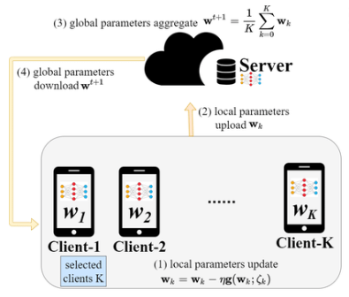
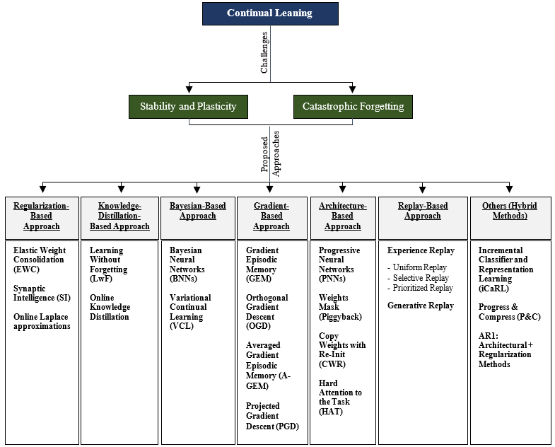
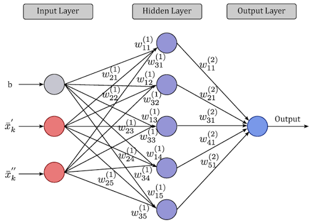
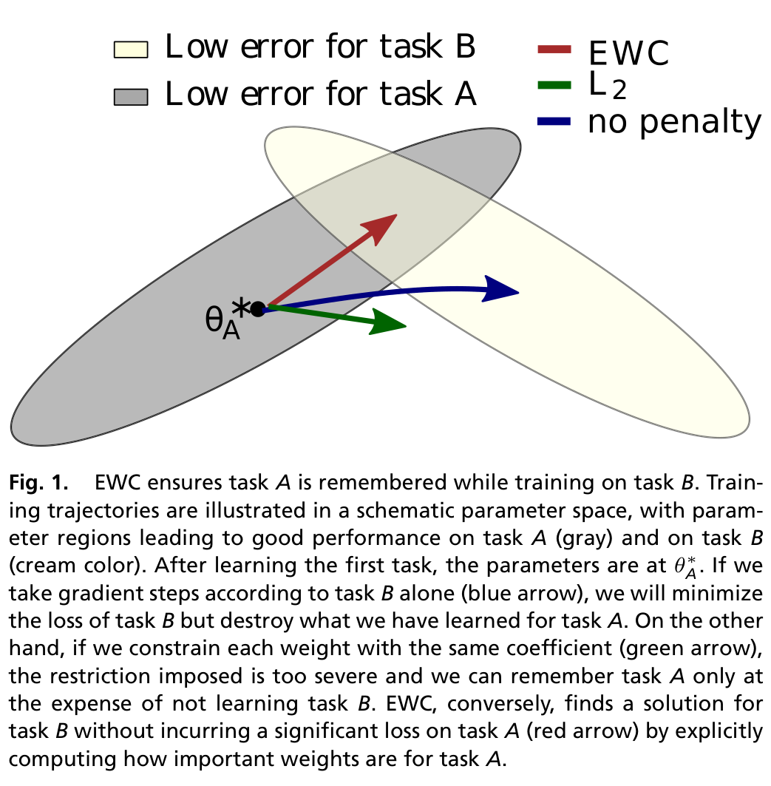
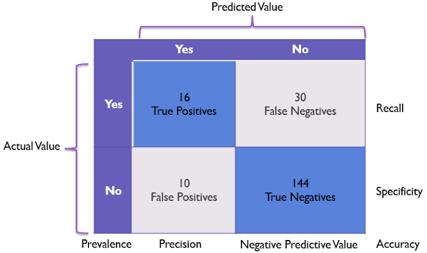
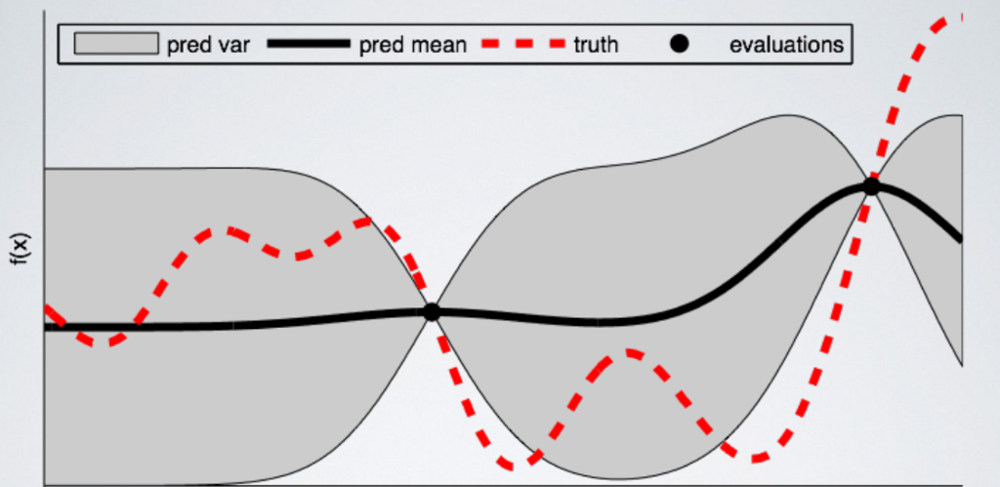

# BAB 2 TINJAUAN PUSTAKA

## 2.1 Keamanan Jaringan

Keamanan jaringan merupakan pilar fundamental dalam disiplin ilmu teknik komputer dan telekomunikasi yang berfokus pada perlindungan infrastruktur jaringan, kanal komunikasi, dan perangkat komputasi dari akses tidak sah (*unauthorized access*), modifikasi data ilegal, eksploitasi kerentanan, serta gangguan ketersediaan layanan[8]. Di era komputasi awan dan transformasi digital saat ini, keterhubungan antar-sistem semakin terbuka, yang secara bersamaan memperluas permukaan serangan (*attack surface*) dari pihak penyerang siber.

Dalam kerangka kerja keamanan jaringan, salah satu pilar konseptual paling fundamental yang dijadikan acuan perancangan sistem pertahanan adalah CIA Triad, yang mengintegrasikan tiga prinsip inti: kerahasiaan (*Confidentiality*), integritas (*Integrity*), dan ketersediaan (*Availability*)[8]. Prinsip kerahasiaan (*Confidentiality*) berfokus pada jaminan bahwa transmisi informasi serta rekaman data sensitif yang melintasi infrastruktur jaringan hanya dapat diakses dan diinterpretasikan oleh entitas yang memiliki hak akses (*authorization*). Perlindungan kerahasiaan ini umumnya ditegakkan melalui enkripsi protokol komunikasi *end-to-end* seperti TLS, IPsec, dan SSH, serta penerapan kebijakan kontrol akses berbasis identitas yang ketat, guna mencegah potensi intersepsi data ilegal seperti *packet sniffing* dan *eavesdropping*.

Selanjutnya, prinsip integritas (*Integrity*) menekankan pada keharusan menjaga keaslian dan konsistensi paket data agar tidak mengalami modifikasi, penyisipan muatan berbahaya, pemotongan, maupun manipulasi di tengah jalur transmisi (*man-in-the-middle tampering*). Integritas dipertahankan melalui mekanisme fungsi *hash* kriptografis, kode autentikasi pesan (*Message Authentication Code* / MAC), serta tanda tangan digital yang mampu memverifikasi keabsahan data secara presisi. Sementara itu, prinsip ketersediaan (*Availability*) menjamin bahwa seluruh sumber daya komputasi, kapasitas *bandwidth*, dan layanan aplikasi jaringan senantiasa siap sedia serta dapat diakses oleh pengguna yang berhak tanpa mengalami gangguan layanan (*downtime*). Aspek ketersediaan ini terancam secara langsung oleh serangan siber volumetrik seperti *Denial of Service* (DoS) yang berupaya menguras antrean soket dan kapasitas komputasi server.

Ketiga elemen dalam CIA Triad saling terikat secara sinergis dan tidak dapat dipisahkan satu sama lain. Untuk menegakkan prinsip tersebut secara holistik, infrastruktur jaringan enterprise mengadopsi model pertahanan berlapis (*Defense-in-Depth*). Dalam kerangka ini, sistem pertahanan tidak hanya mengandalkan perimeter luar (*firewall*), melainkan menyematkan kontrol keamanan pada setiap lapisan jaringan, mulai dari penyaringan paket, segmentasi jaringan (*Virtual LAN* / VLAN), hingga inspeksi aktif terhadap aliran lalu lintas data oleh sistem deteksi intrusi jaringan (*Network Intrusion Detection System*)[8].

  
*Gambar 2.1 Model CIA Triad Keamanan Informasi.*

---

## 2.2 Klasifikasi Serangan Siber

Serangan siber terhadap jaringan komputer memiliki taksonomi yang luas berdasarkan tujuan penyerang, protokol yang dieksploitasi, dan mekanisme gangguan yang ditimbulkan. Dalam penelitian ini, analisis difokuskan pada tiga kategori utama perilaku lalu lintas data yang bersumber dari dataset tolok ukur CIC-IDS2017[9]:

### 2.2.1 Trafik Normal (BENIGN)
Trafik normal merepresentasikan seluruh aliran komunikasi data sah yang dihasilkan oleh pengguna dan aplikasi resmi di dalam jaringan[9]. Aliran ini mencakup protokol web (HTTP/HTTPS), kueri *Domain Name System* (DNS), pertukaran surat elektronik (SMTP, IMAP), sinkronisasi waktu jaringan (NTP), serta lalu lintas manajemen internal. Karakteristik statistik dari trafik normal ditandai oleh distribusi panjang paket (*packet length*) yang heterogen, interval waktu kedatangan antar-paket (*inter-arrival time* / IAT) yang bervariasi sesuai interaksi manusia, serta rasio dua arah (*forward/backward packets*) yang proporsional sesuai standar protokol TCP/IP.

### 2.2.2 Serangan Brute-Force SSH (SSH-Patator)
Protokol *Secure Shell* (SSH) yang beroperasi pada port standar 22 merupakan protokol *de facto* untuk administrasi jarak jauh pada server Linux dan perangkat jaringan enterprise. Dalam lanskap ancaman siber, serangan **SSH-Patator** merupakan bentuk serangan audit penetrasi otomatis multi-utas (*multi-threaded brute force tool*) yang mengeksekusi ribuan kombinasi *username* dan *password* dari basis data kamus (*dictionary attack*) secara masif guna membobol akun administrator sistem[9].

Dari sudut pandang analisis statistik aliran lalu lintas (*flow statistics*), serangan SSH-Patator meninggalkan karakteristik pola yang sangat distingtif dibandingkan dengan sesi interaktif normal. Serangan ini ditandai oleh lonjakan frekuensi inisiasi koneksi TCP menuju nomor port layanan autentikasi dalam jendela waktu yang sangat sempit. Sebagian besar aliran memiliki durasi yang sangat singkat (*short flow duration*), mengingat server target segera memutus sesi koneksi melalui transmisi *flag* TCP RST atau FIN sesaat setelah pertukaran *handshake* kredensial dinyatakan gagal. Di samping itu, ukuran paket data arah maju (*forward*) dan arah mundur (*backward*) menunjukkan konsistensi volume muatan yang seragam pada fase negosiasi kunci kriptografi awal sebelum pemutusan sesi berlangsung, membedakannya secara tajam dari dinamika aliran sesi interaktif pengguna yang sah[9].

### 2.2.3 Serangan Penolakan Layanan (Denial of Service / DoS)
Serangan **Denial of Service (DoS)** bertujuan melumpuhkan pilar ketersediaan (*availability*) sistem target dengan membanjiri sumber daya komputasi seperti CPU, memori, *bandwidth*, atau batas antrean soket koneksi server web, sehingga server target gagal melayani permintaan pengguna yang sah[9]. Dalam penelitian ini, analisis difokuskan pada empat subvarian serangan DoS lapisan aplikasi (*application-layer DoS*) yang merepresentasikan spektrum ancaman volumetrik agresif dan ancaman berkecepatan lambat (*low-and-slow attacks*).

Pada kelompok serangan volumetrik agresif, subvarian pertama adalah **DoS Hulk**, yang melancarkan pembanjiran permintaan HTTP GET bervolume masif dengan memanipulasi *header User-Agent* serta menyisipkan parameter unik acak pada URL guna menggagalkan sistem *caching* server web, memaksa server mengalokasikan siklus komputasi CPU dan memori secara berulang. Subvarian kedua adalah **DoS GoldenEye**, yang mengeksploitasi mekanisme koneksi persisten HTTP (*keep-alive*) dan perintah *Cache-Control: no-cache* secara simultan dalam jumlah besar untuk menahan *worker process* server web tetap terkunci hingga kapasitas *thread pool* server habis terpakai.

Sebaliknya, pada kelompok serangan berkecepatan lambat (*low-and-slow*), subvarian **DoS Slowloris** beroperasi secara *stealthy* dengan mengirimkan fragmen *header* HTTP parsial secara berkala dengan interval lambat. Server target dipaksa menahan soket koneksi tetap terbuka sambil menunggu *header* selesai, menghabiskan batas konkurensi koneksi server tanpa menimbulkan lonjakan volume trafik yang mencurigakan. Serupa dengan Slowloris, subvarian **DoS Slowhttptest** mengeksploitasi spesifikasi protokol HTTP dengan mengirimkan muatan badan (*body*) permintaan POST secara sangat lambat (misalnya 1 bita per interval waktu tertentu), mengunci sumber daya penerimaan data server web secara berkepanjangan dan mencegah pengguna lain untuk menjalin komunikasi[9].

---

## 2.3 Hasil Penelitian Terdahulu

Penelitian terkait penerapan kecerdasan buatan untuk deteksi intrusi jaringan terdistribusi dan adaptif telah berkembang pesat dalam beberapa tahun terakhir. Tinjauan kritis terhadap literatur ilmiah berfokus pada tiga kelompok kajian utama:

Pertama, pada domain pembelajaran terdistribusi, *Federated Learning* (FL) yang diperkenalkan oleh McMahan *et al.*[3] melalui algoritma *Federated Averaging* (FedAvg) telah menjadi fondasi utama pelatihan kolaboratif lintas node tanpa transmisi data mentah. Penerapan FedAvg pada NIDS telah diteliti oleh Popoola *et al.*[10] untuk mendeteksi serangan *zero-day* pada jaringan IoT dan Ruzafa-Alcazar *et al.*[11] pada lingkungan *edge computing*. Namun, mayoritas studi FL-NIDS mengasumsikan data terdistribusi secara independen dan identik (IID). Pada kondisi nyata, data lalu lintas jaringan bersifat *non-Identical and Independently Distributed* (non-IID), yang secara teoretis dibuktikan oleh Zhao *et al.*[4] dapat memicu divergensi bobot (*weight divergence*) dan menurunkan akurasi model global secara signifikan.

Kedua, pada domain pembelajaran berkelanjutan (*Continual Learning* / CL), adaptasi model NIDS terhadap kelas serangan baru secara sekuensial menghadapi kendala berat berupa *catastrophic forgetting*[5]. Ketika model dilatih pada serangan baru, representasi bobot lama tertimpa sehingga kemampuan mendeteksi serangan terdahulu merosot drastis. Berbagai metode mitigasi telah diajukan, seperti *Experience Replay* dan *Gradient Episodic Memory* (GEM) oleh Lopez-Paz dan Ranzato[12], serta integrasi FL-CL oleh Chen *et al.*[13]. Namun, metode berbasis *replay* mengharuskan penyimpanan sampel data mentah di memori lokal, yang membebani kapasitas RAM perangkat *edge* dan berpotensi melanggar privasi pengguna. Sebaliknya, metode regularisasi parameter *Elastic Weight Consolidation* (EWC) yang dirumuskan oleh Kirkpatrick *et al.*[5] dan diuji pada ancaman infrastruktur kritis oleh Al-Abassi *et al.*[14] menawarkan keunggulan proteksi memori murni pada ruang bobot melalui Matriks Informasi Fisher tanpa menyimpan sampel data lama.

Ketiga, pada domain evaluasi dan integritas dataset tolok ukur CIC-IDS2017, studi audit mutakhir oleh Rosay *et al.*[6] dan Dube[7] membuktikan adanya cacat desinkronisasi pelabelan *timestamp* yang parah pada berkas hari Kamis serta kelangkaan sampel mikro ekstrem pada kelas tertentu. Di samping itu, Engelen *et al.*[15] mengidentifikasi fenomena *shortcut learning* (kebocoran fitur nomor port layanan), di mana model NIDS cenderung menghafal nomor port tujuan (*Destination Port*) daripada mempelajari dinamika perilaku statistik paket yang sebenarnya. Dalam konteks latensi operasional, penelitian tugas akhir terdahulu oleh Rinandri[8] menegaskan pentingnya pengukuran efisiensi inferensi tingkat mikrodetik per aliran data pada arsitektur pendeteksi anomali.

Berdasarkan kajian kritis tersebut, posisi ilmiah dan kebaruan (*novelty*) dari penelitian tugas akhir ini dirangkum dalam Tabel 2.1, yang mengintegrasikan paradigma FedAvg dan EWC di bawah distribusi non-IID dua klien, menerapkan pembersihan ketat bebas kebocoran fitur nomor port, serta mengukur ketahanan memori dan profil efisiensi komputasi model.

*Tabel 2.1 Perbandingan Penelitian Terdahulu dalam Domain FL, Continual Learning, dan NIDS.*

| No | Penulis & Tahun | Judul Penelitian | Metode / Algoritma | Dataset | Kontribusi Utama | Keterbatasan / Research Gap |
| :---: | :--- | :--- | :--- | :--- | :--- | :--- |
| 1 | Rosay *et al.*[6] | *Cost-effective Network Intrusion Detection* | Audit & ML Analysis | CIC-IDS2017 | Mengidentifikasi desinkronisasi timestamp hari Kamis pada CIC-IDS2017 | Hanya melakukan audit dataset, tidak merancang mitigasi continual learning. |
| 2 | Engelen *et al.*[15] | *Troubleshooting an Intrusion Detection Dataset* | Feature Importance Audit | CIC-IDS2017 | Membuktikan *shortcut learning* akibat penggunaan fitur `Destination Port` | Hanya fokus pada analisis fitur, tidak menguji arsitektur terdistribusi. |
| 3 | Dube[7] | *Data Leakage and Quality in IDS Datasets* | Audit Statistik | CIC-IDS2017 | Menemukan kelangkaan data ekstrem kelas Infiltration dan Sql Injection | Belum mengusulkan arsitektur model deteksi federasi. |
| 4 | Kirkpatrick *et al.*[5] | *Overcoming catastrophic forgetting in neural networks* | EWC & Fisher Information | Permuted MNIST | Merumuskan dasar matematis EWC menggunakan regularisasi Fisher diagonal | Diuji pada domain visi komputer sederhana, bukan lalu lintas jaringan. |
| 5 | McMahan *et al.*[3] | *Communication-Efficient Learning of Deep Networks* | Federated Averaging (FedAvg) | MNIST, CIFAR-10 | Menetapkan standar arsitektur Federated Learning terdistribusi | Mengasumsikan data seimbang dan tidak membahas *catastrophic forgetting*. |
| 6 | Zhao *et al.*[4] | *Federated Learning with Non-IID Data* | Analisis Divergensi Bobot | CIFAR-10 | Membuktikan secara teoretis degradasi FedAvg pada distribusi non-IID | Membutuhkan pembagian data publik sentral untuk menstabilkan model. |
| 7 | Lopez-Paz & Ranzato[12] | *Gradient Episodic Memory for Continual Learning* | GEM / BWT Metric | CIFAR-100 | Memperkenalkan formulasi metrik evaluasi *Backward Transfer* (BWT) | Solusi berbasis memori penyangga (*buffer*) yang rentan privasi. |
| 8 | Chen *et al.*[13] | *Federated Class-Incremental Learning* | FCL + Distilasi Pengetahuan | Visi Komputer | Mengintegrasikan FL dan CL untuk penambahan kelas sekuensial | Membutuhkan pertukaran representasi data sintetis antar-klien. |
| 9 | Ruzafa-Alcazar *et al.*[11] | *D-FLIDS: Decentralized Federated IDS* | FedAvg MLP | CIC-IDS2017 | Menerapkan federasi NIDS pada sensor edge | Mempertahankan `Destination Port` (rentan *shortcut learning*) dan data IID. |
| 10 | Popoola *et al.*[10] | *Federated Deep Learning for Zero-Day Attacks* | FedAvg DNN | BoT-IoT | Deteksi serangan baru pada jaringan IoT | Tidak menangani *catastrophic forgetting* saat kelas baru dilatih. |
| 11 | Rinandri (2025)[8] | *Semi-Supervised Learning GNN-AE pada Structemp* | Structemp GNN-AE | NF-UQ-NIDS-v2 | Implementasi deteksi anomali real-time dan evaluasi latensi $\mu\text{s}$ | Pembelajaran tersentralisasi statis, tidak mengkaji FL terdistribusi dan CL. |
| 12 | Sarhan *et al.*[16] | *Standard Feature Set for Network Intrusion Detection* | NetFlow Feature Engineering | NetFlow-V2 | Menstandardisasi ekstraksi fitur aliran berbasis flow | Menggunakan representasi fitur tergeneralisasi, bukan investigasi raw flow. |
| 13 | Al-Abassi *et al.*[14] | *Continual Learning for Cyber Threat Intelligence* | EWC & Replay | CSE-CIC-IDS2018 | Menerapkan continual learning pada IDS sentral | Beroperasi pada server tunggal, mengabaikan privasi data terdistribusi. |
| 14 | **Penelitian Ini (2026)** | **Analisis Kinerja Deteksi Network Traffic Intrusion via FCL** | **FedAvg + EWC + Weighted Loss (63 Fitur)** | **CIC-IDS2017** | **Mengintegrasikan FedAvg & EWC, mitigasi port leakage, mitigasi non-IID & imbalanced class, evaluasi BWT, RAM, payload, dan latensi $\mu\text{s}$** | **Memberikan solusi FCL terpadu yang adaptif, aman privasi, dan terverifikasi secara multi-seed.** |

---

## 2.4 Federated Learning (FL)

*Federated Learning* (FL) merupakan paradigma pembelajaran mesin terdistribusi yang memungkinkan sejumlah besar node klien (misalnya sensor jaringan, perangkat edge, atau server perimeter) untuk melatih model secara kolaboratif di bawah koordinasi server agregator terpusat tanpa harus memusatkan data pelatihan lokal ke server tersebut[3].

### 2.4.1 Arsitektur Federated Learning
Arsitektur *Federated Learning* secara fundamental dibangun atas interaksi terkoordinasi antara dua entitas utama, yaitu **Server Agregator** dan sekumpulan **Klien Federasi** ($K$ *node*)[3]. Server agregator bertindak sebagai koordinator orkestrasi global yang menginisialisasi parameter bobot model global awal, menyiarkan konfigurasi parameter model ke klien yang berpartisipasi pada setiap ronde komunikasi, mengumpulkan pembaruan bobot lokal, serta menghitung parameter model global baru melalui fungsi agregasi FedAvg. Di sisi lain, setiap sensor atau node klien federasi bertugas mengelola partisi data lalu lintas jaringan lokalnya secara privat dan terisolasi. Pada setiap putaran komunikasi federasi, klien mengunduh parameter model global terbaru dari server agregator, mengeksekusi proses optimasi lokal berbasis algoritma *Stochastic Gradient Descent* (SGD) atau AdamW selama sejumlah *epoch* lokal menggunakan data lokalnya, lalu mengirimkan kembali parameter bobot hasil pelatihan ke server agregator tanpa pernah mentransmisikan rekaman data mentah pengguna[3].

  
*Gambar 2.2 Siklus Pelatihan dan Agregasi Bobot pada Federated Learning (FedAvg)[3].*

### 2.4.2 Algoritma Federated Averaging (FedAvg)
Algoritma standar paling populer dalam FL adalah *Federated Averaging* (FedAvg). Pada setiap ronde komunikasi $t \in \{1, 2, \dots, T\}$[3]:

$$
w_{t+1} = \sum_{k=1}^{K} \frac{n_k}{n} w_{t+1}^k
$$

dengan:

$$
n_k = |\mathcal{D}_k|, \quad n = \sum_{k=1}^K n_k
$$

di mana $n_k$ menyatakan jumlah sampel data lokal pada klien $k$, dan $n$ adalah total seluruh sampel data di seluruh klien.

### 2.4.3 Tantangan Heterogenitas Data Non-IID
Pada lingkungan jaringan komputer nyata, asumsi bahwa data terdistribusi secara independen dan identik (*Independent and Identically Distributed* / IID) hampir selalu dilanggar. Fenomena ini disebut **Non-IID Data**. Bentuk non-IID paling dominan pada NIDS adalah ketimpangan distribusi label (*label distribution skew*), di mana Klien A di subnet internal dominan menangani serangan autentikasi SSH, sedangkan Klien B di zona publik dominan menangani serangan DoS. Heterogenitas non-IID terbukti secara teoretis menyebabkan pembaruan gradien lokal mengarah pada titik minimum lokal yang saling bertolak belakang (*weight divergence*), yang memperlambat konvergensi dan menurunkan akurasi model global[4].

---

## 2.5 Continual Learning

*Continual Learning* (CL) atau *Lifelong Learning* adalah cabang pembelajaran mesin yang berfokus pada kemampuan model kecerdasan buatan untuk mempelajari aliran tugas atau kelas data baru secara sekuensial dari waktu ke waktu tanpa melupakan representasi pengetahuan yang telah dipelajari dari tugas masa lalu.

### 2.5.1 Dilema Stabilitas-Plastisitas dan Catastrophic Forgetting
Dalam sistem pembelajaran adaptif, model dihadapkan pada dilema stabilitas-plastisitas (*stability-plasticity dilemma*), yaitu tuntutan untuk mempertahankan fleksibilitas dalam mengintegrasikan pengetahuan baru (*plasticity*) seraya mempertahankan kestabilan representasi yang telah terbentuk sebelumnya (*stability*). Jaringan saraf tiruan (*Deep Neural Networks*) modern memiliki kecenderungan bawaan yang parah terhadap fenomena **catastrophic forgetting** saat mempelajari aliran tugas baru secara berurutan[5]. Ketika model dilatih pada tugas pertama $\mathcal{T}_1$, bobot sinaptik $\theta$ dioptimasi untuk meminimalkan fungsi kerugian $\mathcal{L}_1$. Ketika tugas baru $\mathcal{T}_2$ diberikan, proses *backpropagation* akan memperbarui bobot $\theta$ demi meminimalkan $\mathcal{L}_2$. Pembaruan bobot ini menimpa (*overwrite*) konfigurasi parameter yang bertanggung jawab atas pengenalan $\mathcal{T}_1$, menyebabkan akurasi model terhadap $\mathcal{T}_1$ runtuh seketika mendekati nol.

### 2.5.2 Taksonomi Skenario Continual Learning
Berdasarkan ketersediaan identitas tugas (*Task-ID*) saat fase inferensi operasional, literatur Continual Learning mengklasifikasikan proses pembelajaran inkremental ke dalam tiga skenario utama[17]. Skenario pertama adalah **Task-Incremental Learning (Task-IL)**, di mana model selalu diberikan informasi identitas tugas (*Task-ID*) baik selama fase pelatihan maupun saat evaluasi inferensi, sehingga model hanya perlu memilih kelas luaran yang relevan dengan tugas tersebut. Skenario kedua adalah **Domain-Incremental Learning (Domain-IL)**, di mana struktur dan jumlah kelas keluaran tetap konstan, namun distribusi fitur masukan mengalami pergeseran domain seiring berjalannya waktu. Skenario ketiga dan yang paling kompleks adalah **Class-Incremental Learning (Class-IL)**, di mana model dituntut untuk mengidentifikasi dan membedakan seluruh kelas dari seluruh tugas yang pernah dipelajari tanpa pernah diberikan informasi *Task-ID* saat proses inferensi. Skenario Class-IL ini merupakan representasi paling realistis sekaligus paling menantang bagi implementasi sistem deteksi intrusi jaringan di dunia nyata, karena sensor keamanan operasional harus mampu mengklasifikasikan apakah suatu aliran data bersifat normal, serangan SSH, atau serangan DoS secara mandiri tanpa mengetahui konteks fase pelatihan model[17].

### 2.5.3 Taksonomi Pendekatan Mitigasi Forgetting
Secara komprehensif, literatur saintifik membagi pendekatan mitigasi *catastrophic forgetting* ke dalam beberapa paradigma metodologis utama sebagaimana diilustrasikan pada Gambar 2.3[17]. Paradigma pertama adalah **Regularization-Based Approach**, yang menambahkan suku penalti regularisasi ke dalam fungsi kerugian guna membatasi pergeseran bobot-bobot sinaptik yang dinilai krusial bagi tugas masa lalu tanpa memerlukan penyimpanan sampel data mentah, seperti pada algoritma *Elastic Weight Consolidation* (EWC), *Synaptic Intelligence* (SI), dan *Online Laplace Approximation*. Paradigma kedua adalah **Knowledge-Distillation-Based Approach**, yang mentransfer representasi pengetahuan luaran model lama ke arsitektur model baru menggunakan luaran probabilitas lunak (*soft targets*), seperti pada metode *Learning Without Forgetting* (LwF).

Di samping kedua paradigma tersebut, pendekatan mitigasi lainnya mencakup **Bayesian-Based Approach** yang merumuskan pembelajaran sekuensial melalui pembaharuan distribusi probabilitas posterior parameter, serta **Gradient-Based Approach** (seperti *Gradient Episodic Memory* / GEM) yang memproyeksikan vektor gradien tugas baru agar selalu ortogonal terhadap ruang gradien tugas lampau[12]. Pendekatan lain melibatkan **Architecture-Based Approach** yang mengalokasikan kapasitas sub-jaringan atau neuron baru khusus per tugas (seperti *Progressive Neural Networks*), serta **Replay-Based Approach** yang menyimpan kembali cuplikan data historis (*Experience Replay*) atau membangkitkan data sintetis (*Generative Replay*). Namun, untuk lingkungan sensor jaringan terdistribusi yang sensitif terhadap privasi dan memiliki keterbatasan memori fisik, pendekatan berbasis regularisasi parameter seperti EWC menawarkan keunggulan paling menonjol karena tidak menuntut penyimpanan rekaman data mentah pengguna di memori lokal[5], [17].

  
*Gambar 2.3 Taksonomi Pendekatan Mitigasi Catastrophic Forgetting pada Continual Learning.*

---

## 2.6 Network Intrusion Detection System (NIDS)

*Network Intrusion Detection System* (NIDS) merupakan mekanisme pertahanan siber yang ditempatkan pada infrastruktur jaringan untuk menginspeksi lalu lintas data dan mendeteksi aktivitas mencurigakan yang mengindikasikan adanya intrusi, eksploitasi kerentanan, atau pelanggaran kebijakan keamanan[8].

### 2.6.1 NIDS vs HIDS
Berdasarkan arsitektur penempatan dan cakupan monitoringnya, sistem deteksi intrusi secara mendasar terbagi menjadi dua kategori utama, yaitu *Host-Based IDS* (HIDS) dan *Network-Based IDS* (NIDS)[8], [13]. HIDS beroperasi secara langsung pada tingkat sistem operasi dari perangkat *endpoint* atau server individual untuk mengawasi integritas berkas sistem (*file integrity*), log autentikasi, serta pemanggilan instruksi sistem (*system calls*). Karakteristik HIDS sangat efektif untuk mengidentifikasi ancaman internal atau eksploitasi hak akses di tingkat lokal, namun memerlukan instalasi agen pada setiap mesin dan mengonsumsi sumber daya komputasi dari server aplikasi target. Sebaliknya, NIDS ditempatkan secara strategis pada tautan jaringan (*network links*), seperti *switch*, *gateway*, atau port agregasi, guna memantau seluruh paket dan aliran data yang melintasi segmen jaringan secara non-invasif. Keunggulan utama NIDS terletak pada kemampuannya mengawasi puluhan hingga ratusan perangkat sekaligus secara simultan tanpa membebani performa komputasi server aplikasi serta mampu mendeteksi pola serangan yang bergerak lintas subnet jaringan[8].

### 2.6.2 Signature-Based vs Anomaly-Based NIDS
Ditinjau dari metodologi deteksi yang diimplementasikan, NIDS terbagi menjadi pendekatan berbasis tanda tangan (*Signature-Based IDS* / SIDS) dan pendekatan berbasis anomali (*Anomaly-Based IDS* / ABDS)[8], [10]. SIDS beroperasi dengan mencocokkan setiap muatan paket atau pola lalu lintas terhadap basis data tanda tangan serangan (*attack signatures*) yang telah didefinisikan sebelumnya oleh analis keamanan. Pendekatan SIDS memiliki keunggulan dalam kecepatan komputasi dan menghasilkan tingkat alarm palsu (*false positive*) yang sangat rendah untuk ancaman lama yang telah terdaftar, namun mengalami kegagalan mutlak ketika berhadapan dengan serangan baru (*zero-day attacks*) atau varian serangan yang telah dimodifikasi polanya. Sebaliknya, ABDS memodelkan perilaku lalu lintas normal sebagai profil tolok ukur (*baseline*), sehingga setiap penyimpangan statistik yang signifikan akan ditandai sebagai indikasi anomali intrusi. ABDS modern mengandalkan model pembelajaran mesin dan jaringan saraf tiruan untuk mengevaluasi fitur statistik aliran dua arah (*bidirectional flow features*), memberikan kemampuan generalisasi yang tangguh dalam mengidentifikasi pola ancaman baru yang belum pernah terpetakan sebelumnya[8], [10].

---

## 2.7 Kerangka Kerja Pengembangan Komputasi dan Federasi

Pengembangan sistem NIDS adaptif terdistribusi dalam penelitian ini memanfaatkan integrasi dua kerangka kerja komputasi terbuka standar industri:

### 2.7.1 PyTorch
PyTorch merupakan pustaka komputasi ilmiah dan *deep learning* sumber terbuka berbasis Python yang dikembangkan oleh Meta AI, yang telah menjadi standar *de facto* dalam riset pembelajaran mesin modern. Keunggulan fundamental PyTorch bersumber dari mekanisme graf komputasi dinamis (*Dynamic Computational Graph* via modul Autograd), yang memungkinkan modifikasi struktur jaringan saraf tiruan secara fleksibel selama waktu eksekusi (*runtime*) tanpa perlu mendefinisikan graf statis terlebih dahulu. Di samping itu, PyTorch menyediakan integrasi terakselerasi dengan perangkat keras GPU melalui pustaka *NVIDIA CUDA* dan *cuDNN*, yang mempercepat operasi aljabar linear tensor berskala masif. Fleksibilitas ini mempermudah formulasi fungsi kerugian kustom (*custom loss function*), seperti penggabungan fungsi *Weighted Cross-Entropy Loss* dengan penalti kuadratik EWC berbasis perkalian tensor elemen-per-elemen secara langsung pada tingkat gradien[5], [8].

### 2.7.2 Flower Framework (`flwr`)
Dalam mengimplementasikan paradigma pembelajaran terdistribusi, penelitian ini memanfaatkan Flower (`flwr`), yaitu kerangka kerja *Federated Learning* yang modular, terukur, dan agnostik terhadap pustaka *deep learning*[18]. Arsitektur komunikasi Flower dibangun di atas protokol *Google Remote Procedure Call* (gRPC) yang beroperasi melalui HTTP/2 pada port standar TCP 8080, menjamin latensi transmisi yang rendah dan throughput yang andal. Dalam siklus federasi, parameter bobot model PyTorch diekstraksi ke dalam array NumPy (*float32*) dan diserialisasi ke dalam format biner *Protocol Buffers* (`Parameters` proto) sebelum dikirimkan melintasi jaringan. Penggunaan arsitektur model MLP yang kompak (memuat 6.275 parameter *float32*) menghasilkan ukuran muatan biner parameter hanya sebesar $\approx 25,1$ KB per transmisi klien. Dengan total pertukaran parameter untuk dua klien sebesar $100,4$ KB per ronde federasi, Flower menghasilkan penghematan lebar pita jaringan sebesar $99,48\%$ dibandingkan skenario sentralisasi yang mentransmisikan data mentah bervolume gigabita. Keunggulan ini dipadukan dengan skalabilitas Flower yang mendukung emulasi klien virtual maupun penerapan riil pada perangkat komputasi fisik terdistribusi (*cross-silo edge deployment*)[18].

---

## 2.8 Multilayer Perceptron (MLP)

Untuk memenuhi batasan komputasi perangkat gerbang jaringan (*edge gateway*) dan menghindari latensi komputasi yang tinggi, arsitektur model klasifikasi dirancang menggunakan **Multilayer Perceptron (MLP)** kompak tiga lapis terhubung penuh (*Fully Connected Layers*).

### 2.8.1 Struktur Matematika MLP
Model menerima vektor fitur masukan $x \in \mathbb{R}^{63}$ yang merepresentasikan statistik aliran paket:

$$
\begin{aligned}
h_1 &= f_1(W_1 x + b_1), \quad W_1 \in \mathbb{R}^{64 \times 63}, \ b_1 \in \mathbb{R}^{64} \\
h_2 &= f_2(W_2 h_1 + b_2), \quad W_2 \in \mathbb{R}^{32 \times 64}, \ b_2 \in \mathbb{R}^{32} \\
z &= W_3 h_2 + b_3, \quad W_3 \in \mathbb{R}^{3 \times 32}, \ b_3 \in \mathbb{R}^{3} \\
\hat{y} &= \text{Softmax}(z)
\end{aligned}
$$

di mana $f_1, f_2$ merupakan fungsi aktivasi non-linear ReLU.

### 2.8.2 Alasan Pemilihan Arsitektur Kompak
Pemilihan arsitektur MLP kompak didasari oleh pertimbangan kritis terhadap keterbatasan sumber daya komputasi perangkat sensor jaringan (*edge gateways*) dan kebutuhan latensi inspeksi paket waktu nyata[8]. Model yang dirancang memiliki 63 fitur masukan, 64 neuron pada lapisan tersembunyi pertama, 32 neuron pada lapisan tersembunyi kedua, dan 3 neuron keluaran, yang secara keseluruhan menghasilkan total parameter komputasi sebesar:

$$
|\theta| = (63 \times 64 + 64) + (64 \times 32 + 32) + (32 \times 3 + 3) = 4.096 + 2.080 + 99 = 6.275 \text{ parameter}
$$

Dengan representasi angka mengambang 32-bit (*single precision float32* berukuran 4 bita), ukuran biner parameter model hanya mencapai sekitar **25,1 KB**. Jejak memori (*memory footprint*) yang sangat kecil ini memberikan dua keuntungan operasional yang krusial. Pertama, proses serialisasi dan transmisi bobot melalui protokol gRPC Flower pada setiap ronde federasi dapat diselesaikan dalam orde milidetik tanpa membebani kapasitas lebar pita jaringan. Kedua, model mampu mengeksekusi inferensi klasifikasi aliran data secara lokal dalam skala mikrodetik per sampel aliran ($\mu\text{s/flow}$), memastikan sistem mampu mengimbangi laju paket pada tautan jaringan berkecepatan tinggi tanpa menimbulkan antrean *buffer* yang berisiko memicu hilangnya paket (*packet drop*)[8].

  
*Gambar 2.4 Struktur Arsitektur Jaringan Multilayer Perceptron (MLP) dengan Lapisan Tersembunyi.*

---

## 2.9 Elastic Weight Consolidation (EWC)

*Elastic Weight Consolidation* (EWC) merupakan metode mitigasi *catastrophic forgetting* berbasis regularisasi parameter yang terinspirasi oleh fenomena konsolidasi memori sinaptik pada otak biologis[5].

### 2.9.1 Landasan Teoretis Bayes dan Matriks Fisher
Dari perspektif inferensi Bayesian, mempelajari tugas kedua $\mathcal{D}_2$ setelah menyelesaikan tugas pertama $\mathcal{D}_1$ dirumuskan melalui probabilitas posterior parameter $\theta$:

$$
\log p(\theta \mid \mathcal{D}_1, \mathcal{D}_2) = \log p(\mathcal{D}_2 \mid \theta) + \log p(\theta \mid \mathcal{D}_1) - \log p(\mathcal{D}_2)
$$

Distribusi posterior $\log p(\theta \mid \mathcal{D}_1)$ memuat seluruh informasi mengenai tugas pertama. Melalui aproksimasi deret Taylor orde kedua di sekitar parameter optimal tugas pertama $\theta_1^*$, fungsi ini dapat didekati sebagai distribusi Gaussian dengan presisi yang ditentukan oleh **Matriks Informasi Fisher (Fisher Information Matrix / FIM)**:

$$
F = \mathbb{E}_{x \sim \mathcal{D}_1, y \sim p(y \mid x, \theta_1^*)} \left[ \nabla_\theta \log p(y \mid x, \theta_1^*) \nabla_\theta \log p(y \mid x, \theta_1^*)^T \right]
$$

### 2.9.2 Matriks Fisher Diagonal dan Formulasi Kerugian EWC
Untuk menghindari komputasi inversi matriks kovariansi penuh yang berukuran $|\theta| \times |\theta|$, EWC mengasumsikan elemen-elemen Fisher saling independen dan hanya menghitung elemen diagonalnya ($F_i$). Dalam implementasi praktis *machine learning*, ekspektasi terhadap distribusi analitis didekati menggunakan **Empirical Fisher Information Matrix**, di mana gradien kuadratik dihitung terhadap label aktual (*ground truth*) tugas pertama:

$$
F_i = \frac{1}{N} \sum_{n=1}^N \left( \left. \frac{\partial \mathcal{L}_{\text{CE}}(f(x_n; \theta), y_n)}{\partial \theta_i} \right|_{\theta = \theta_1^*} \right)^2
$$

Ketika model dilatih pada tugas kedua, fungsi kerugian total lokal dimodifikasi menjadi:

$$
\mathcal{L}_{\text{total}}(\theta) = \mathcal{L}_2(\theta) + \sum_{i} \frac{\lambda}{2} F_i (\theta_i - \theta_{1, i}^*)^2
$$

di mana $\lambda$ adalah koefisien hiperparameter penalti EWC yang mengontrol seberapa kuat model mempertahankan memori tugas lama dibandingkan mempelajari tugas baru.

  
*Gambar 2.5 Mekanisme Regularisasi EWC Membatasi Pergeseran Bobot Kritis pada Kontur Kerugian[5].*

### 2.9.3 Weighted Cross-Entropy dan Gradient Clipping
Untuk mengatasi ketimpangan kelas yang parah, fungsi kerugian dasar $\mathcal{L}_2(\theta)$ menggunakan pembobotan invers frekuensi kelas:

$$
\mathcal{L}_{\text{CE}}(y, \hat{y}) = - \sum_{c=1}^{C} w_c \cdot y_c \log(\hat{y}_c), \quad \text{dengan } w_c = \frac{N_{\text{total}}}{C \cdot N_c}
$$

Untuk mencegah lonjakan gradien akibat perkalian dengan bobot kelas minoritas yang besar dan penalti EWC, diterapkan pemotongan gradien (*Gradient Clipping*):

$$
\text{jika } \|\mathbf{g}\|_2 > \gamma, \quad \text{maka } \mathbf{g} \leftarrow \frac{\gamma}{\|\mathbf{g}\|_2} \mathbf{g}, \quad \text{dengan } \gamma = 1.0
$$

---

## 2.10 Karakteristik Dataset Tolok Ukur CIC-IDS2017

Dataset tolok ukur yang digunakan dalam penelitian ini adalah **CIC-IDS2017** (*Canadian Institute for Cybersecurity Intrusion Detection System 2017*). Dataset ini dibangun menggunakan topologi jaringan korban (*Victim Network*) dan jaringan penyerang (*Attack Network*) yang merekam lalu lintas paket nyata selama lima hari kerja (Senin s.d. Jumat)[9].

### 2.10.1 Karakteristik dan Komposisi Aliran Data
Seluruh lalu lintas jaringan mentah dalam format *packet capture* (pcap) diekstraksi menggunakan perangkat lunak *CICFlowMeter* menjadi rekaman statistik aliran dua arah (*bidirectional flow features*). Berkas lalu lintas yang dianalisis dalam penelitian ini mencakup berkas hari Senin (*Monday*) yang merepresentasikan lalu lintas operasional normal (BENIGN) secara eksklusif, berkas hari Selasa (*Tuesday*) yang memuat aktivitas normal dan serangan penetrasi autentikasi SSH (*SSH-Patator*), serta berkas hari Rabu (*Wednesday*) yang memuat lalu lintas normal dan varian serangan *Denial of Service* (DoS Slowloris, Slowhttptest, Hulk, dan GoldenEye)[9].

### 2.10.2 Audit Kritis dan Mitigasi Shortcut Learning (Port Leakage)
Meskipun CIC-IDS2017 merupakan tolok ukur standar dalam riset NIDS, sejumlah studi audit saintifik mutakhir mengidentifikasi kelemahan mendasar dalam dataset mentah yang berpotensi menghasilkan evaluasi model yang bias[6], [7], [15]. Audit oleh Rosay *et al.*[6] dan Dube[7] membuktikan bahwa berkas hari Kamis menderita desinkronisasi penanda waktu (*timestamp labeling error*) yang parah antara file rekaman pcap dan file CSV, serta memiliki kelangkaan sampel kelas ekstrem (seperti serangan Infiltration yang hanya terdiri dari 36 baris dan Sql Injection sebanyak 21 baris). Kondisi ini menyebabkan berkas hari Kamis dan Jumat dieksklusi secara sengaja dari penelitian ini guna menjamin validitas dan reliabilitas eksperimen.

Lebih lanjut, studi audit oleh Engelen *et al.*[15] membuktikan adanya fenomena *shortcut learning* atau kebocoran fitur (*feature leakage*) akibat keberadaan atribut nomor port tujuan (`Destination Port`). Ketika fitur nomor port diikutsertakan, algoritma pembelajaran mesin cenderung mengambil jalan pintas dengan menghafal nomor port layanan standar (misalnya port 22 untuk SSH dan port 80 untuk DoS), sehingga menghasilkan akurasi klasifikasi yang tinggi semu tanpa pernah mempelajari pola statistik lalu lintas paket yang sebenarnya. Menjawab tantangan tersebut, penelitian ini menerapkan protokol kurasi yang ketat dengan membuang fitur `Destination Port` secara definitif, mengeliminasi 132.909 baris data duplikat identik, membuang 10 fitur konstan bervariansi nol, serta mengeliminasi 5 pasangan fitur duplikat mutlak. Melalui prosedur praproses ini, diperoleh tepat **63 fitur statistik numerik bersih** yang memastikan model dievaluasi secara otentik atas dinamika perilaku aliran jaringan[15].

---

## 2.11 Evaluasi Metrik

Evaluasi sistem dilakukan secara komprehensif mencakup metrik kinerja deteksi kecerdasan buatan, metrik retensi continual learning, dan metrik profil komputasi perangkat.

### 2.11.1 Metrik Deteksi Pembelajaran Mesin
Kinerja deteksi model dievaluasi secara menyeluruh menggunakan matriks konfusi (*Confusion Matrix*) yang mengelompokkan prediksi model ke dalam empat kuadran hasil: *True Positive* (TP), *True Negative* (TN), *False Positive* (FP), dan *False Negative* (FN) sebagaimana diilustrasikan pada Gambar 2.6[8].

  
*Gambar 2.6 Struktur Dasar Confusion Matrix untuk Evaluasi Deteksi Biner dan Multi-kelas.*

Metrik pertama adalah **Akurasi (*Accuracy*)**, yang mengukur proporsi keseluruhan prediksi yang benar terhadap total sampel data yang dievaluasi:

$$
\text{Accuracy} = \frac{TP + TN}{TP + TN + FP + FN}
$$

Meskipun akurasi memberikan gambaran umum efektivitas model, metrik ini rentan menghasilkan interpretasi yang menyesatkan pada dataset deteksi intrusi yang memiliki ketimpangan kelas ekstrem di mana kelas normal mendominasi secara absolut. Oleh karena itu, metrik **Presisi (*Precision*)** digunakan untuk mengukur ketepatan deteksi positif dari seluruh peringatan yang dibunyikan oleh model, yang dirumuskan sebagai:

$$
\text{Precision} = \frac{TP}{TP + FP}
$$

Presisi yang tinggi menjamin bahwa sistem meminimalkan frekuensi alarm palsu (*false alarm rate*), sehingga tidak membebani operator keamanan jaringan dengan peringatan keliru. Selanjutnya, metrik **Recall (*Sensitivity*)** mengevaluasi kemampuan sistem dalam menjaring seluruh insiden serangan yang sebenarnya terjadi di dalam jaringan:

$$
\text{Recall} = \frac{TP}{TP + FN}
$$

Nilai *Recall* yang tinggi memastikan sistem memiliki tingkat deteksi lolos (*false negative*) yang rendah, sehingga serangan berbahaya tidak menyusup tanpa terdeteksi. Sebagai penyeimbang trade-off antara Presisi dan Recall, evaluasi utama dalam penelitian ini mengadopsi metrik **Macro-Averaged F1 (Macro-F1)**, yang menghitung rata-rata harmonik F1-score secara mandiri pada setiap kelas tanpa dipengaruhi oleh bobot proporsi jumlah sampel:

$$
\text{Macro-F1} = \frac{1}{C} \sum_{c=1}^C \frac{2 \cdot \text{Precision}_c \cdot \text{Recall}_c}{\text{Precision}_c + \text{Recall}_c}
$$

Dengan menghitung rata-rata secara unweighted antar-kelas, Macro-F1 memberikan bobot evaluasi yang setara pada kelas minoritas (seperti SSH-Patator) maupun kelas mayoritas (BENIGN), menjadikannya metrik objektif paling andal untuk mengukur performa NIDS pada kondisi distribusi data yang timpang[8].

### 2.11.2 Metrik Continual Learning: Backward Transfer (BWT)
Dalam skenario pembelajaran berkelanjutan (*Continual Learning*), retensi pengetahuan model terhadap tugas lampau setelah mempelajari tugas baru diukur secara matematis menggunakan metrik **Backward Transfer (BWT)**[12]:

$$
\text{BWT} = R_{2, 1} - R_{1, 1}
$$

di mana $R_{1, 1}$ menyatakan skor Macro-F1 pada tugas pertama sesaat setelah fase pelatihan pertama selesai, sedangkan $R_{2, 1}$ merepresentasikan skor Macro-F1 pada tugas pertama setelah model menyelesaikan pelatihan pada tugas kedua. Nilai $\text{BWT} < 0$ mengindikasikan terjadinya degradasi representasi memori atau *catastrophic forgetting*, di mana semakin negatif nilai BWT maka semakin parah derajat kepunahan memori model terhadap ancaman lampau. Sebaliknya, nilai $\text{BWT} \ge 0$ membuktikan bahwa model mampu mempertahankan representasi tugas lama secara stabil atau bahkan mengalami transfer pengetahuan positif (*positive backward transfer*)[12].

### 2.11.3 Metrik Profiling Komputasi dan Instance
Di samping evaluasi kinerja klasifikasi, pengukuran efisiensi komputasi menjadi parameter penentu kelayakan sistem NIDS saat dioperasikan secara nyata pada perangkat jaringan, mengadopsi standar profiling yang dirumuskan pada penelitian teknik elektro terdahulu[8]. Profiling ini mencakup tiga parameter utama. Parameter pertama adalah **Waktu Inferensi per Aliran (*Inference Time*)**, yang mengukur rata-rata durasi eksekusi algoritma dalam memproses dan mengklasifikasikan satu sampel aliran data jaringan:

$$
\text{Inference Time} = \frac{T_{\text{total}}}{N_{\text{flows}}} \quad (\mu\text{s/flow})
$$

Pengukuran waktu inferensi dilakukan dengan menerapkan fase pemanasan (*warm-up phase*) untuk menstabilkan alokasi memori *cache*, kemudian waktu diukur secara presisi menggunakan pewaktu resolusi nanodetik (`time.perf_counter_ns()`) melintasi 10.000 aliran data uji independen. Parameter kedua adalah **Konsumsi Memori RAM (*Memory Footprint*)**, yang mengukur alokasi memori fisik puncak selama fase pelatihan lokal dan penyimpanan bobot, membuktikan efisiensi memori EWC (hanya menyimpan vektor diagonal Fisher $\approx 25$ KB) dibandingkan metode *Experience Replay* yang membutuhkan *buffer* data mentah puluhan megabita. Parameter ketiga adalah **Beban Komunikasi Jaringan (*Communication Overhead*)**, yang menghitung total volume biner parameter model yang ditransmisikan antara node klien dan server agregator per putaran federasi:

$$
\text{Payload} = 2 \times |\theta| \times \text{sizeof}(\text{float32}) \quad (\text{KB})
$$

Parameter ini menunjukkan efisiensi protokol gRPC Flower dalam meminimalkan overhead lebar pita jaringan selama kolaborasi terdistribusi berlangsung[8], [18].

---

## 2.12 Bayesian Hyperparameter Tuning

Penyetelan hiperparameter (*hyperparameter tuning*) merupakan tahapan kritis untuk menemukan kombinasi parameter optimal yang memaksimalkan kinerja model. Dibandingkan metode *Grid Search* yang tidak efisien atau *Random Search* yang acak, penelitian ini mengadopsi metode **Bayesian Optimization** menggunakan kerangka kerja **Optuna**.

### 2.12.1 Algoritma Tree-structured Parzen Estimator (TPE)
Optuna mengimplementasikan algoritma *Tree-structured Parzen Estimator* (TPE)[19]. TPE memodelkan probabilitas kondisional $p(x \mid y)$ dari konfigurasi hiperparameter $x$ terhadap hasil evaluasi $y$ dengan membagi riwayat percobaan sebelumnya ke dalam dua distribusi terpisah:

$$
p(x \mid y) = \begin{cases} \ell(x), & \text{jika } y < y^* \\ g(x), & \text{jika } y \ge y^* \end{cases}
$$

di mana $y^*$ adalah nilai ambang kuantil performa terbaik. Nilai *Expected Improvement* (EI) dimaksimalkan dengan memilih hiperparameter yang memaksimumkan rasio $\frac{\ell(x)}{g(x)}$.

  
*Gambar 2.7 Pemodelan Distribusi Ketidakpastian pada Optimasi Bayesian Berbasis Estimator Parzen (TPE)[19].*

---

## 2.13 Optimizer

Algoritma pengoptimalan (*optimizer*) bertugas memperbarui bobot parameter jaringan saraf tiruan guna meminimalkan fungsi kerugian selama proses pelatihan *backpropagation*.

### 2.13.1 Stochastic Gradient Descent (SGD)
Algoritma SGD memperbarui parameter $\theta$ ke arah yang berlawanan dengan gradien fungsi kerugian:

$$
\theta_{t+1} = \theta_t - \eta \nabla_\theta \mathcal{L}(\theta_t)
$$

di mana $\eta$ adalah laju pembelajaran (*learning rate*). Meskipun sederhana dan memiliki generalisasi akhir yang baik, SGD rentan terjebak pada dataran datar (*saddle points*) dan memiliki laju konvergensi yang lambat pada permukaan kerugian yang memiliki kelengkungan tidak seragam.

### 2.13.2 AdamW (Decoupled Weight Decay)
Untuk mengatasi kelemahan SGD dan kekurangan algoritma Adam standar, penelitian ini menggunakan algoritma optimasi **AdamW**[20]. AdamW menghitung momen pertama $m_t$ dan momen kedua $v_t$ dari gradien untuk menyesuaikan laju pembaruan parameter secara adaptif, seraya memisahkan (*decoupling*) penalti *weight decay* $\lambda_{\text{wd}}$ dari pembaruan gradien adaptif:

$$
\begin{aligned}
m_t &= \beta_1 m_{t-1} + (1 - \beta_1) g_t \\
v_t &= \beta_2 v_{t-1} + (1 - \beta_2) g_t^2 \\
\hat{m}_t &= \frac{m_t}{1 - \beta_1^t}, \quad \hat{v}_t = \frac{v_t}{1 - \beta_2^t} \\
\theta_t &= \theta_{t-1} - \eta \left( \frac{\hat{m}_t}{\sqrt{\hat{v}_t} + \epsilon} + \lambda_{\text{wd}} \theta_{t-1} \right)
\end{aligned}
$$

Pemisahan penalti bobot ini mencegah distorsi regulasi L2 pada arah gradien adaptif, menghasilkan kestabilan pelatihan yang superior pada arsitektur MLP.

---

## 2.14 Fungsi Aktivasi

Fungsi aktivasi merupakan komponen esensial pada machine learning dan deep learning. Fungsinya adalah memperkenalkan sifat non-linearitas ke dalam sistem, yang memungkinkan model untuk mempelajari dan mengekspresikan hubungan kompleks antar-fitur dalam ruang aliran lalu lintas jaringan.

### 2.14.1 Rectified Linear Unit (ReLU)
Fungsi aktivasi utama yang digunakan pada lapisan tersembunyi model MLP adalah **ReLU**[8]:

$$
f(x) = \max(0, x)
$$

Keunggulan fundamental dari ReLU terletak pada efisiensi komputasinya yang sangat tinggi, karena hanya mengeksekusi operasi perbandingan ambang batas matematis sederhana tanpa melibatkan kalkulasi eksponensial yang membutuhkan daya pemrosesan intensif. Selain itu, ReLU secara efektif memitigasi fenomena *vanishing gradient* pada nilai masukan positif ($x > 0$) dengan mempertahankan nilai gradien turunan konstan bernilai $1$, memungkinkan sinyal pembaruan bobot merambat secara stabil melintasi lapisan-lapisan jaringan selama fase *backpropagation*. Sifat aktivasi ReLU yang mengubah nilai masukan negatif menjadi nol juga menghasilkan representasi bobot yang renggang (*sparse activation*), yang mendorong efisiensi pemrosesan dan mempercepat konvergensi model selama pelatihan[8].

### 2.14.2 Softmax
Pada lapisan keluaran klasifikasi multi-kelas, fungsi **Softmax** digunakan untuk mengubah nilai logit mentah $z \in \mathbb{R}^C$ menjadi distribusi probabilitas ternormalisasi:

$$
\text{Softmax}(z_i) = \frac{e^{z_i}}{\sum_{j=1}^C e^{z_j}}, \quad \text{dengan } 0 \le \hat{y}_i \le 1 \quad \text{dan} \quad \sum_{j=1}^C \hat{y}_j = 1
$$

di mana setiap elemen keluaran merepresentasikan tingkat keyakinan model terhadap kelas BENIGN, SSH-Patator, atau DoS.
