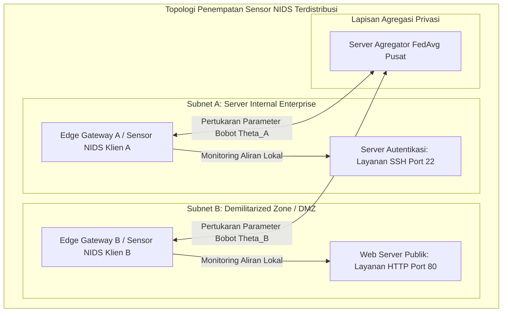
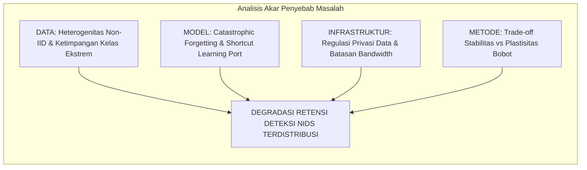
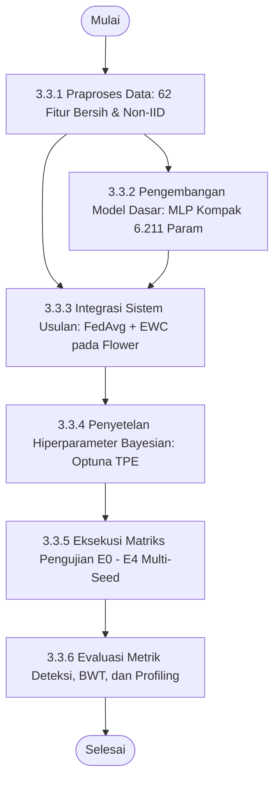
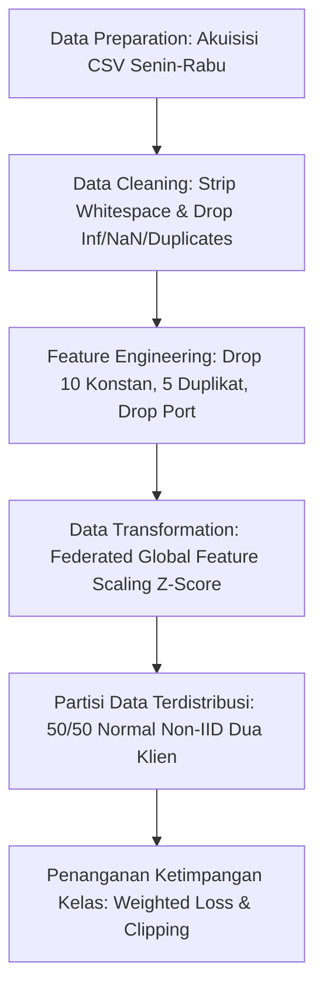
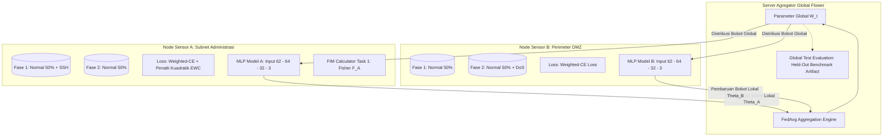

# BAB 3 METODOLOGI

Bab ini menguraikan metode yang digunakan, bahan dan peralatan penelitian, alur urutan pelaksanaan penelitian, tahapan praproses data, arsitektur sistem terdistribusi yang diusulkan, penyetelan hiperparameter Bayesian, matriks skenario pengujian komparatif, mekanisme evaluasi, dan jadwal pelaksanaan kegiatan penelitian. Penelitian ini berfokus pada evaluasi integrasi *Federated Learning* (FL) dan *Continual Learning* (CL) berbasis *Elastic Weight Consolidation* (EWC) pada sistem deteksi intrusi jaringan (*Network Intrusion Detection System* / NIDS). Struktur penyusunan bab ini diselaraskan secara penuh dengan format Buku Pedoman Penyusunan Laporan Tugas/Proyek Akhir Program Sarjana dan Sarjana Terapan Departemen Teknik Elektro, FTEIC, Institut Teknologi Sepuluh Nopember (ITS) berdasarkan SK Rektor No. 280/IT2/T/HK.00.01/2022 serta rujukan tugas akhir alumnus Departemen Teknik Elektro FTEIC ITS ([Referensi-Skripsi-Hafizh.pdf](../Proposal/Referensi-Skripsi-Hafizh.pdf))[16].

---

## 3.1 Metode yang Digunakan

Penelitian ini mengembangkan sistem deteksi intrusi jaringan terdistribusi dan adaptif berbasis *Federated Continual Learning* (FCL) yang menggabungkan algoritma *Federated Averaging* (FedAvg)[3] dan regularisasi *Elastic Weight Consolidation* (EWC)[5] dengan arsitektur *Multilayer Perceptron* (MLP) kompak untuk mengatasi degradasi memori katastrofik (*catastrophic forgetting*) pada kondisi data heterogen (*non-IID*) dan aliran serangan yang muncul secara sekuensial. Metodologi ini dirancang secara khusus untuk mengatasi dua dilema utama dalam keamanan siber modern:
1. **Dilema Privasi dan Isolasi Data:** Keharusan menjaga kerahasiaan data lalu lintas internal tanpa memindahkan rekaman paket mentah ke server eksternal, yang diselesaikan melalui paradigma *Federated Learning*.
2. **Dilema Stabilitas vs Plastisitas (*Stability-Plasticity Dilemma*):** Kecenderungan jaringan saraf tiruan untuk menimpa representasi serangan lama saat mempelajari serangan baru secara berkelanjutan, yang diselesaikan melalui regularisasi penalti kuadratik EWC berbasis Matriks Informasi Fisher diagonal tanpa memerlukan memori penyangga (*replay buffer*).


*Gambar 3.1 Arsitektur Penempatan Sensor NIDS Terdistribusi dalam Jaringan Enterprise.*

Untuk mengidentifikasi akar penyebab kegagalan NIDS terdistribusi dan merumuskan solusi teknis yang sistematis, disusun diagram sebab-akibat (*Fishbone Diagram*) sebagaimana diilustrasikan pada Gambar 3.2.


*Gambar 3.2 Fishbone Diagram Identifikasi Tantangan NIDS Terdistribusi.*

---

## 3.2 Bahan dan Peralatan yang Digunakan

### 3.2.1 Bahan Penelitian (Dataset Publik CIC-IDS2017)
Bahan utama yang digunakan dalam penelitian ini adalah dataset tolok ukur resmi **CIC-IDS2017** dari Canadian Institute for Cybersecurity[7]. Data merekam lalu lintas jaringan nyata selama lima hari kerja (Senin s.d. Jumat). Berkas yang digunakan secara spesifik adalah:
1. `Monday-WorkingHours.pcap_ISCX.csv`: 529.918 baris lalu lintas normal murni (BENIGN).
2. `Tuesday-WorkingHours.pcap_ISCX.csv`: 445.909 baris memuat serangan penetrasi autentikasi SSH (*SSH-Patator*).
3. `Wednesday-workingHours.pcap_ISCX.csv`: 692.703 baris memuat serangan *Denial of Service* (DoS Hulk, GoldenEye, slowloris, slowhttptest).

Berkas hari Kamis dan Jumat dieksklusi karena menderita desinkronisasi timestamp pelabelan yang parah serta kelangkaan sampel mikro ekstrem[13], [14].

### 3.2.2 Peralatan Penelitian (Perangkat Keras dan Perangkat Lunak)
Pengujian dan evaluasi performa sistem dalam penelitian ini dirancang melalui strategi evaluasi dua tahap progresif (*two-stage progressive evaluation strategy*):
1. **Tahap 1: Pengujian dan Validasi Simulasi Lokal (*Local Simulation and Algorithm Verification*):** Dilaksanakan pada mesin kerja pengembang untuk memvalidasi fungsionalitas algoritma, prapengolahan 62 fitur numerik bersih, simulasi multi-klien secara *in-memory* menggunakan Flower *Virtual Client Engine*, penalaan hiperparameter Bayesian EWC ($\lambda$) via Optuna TPE, serta memastikan stabilitas gradien dan konvergensi model sebelum diimplementasikan pada lingkungan klaster server fisik.
2. **Tahap 2: Pengujian Implementasi Testbed Terdistribusi (*Distributed Private Cloud Server Testbed*):** Dilaksanakan pada klaster *private cloud* Proxmox Virtual Environment (PVE) 3-node *bare-metal*. Mengacu pada batasan masalah dan kesepakatan ruang lingkup penelitian, implementasi testbed server **secara khusus menggunakan tiga (3) instans komputasi inti**, yaitu satu Server Agregator dan dua Klien Sensor Terdistribusi. Peniadaan injeksi lalu lintas aktif dan penangkapan paket waktu nyata (*live sniffing*) bertujuan mengeliminasi faktor pengganggu (*confounding variables*) seperti hilangnya paket (*packet drops*), *buffer overrun*, dan fluktuasi latensi (*jitter*), sehingga seluruh node klien membaca data partisi tabular CIC-IDS2017 bersih langsung dari media penyimpanan lokal masing-masing secara terisolasi dan deterministik.

Rincian spesifikasi perangkat keras dan perangkat lunak untuk kedua lingkungan pengujian tersebut disajikan pada Tabel 3.1.

*Tabel 3.1 Spesifikasi Lingkungan Perangkat Keras dan Perangkat Lunak.*

| Lingkungan / Node | Komponen | Spesifikasi Teknis | Peran dan Fungsi Utama |
| :--- | :--- | :--- | :--- |
| **A. Lingkungan Pengujian Lokal (Mesin Pengembang)** | Unit Perangkat | Laptop Komputasi Pengembang | Pengembangan, validasi unit, dan simulasi algoritma awal |
| | Prosesor (CPU) | Intel® Core™ i5-8350U @ 1.70 GHz (4 Cores, 8 Threads, Turbo 3.60 GHz, 6 MB Cache) | Komputasi pelatihan lokal dan kalkulasi FIM berbasis CPU (AVX2) |
| | Memori Utama (RAM) | 16 GB DDR4 (15.84 GB usable, 2400 MHz) | Penyimpanan data latih in-memory dan eksekusi virtual client FL |
| | Kartu Grafis (GPU) | Intel® UHD Graphics 620 (Shared memory) | Rendering visualisasi metrik dan evaluasi grafik analitik |
| | Media Penyimpanan | 512 GB NVMe M.2 SSD | Penyimpanan lokal repositori kode, cache data, dan checkpoint |
| | Sistem Operasi | Microsoft Windows 11 Pro 64-bit | Sistem operasi host pengembangan |
| | Lingkungan & Runtime | Python 3.10+ / 3.11 dalam Virtual Environment (`venv`) | Eksekusi skrip praproses, pemodelan PyTorch, dan optimasi |
| | Kerangka Kerja DL & FL | PyTorch 2.2+[21], Flower (`flwr` $\ge 1.7.0$)[22] | Pembangun arsitektur MLP dan simulasi federasi in-process |
| | Penyetelan Bayesian | Optuna Framework ($\ge 3.5.0$)[25] | Optimasi hiperparameter $\lambda$ EWC dan laju pembelajaran |
| | Pustaka Analisis Data | Pandas, NumPy, Scikit-learn, Matplotlib, Seaborn | Pembersihan data, scaling Z-score, dan kalkulasi metrik evaluasi |
| **B. Lingkungan Testbed Private Cloud Server (Proxmox VE Cluster)** | Infrastruktur Fisik Klaster (*Bare-Metal*) | 3 Node Server Fisik: 2x Dell PowerEdge R630 dan 1x Dell PowerEdge R760xs | Penyedia komputasi tervirtualisasi multi-node terdistribusi |
| | Pengendali Penyimpanan | Dell PERC H755 Adp / H730 RAID Controller, LVM-Thin pools 1.20 TB NVMe/SSD | Provisi disk dinamis dan mekanisme snapshot/rollback |
| | Infrastruktur Jaringan | Dual LACP Bond, Bridge internal L2 datar (subnet `10.10.0.0/16`), Bridge manajemen (`192.168.30.0/24`) | Komunikasi gRPC berlatensi rendah dan isolasi data jaringan |
| | **Server Agregator Global** | Ubuntu Server 24.04 LTS (LXC Container), 4 vCPU, 8 GB RAM, 2 GB Swap, 50 GB Disk | Menjalankan Flower Server (FedAvg), orkestrasi gRPC over TLS (port 8080), agregasi parameter, dan checkpoint model global |
| | **Sensor NIDS Klien A** | Ubuntu Server 24.04 LTS (KVM Virtual Machine), 8 vCPU, 16 GB RAM, 100 GB SCSI Disk | Menjalankan Flower Client Klien A, PyTorch MLP, pelatihan lokal Fase 1 (Normal + SSH-Patator) dan Fase 2 (Normal dengan penalti EWC), serta kalkulasi FIM |
| | **Sensor NIDS Klien B** | Ubuntu Server 24.04 LTS (KVM Virtual Machine), 8 vCPU, 16 GB RAM, 100 GB SCSI Disk | Menjalankan Flower Client Klien B, PyTorch MLP, pelatihan lokal Fase 1 (Normal) dan Fase 2 (Normal + DoS) |
| | Penyimpanan Data Klien | Partisi data offline tabular CIC-IDS2017 pada disk lokal masing-masing VM (~670K sampel Klien A, ~860K sampel Klien B) | Meniadakan risiko dropped-packet dan memastikan replikasi data identik bebas interferensi jaringan eksternal |
| | Pustaka Eksekusi & ML | Python 3.11+, PyTorch 2.x[21], Flower (`flwr` $\ge 1.7.0$)[22], Scikit-learn, Pandas | Runtime eksekusi pelatihan lokal dan pertukaran parameter gRPC |
| *Catatan Batasan Sistem:* | *Eksklusi Komponen Tambahan* | *Pembangkit lalu lintas aktif sintetis dan penangkapan paket live ditiadakan* | *Fokus murni pada optimasi algoritma FL-CL berbasis dataset benchmark terkalibrasi* |

---

## 3.3 Urutan Pelaksanaan Penelitian

Alur urutan pelaksanaan penelitian disusun ke dalam tahapan yang sistematis dan terstruktur mulai dari persiapan data hingga analisis hasil akhir, sebagaimana disajikan pada diagram alir Gambar 3.3.


*Gambar 3.3 Diagram Alir Urutan Pelaksanaan Penelitian.*

### 3.3.1 Praproses Data dan Ekstraksi 62 Fitur Numerik
Tahapan praproses data dirancang secara ketat untuk mentransformasikan data mentah menjadi format masukan yang bersih, representatif, dan bebas bias *shortcut learning*.


*Gambar 3.4 Diagram Alur Global Data Preprocessing.*

1. **Pembersihan Data (*Data Cleaning*):** Nama kolom distandardisasi (*whitespace trimming*). Nilai `+Infinity`, `-Infinity`, dan nilai kosong dikonversi ke `NaN` lalu dieliminasi. Sebanyak 132.909 baris data duplikat identik dieliminasi secara penuh sehingga tersisa **1.529.677 baris aliran unik bersih**.
2. **Rekayasa Fitur (*Feature Engineering*):**
   - 10 fitur bernilai konstan 0 dieliminasi (`Bwd PSH Flags`, `Fwd URG Flags`, `Bwd URG Flags`, `CWE Flag Count`, `Fwd Avg Bytes/Bulk`, `Fwd Avg Packets/Bulk`, `Fwd Avg Bulk Rate`, `Bwd Avg Bytes/Bulk`, `Bwd Avg Packets/Bulk`, `Bwd Avg Bulk Rate`).
   - 5 kolom duplikat identik via hash dibuang (`Fwd Header Length.1`, `Subflow Fwd Bytes`, `Subflow Fwd Packets`, `Subflow Bwd Packets`, `SYN Flag Count`).
   - **Eliminasi Destination Port:** Fitur `Destination Port` **secara sengaja dibuang** untuk memitigasi bias *port leakage* dan memaksa model mempelajari karakteristik statistik dinamika paket murni[15].
   - Dihasilkan **62 fitur statistik numerik bersih** ditambah 1 label (Tabel 3.2).
3. **Transformasi Data (*Scaling*):** Pada lingkungan pembelajaran terdistribusi yang menjaga privasi, data mentah tidak boleh disatukan. Untuk menghindari disparitas ruang fitur (*feature space mismatch*) akibat perbedaan sebaran statistik non-IID antar-klien, standardisasi Z-score ($z = \frac{x - \mu}{\sigma}$) dihitung melalui **Federated Global Feature Scaling** berbasis ringkasan statistik agregat terdesentralisasi:
   - Sebelum pelatihan dimulai (Ronde 0), setiap klien $k \in \{A, B\}$ menghitung ringkasan statistik lokal tanpa mentransfer data mentah: jumlah sampel $n_k$, jumlah nilai tiap fitur $S_{1, k} = \sum_{j=1}^{n_k} x_{j}$, dan jumlah kuadrat nilai tiap fitur $S_{2, k} = \sum_{j=1}^{n_k} x_{j}^2$.
   - Server agregator menghitung rata-rata global $\mu_{\text{global}} = \frac{S_{1, A} + S_{1, B}}{n_A + n_B}$ dan variansi global $\sigma_{\text{global}}^2 = \frac{S_{2, A} + S_{2, B}}{n_A + n_B} - \mu_{\text{global}}^2$.
   - Vektor parameter $\mu_{\text{global}}$ dan $\sigma_{\text{global}}$ disiarkan kembali ke seluruh klien untuk mentransformasikan data latih lokal serta disimpan pada server untuk menskalakan *test set* evaluasi global. Seluruh node mengevaluasi model pada ruang representasi fitur yang identik secara seragam tanpa pernah membocorkan data lalu lintas mentah.
4. **Partisi Non-IID dan Alokasi Fase Pembelajaran:** Seluruh aliran `BENIGN` digabungkan lalu dibagi acak tepat **50% untuk Klien A** (666.355 aliran) dan **50% untuk Klien B** (666.355 aliran) guna mencegah bias hari perekaman. Klien A bertindak sebagai sensor perimeter subnet internal yang memegang seluruh data serangan **SSH-Patator** (3.219 aliran). Klien B bertindak sebagai sensor perimeter DMZ yang memegang seluruh data serangan **DoS** (193.748 aliran). Pembagian data per fase pembelajaran sekuensial dirangkum pada Tabel 3.3.
5. **Penanganan Ketimpangan Kelas:** Perbandingan kelas Normal terhadap SSH-Patator mencapai $\approx 414 : 1$. Mengatasi hal ini, diterapkan **Weighted Cross-Entropy Loss** berbasis invers frekuensi kelas terkalibrasi dan pemotongan gradien (*Gradient Clipping* norm $\le 1.0$).

*Tabel 3.2 Ringkasan 62 Fitur Statistik Numerik Aliran Bersih CIC-IDS2017.*

| Kategori Fitur | Jumlah | Nama Fitur |
| :--- | :---: | :--- |
| **Statistik Waktu & Durasi** | 5 | `Flow Duration`, `Flow IAT Mean`, `Flow IAT Std`, `Flow IAT Max`, `Flow IAT Min` |
| **Inter-Arrival Time (IAT)** | 10 | `Fwd IAT Total`, `Fwd IAT Mean`, `Fwd IAT Std`, `Fwd IAT Max`, `Fwd IAT Min`, `Bwd IAT Total`, `Bwd IAT Mean`, `Bwd IAT Std`, `Bwd IAT Max`, `Bwd IAT Min` |
| **Statistik Paket Maju (Fwd)** | 8 | `Total Fwd Packets`, `Total Length of Fwd Packets`, `Fwd Packet Length Max`, `Fwd Packet Length Min`, `Fwd Packet Length Mean`, `Fwd Packet Length Std`, `Fwd Header Length`, `act_data_pkt_fwd` |
| **Statistik Paket Balik (Bwd)** | 7 | `Total Backward Packets`, `Total Length of Bwd Packets`, `Bwd Packet Length Max`, `Bwd Packet Length Min`, `Bwd Packet Length Mean`, `Bwd Packet Length Std`, `Bwd Header Length` |
| **Kecepatan Transfer (Rates)** | 4 | `Flow Bytes/s`, `Flow Packets/s`, `Fwd Packets/s`, `Bwd Packets/s` |
| **Statistik Ukuran Paket** | 7 | `Min Packet Length`, `Max Packet Length`, `Packet Length Mean`, `Packet Length Std`, `Packet Length Variance`, `Average Packet Size`, `Avg Fwd Segment Size` |
| **Bendera TCP (Flags)** | 7 | `FIN Flag Count`, `RST Flag Count`, `PSH Flag Count`, `ACK Flag Count`, `URG Flag Count`, `ECE Flag Count`, `Fwd PSH Flags` |
| **Karakteristik Segmen & Jendela** | 6 | `Down/Up Ratio`, `Avg Bwd Segment Size`, `Subflow Bwd Bytes`, `Init_Win_bytes_forward`, `Init_Win_bytes_backward`, `min_seg_size_forward` |
| **Aktivitas Temporal Aktif** | 4 | `Active Mean`, `Active Std`, `Active Max`, `Active Min` |
| **Aktivitas Temporal Idle** | 4 | `Idle Mean`, `Idle Std`, `Idle Max`, `Idle Min` |
| **Total Fitur Input** | **62** | *Seluruhnya bertipe numerik kontinu / diskret* |

*Tabel 3.3 Alokasi Partisi Data Non-IID dan Peran Klien pada Setiap Fase Pembelajaran.*

| Entitas / Node | Karakteristik Perimeter Sensor | Fase 1 (Task 1: Penetrasi Autentikasi SSH) | Fase 2 (Task 2: Serangan Volumetrik DoS) | Peran Modul EWC & Retensi Memori |
| :--- | :--- | :--- | :--- | :--- |
| **Klien A** | Sensor Subnet Administrasi Internal | Data Latih: **Normal (50%) + SSH-Patator (100%)** (~670 ribu sampel) | Data Latih: **Normal (50%)** (~666 ribu sampel) | Menghitung Matriks Informasi Fisher diagonal $F_A$ pada akhir Fase 1; menerapkan penalti kuadratik EWC pada Fase 2 untuk membatasi pergeseran bobot representasi SSH-Patator. |
| **Klien B** | Sensor Perimeter DMZ / Web Server | Data Latih: **Normal (50%)** (~666 ribu sampel) | Data Latih: **Normal (50%) + DoS (100%)** (~860 ribu sampel) | Mempelajari representasi lalu lintas Normal pada Fase 1; mempelajari representasi serangan DoS pada Fase 2; menjaga stabilitas model bersama saat menerima penalti gradien dari model global. |
| **Server Agregator** | Server Agregasi Terpusat (Flower FedAvg) | Mengagregasi pembaruan bobot $\theta_r^A$ dan $\theta_r^B$ selama $R_1$ ronde | Mengagregasi pembaruan bobot $\theta_r^A$ dan $\theta_r^B$ selama $R_2$ ronde | Menghasilkan model global terpadu $\theta$ yang menguasai deteksi Normal, SSH-Patator, dan DoS secara simultan. |

### 3.3.2 Pengembangan Model Dasar MLP Kompak
Model klasifikasi dirancang menggunakan **Multilayer Perceptron (MLP)** kompak tiga lapis terhubung penuh (`Input(62) → Linear(64) → ReLU → Linear(32) → ReLU → Linear(3)`). Model ini hanya memiliki 6.211 parameter bobot ($\approx 24,8$ KB) sehingga sangat ringan untuk pertukaran parameter jaringan pada node klien terdistribusi tanpa membebani kapasitas komputasi maupun *bandwidth* komunikasi.

### 3.3.3 Integrasi Sistem Usulan: FedAvg dan EWC pada Lingkungan Terdistribusi
Mekanisme mitigasi *catastrophic forgetting* diimplementasikan dengan menambahkan modul kalkulasi **Matriks Informasi Fisher (FIM) diagonal** pada klien lokal setelah menyelesaikan pelatihan Task 1[5]. Saat mempelajari Task 2, klien menambahkan penalti kuadratik EWC ke fungsi kerugian lokal sebelum bobot diagregasi oleh server pusat menggunakan algoritma *Federated Averaging* (FedAvg)[3], sebagaimana diilustrasikan pada Gambar 3.5.


*Gambar 3.5 Arsitektur Sistem Federated Continual Learning yang Diimplementasikan.*

**Klarifikasi Evaluasi Global (*Evaluation Benchmark Artifact*):**
Komponen evaluasi global (*Global Test Evaluation*) pada server Flower bukanlah data operasional yang dimiliki oleh server dalam skenario implementasi nyata, melainkan merupakan **artefak tolok ukur eksperimental (*experimental benchmark artifact*)** yang dibentuk dari gabungan 15% data uji terstratifikasi (*held-out test set*) dari Klien A dan Klien B. Data uji ini disimpan terisolasi di sisi server murni untuk mengukur metrik ilmiah (Macro-F1, Recall per-kelas, dan BWT) terhadap representasi model global $\theta_r$ di setiap akhir ronde atau fase, mengadopsi standar metodologis tolok ukur *Federated Learning* (McMahan et al., 2017; Caldas et al., 2018).

**Hipotesis Pengenceran EWC oleh FedAvg (*EWC Dilution Effect*) & Analisis Sensitivitas:**
Karena penalti Fisher $F_A$ ditambatkan pada Klien A, sedangkan Klien B melakukan pembaruan gradien terhadap kelas serangan baru (DoS) dengan volume data yang lebih besar ($n_B \approx 860.000 > n_A \approx 666.000$), proses agregasi rata-rata tertimbang FedAvg di server berpotensi mengencerkan (*dilute*) efek pengekangan bobot EWC pada model global. Untuk menginvestigasi fenomena ini, penelitian menyertakan **analisis sensitivitas** terhadap: (1) magnitudo hiperparameter penalti $\lambda$ (menguji apakah diperlukan nilai $\lambda$ yang lebih agresif pada FL terdistribusi dibanding sentralisasi untuk mempertahankan retensi memori), dan (2) skema bobot agregasi federasi.

Secara matematis dan algoritmik, prosedur eksekusi *Federated Continual Learning* memadukan mekanisme agregasi FedAvg dan regularisasi penalti Fisher lokal EWC, sebagaimana dirumuskan pada Algoritma 3.1.

#### **Algoritma 3.1: Prosedur Pelatihan Federated Continual Learning (FedAvg + EWC)**

```text
Masukan:
  - Partisi Data Klien: D_{A, Fase1} (Normal + SSH), D_{A, Fase2} (Normal),
                        D_{B, Fase1} (Normal), D_{B, Fase2} (Normal + DoS)
  - Ronde Federasi: R1 (Fase 1: SSH-Patator) dan R2 (Fase 2: DoS)
  - Hiperparameter Lokal: Epoch E, Ukuran Batch B, Laju Pembelajaran eta, Penalti EWC lambda

FASE 1: Pelatihan Kolaboratif Terdistribusi Penetrasi Autentikasi SSH
 1: Server menginisialisasi parameter bobot global theta_0
 2: Untuk setiap ronde federasi r = 0, 1, ..., R1 - 1:
 3:     Server menyiarkan parameter global theta_r ke Klien A dan Klien B
 4:     Klien A mengeksekusi: theta_{r+1}^A <- LocalUpdate(A, theta_r, Loss_WCE(D_{A, Fase1}))
 5:     Klien B mengeksekusi: theta_{r+1}^B <- LocalUpdate(B, theta_r, Loss_CE(D_{B, Fase1}))
 6:     Klien A dan B mengirimkan theta_{r+1}^k kembali ke Server
 7:     Server memperbarui bobot global via agregasi FedAvg:
            theta_{r+1} <- (n_A / n) * theta_{r+1}^A + (n_B / n) * theta_{r+1}^B
 8: Server menetapkan parameter referensi optimal Fase 1: theta_1* <- theta_{R1}
 9: Server mengirimkan theta_1* ke Klien A
10: Klien A membekukan theta_1* dan menghitung Matriks Informasi Fisher diagonal F_A:
        F_{A, i} <- (1 / N_fisher) * sum_{n=1}^{N_fisher} [ (d Loss_CE(f(x_n; theta_1*), y_n) / d theta_i) ]^2

FASE 2: Pelatihan Kolaboratif Terdistribusi Serangan Volumetrik DoS dengan Proteksi EWC
11: Untuk setiap ronde federasi r = R1, R1 + 1, ..., R1 + R2 - 1:
12:     Server menyiarkan parameter global theta_r ke Klien A dan Klien B
13:     Klien A mengeksekusi pelatihan lokal dengan penalti kuadratik EWC:
            Loss_total^A(theta) = Loss_CE(theta; D_{A, Fase2}) + (lambda / 2) * sum_i F_{A, i} (theta_i - theta_{1, i}^{\ast})^2
            theta_{r+1}^A <- LocalUpdate(A, theta_r, Loss_total^A)
14:     Klien B mengeksekusi pelatihan lokal serangan DoS:
            Loss_total^B(theta) = Loss_WCE(theta; D_{B, Fase2})
            theta_{r+1}^B <- LocalUpdate(B, theta_r, Loss_total^B)
15:     Klien A dan B mengirimkan theta_{r+1}^k kembali ke Server
16:     Server memperbarui bobot global via agregasi FedAvg:
            theta_{r+1} <- (n_A / n) * theta_{r+1}^A + (n_B / n) * theta_{r+1}^B

Keluaran:
  - Model global terpadu theta_final = theta_{R1 + R2} yang tangguh mendeteksi Normal, SSH-Patator, dan DoS.
```

### 3.3.4 Penyetelan Hiperparameter Bayesian (Optuna TPE)
Penyetelan hiperparameter dijalankan melalui 50 *trials* Optuna berbasis algoritma Tree-structured Parzen Estimator (TPE)[25] dengan fungsi objektif memaksimalkan rata-rata Macro-F1 pada subset validasi, menyeimbangkan *trade-off* plastisitas pembelajaran tugas baru dan stabilitas memori tugas lama melalui penyesuaian koefisien penalti $\lambda$ serta parameter optimasi lokal, sebagaimana dirangkum pada Tabel 3.4.

*Tabel 3.4 Konfigurasi Parameter Pelatihan Baseline dan Ruang Pencarian Hiperparameter.*

| Komponen | Hiperparameter | Simbol | Nilai Default Baseline | Ruang Pencarian (*Search Space*) Optuna |
| :--- | :--- | :---: | :---: | :--- |
| **Optimasi Lokal** | Algoritma Optimizer | - | AdamW | AdamW |
| | Laju Pembelajaran | $\eta$ | $10^{-3}$ | $\{10^{-4}, 5 \times 10^{-4}, 10^{-3}\}$ |
| | Peluruhan Bobot (*Weight Decay*) | $\lambda_{\text{wd}}$ | $10^{-4}$ | $\{0, 10^{-5}, 10^{-4}\}$ |
| **Batching & Epoch** | Ukuran Batch | $B$ | 128 | $\{64, 128, 256\}$ |
| | Epoch Lokal Klien | $E$ | 3 | $\{1, 3, 5\}$ |
| **Arsitektur Model** | Dropout Rate | $p$ | 0,2 | $\{0,1, \ 0,2, \ 0,3\}$ |
| **Regularisasi EWC** | Penalti Fisher | $\lambda$ | $10^3$ | $\{10^1, 10^2, 10^3, 10^4, 10^5\}$ |
| | Sampel Estimasi Fisher | $N_{\text{fisher}}$ | 1.000 / kelas | $\{500, 1.000, 2.000\}$ / kelas |
| **Federated Learning** | Ronde Komunikasi Task 1 | $R_1$ | 10 | $\{10, 20\}$ |
| | Ronde Komunikasi Task 2 | $R_2$ | 10 | $\{10, 20\}$ |
| **Stabilitas Gradien** | Batas Pemotongan Gradien | $\gamma$ | 1,0 | Tetap 1,0 (*Norm L2*) |

### 3.3.5 Matriks Skenario Pengujian Komparatif E0–E4
Matriks pengujian komparatif dirancang secara sistematis mencakup lima skenario utama (E0 s.d. E4) untuk menjawab secara langsung Rumusan Masalah 1 (RM1) dan Rumusan Masalah 2 (RM2), sebagaimana disajikan pada Tabel 3.5.

*Tabel 3.5 Matriks Skenario Pengujian Eksperimen E0–E4.*

| Skenario | Topologi Pelatihan | Urutan Data & Tugas | Metode Mitigasi Forgetting | Target Pembuktian Ilmiah & Relevansi Rumusan Masalah |
| :---: | :--- | :--- | :--- | :--- |
| **E0** | Sentralisasi Penuh (1 Node Sentral) | Simultan (Normal, SSH, DoS digabung bersamaan) | Tanpa Proteksi CL (*Joint Training*) | **Batas Atas Teoretis (*Upper Bound*):** Mengukur performa klasifikasi ideal jika seluruh data disatukan tanpa batasan privasi dan tanpa penahapan sekuensial. |
| **E1** | **Lokal Mandiri (Isolated Single-Client)** | Data lokal per klien tanpa komunikasi jaringan | Pelatihan lokal murni | **Menjawab RM1 (Baseline Data Silo):**<br>- **E1a (Klien A Mandiri):** Melatih Normal + SSH-Patator (buta terhadap DoS, Recall DoS = 0%).<br>- **E1b (Klien B Mandiri):** Melatih Normal + DoS (buta terhadap SSH, Recall SSH = 0%).<br>Membuktikan kelemahan fundamental ketiadaan kolaborasi lintas klien. |
| **E2** | Sentralisasi Sekuensial (1 Node Sentral) | Sekuensial:<br>Fase 1 (Normal + SSH) $\to$<br>Fase 2 (Normal + DoS) | **E2a:** *Naive Fine-Tuning*<br>**E2b:** Regularisasi EWC ($\lambda$ optimal) | **Isolasi Efek EWC Sentral (Relevansi RM2):** Mengukur degradasi kelupaan katastropik murni (*naive*) dan efektivitas EWC mempertahankan memori lama pada lingkungan terpusat tanpa gangguan heterogenitas jaringan federasi. |
| **E3** | **Federated (2 Klien Non-IID)** | Sekuensial:<br>Fase 1 $\to$ Fase 2 | ***Naive* FedAvg** (tanpa mitigasi EWC) | **Menjawab RM1 & Baseline RM2:**<br>- Membuktikan keunggulan kolaborasi FedAvg dibanding lokal mandiri E1 (kedua serangan berhasil dikenali).<br>- Membuktikan terjadinya *catastrophic forgetting* terdistribusi ($BWT \ll 0$) saat Fase 2 menimpa memori SSH-Patator. |
| **E4** | **Federated (2 Klien Non-IID)** | Sekuensial:<br>Fase 1 $\to$ Fase 2 | **FedAvg + EWC (Sistem Usulan TA)** | **Menjawab RM2 (Metode Usulan FCL):** Mengevaluasi efektivitas regularisasi penalti Fisher EWC dalam mempertahankan memori kelas serangan lama (SSH-Patator) di bawah agregasi FedAvg non-IID ($BWT \approx 0$). |

```mermaid
flowchart TD
    subgraph Timeline_Klien_A [Alur Sekuensial Klien A: Subnet Administrasi]
        A1["Fase 1 (Ronde 1 - R1):<br/>Normal 50% + SSH-Patator"] -->|Selesai Fase 1: Kunci Bobot Theta_1* & Hitung Fisher F_A| A2["Fase 2 (Ronde R1+1 - R1+R2):<br/>Normal 50% + Penalti EWC"]
    end
    subgraph Timeline_Klien_B [Alur Sekuensial Klien B: Perimeter DMZ]
        B1["Fase 1 (Ronde 1 - R1):<br/>Normal 50%"] -->|Selesai Fase 1: Terima Bobot Global Theta_1*| B2["Fase 2 (Ronde R1+1 - R1+R2):<br/>Normal 50% + DoS"]
    end
    subgraph Server_FL [Server Agregator FedAvg]
        S1["Agregasi FedAvg Fase 1<br/>Model Global Mampu Deteksi SSH"]
        S2["Agregasi FedAvg Fase 2<br/>Model Global Terpadu Multi-Kelas"]
    end
    A1 -.->|Pembaruan Bobot Theta_A| S1
    B1 -.->|Pembaruan Bobot Theta_B| S1
    S1 -.->|Siarkan Bobot Global Theta_1*| A2
    S1 -.->|Siarkan Bobot Global Theta_1*| B2
    A2 -.->|Pembaruan Bobot Theta_A (EWC)| S2
    B2 -.->|Pembaruan Bobot Theta_B| S2
```
*Gambar 3.6 Diagram Alir Skenario Pengujian Sekuensial Non-IID.*

### 3.3.6 Mekanisme Evaluasi Multi-Seed dan Profiling Komputasi
Setiap skenario dievaluasi melintasi lima *random seed* (42, 43, 44, 45, 46) menggunakan metrik evaluasi yang komprehensif:

1. **Performa Deteksi ML:** Macro-F1, per-class Precision, Recall, dan Akurasi dievaluasi pada *test set* independen di akhir setiap fase pembelajaran. Indikator $Recall_{\text{SSH-Patator}}$ ditetapkan sebagai metrik evaluasi utama untuk mendeteksi tingkat keparahan *catastrophic forgetting*.
2. **Retensi Continual Learning:** Metrik *Backward Transfer* (BWT) dihitung untuk mengukur degradasi memori terhadap tugas masa lalu[10]:

$$
\text{BWT} = R_{2, 1} - R_{1, 1}
$$

di mana $R_{i, j}$ merepresentasikan skor performa (Macro-F1 dan Recall spesifik kelas lama) pada data uji Tugas $j$ setelah model menyelesaikan pembelajaran Fase $i$. Nilai $BWT < 0$ menunjukkan terjadinya kelupaan katastropik, sedangkan $BWT \approx 0$ menunjukkan keberhasilan retensi memori.

3. **Efisiensi Komputasi & Instance:**
   - *Inference Time:* Pengukuran waktu inferensi dilakukan dengan menerapkan fase pemanasan (*warm-up phase*) sebanyak 100 sampel aliran pertama untuk menstabilkan alokasi memori *cache* CPU. Selanjutnya, model mengeksekusi inferensi pada 10.000 aliran data uji independen secara sekuensial. Waktu pemrosesan dicatat menggunakan pewaktu berpresisi tinggi monotonic nanosecond clock (`time.perf_counter_ns()`), dan dilaporkan dalam rata-rata mikrodetik per aliran data ($\mu\text{s/flow}$) beserta deviasi standarnya, mengadopsi standar evaluasi skripsi rujukan Departemen Teknik Elektro FTEIC ITS[16].
   - *Memory Footprint:* Alokasi RAM fisik puncak (*peak RAM usage*) selama fase pelatihan lokal dan penyimpanan parameter diukur secara dinamis.
   - *Communication Payload:* Total ukuran data parameter biner yang dikirimkan per ronde federasi ($2 \times |\theta| \times 4 \text{ bita} = 2 \times 6.211 \times 4 \approx 49,7$ KB/ronde untuk transmisi uplink dan downlink), menunjukkan efisiensi komunikasi protokol gRPC Flower.

---

## 3.4 Jadwal Pelaksanaan Penelitian

Rencana pelaksanaan penelitian dijadwalkan dalam durasi 14 minggu (1 semester) sebagaimana dirangkum pada jadwal kegiatan Tabel 3.6 mengacu pada format Lampiran 5 Buku Pedoman ITS 2022.

*Tabel 3.6 Jadwal Pelaksanaan Penelitian Tugas Akhir.*

| No | Nama Kegiatan | 1 | 2 | 3 | 4 | 5 | 6 | 7 | 8 | 9 | 10 | 11 | 12 | 13 | 14 |
|:---:|:---|:---:|:---:|:---:|:---:|:---:|:---:|:---:|:---:|:---:|:---:|:---:|:---:|:---:|:---:|
| 1 | Studi Pustaka dan Perumusan Masalah | ■ | ■ | | | | | | | | | | | | |
| 2 | Akuisisi dan Audit Kritis Dataset CIC-IDS2017 | | ■ | ■ | | | | | | | | | | | |
| 3 | Praproses Data & Ekstraksi 62 Fitur Bebas Port Leakage | | | ■ | ■ | | | | | | | | | | |
| 4 | Pengembangan Model Dasar MLP & Lingkungan FL Flower | | | | ■ | ■ | | | | | | | | | |
| 5 | Implementasi Regularisasi EWC dan Matriks Fisher Lokal | | | | | ■ | ■ | | | | | | | | |
| 6 | Penyetelan Hiperparameter Bayesian (Optuna TPE) | | | | | | ■ | ■ | | | | | | | |
| 7 | Penyusunan dan Pelaksanaan Seminar Proposal Tugas Akhir | | | | | | | ■ | ■ | | | | | | |
| 8 | Eksekusi Eksperimen Komparatif E0–E4 (5 Random Seeds) | | | | | | | | | ■ | ■ | ■ | | | |
| 9 | Evaluasi Metrik BWT, Latensi Inferensi, RAM, & Payload | | | | | | | | | | | ■ | ■ | | |
| 10 | Pengujian pada Testbed Server Terdistribusi Proxmox VE | | | | | | | | | | | | ■ | ■ | |
| 11 | Penyusunan Laporan Akhir Skripsi dan Ujian Sidang Akhir | | | | | | | | | | | | | ■ | ■ |
