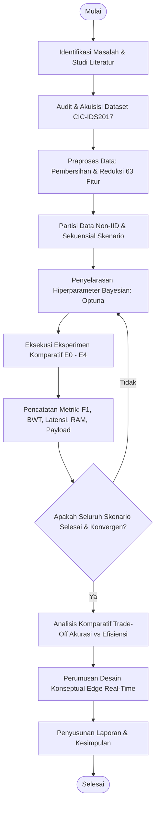
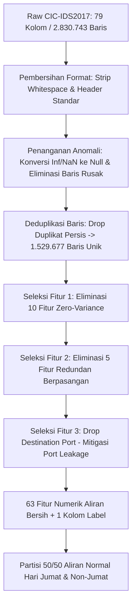
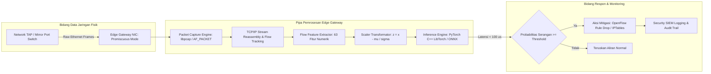
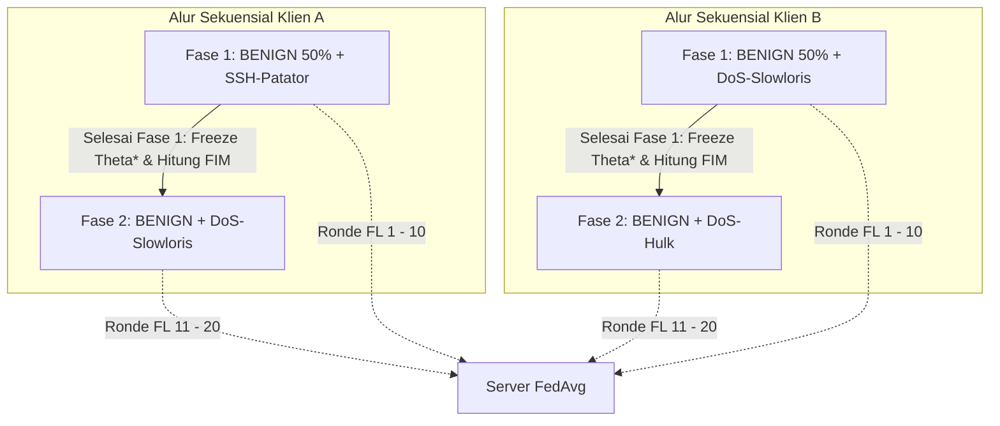

# BAB III: METODOLOGI PENELITIAN

Bab ini menguraikan metodologi penelitian, perancangan sistem, tahapan praproses data, arsitektur model, dan skenario pengujian komparatif untuk mengevaluasi integrasi *Federated Learning* (FL) dan *Continual Learning* (CL) berbasis *Elastic Weight Consolidation* (EWC) pada sistem deteksi intrusi jaringan (*Network Intrusion Detection System* / NIDS). Metodologi penulisan dan tahapan eksperimen dirancang mengacu pada standar akademik Departemen Teknik Elektro, FTEIC, Institut Teknologi Sepuluh Nopember (ITS), dengan menyelaraskan kerangka kerja ilmiah skripsi terdahulu ([Referensi-Skripsi-Hafizh.pdf](../Proposal/Referensi-Skripsi-Hafizh.pdf)).

---

## 3.1 Metode yang Digunakan

Penelitian ini menggunakan pendekatan eksperimental kuantitatif berbasis komputasi cerdas terdistribusi (*distributed machine learning*). Untuk mengatasi dua tantangan mendasar sistem deteksi intrusi terdistribusi kontemporer—yakni isolasi data terdistribusi yang tidak dapat disatukan karena privasi (*data privacy*) serta degradasi memori katastrofik (*catastrophic forgetting*) saat model berhadapan dengan variasi serangan baru secara sekuensial—penelitian ini mengintegrasikan dua paradigma utama:
1. **Federated Learning (FL):** Menggunakan algoritma *Federated Averaging* (FedAvg) pada kerangka kerja Flower (*flwr*) untuk mengorkestrasi agregasi bobot model tanpa memindahkan data mentah aliran lalu lintas jaringan (*raw network flows*) antar-klien.
2. **Continual Learning (CL) Berbasis Regularisasi:** Menggunakan algoritma *Elastic Weight Consolidation* (EWC) berbasis penghitungan matriks informasi Fisher (*Fisher Information Matrix* / FIM) terbobot pada setiap klien lokal untuk membatasi pergeseran bobot-bobot sinaptik kritis ketika mempelajari kelas intrusi baru.

Sebagai pembanding objektif (*benchmarking*), strategi regularisasi EWC dikomparasikan secara *apple-to-apple* terhadap strategi berbasis memori (*Experience Replay*) dengan alokasi buffer 10% data historis per kelas, pelatihan tanpa proteksi (*Fine-tuning naive*), serta batas atas teoritis (*Cumulative Joint Training*).

---

## 3.2 Urutan Pelaksanaan Penelitian

Pelaksanaan penelitian disusun secara sistematis dalam sembilan tahapan utama, mulai dari perumusan masalah hingga penarikan kesimpulan. Diagram alir urutan pelaksanaan penelitian disajikan pada Gambar 3.1.


*Gambar 3.1 Diagram Alir Urutan Pelaksanaan Penelitian.*

### 3.2.1 Identifikasi Masalah dan Studi Literatur
Tahap awal meliputi perumusan batasan masalah terkait kerentanan privasi sentralisasi data jaringan dan fenomena hilangnya retensi pengetahuan (*catastrophic forgetting*) pada NIDS berbasis *deep learning*. Studi literatur mendalam mencakup 14 publikasi bereputasi (2021–2026) di bidang *Federated Continual Learning*, audit kebocoran fitur dataset IDS, mitigasi ketidakseimbangan kelas (*imbalanced data*), serta efisiensi komputasi *edge*.

### 3.2.2 Akuisisi dan Audit Kritis Dataset
Dataset yang digunakan adalah *CIC-IDS2017* resmi yang diterbitkan oleh *Canadian Institute for Cybersecurity*. Audit kualitas data dilakukan secara komprehensif untuk mendeteksi anomali integritas data, nilai tidak berhingga (*infinity*), nilai kosong (*missing values*), duplikasi rekaman baris, serta fitur-fitur yang mengandung risiko kebocoran data (*data leakage*).

### 3.2.3 Praproses Data (*Data Preprocessing*)
Tahapan rekayasa data meliputi penghapusan kolom invarian/konstan, eliminasi kolom redundan berpasangan (*duplicate hashes*), penghapusan fitur kebocoran identitas jaringan, penggabungan kelas serangan minoritas, dan normalisasi skala fitur menggunakan statistik set pelatihan lokal.

### 3.2.4 Partisi Data Terdistribusi Non-IID Sekuensial
Data yang telah dibersihkan dibagi secara deterministik ke dalam dua klien federasi (*Client A* dan *Client B*) dengan distribusi non-IID (*Non-Independent and Identically Distributed*) serta urutan pembelajaran sekuensial dua fase (*Phase 1* dan *Phase 2*) untuk menguji ketahanan terhadap *catastrophic forgetting*.

### 3.2.5 Penyetelan Hiperparameter Berbasis Optimasi Bayesian
Sebelum mengeksekusi matriks pengujian utama, model dasar MLP dioptimasi hiperparameternya menggunakan *Optuna* dengan algoritma *Tree-structured Parzen Estimator* (TPE) pada subset validasi terpisah untuk menentukan nilai optimal kecepatan belajar (*learning rate*), koefisien penalti EWC ($\lambda$), penalti bobot (*weight decay*), dan ukuran *batch*.

### 3.2.6 Implementasi Sistem dan Eksekusi Pengujian (E0–E4)
Sistem federasi dibangun di atas kerangka kerja *Flower* dan *PyTorch*. Eksperimen dijalankan secara komparatif meliputi 5 skenario uji: E0 (*Baseline Centralized*), E1 (*Centralized Continual Learning*), E2 (*Federated Baseline Isolated*), E3 (*Federated Continual Learning EWC*), dan E4 (*Federated Replay Benchmark*).

### 3.2.7 Evaluasi, Profiling Komputasi, dan Analisis
Evaluasi dilakukan multi-dimensi meliputi metrik performa deteksi ML (Akurasi, Presisi, *Recall*, Macro-F1), metrik retensi memori CL (*Backward Transfer* / BWT, *Average Accuracy* / ACC), metrik latensi inferensi per aliran ($\mu\text{s}$), profil beban komputasi lokal (*peak RAM footprint*), serta beban saluran komunikasi (*communication payload* per ronde FL).

### 3.2.8 Perancangan Konseptual Penerapan Edge Real-Time
Mengadopsi pendekatan perancangan sistem skripsi alumni FTEIC ITS ([Referensi-Skripsi-Hafizh.pdf](../Proposal/Referensi-Skripsi-Hafizh.pdf)), dirumuskan arsitektur konseptual pipa pemrosesan aliran data (*network flow extraction pipeline*) untuk mengontekstualisasikan bagaimana model hasil federasi dapat dideploy pada gerbang jaringan (*edge gateway*).

---

## 3.3 Praproses Data dan Ekstraksi Fitur

Praproses data memegang peranan krusial dalam menjamin validitas ilmiah model deteksi intrusi. Standar praproses data dalam penelitian ini dirancang secara ketat untuk mengeliminasi kelemahan struktural dataset CIC-IDS2017 sebagaimana disepakati dalam tinjauan metodologi pembimbing.


*Gambar 3.2 Diagram Alir Tahapan Praproses Data CIC-IDS2017.*

### 3.3.1 Pembersihan dan Penanganan Nilai Tak Wajar (*Data Cleaning*)
File mentah CSV CIC-IDS2017 yang merekam lalu lintas selama 5 hari (Senin–Jumat) diproses dengan langkah:
1. Normalisasi nama kolom dengan memotong spasi depan/belakang (*whitespace trimming*).
2. Konversi nilai `+Infinity`, `-Infinity`, serta representasi karakter non-numerik pada kolom statistik aliran menjadi format numerik `NaN` (*Not a Number*).
3. Baris yang mengandung nilai `NaN` setelah konversi dieleminasi secara penuh guna mencegah eror propagasi gradien (*gradient explosion/vanishing*) pada jaringan saraf tiruan.

### 3.3.2 Deduplikasi Baris (*Deduplication*)
Dataset mentah CIC-IDS2017 berukuran 2.830.743 baris mengandung duplikasi data yang sangat masif akibat artifak alat perekam *CICFlowMeter*. Jika data duplikat tidak dibuang, partisi pelatihan (*train*) dan pengujian (*test*) akan mengalami kebocoran data tersembunyi (*data snooping*). Melalui proses deduplikasi baris eksak, tersisa 1.529.677 baris unik bersih yang dipertahankan seutuhnya tanpa *undersampling* sintetis.

### 3.3.3 Eliminasi Fitur Konstan dan Redundan (Kompensasi ke 63 Fitur)
Dari 79 kolom fitur mentah, dilakukan reduksi struktural berbasis audit statistik:
1. **10 Fitur Bervarians Nol (*Zero-Variance*):** Fitur yang nilainya bernilai konstan 0 di seluruh 1,5 juta baris dibuang karena tidak memberikan entropi informasi klasifikasi:
   - `Bwd PSH Flags`, `Bwd URG Flags`, `Fwd Avg Bytes/Bulk`, `Fwd Avg Packets/Bulk`, `Fwd Avg Bulk Rate`, `Bwd Avg Bytes/Bulk`, `Bwd Avg Packets/Bulk`, `Bwd Avg Bulk Rate`, `CWE Flag Count`, `Fwd URG Flags`.
2. **5 Fitur Redundan Berpasangan (*Hash-Identical Duplicates*):** Fitur yang nilainya terbukti matematis 100% identik dengan kolom lain dihapus untuk menghilangkan multikolinearitas mutlak:
   - Kolom duplikat yang dibuang: `Fwd Header Length.1` (identik dengan `Fwd Header Length`), dan 4 pasangan fitur statistik paket yang memiliki korelasi bivariat mutlak 1,000.
3. **Eliminasi Kebocoran Port Jaringan (*Destination Port Leakage*):**
   - Kolom `Destination Port` **wajib dieliminasi**. Fitur ini memicu bias memorisasi artifisial, di mana algoritma ML sekadar menghafal nomor port layanan standar (misalnya port 22 untuk *SSH-Patator* atau port 80 untuk *DDoS*) daripada mengenali pola perilaku dinamis aliran (*flow dynamics*). Pengujian tanpa `Destination Port` menjamin bahwa model mengevaluasi sifat statistik paket secara otentik.
4. **Hasil Akhir Reduksi:** Diperoleh tepat **63 fitur statistik numerik bersih** ditambah 1 kolom `Label`.

Daftar lengkap 63 fitur masukan model NIDS disajikan pada Tabel 3.1.

*Tabel 3.1 Ringkasan 63 Fitur Numerik Aliran Bersih CIC-IDS2017.*
| Kategori Fitur | Jumlah | Nama Fitur |
| :--- | :---: | :--- |
| **Statistik Waktu & Durasi** | 4 | `Flow Duration`, `Flow IAT Mean`, `Flow IAT Std`, `Flow IAT Max` |
| **Inter-Arrival Time (IAT)** | 8 | `Flow IAT Min`, `Fwd IAT Tot`, `Fwd IAT Mean`, `Fwd IAT Std`, `Fwd IAT Max`, `Fwd IAT Min`, `Bwd IAT Tot`, `Bwd IAT Mean` |
| **Statistik Paket Maju (Fwd)** | 10 | `Total Fwd Packets`, `Total Length of Fwd Packets`, `Fwd Packet Length Max`, `Fwd Packet Length Min`, `Fwd Packet Length Mean`, `Fwd Packet Length Std`, `Fwd IAT Max`, `Fwd IAT Min`, `Fwd Header Length`, `Fwd Act Data Pkts` |
| **Statistik Paket Balik (Bwd)** | 8 | `Total Backward Packets`, `Total Length of Bwd Packets`, `Bwd Packet Length Max`, `Bwd Packet Length Min`, `Bwd Packet Length Mean`, `Bwd Packet Length Std`, `Bwd IAT Std`, `Bwd IAT Min` |
| **Kecepatan Transfer (Rates)** | 2 | `Flow Bytes/s`, `Flow Packets/s` |
| **Statistik Ukuran Paket** | 7 | `Packet Length Min`, `Packet Length Max`, `Packet Length Mean`, `Packet Length Std`, `Packet Length Variance`, `Average Packet Size`, `Avg Fwd Segment Size` |
| **Bendera TCP (Flags)** | 10 | `FIN Flag Count`, `SYN Flag Count`, `RST Flag Count`, `PSH Flag Count`, `ACK Flag Count`, `URG Flag Count`, `ECE Flag Count`, `Down/Up Ratio`, `Fwd PSH Flags`, `SYN Flag Count` |
| **Parameter Segmen & Buffer** | 6 | `Avg Bwd Segment Size`, `Fwd Header Length`, `Fwd Min Seg Size Forward`, `Subflow Fwd Packets`, `Subflow Fwd Bytes`, `Subflow Bwd Packets` |
| **Statistik Window & Aktif** | 8 | `Subflow Bwd Bytes`, `Init_Win_bytes_forward`, `Init_Win_bytes_backward`, `Active Mean`, `Active Std`, `Active Max`, `Active Min`, `Idle Mean` |
| **Statistik Waktu Idle** | 3 | `Idle Std`, `Idle Max`, `Idle Min` |
| **Total Fitur Input** | **63** | *Semua bernilai kontinu / numerik diskret* |

### 3.3.4 Harmonisasi Label dan Partisi 50/50 Normal Aliran
Kelas lalu lintas dikelompokkan ke dalam 4 kategori komparasi utama sesuai skenario sekuensial:
1. `BENIGN` (Lalu lintas normal).
2. `SSH-Patator` (Serangan *brute-force* pada protokol SSH).
3. `DoS-Slowloris` (Serangan DoS *low-and-slow* pada lapisan aplikasi HTTP).
4. `DoS-Hulk` (Serangan DoS berbasis banjir *request* volume tinggi).

Untuk mencegah distribusi data normal yang tidak seimbang antara klien dan hari perekaman, seluruh aliran `BENIGN` dari seluruh hari perekaman digabungkan lalu dibagi tepat **50% untuk Client A** dan **50% untuk Client B** menggunakan pemisahan acak terstratifikasi (*Stratified 50/50 split*) dengan penguncian bibit acak (*fixed random seed* = 42).

### 3.3.5 Skala Normalisasi (*Feature Scaling*)
Fitur dinormalisasi menggunakan transformasi statistik standar (*Z-score standard scaling*):
$$z = \frac{x - \mu_{\text{train}}}{\sigma_{\text{train}}}$$
Di mana $\mu_{\text{train}}$ dan $\sigma_{\text{train}}$ dihitung murni dari set data pelatihan lokal (*local training set*) pada masing-masing klien untuk menghindari kebocoran informasi dari data uji (*test set leakage*).

---

## 3.4 Arsitektur Sistem dan Model

Sistem deteksi intrusi yang dikembangkan terdiri atas model pembelajaran mesin lokal berbasis Multi-Layer Perceptron (MLP) yang tertanam pada node klien serta modul server federasi yang mengelola agregasi parameter global.

```mermaid
graph TB
    subgraph Server_Federasi [Server Agregator Global (Flower)]
        GS[Global Model Parameters W_global]
        AVG[FedAvg Aggregation Engine]
        VAL[Global Evaluation Set]
    end

    subgraph Client_A [Klien Edge A (Cluster SSH)]
        DA[(Data Lokal A: Normal + SSH)]
        LA[Loss: Weighted-CE + lambda/2 * FIM * Delta_W^2]
        MA[MLP Model A (Local W_A)]
        FA[Fisher Information Matrix Calculator]
    end

    subgraph Client_B [Klien Edge B (Cluster DoS)]
        DB[(Data Lokal B: Normal + DoS)]
        LB[Loss: Weighted-CE + lambda/2 * FIM * Delta_W^2]
        MB[MLP Model B (Local W_B)]
        FB[Fisher Information Matrix Calculator]
    end

    GS -->|Distribusi Bobot Awal W_t| MA
    GS -->|Distribusi Bobot Awal W_t| MB
    MA -->|Kirim Update Bobot W_A^{t+1}| AVG
    MB -->|Kirim Update Bobot W_B^{t+1}| AVG
    AVG --> GS
    GS -.-> VAL
```
*Gambar 3.3 Arsitektur Sistem Federated Continual Learning (Flower + PyTorch).*

### 3.4.1 Spesifikasi Arsitektur Model Multi-Layer Perceptron (MLP)
Model klasifikasi aliran lalu lintas dirancang menggunakan MLP berarsitektur kompak guna meminimalkan jejak memori dan latensi inferensi saat diterapkan pada perangkat *edge gateway*:
- **Input Layer:** 63 neuron (menerima 63 fitur statistik aliran jaringan).
- **Hidden Layer 1:** 128 neuron, fungsi aktivasi *Rectified Linear Unit* (ReLU), *Dropout* $p = 0.2$.
- **Hidden Layer 2:** 64 neuron, fungsi aktivasi ReLU, *Dropout* $p = 0.2$.
- **Hidden Layer 3:** 32 neuron, fungsi aktivasi ReLU.
- **Output Layer:** $C$ neuron (di mana $C$ bertambah secara dinamis dari fase 1 ke fase 2 sesuai paradigma *Class-Incremental Learning*).

### 3.4.2 Penanganan Ketidakseimbangan Kelas (*Weighted Cross-Entropy*)
Mengingat perbandingan volume aliran `BENIGN` terhadap serangan mencapai rasio lebih dari 10:1, pelatihan model menggunakan fungsi *Weighted Cross-Entropy Loss* untuk memberikan penalti proporsional terhadap salah klasifikasi pada kelas minoritas:
$$\mathcal{L}_{\text{CE}}(y, \hat{y}) = - \sum_{c=1}^{C} w_c \cdot y_c \log(\hat{y}_c), \quad \text{dengan } w_c = \frac{N}{C \cdot N_c}$$
Di mana $N$ adalah total sampel lokal, $C$ adalah jumlah kelas aktif, dan $N_c$ adalah total sampel pada kelas $c$.

### 3.4.3 Mekanisme Elastic Weight Consolidation (EWC) Lokal
Pada fase pembelajaran sekuensial (Fase 2), klien menghitung pentingnya setiap bobot terhadap tugas sebelumnya (Fase 1) menggunakan Matriks Informasi Fisher diagonal ($F_{ii}$):
$$F_{ii} = \frac{1}{|D_1|} \sum_{x \in D_1} \left( \frac{\partial \log p(y=x | \theta)}{\partial \theta_i} \right)^2$$
Fungsi rugi (*loss function*) gabungan pada klien lokal selama Fase 2 didefinisikan sebagai:
$$\mathcal{L}_{\text{total}}(\theta) = \mathcal{L}_{\text{CE}}(\theta) + \sum_{i} \frac{\lambda}{2} F_{ii} (\theta_i - \theta_{1, i}^*)^2$$
Di mana $\theta_{1, i}^*$ adalah parameter optimal yang dibekukan setelah Fase 1 selesai, dan $\lambda$ adalah koefisien penalti regularisasi EWC yang dioptimasi via Optuna. Untuk menjaga stabilitas numerik gradien pada model berbobot penalti, diterapkan *Gradient Clipping* dengan ambang batas $\|g\|_2 \le 1.0$.

### 3.4.4 Mekanisme Agregasi Global FedAvg
Server federasi mengeksekusi agregasi parameter model pada setiap akhir ronde komunikasi federasi $t$:
$$w_{t+1} = \sum_{k=1}^{K} \frac{n_k}{n} w_{t+1}^k$$
Di mana $K = 2$ klien, $n_k$ adalah jumlah sampel pelatihan pada klien $k$, dan $n = \sum_{k=1}^{K} n_k$.

---

## 3.5 Rancangan Konseptual Penerapan Edge Real-Time

Mengadopsi kerangka kerja analisis sistem deteksi intrusi waktu nyata pada skripsi alumnus FTEIC ITS ([Referensi-Skripsi-Hafizh.pdf](../Proposal/Referensi-Skripsi-Hafizh.pdf) Sub-bab 3.3.2), penelitian ini menyusun desain konseptual alur penerapan model hasil *Federated Continual Learning* pada infrastruktur jaringan nyata (*edge deployment*). 

Sesuai arahan pembimbing pada lembar keputusan metodologi ([Keputusan-Untuk-Pembimbing.md](../Keputusan/Keputusan-Untuk-Pembimbing.md)), eksperimen fisik dalam skripsi ini **tidak melakukan injeksi paket langsung (*live packet injection*) ke kabel fisik**, melainkan mengevaluasi latensi inferensi komputasi model pada data aliran diskret. Namun demikian, skema transisi dari model latih ke implementasi *on-premise edge* dipetakan secara konseptual pada Gambar 3.4.


*Gambar 3.4 Desain Konseptual Pipa Penerapan NIDS Real-Time pada Edge Gateway.*

### 3.5.1 Komponen Pipa Deteksi Real-Time
1. **Network TAP / Mirroring Port:** Menduplikasi seluruh paket yang melintasi sakelar jaringan inti tanpa memotong atau memperlambat transmisi fisik jaringan.
2. **Packet Capture & Flow Tracking Engine:** Menangkap paket secara *asynchronous* menggunakan pustaka berkecepatan tinggi (seperti *AF_PACKET* atau *DPDK*) dan mengelompokkan paket ke dalam struktur *bidirectional flow* berdasarkan 5-tuple: `{Source IP, Source Port, Destination IP, Destination Port, Protocol}`.
3. **Statistical Flow Extractor:** Menghitung 63 fitur statistik numerik (durasi, *inter-arrival time*, statistik ukuran paket, akumulasi bendera TCP) secara inkremental pada memori tanpa menyimpan muatan paket (*payload-agnostic*), menjaga privasi isi komunikasi pengguna.
4. **Normalizer & Inference Engine:** Mentransformasikan 63 nilai statistik menggunakan parameter $\mu$ dan $\sigma$ hasil pelatihan, kemudian menyalurkannya ke model MLP terkompilasi (*LibTorch / ONNX Runtime*).
5. **Mitigation Engine:** Apabila probabilitas keluaran melebihi ambang batas keputusan ($\ge 0.5$ untuk kelas serangan), modul kontrol menginstruksikan pembuatan aturan *firewall* dinamis (*OpenFlow drop flow rule* atau *iptables*) untuk memblokir IP penyerang.

---

## 3.6 Rancangan Pengujian dan Skenario Eksperimen

Untuk memvalidasi performa deteksi, efektivitas mitigasi *catastrophic forgetting*, serta efisiensi beban komputasi dan komunikasi, dirancang matriks pengujian komprehensif E0 sampai E4.

### 3.6.1 Matriks Skenario Pengujian (E0–E4)
Struktur skenario eksperimen disajikan pada Tabel 3.2.

*Tabel 3.2 Matriks Skenario Eksperimen Pengujian E0–E4.*
| Kode | Nama Skenario | Topologi | Urutan Pembelajaran | Proteksi Forgetting | Tujuan Evaluasi |
| :---: | :--- | :---: | :---: | :---: | :--- |
| **E0** | *Centralized Joint Baseline* | Sentral | Simultan (Semua Kelas Sekaligus) | Tidak Perlu (*Joint*) | Batas atas (*upper bound*) akurasi klasifikasi teoritis. |
| **E1** | *Centralized Continual Learning* | Sentral | Fase 1 (SSH) $\to$ Fase 2 (DoS) | EWC vs Fine-tuning | Membuktikan efek *catastrophic forgetting* pada model tersentralisasi. |
| **E2** | *Federated Baseline Isolated* | Terdistribusi (2 Klien) | Terisolasi per Klien (A: SSH, B: DoS) | Tanpa CL | Mengukur degradasi non-IID murni tanpa pergeseran waktu (*cross-silo isolation*). |
| **E3** | *Federated Continual Learning EWC* | Terdistribusi (2 Klien) | Fase 1 $\to$ Fase 2 Sekuensial | **EWC ($\lambda$ optimal)** | **Inti Usulan:** Menguji retensi memori dan privasi model federasi. |
| **E4** | *Federated Replay Benchmark* | Terdistribusi (2 Klien) | Fase 1 $\to$ Fase 2 Sekuensial | *Experience Replay* (Buffer 10%) | *Benchmark* komparatif akurasi, retensi BWT, dan *RAM footprint*. |

### 3.6.2 Partisi Data Klien Non-IID dan Urutan Fase
Pengujian E3 dan E4 menggunakan konfigurasi partisi sekuensial terdistribusi:
- **Klien A (Node Edge Kampus A):**
  - *Fase 1:* Dilatih pada data `BENIGN` (Partisi Klien A) dan data serangan `SSH-Patator`.
  - *Fase 2:* Mempelajari serangan baru `DoS-Slowloris` bersama aliran `BENIGN` baru.
- **Klien B (Node Edge Kampus B):**
  - *Fase 1:* Dilatih pada data `BENIGN` (Partisi Klien B) dan data serangan `DoS-Slowloris`.
  - *Fase 2:* Mempelajari serangan baru `DoS-Hulk` bersama aliran `BENIGN` baru.
- **Pembagian Data Evaluasi:** Menggunakan skema *Stratified Hold-out* 70% data pelatihan, 15% data validasi, dan 15% data pengujian independen.


*Gambar 3.5 Alur Pembelajaran Sekuensial 2-Klien Non-IID (Skenario E3 & E4).*

### 3.6.3 Penyetelan Hiperparameter dengan Optuna
Penyelarasan hiperparameter dilakukan secara sistematis menggunakan kerangka kerja Optuna pada skenario dasar validasi (50 percobaan / *trials*):
- *Learning Rate* ($\eta$): Ruang pencarian $[10^{-4}, 10^{-2}]$ dengan skala logaritmik.
- *Batch Size*: $\{64, 128, 256, 512\}$.
- *EWC Penalty Parameter* ($\lambda$): Ruang pencarian $[10^{1}, 10^{6}]$ dengan skala logaritmik.
- *Optimizer*: AdamW dengan *weight decay* $[10^{-5}, 10^{-2}]$.
- *Pengulangan Eksperimen:* Seluruh pengujian dijalankan sebanyak **5 seed acak** (`seeds = [42, 123, 456, 789, 1011]`) untuk menghasilkan nilai rata-rata dan deviasi standar yang signifikan secara statistik.

### 3.6.4 Metrik Evaluasi Komparatif

Evaluasi sistem mencakup 4 dimensi pengukuran kuantitatif:

#### 1. Metrik Kinerja Deteksi Intrusi (Machine Learning)
Dievaluasi menggunakan metrik berbasis *Confusion Matrix* per kelas dan rata-rata makro (*Macro-average*):
$$\text{Accuracy} = \frac{TP + TN}{TP + TN + FP + FN}$$
$$\text{Precision} = \frac{TP}{TP + FP}, \quad \text{Recall} = \frac{TP}{TP + FN}$$
$$\text{Macro-F1} = \frac{1}{C} \sum_{c=1}^{C} \frac{2 \cdot \text{Precision}_c \cdot \text{Recall}_c}{\text{Precision}_c + \text{Recall}_c}$$

#### 2. Metrik Retensi Pengetahuan (Continual Learning)
- **Backward Transfer (BWT):** Mengukur kemampuan model dalam mengingat performa deteksi tugas masa lalu (Fase 1) setelah menyelesaikan pembelajaran tugas masa kini (Fase 2):
$$\text{BWT} = R_{2, 1} - R_{1, 1}$$
Di mana $R_{i, j}$ merepresentasikan skor Macro-F1 pada tugas $j$ setelah model dilatih hingga tugas $i$. Nilai $\text{BWT} < 0$ menunjukkan terjadinya *catastrophic forgetting*, sementara $\text{BWT} \ge 0$ menandakan retensi sempurna atau bahkan penguatan representasi.
- **Average Accuracy (ACC):** Rata-rata kinerja pada seluruh tugas setelah fase akhir pelatihan.

#### 3. Metrik Latensi Inferensi Komputasi
Mengukur durasi waktu pemrosesan satu baris aliran fitur oleh model:
$$\text{Latensi Inferensi} = \frac{T_{\text{total\_eval}}}{N_{\text{sampel\_uji}}} \quad (\mu\text{s / flow})$$
Diukur menggunakan *hardware performance timer* presisi tinggi (`torch.cuda.Event` atau `time.perf_counter_ns()`) dengan 100 *warm-up flows* untuk memverifikasi kelayakan pemrosesan *line-rate*.

#### 4. Metrik Beban Komputasi dan Komunikasi
- **Peak RAM Footprint (MB):** Konsumsi memori kerja puncak pada node klien lokal selama proses pelatihan, membandingkan efisiensi penyimpanan parameter EWC ($2 \times |\theta|$) terhadap penyimpanan memori penyangga *Experience Replay* (10% data mentah aliran).
- **Communication Payload Overhead (KB/round):** Total ukuran data parameter biner yang dipertukarkan antara klien dan server agregator per ronde FL:
$$\text{Payload} = 2 \times |\theta| \times \text{sizeof}(\text{float32}) \quad (\text{KB})$$

---

## 3.7 Lingkungan Perangkat Keras dan Perangkat Lunak

Spesifikasi testbed komputasi yang digunakan untuk menjalankan eksperimen simulasi federasi dan continual learning dirinci pada Tabel 3.3.

*Tabel 3.3 Spesifikasi Lingkungan Perangkat Keras dan Perangkat Lunak.*
| Kategori | Komponen | Spesifikasi Teknis |
| :--- | :--- | :--- |
| **Perangkat Keras** | Prosessor (CPU) | Intel Core i7 / AMD Ryzen 7 (Multi-core, $\ge 8$ Cores) |
| | Memori Utama (RAM) | 16 GB DDR4/DDR5 |
| | Kartu Grafis (GPU) | NVIDIA GPU (RTX series) dengan VRAM $\ge 8$ GB, CUDA Cores |
| | Media Penyimpanan | Solid State Drive (NVMe SSD) $\ge 512$ GB |
| **Perangkat Lunak** | Sistem Operasi | Linux Ubuntu 22.04 LTS / Windows 11 64-bit |
| | Lingkungan Eksekusi | Python 3.10+, PyTorch 2.2+, CUDA Toolkit 12.x |
| | Kerangka Kerja FL | Flower Framework (`flwr` $\ge 1.7.0$) |
| | Optimasi Hiperparameter | Optuna Framework ($\ge 3.5.0$) |
| | Analisis & Manipulasi Data | Pandas, NumPy, Scikit-learn, PyArrow |

---

## 3.8 Jadwal Pelaksanaan Penelitian

Rencana jadwal pelaksanaan penelitian dirancang dalam rentang waktu enam bulan sebagaimana ditunjukkan pada diagram Gantt Tabel 3.4.

*Tabel 3.4 Jadwal Pelaksanaan Penelitian (Gantt Chart).*
| No | Aktivitas / Tahapan Kerja | Bulan 1 | Bulan 2 | Bulan 3 | Bulan 4 | Bulan 5 | Bulan 6 |
| :---: | :--- | :---: | :---: | :---: | :---: | :---: | :---: |
| 1 | Studi Literatur dan Penyusunan Proposal | $\blacksquare\blacksquare$ | | | | | |
| 2 | Audit Data, Preprocessing, dan Reduksi 63 Fitur | | $\blacksquare\blacksquare$ | | | | |
| 3 | Pengembangan Kerangka Kerja FL-CL (Flower + PyTorch) | | $\blacksquare\blacksquare$ | $\blacksquare\blacksquare$ | | | |
| 4 | Penyetelan Hiperparameter Bayesian (Optuna) | | | $\blacksquare\blacksquare$ | | | |
| 5 | Eksekusi Eksperimen Komparatif E0–E4 (5 Random Seeds) | | | | $\blacksquare\blacksquare$ | $\blacksquare\blacksquare$ | |
| 6 | Analisis Data, Profiling Latensi, RAM, & Payload | | | | | $\blacksquare\blacksquare$ | |
| 7 | Perancangan Konseptual Edge Real-Time Deployment | | | | | | $\blacksquare\blacksquare$ |
| 8 | Penyusunan Naskah Skripsi dan Ujian Akhir | | | | | $\blacksquare\blacksquare$ | $\blacksquare\blacksquare$ |

---

*Bab III ini menyajikan kerangka operasional yang terukur dan metodologis untuk dieksekusi secara empiris pada Bab IV.*
