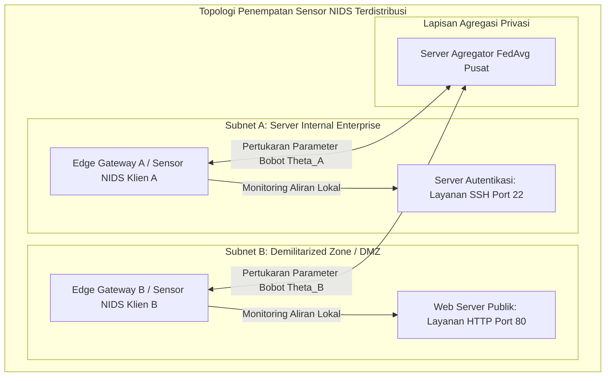
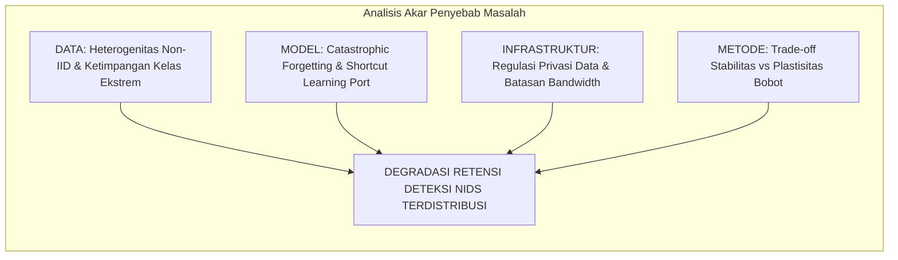
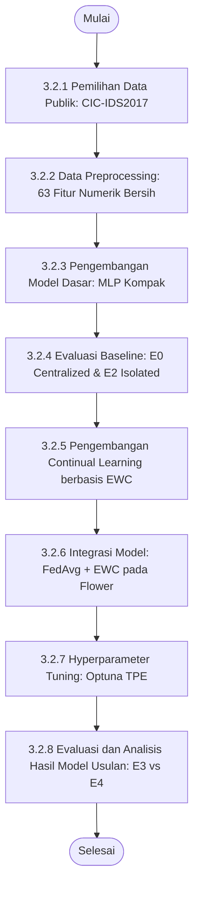
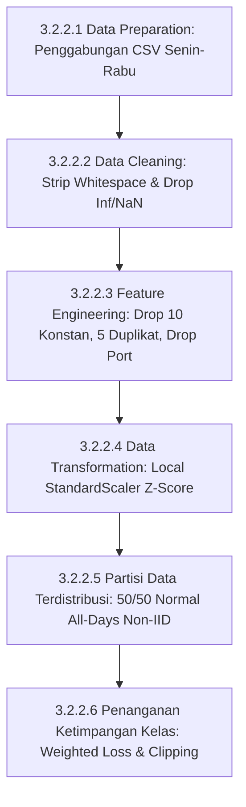
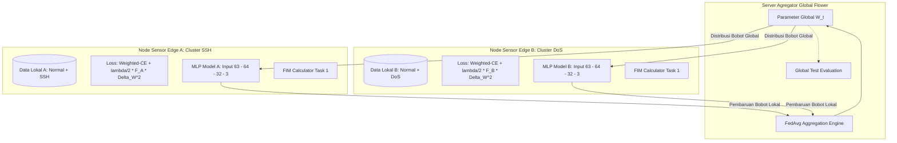
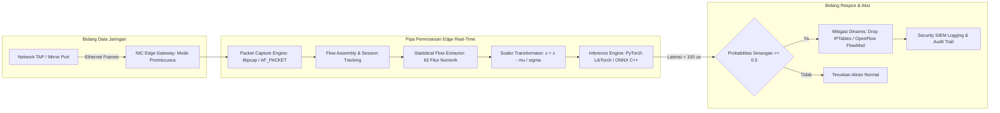
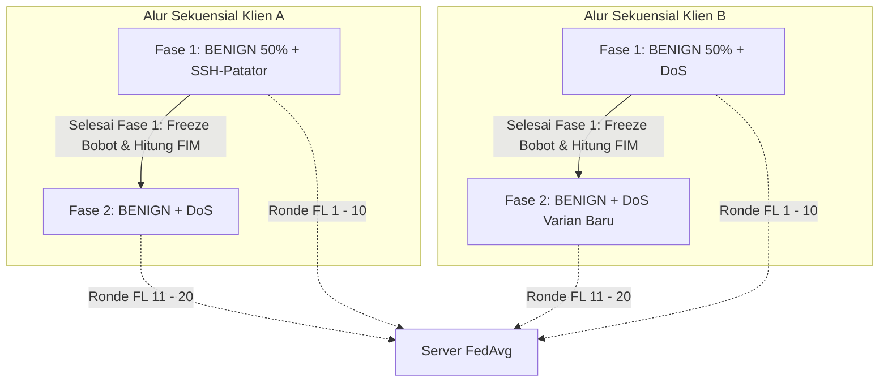

# BAB 3 METODOLOGI

Bab ini menguraikan metodologi penelitian, alur pelaksanaan, tahapan praproses data, arsitektur model, dan skenario pengujian komparatif untuk mengevaluasi integrasi *Federated Learning* (FL) dan *Continual Learning* (CL) berbasis *Elastic Weight Consolidation* (EWC) pada sistem deteksi intrusi jaringan (*Network Intrusion Detection System* / NIDS). Struktur penyusunan bab ini diselaraskan secara penuh dengan format skripsi Departemen Teknik Elektro, FTEIC, Institut Teknologi Sepuluh Nopember (ITS) mengacu pada rujukan skripsi alumnus ([Referensi-Skripsi-Hafizh.pdf](../Proposal/Referensi-Skripsi-Hafizh.pdf)).

---

## 3.1 Metode yang digunakan

Penelitian ini mengembangkan sistem deteksi intrusi jaringan terdistribusi dan adaptif berbasis *Federated Continual Learning* (FCL) yang menggabungkan algoritma *Federated Averaging* (FedAvg) dan regularisasi *Elastic Weight Consolidation* (EWC) dengan arsitektur *Multilayer Perceptron* (MLP) kompak untuk mengatasi degradasi memori katastrofik (*catastrophic forgetting*) pada kondisi data heterogen (*non-IID*) dan aliran serangan yang muncul secara sekuensial. Metodologi ini dirancang secara khusus untuk mengatasi dua dilema utama dalam keamanan siber modern:
1. **Dilema Privasi dan Isolasi Data:** Keharusan menjaga kerahasiaan data lalu lintas internal tanpa memindahkan rekaman paket mentah ke server eksternal, yang diselesaikan melalui paradigma *Federated Learning*.
2. **Dilema Stabilitas vs Plastisitas (*Stability-Plasticity Dilemma*):** Kecenderungan jaringan saraf tiruan untuk menimpa representasi serangan lama saat mempelajari serangan baru secara berkelanjutan, yang diselesaikan melalui regularisasi penalti kuadratik EWC berbasis Matriks Informasi Fisher diagonal tanpa memerlukan memori penyangga (*replay buffer*).

*Gambar 3.1 Arsitektur Penempatan Sensor NIDS Terdistribusi dalam Jaringan Enterprise.*

Untuk mengidentifikasi akar penyebab kegagalan NIDS terdistribusi dan merumuskan solusi teknis yang sistematis, disusun diagram sebab-akibat (*Fishbone Diagram*) sebagaimana diilustrasikan pada Gambar 3.2.

*Gambar 3.2 Fishbone Diagram Identifikasi Tantangan NIDS Terdistribusi.*

---

## 3.2 Urutan pelaksanaan penelitian

Alur urutan pelaksanaan penelitian disusun ke dalam tahapan yang sistematis dan terstruktur mulai dari pemilihan data hingga analisis hasil akhir, sebagaimana disajikan pada diagram alir Gambar 3.3.

*Gambar 3.3 Diagram Alir Urutan Pelaksanaan Penelitian.*

### 3.2.1 Pemilihan Data Publik
Dataset yang dipilih adalah **CIC-IDS2017** resmi dari Canadian Institute for Cybersecurity. Pemilihan ini didasarkan pada representasi lalu lintas jaringan nyata yang mencakup aktivitas normal serta serangan eksploitasi multi-tahap. Berkas yang digunakan secara spesifik adalah hari Senin (*Monday*), Selasa (*Tuesday*), dan Rabu (*Wednesday*). Berkas hari Kamis dieksklusi karena menderita desinkronisasi timestamp pelabelan yang parah serta kelangkaan sampel mikro ekstrem (Rosay et al., 2022; Dube et al., 2024).

### 3.2.2 Data Preprocessing
Tahapan praproses data dirancang secara ketat untuk mentransformasikan data mentah menjadi format masukan yang bersih, representatif, dan bebas bias *shortcut learning*.

*Gambar 3.4 Diagram Alur Global Data Preprocessing.*

#### 3.2.2.1 Data Preparation
Berkas CSV mentah dari hari Senin (lalu lintas normal penuh), Selasa (serangan SSH-Patator), dan Rabu (serangan DoS Slowloris, Slowhttptest, Hulk, GoldenEye) diakuisisi dan divalidasi integritas strukturnya.

#### 3.2.2.2 Data Cleaning
Nama kolom distandarisasi dengan menghapus spasi awal/akhir (*whitespace trimming*). Seluruh nilai `+Infinity`, `-Infinity`, dan nilai kosong dikonversi ke format numerik `NaN` lalu baris yang memuat nilai tidak valid tersebut dihapus. Sebanyak 132.909 baris data duplikat identik dieliminasi secara penuh sehingga tersisa **1.529.677 baris aliran unik bersih**.

#### 3.2.2.3 Feature Engineering
Dari 79 kolom mentah, dilakukan eliminasi fitur:
1. **10 Fitur Zero-Variance:** Kolom bernilai konstan 0 (`Bwd PSH Flags`, `Bwd URG Flags`, `Fwd Avg Bytes/Bulk`, `Fwd Avg Packets/Bulk`, `Fwd Avg Bulk Rate`, `Bwd Avg Bytes/Bulk`, `Bwd Avg Packets/Bulk`, `Bwd Avg Bulk Rate`, `CWE Flag Count`, `Fwd URG Flags`) dieliminasi.
2. **5 Kolom Duplikat via Hash:** Kolom yang 100% identik seperti `Fwd Header Length.1` dibuang guna mengeliminasi multikolinearitas mutlak.
3. **Eliminasi Destination Port:** Fitur `Destination Port` **secara sengaja dibuang** untuk memitigasi bias *port leakage* dan memaksa model mempelajari karakteristik statistik paket murni (Engelen et al., 2021).  
Hasil akhir menghasilkan **63 fitur statistik numerik bersih** ditambah 1 label.

#### 3.2.2.4 Data Transformation
Fitur numerik diskalakan menggunakan transformasi statistik Z-score standar:
$$z = \frac{x - \mu_{\text{train}}}{\sigma_{\text{train}}}$$
Parameter rata-rata ($\mu_{\text{train}}$) dan deviasi standar ($\sigma_{\text{train}}$) dihitung murni dari set data pelatihan lokal pada masing-masing klien untuk mencegah kebocoran data uji (*test leakage*).

#### 3.2.2.5 Partisi Data Terdistribusi Non-IID
Untuk memodelkan heterogenitas jaringan enterprise:
- Seluruh aliran `BENIGN` dari seluruh hari digabungkan lalu dibagi acak tepat **50% untuk Klien A** dan **50% untuk Klien B** (*stratified split*) guna mencegah bias hari perekaman (*day-of-week confound*).
- **Klien A:** Mempelajari Task 1 (Normal + 100% data serangan SSH-Patator).
- **Klien B:** Mempelajari Task 2 (Normal + 100% data serangan DoS).
- Pembagian data internal per klien menggunakan rasio 70% pelatihan, 15% validasi, dan 15% pengujian.

#### 3.2.2.6 Penanganan Ketimpangan Kelas
Mengingat perbandingan volume aliran Normal (1.332.710 aliran) terhadap SSH-Patator (3.219 aliran) mencapai $\approx 414 : 1$, fungsi kerugian menggunakan **Weighted Cross-Entropy Loss** berbasis invers frekuensi kelas terkalibrasi, disertai pemotongan gradien (*Gradient Clipping*) dengan ambang norm $\le 1.0$ untuk menjamin kestabilan konvergensi numerik.

### 3.2.3 Pengembangan Model Dasar
Model dasar dirancang menggunakan arsitektur *Multilayer Perceptron* (MLP) kompak tiga lapis terhubung penuh (`Input(63) → Linear(64) → ReLU → Linear(32) → ReLU → Linear(3)`). Model ini diimplementasikan menggunakan PyTorch dengan total 6.275 parameter terbobot.

### 3.2.4 Evaluasi Baseline
Evaluasi model dasar dilakukan melalui dua skenario fondasi:
1. **Skenario E0 (Centralized Joint Training):** Model dilatih secara terpusat menggunakan seluruh data gabungan sekaligus sebagai batas atas teoretis (*upper bound*).
2. **Skenario E2 (Federated Baseline Isolated):** Model dilatih menggunakan FedAvg standar pada klien yang terisolasi untuk mengukur dampak degradasi non-IID murni tanpa pergeseran waktu.

### 3.2.5 Pengembangan Continual Learning berbasis EWC
Metode mitigasi *catastrophic forgetting* dikembangkan dengan menyematkan modul kalkulasi **Matriks Informasi Fisher (FIM) diagonal** pada klien lokal. Setelah menyelesaikan pelatihan Task 1, klien menghitung nilai sensitivitas setiap parameter bobot $\theta_i$ terhadap data Task 1, membekukan parameter referensi $\theta_1^*$, dan menambahkan suku penalti kuadratik $\frac{\lambda}{2} \sum_i F_i (\theta_i - \theta_{1, i}^*)^2$ pada fungsi kerugian selama pelatihan Task 2.

### 3.2.6 Integrasi Model
Model lokal PyTorch dengan penalti EWC diintegrasikan ke dalam kerangka kerja *Flower* (`flwr`). Klien mengeksekusi pelatihan lokal dan mengembalikan bobot terbarui ke server agregator yang menjalankan strategi *Federated Averaging* (FedAvg) pada setiap ronde komunikasi.

### 3.2.7 Hyperparameter Tuning
Penyelarasan parameter kunci model dan federasi dioptimasi menggunakan kerangka kerja **Optuna** berbasis algoritma *Tree-structured Parzen Estimator* (TPE) pada subset data validasi terpisah. Parameter yang diselaraskan meliputi laju pembelajaran ($\eta \in [10^{-4}, 10^{-2}]$), koefisien penalti EWC ($\lambda \in [10^2, 10^6]$), ukuran *batch* ($B \in [64, 256]$), dan jumlah epoch lokal ($E \in [1, 5]$).

### 3.2.8 Evaluasi dan Analisis Hasil Model Usulan
Model usulan (Skenario E3: FedAvg + EWC) dievaluasi kinerjanya dan dikomparasikan secara *apple-to-apple* terhadap tolok ukur berbasis memori (Skenario E4: FedAvg + Experience Replay buffer 10%) serta model tanpa proteksi (*naive fine-tuning*). Evaluasi dijalankan melintasi lima *random seed* independen (42, 43, 44, 45, 46) untuk membuktikan signifikansi statistik.

---

## 3.3 Aristektur Sistem yang Diusulkan

### 3.3.1 Arsitektur Model yang Diimplementasikan
Arsitektur sistem yang diimplementasikan memadukan orkestrasi federasi global dan mekanisme perlindungan memori lokal pada klien, sebagaimana diilustrasikan pada Gambar 3.5.

*Gambar 3.5 Arsitektur Sistem Federated Continual Learning yang Diimplementasikan.*

### 3.3.2 Rancangan Sistem untuk Penerapan Real-Time
Mengadopsi kerangka kerja analisis sistem deteksi intrusi waktu nyata pada skripsi alumnus FTEIC ITS ([Referensi-Skripsi-Hafizh.pdf](../Proposal/Referensi-Skripsi-Hafizh.pdf) Sub-bab 3.3.2), disusun rancangan konseptual alur penerapan model hasil *Federated Continual Learning* pada infrastruktur gerbang jaringan nyata (*edge gateway deployment*), sebagaimana disajikan pada Gambar 3.6.

Sesuai komitmen batasan masalah, eksperimen fisik dalam tugas akhir ini **tidak melakukan injeksi paket langsung (*live packet injection*) ke kabel fisik**, melainkan memetakan arsitektur pipa pemrosesan sebagai landasan transisi dari model teruji ke penerapan lapangan.

*Gambar 3.6 Rancangan Sistem Konseptual untuk Penerapan Real-Time pada Edge Gateway.*

---

## 3.4 Rancangan Pengujian

### 3.4.1 Setup Pengujian
Pengujian dijalankan pada lingkungan komputasi dengan spesifikasi:
- **Perangkat Keras:** Prosessor Intel Core i7 / AMD Ryzen (Multi-core $\ge 8$ core), RAM 16 GB DDR4/DDR5, GPU NVIDIA (VRAM $\ge 8$ GB dengan dukungan CUDA Cores), dan penyimpanan NVMe SSD $\ge 512$ GB.
- **Perangkat Lunak:** Sistem Operasi Linux Ubuntu 22.04 LTS / Windows 11 64-bit, Python 3.10+, PyTorch 2.2+, CUDA Toolkit 12.x, Flower Framework (`flwr` $\ge 1.7.0$), Optuna ($\ge 3.5.0$), Pandas, NumPy, dan Scikit-learn.

### 3.4.2 Skenario Pengujian
Matriks pengujian komparatif dirancang mencakup lima skenario utama (E0 s.d. E4), sebagaimana disajikan pada Tabel 3.1.

*Tabel 3.1 Matriks Skenario Pengujian Eksperimen E0–E4.*
| Skenario | Topologi Pelatihan | Urutan Pembelajaran | Metode Mitigasi Forgetting | Tujuan Pengujian |
| :---: | :--- | :--- | :--- | :--- |
| **E0** | Sentralisasi Penuh | Simultan (Task 1 & Task 2 Bersama) | Tidak Perlu (*Joint*) | Batas atas (*upper bound*) performa model teoretis. |
| **E1** | Sentralisasi Penuh | Sekuensial (Task 1 $\to$ Task 2) | EWC vs Fine-tuning | Membuktikan fenomena *catastrophic forgetting* pada model sentral. |
| **E2** | Federated (2 Klien) | Terisolasi per Klien | Tanpa Proteksi CL | Mengukur dampak murni heterogenitas non-IID (*cross-silo isolation*). |
| **E3** | **Federated (2 Klien)** | **Sekuensial (Task 1 $\to$ Task 2)** | **EWC ($\lambda$ Optimal)** | **Inti Usulan:** Menguji retensi memori dan privasi model federasi. |
| **E4** | Federated (2 Klien) | Sekuensial (Task 1 $\to$ Task 2) | *Experience Replay* (Buffer 10%) | Pembanding *benchmark* akurasi, retensi BWT, dan alokasi memori RAM. |

*Gambar 3.7 Diagram Alir Skenario Pengujian Sekuensial Non-IID.*

### 3.4.3 Mekansime Pengujian

#### 3.4.3.1 Mekanisme Evaluasi Model
Setiap skenario dievaluasi melintasi lima *random seed* (42, 43, 44, 45, 46) menggunakan metrik:
1. **Performa Deteksi ML:** Macro-F1, per-class Precision, Recall, dan Akurasi dievaluasi pada *test set* independen di akhir setiap fase.
2. **Retensi Continual Learning:** Metrik *Backward Transfer* (BWT) dihitung untuk mengukur degradasi memori: $\text{BWT} = R_{2, 1} - R_{1, 1}$.
3. **Efisiensi Komputasi & Instance:**
   - *Inference Time:* Rata-rata durasi prediksi per aliran data dalam mikrodetik ($\mu\text{s/flow}$) menggunakan timer presisi tinggi (`time.perf_counter_ns()`).
   - *Memory Footprint:* Alokasi RAM fisik puncak (*peak RAM usage*) selama fase pelatihan dan penyimpanan parameter.
   - *Communication Payload:* Total ukuran data parameter biner yang dikirimkan per ronde federasi ($2 \times |\theta| \times 4$ bita $\approx 50,2$ KB/ronde).

#### 3.4.3.2 Mekanisme Evaluasi Hyperparameter Tuning
Evaluasi penyetelan hiperparameter dijalankan melalui 50 *trials* Optuna dengan fungsi objektif memaksimalkan rata-rata Macro-F1 pada subset validasi, menyeimbangkan trade-off antara plastisitas pembelajaran tugas baru dan stabilitas memori tugas lama melalui penyesuaian koefisien $\lambda$.

---

## 3.5 Jadwal Pelaksanaan Penelitian

Rencana pelaksanaan penelitian dijadwalkan dalam durasi enam bulan sebagaimana dirangkum pada diagram Gantt Tabel 3.2.

*Tabel 3.2 Jadwal Pelaksanaan Penelitian (Gantt Chart).*
| No | Aktivitas / Tahapan Kerja | Bulan 1 | Bulan 2 | Bulan 3 | Bulan 4 | Bulan 5 | Bulan 6 |
| :---: | :--- | :---: | :---: | :---: | :---: | :---: | :---: |
| 1 | Studi Literatur dan Penyusunan Proposal | $\blacksquare\blacksquare$ | | | | | |
| 2 | Pemilihan Data Publik, Audit, dan Preprocessing 63 Fitur | | $\blacksquare\blacksquare$ | | | | |
| 3 | Pengembangan Model Dasar MLP dan Lingkungan FL Flower | | $\blacksquare\blacksquare$ | $\blacksquare\blacksquare$ | | | |
| 4 | Penyetelan Hiperparameter Bayesian (Optuna) | | | $\blacksquare\blacksquare$ | | | |
| 5 | Eksekusi Eksperimen Komparatif E0–E4 (5 Random Seeds) | | | | $\blacksquare\blacksquare$ | $\blacksquare\blacksquare$ | |
| 6 | Evaluasi Metrik BWT, Latensi Inferensi, RAM, & Payload | | | | | $\blacksquare\blacksquare$ | |
| 7 | Perancangan Konseptual Edge Real-Time Deployment | | | | | | $\blacksquare\blacksquare$ |
| 8 | Penyusunan Naskah Buku Skripsi dan Ujian Sidang Akhir | | | | | $\blacksquare\blacksquare$ | $\blacksquare\blacksquare$ |
