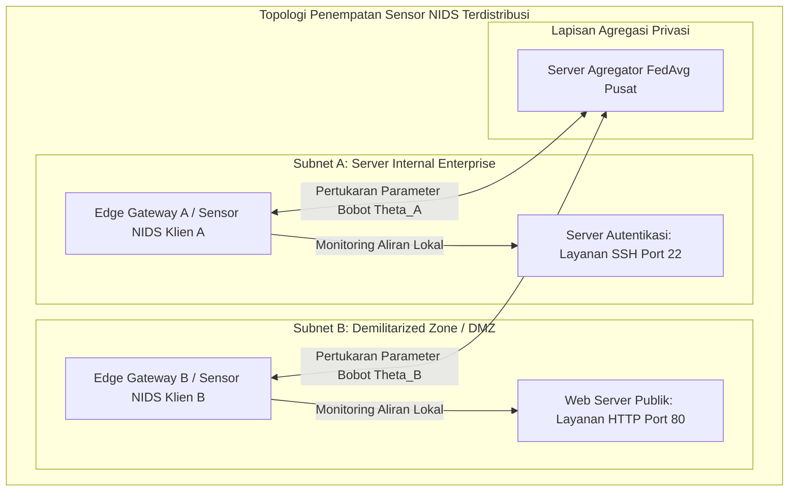
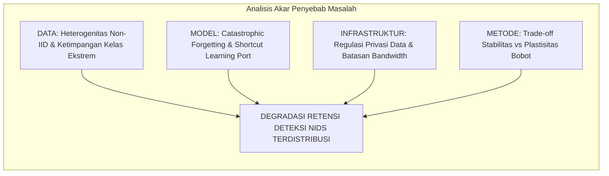
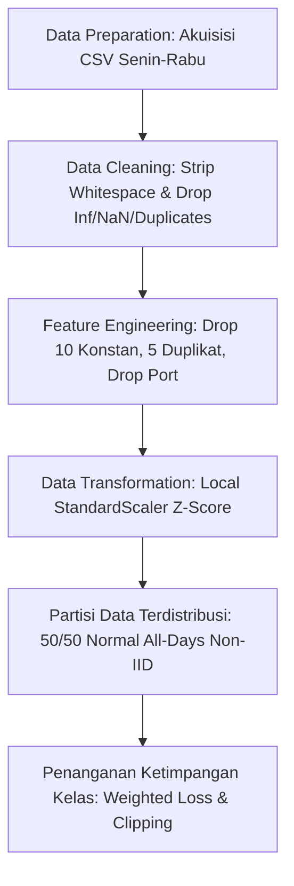
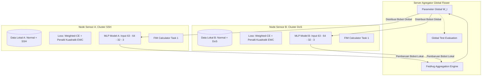
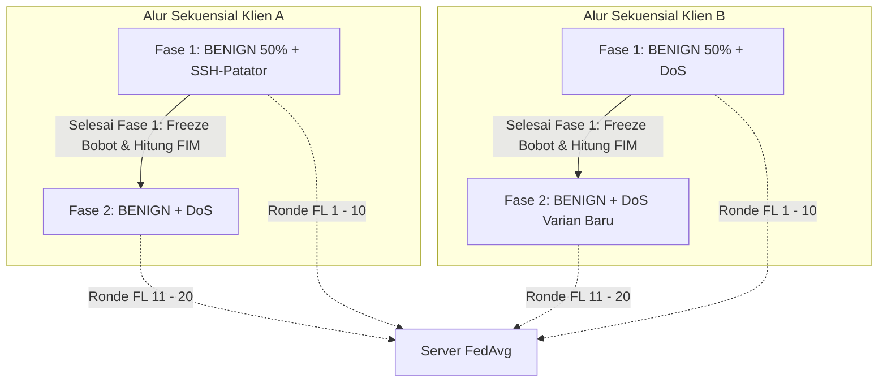

# BAB 3 METODOLOGI

Bab ini menguraikan metode yang digunakan, bahan dan peralatan penelitian, alur urutan pelaksanaan penelitian, tahapan praproses data, arsitektur sistem terdistribusi yang diusulkan, penyetelan hiperparameter Bayesian, matriks skenario pengujian komparatif, mekanisme evaluasi, dan jadwal pelaksanaan kegiatan penelitian. Penelitian ini berfokus pada evaluasi integrasi *Federated Learning* (FL) dan *Continual Learning* (CL) berbasis *Elastic Weight Consolidation* (EWC) pada sistem deteksi intrusi jaringan (*Network Intrusion Detection System* / NIDS). Struktur penyusunan bab ini diselaraskan secara penuh dengan format Buku Pedoman Penyusunan Laporan Tugas/Proyek Akhir Program Sarjana dan Sarjana Terapan Departemen Teknik Elektro, FTEIC, Institut Teknologi Sepuluh Nopember (ITS) berdasarkan SK Rektor No. 280/IT2/T/HK.00.01/2022 serta rujukan tugas akhir alumnus Departemen Teknik Elektro FTEIC ITS ([Referensi-Skripsi-Hafizh.pdf](../Proposal/Referensi-Skripsi-Hafizh.pdf))[8].

---

## 3.1 Metode yang Digunakan

Penelitian ini mengembangkan sistem deteksi intrusi jaringan terdistribusi dan adaptif berbasis *Federated Continual Learning* (FCL) yang menggabungkan algoritma *Federated Averaging* (FedAvg)[3] dan regularisasi *Elastic Weight Consolidation* (EWC)[5] dengan arsitektur *Multilayer Perceptron* (MLP) kompak untuk mengatasi degradasi memori katastrofik (*catastrophic forgetting*) pada kondisi data heterogen (*non-IID*) dan aliran serangan yang muncul secara sekuensial. Metodologi ini dirancang secara khusus untuk mengatasi dua dilema utama dalam keamanan siber modern:
1. **Dilema Privasi dan Isolasi Data:** Keharusan menjaga kerahasiaan data lalu lintas internal tanpa memindahkan rekaman paket mentah ke server eksternal, yang diselesaikan melalui paradigma *Federated Learning*.
2. **Dilema Stabilitas vs Plastisitas (*Stability-Plasticity Dilemma*):** Kecenderungan jaringan saraf tiruan untuk menimpa representasi serangan lama saat mempelajari serangan baru secara berkelanjutan, yang diselesaikan melalui regularisasi penalti kuadratik EWC berbasis Matriks Informasi Fisher diagonal tanpa memerlukan memori penyangga (*replay buffer*).


*Gambar 3.1 Arsitektur Penempatan Sensor NIDS Terdistribusi dalam Jaringan Enterprise.*

Untuk mengidentifikasi akar penyebab kegagalan NIDS terdistribusi dan merumuskan solusi teknis yang sistematis, disusun diagram sebab-akibat (*Fishbone Diagram*) sebagaimana diilustrasikan pada Gambar 3.2.


*Gambar 3.2 Fishbone Diagram Identifikasi Tantangan NIDS Terdistribusi.*

---

## 3.2 Bahan dan Peralatan yang Digunakan

### 3.2.1 Bahan Penelitian (Dataset Publik CIC-IDS2017)
Bahan utama yang digunakan dalam penelitian ini adalah dataset tolok ukur resmi **CIC-IDS2017** dari Canadian Institute for Cybersecurity[9]. Data merekam lalu lintas jaringan nyata selama lima hari kerja (Senin s.d. Jumat). Berkas yang digunakan secara spesifik adalah:
1. `Monday-WorkingHours.pcap_ISCX.csv`: 529.918 baris lalu lintas normal murni (BENIGN).
2. `Tuesday-WorkingHours.pcap_ISCX.csv`: 445.909 baris memuat serangan penetrasi autentikasi SSH (*SSH-Patator*).
3. `Wednesday-workingHours.pcap_ISCX.csv`: 692.703 baris memuat serangan *Denial of Service* (DoS Hulk, GoldenEye, slowloris, slowhttptest).

Berkas hari Kamis dan Jumat dieksklusi karena menderita desinkronisasi timestamp pelabelan yang parah serta kelangkaan sampel mikro ekstrem[6], [7].

### 3.2.2 Peralatan Penelitian (Perangkat Keras dan Perangkat Lunak)
Pengujian dan evaluasi performa sistem dalam penelitian ini dirancang melalui strategi evaluasi dua tahap progresif (*two-stage progressive evaluation strategy*):
1. **Tahap 1: Pengujian dan Validasi Simulasi Lokal (*Local Simulation and Algorithm Verification*):** Dilaksanakan langsung pada mesin laptop pengembang untuk memvalidasi fungsionalitas algoritma, prapengolahan 63 fitur numerik bersih, simulasi multi-klien secara *in-memory* menggunakan Flower *Virtual Client Engine*, penalaan hiperparameter Bayesian EWC ($\lambda$) via Optuna TPE, serta memastikan stabilitas gradien dan konvergensi model sebelum diimplementasikan pada klaster server fisik.
2. **Tahap 2: Pengujian Implementasi Testbed Terdistribusi (*Distributed Private Cloud Server Testbed*):** Dilaksanakan pada klaster *private cloud* Proxmox Virtual Environment (PVE) 3-node *bare-metal* yang mengadopsi arsitektur dari repositori proyek FCL (`E:/projects/fcl`). Mengacu pada batasan masalah dan kesepakatan ruang lingkup penelitian pada dokumen acuan tugas akhir ([Briefing-Scope-TA.md](../Proposal/Briefing-Scope-TA.md)), implementasi testbed server **secara khusus hanya menggunakan tiga (3) instans mesin virtual/kontainer inti**, yaitu satu Server Agregator dan dua Klien Terdistribusi, dengan **mengesampingkan mesin pembangkit lalu lintas (*traffic generator* VM 400) maupun host target (*target hosts* VM 311 dan VM 321)**. Peniadaan injeksi lalu lintas aktif dan penangkapan paket waktu nyata (*live sniffing*) bertujuan mengeliminasi faktor pengganggu (*confounding variables*) seperti hilangnya paket (*packet drops*), *buffer overrun*, dan fluktuasi latensi (*jitter*), sehingga seluruh node klien membaca data partisi tabular CIC-IDS2017 bersih langsung dari media penyimpanan lokal masing-masing secara terisolasi dan deterministik.

Rincian spesifikasi perangkat keras dan perangkat lunak untuk kedua lingkungan pengujian tersebut disajikan pada Tabel 3.1.

*Tabel 3.1 Spesifikasi Lingkungan Perangkat Keras dan Perangkat Lunak.*

| Lingkungan / Node | Komponen | Spesifikasi Teknis | Peran dan Fungsi Utama |
| :--- | :--- | :--- | :--- |
| **A. Lingkungan Pengujian Lokal (Laptop Pengembang)** | Unit Perangkat | Laptop Fisik Pengembang | *Development*, validasi unit, dan simulasi algoritma awal |
| | Prosesor (CPU) | Intel® Core™ i5-8350U @ 1.70 GHz (4 Cores, 8 Threads, Turbo 3.60 GHz, 6 MB Cache) | Komputasi pelatihan lokal dan kalkulasi FIM berbasis CPU (AVX2) |
| | Memori Utama (RAM) | 16 GB DDR4 (15.84 GB usable, 2400 MHz) | Penyimpanan data latih in-memory dan eksekusi virtual client FL |
| | Kartu Grafis (GPU) | Intel® UHD Graphics 620 (Shared memory) | Rendering visualisasi metrik dan evaluasi grafik analitik |
| | Media Penyimpanan | 512 GB NVMe M.2 SSD | Penyimpanan lokal repositori kode, cache CSV, dan checkpoint |
| | Sistem Operasi | Microsoft Windows 11 Pro 64-bit (Build 26100) | Sistem operasi host pengembangan |
| | Lingkungan & Runtime | Python 3.10+ / 3.13 dalam Virtual Environment (`venv`) | Eksekusi skrip praproses, pemodelan PyTorch, dan optimasi |
| | Kerangka Kerja DL & FL | PyTorch 2.2+ (CPU engine), Flower (`flwr` $\ge 1.7.0$)[18] | Pembangun arsitektur MLP dan simulasi federasi in-process |
| | Penyetelan Bayesian | Optuna Framework ($\ge 3.5.0$)[19] | Optimasi hiperparameter $\lambda$ EWC dan laju pembelajaran |
| | Pustaka Analisis Data | Pandas, NumPy, Scikit-learn, Matplotlib, Seaborn | Pembersihan data, scaling Z-score, dan kalkulasi metrik evaluasi |
| **B. Lingkungan Testbed Private Cloud Server (Proxmox VE Cluster)** | Infrastruktur Fisik Klaster (*Bare-Metal*) | 3 Node Server Fisik: 2x Dell PowerEdge R630 (node `its` & `node2`) dan 1x Dell PowerEdge R760xs (node `pve`) | Penyedia komputasi tervirtualisasi multi-node terdistribusi |
| | Pengendali Penyimpanan | Dell PERC H755 Adp / H730 RAID Controller, LVM-Thin pools (`local-lvm`) 1.20 TB NVMe/SSD | Provisi disk dinamis dan mekanisme snapshot/rollback VM |
| | Infrastruktur Jaringan | Dual LACP Bond (`bond0`), Bridge internal L2 datar `vmbr1` (subnet `10.10.0.0/16`), Bridge manajemen `vmbr0` (`192.168.30.0/24`) | Komunikasi gRPC berlatensi rendah dan isolasi data jaringan |
| | **Server Agregator Global (LXC 300 - `fl-aggregator`)** | Ubuntu Server 24.04 LTS (LXC Container pada host `pve`), 4 vCPU, 8 GB RAM, 2 GB Swap, 50 GB Disk, IP `10.10.130.10/16` | Menjalankan Flower Server (FedAvg), orkestrasi gRPC over TLS (port 8080), agregasi parameter, dan checkpoint model global |
| | **Sensor NIDS Klien A (VM 310 - `defender-a`)** | Ubuntu Server 24.04 LTS (KVM VM pada host `its`), 8 vCPU, 16 GB RAM (ballooning 8 GB), 100 GB SCSI Disk, IP `10.10.130.11/16` | Menjalankan Flower Client Klien A, PyTorch MLP, pelatihan lokal Task 1 (Normal + SSH-Patator), kalkulasi FIM & penalti EWC |
| | **Sensor NIDS Klien B (VM 320 - `defender-b`)** | Ubuntu Server 24.04 LTS (KVM VM pada host `node2`), 8 vCPU, 16 GB RAM (ballooning 8 GB), 100 GB SCSI Disk, IP `10.10.130.12/16` | Menjalankan Flower Client Klien B, PyTorch MLP, pelatihan lokal Task 2 (Normal + DoS), dan kalkulasi regularisasi EWC |
| | Penyimpanan Data Klien | Partisi data offline tabular CIC-IDS2017 pada disk lokal masing-masing VM (~670K sampel Klien A, ~860K sampel Klien B) | Meniadakan risiko dropped-packet dan memastikan replikasi data identik bebas interferensi jaringan eksternal |
| | Pustaka Eksekusi & ML | Python 3.11+, PyTorch 2.x (CPU engine), Flower (`flwr` $\ge 1.7.0$)[18], Scikit-learn, Pandas | Runtime eksekusi pelatihan lokal dan pertukaran parameter gRPC |
| *Catatan Batasan Sistem:* | *Eksklusi Komponen Tambahan* | *Komponen Pembangkit Lalu Lintas (VM 400 traffic-gen), Host Target (VM 311 & 321), serta penangkapan paket live (NFStream/tc mirroring) secara sengaja ditiadakan sesuai batasan ruang lingkup penelitian ([Briefing-Scope-TA.md](../Proposal/Briefing-Scope-TA.md)).* |

---

## 3.3 Urutan Pelaksanaan Penelitian

Alur urutan pelaksanaan penelitian disusun ke dalam tahapan yang sistematis dan terstruktur mulai dari persiapan data hingga analisis hasil akhir, sebagaimana disajikan pada diagram alir Gambar 3.3.


*Gambar 3.3 Diagram Alir Urutan Pelaksanaan Penelitian.*

### 3.3.1 Praproses Data dan Ekstraksi 63 Fitur Numerik
Tahapan praproses data dirancang secara ketat untuk mentransformasikan data mentah menjadi format masukan yang bersih, representatif, dan bebas bias *shortcut learning*.


*Gambar 3.4 Diagram Alur Global Data Preprocessing.*

1. **Pembersihan Data (*Data Cleaning*):** Nama kolom distandardisasi (*whitespace trimming*). Nilai `+Infinity`, `-Infinity`, dan nilai kosong dikonversi ke `NaN` lalu dieliminasi. Sebanyak 132.909 baris data duplikat identik dieliminasi secara penuh sehingga tersisa **1.529.677 baris aliran unik bersih**.
2. **Rekayasa Fitur (*Feature Engineering*):**
   - 10 fitur bernilai konstan 0 dieliminasi (`Bwd PSH Flags`, `Bwd URG Flags`, `Fwd Avg Bytes/Bulk`, `Fwd Avg Packets/Bulk`, `Fwd Avg Bulk Rate`, `Bwd Avg Bytes/Bulk`, `Bwd Avg Packets/Bulk`, `Bwd Avg Bulk Rate`, `CWE Flag Count`, `Fwd URG Flags`).
   - 5 kolom duplikat identik via hash dibuang (seperti `Fwd Header Length.1`, `Subflow Fwd Bytes`, `Subflow Fwd Packets`, `Subflow Bwd Packets`, `SYN Flag Count`).
   - **Eliminasi Destination Port:** Fitur `Destination Port` **secara sengaja dibuang** untuk memitigasi bias *port leakage* dan memaksa model mempelajari karakteristik statistik paket murni[15].
   - Dihasilkan **63 fitur statistik numerik bersih** ditambah 1 label (Tabel 3.2).
3. **Transformasi Data (*Scaling*):** Fitur numerik diskalakan menggunakan standardisasi Z-score lokal ($z = \frac{x - \mu}{\sigma}$) yang dihitung murni dari set data pelatihan lokal pada masing-masing klien untuk mencegah *data snooping*.
4. **Partisi Non-IID:** Seluruh aliran `BENIGN` digabungkan lalu dibagi acak tepat **50% untuk Klien A** dan **50% untuk Klien B** (*stratified split*) guna mencegah bias hari perekaman. Klien A memuat Task 1 (Normal + SSH-Patator), Klien B memuat Task 2 (Normal + DoS), dengan rasio internal 70% latih, 15% validasi, dan 15% uji.
5. **Penanganan Ketimpangan Kelas:** Perbandingan kelas Normal terhadap SSH-Patator mencapai $\approx 414 : 1$. Mengatasi hal ini, diterapkan **Weighted Cross-Entropy Loss** berbasis invers frekuensi kelas terkalibrasi dan pemotongan gradien (*Gradient Clipping* norm $\le 1.0$).

*Tabel 3.2 Ringkasan 63 Fitur Statistik Numerik Aliran Bersih CIC-IDS2017.*

| Kategori Fitur | Jumlah | Nama Fitur |
| :--- | :---: | :--- |
| **Statistik Waktu & Durasi** | 5 | `Flow Duration`, `Flow IAT Mean`, `Flow IAT Std`, `Flow IAT Max`, `Flow IAT Min` |
| **Inter-Arrival Time (IAT)** | 10 | `Fwd IAT Total`, `Fwd IAT Mean`, `Fwd IAT Std`, `Fwd IAT Max`, `Fwd IAT Min`, `Bwd IAT Total`, `Bwd IAT Mean`, `Bwd IAT Std`, `Bwd IAT Max`, `Bwd IAT Min` |
| **Statistik Paket Maju (Fwd)** | 8 | `Total Fwd Packets`, `Total Length of Fwd Packets`, `Fwd Packet Length Max`, `Fwd Packet Length Min`, `Fwd Packet Length Mean`, `Fwd Packet Length Std`, `Fwd Header Length`, `act_data_pkt_fwd` |
| **Statistik Paket Balik (Bwd)** | 7 | `Total Backward Packets`, `Total Length of Bwd Packets`, `Bwd Packet Length Max`, `Bwd Packet Length Min`, `Bwd Packet Length Mean`, `Bwd Packet Length Std`, `Bwd Header Length` |
| **Kecepatan Transfer (Rates)** | 4 | `Flow Bytes/s`, `Flow Packets/s`, `Fwd Packets/s`, `Bwd Packets/s` |
| **Statistik Ukuran Paket** | 7 | `Min Packet Length`, `Max Packet Length`, `Packet Length Mean`, `Packet Length Std`, `Packet Length Variance`, `Average Packet Size`, `Avg Fwd Segment Size` |
| **Bendera TCP (Flags)** | 7 | `FIN Flag Count`, `RST Flag Count`, `PSH Flag Count`, `ACK Flag Count`, `URG Flag Count`, `ECE Flag Count`, `Fwd PSH Flags` |
| **Karakteristik Segmen & Jendela** | 7 | `Down/Up Ratio`, `Avg Bwd Segment Size`, `min_seg_size_forward`, `Init_Win_bytes_forward`, `Init_Win_bytes_backward`, `Subflow Bwd Bytes`, `Fwd Act Data Pkts` |
| **Aktivitas Temporal Aktif** | 4 | `Active Mean`, `Active Std`, `Active Max`, `Active Min` |
| **Aktivitas Temporal Idle** | 4 | `Idle Mean`, `Idle Std`, `Idle Max`, `Idle Min` |
| **Total Fitur Input** | **63** | *Seluruhnya bertipe numerik kontinu / diskret* |

### 3.3.2 Pengembangan Model Dasar MLP Kompak
Model klasifikasi dirancang menggunakan **Multilayer Perceptron (MLP)** kompak tiga lapis terhubung penuh (`Input(63) → Linear(64) → ReLU → Linear(32) → ReLU → Linear(3)`). Model ini hanya memiliki 6.275 parameter bobot ($\approx 25,1$ KB) sehingga sangat ringan untuk pertukaran parameter jaringan pada node klien terdistribusi tanpa membebani kapasitas komputasi maupun *bandwidth* komunikasi.

### 3.3.3 Integrasi Sistem Usulan: FedAvg dan EWC pada Lingkungan Terdistribusi
Mekanisme mitigasi *catastrophic forgetting* diimplementasikan dengan menambahkan modul kalkulasi **Matriks Informasi Fisher (FIM) diagonal** pada klien lokal setelah menyelesaikan pelatihan Task 1[5]. Saat mempelajari Task 2, klien menambahkan penalti kuadratik EWC ke fungsi kerugian lokal sebelum bobot diagregasi oleh server pusat menggunakan algoritma *Federated Averaging* (FedAvg)[3], sebagaimana diilustrasikan pada Gambar 3.5.


*Gambar 3.5 Arsitektur Sistem Federated Continual Learning yang Diimplementasikan.*

Secara matematis dan algoritmik, prosedur eksekusi *Federated Continual Learning* memadukan mekanisme agregasi FedAvg dan regularisasi penalti Fisher lokal EWC, sebagaimana dirumuskan pada Algoritma 3.1.

#### **Algoritma 3.1: Prosedur Pelatihan Federated Continual Learning (FedAvg + EWC)**

```text
Masukan:
  - Dataset Klien k: D_k = {(x_n, y_n)}, untuk k in {A, B}
  - Ronde Federasi R1 (Task 1) dan R2 (Task 2)
  - Hiperparameter Lokal: Epoch E, Ukuran Batch B, Laju Pembelajaran eta, Penalti EWC lambda

FASE 1: Pelatihan Kolaboratif Terdistribusi Task 1 (Normal + SSH-Patator)
 1: Server menginisialisasi parameter bobot global theta_0
 2: Untuk setiap ronde federasi r = 0, 1, ..., R1 - 1:
 3:     Server menyiarkan parameter global theta_r ke Klien A dan Klien B
 4:     Untuk setiap klien k in {A, B} secara paralel:
 5:         theta_{r+1}^k <- LocalUpdate(k, theta_r, Loss_CE)  // E epoch optimasi AdamW
 6:         Klien k mengirimkan theta_{r+1}^k kembali ke Server
 7:     Server memperbarui bobot global via agregasi FedAvg:
            theta_{r+1} <- (n_A / n) * theta_{r+1}^A + (n_B / n) * theta_{r+1}^B
 8: Server menetapkan parameter referensi optimal Task 1: theta_1* <- theta_{R1}
 9: Untuk setiap klien k in {A, B} secara lokal:
10:     Klien k membekukan theta_1*
11:     Klien k menghitung Matriks Informasi Fisher diagonal lokal F_k:
            F_{k, i} <- (1 / N_fisher) * sum_{n=1}^{N_fisher} [ (d Loss_CE(f(x_n; theta_1*), y_n) / d theta_i) ]^2

FASE 2: Pelatihan Kolaboratif Terdistribusi Task 2 (Normal + DoS) dengan Proteksi EWC
12: Untuk setiap ronde federasi r = R1, R1 + 1, ..., R1 + R2 - 1:
13:     Server menyiarkan parameter global theta_r ke Klien A dan Klien B
14:     Untuk setiap klien k in {A, B} secara paralel:
15:         Fungsi objektif lokal diinjeksi penalti kuadratik EWC:
                Loss_total(theta) = Loss_CE(theta; D_{k, Task2}) + (lambda / 2) * sum_i F_{k, i} (theta_i - theta_{1, i}^*)^2
16:         theta_{r+1}^k <- LocalUpdate(k, theta_r, Loss_total)  // E epoch dengan clipping gradien
17:         Klien k mengirimkan theta_{r+1}^k kembali ke Server
18:     Server memperbarui bobot global via agregasi FedAvg:
            theta_{r+1} <- (n_A / n) * theta_{r+1}^A + (n_B / n) * theta_{r+1}^B

Keluaran:
  - Model global terpadu theta_final = theta_{R1 + R2} yang tangguh mendeteksi Task 1 dan Task 2.
```

### 3.3.4 Penyetelan Hiperparameter Bayesian (Optuna TPE)
Penyetelan hiperparameter dijalankan melalui 50 *trials* Optuna berbasis algoritma Tree-structured Parzen Estimator (TPE)[19] dengan fungsi objektif memaksimalkan rata-rata Macro-F1 pada subset validasi, menyeimbangkan *trade-off* plastisitas pembelajaran tugas baru dan stabilitas memori tugas lama melalui penyesuaian koefisien penalti $\lambda$ serta parameter optimasi lokal, sebagaimana dirangkum pada Tabel 3.3.

*Tabel 3.3 Konfigurasi Parameter Pelatihan Baseline dan Ruang Pencarian Hiperparameter.*

| Komponen | Hiperparameter | Simbol | Nilai Default Baseline | Ruang Pencarian (*Search Space*) Optuna |
| :--- | :--- | :---: | :---: | :--- |
| **Optimasi Lokal** | Algoritma Optimizer | - | AdamW | AdamW |
| | Laju Pembelajaran | $\eta$ | $10^{-3}$ | $\{10^{-4}, 5 \times 10^{-4}, 10^{-3}\}$ |
| | Peluruhan Bobot (*Weight Decay*) | $\lambda_{\text{wd}}$ | $10^{-4}$ | $\{0, 10^{-5}, 10^{-4}\}$ |
| **Batching & Epoch** | Ukuran Batch | $B$ | 128 | $\{64, 128, 256\}$ |
| | Epoch Lokal Klien | $E$ | 3 | $\{1, 3, 5\}$ |
| **Arsitektur Model** | Dropout Rate | $p$ | 0,2 | $\{0,1, \ 0,2, \ 0,3\}$ |
| **Regularisasi EWC** | Penalti Fisher | $\lambda$ | $10^3$ | $\{10^1, 10^2, 10^3, 10^4, 10^5\}$ |
| | Sampel Estimasi Fisher | $N_{\text{fisher}}$ | 1.000 / kelas | $\{500, 1.000, 2.000\}$ / kelas |
| **Federated Learning** | Ronde Komunikasi Task 1 | $R_1$ | 10 | $\{10, 20\}$ |
| | Ronde Komunikasi Task 2 | $R_2$ | 10 | $\{10, 20\}$ |
| **Stabilitas Gradien** | Batas Pemotongan Gradien | $\gamma$ | 1,0 | Tetap 1,0 (*Norm L2*) |

### 3.3.5 Matriks Skenario Pengujian Komparatif E0–E4
Matriks pengujian komparatif dirancang mencakup lima skenario utama (E0 s.d. E4) untuk mengisolasi pengaruh federasi data non-IID dan regularisasi EWC secara bertahap, sebagaimana disajikan pada Tabel 3.4.

*Tabel 3.4 Matriks Skenario Pengujian Eksperimen E0–E4.*

| Skenario | Topologi Pelatihan | Urutan Pembelajaran | Metode Mitigasi Forgetting | Target Bukti Ilmiah |
| :---: | :--- | :--- | :--- | :--- |
| **E0** | Sentralisasi Penuh | Simultan (Task 1 & Task 2) | Tanpa Proteksi CL (*Joint*) | Batas atas (*upper bound*) performa teoretis ideal. |
| **E1** | Sentralisasi / Lokal | Sekuensial (Task 1 $\to$ Task 2) | *Naive Fine-Tuning* | Membuktikan *catastrophic forgetting* lokal ($BWT \ll 0$). |
| **E2** | Sentralisasi / Lokal | Sekuensial (Task 1 $\to$ Task 2) | **EWC ($\lambda$ Optimal)** | Mengukur efektivitas EWC mempertahankan memori lokal. |
| **E3** | **Federated (2 Klien)** | **Sekuensial (Task 1 $\to$ Task 2)** | ***Naive* FedAvg** | Mengukur dampak kolaborasi FedAvg murni pada data non-IID. |
| **E4** | **Federated (2 Klien)** | **Sekuensial (Task 1 $\to$ Task 2)** | **FedAvg + EWC (Usulan)** | **Sistem Usulan (FL-CL):** Evaluasi ketahanan memori terdistribusi. |


*Gambar 3.6 Diagram Alir Skenario Pengujian Sekuensial Non-IID.*

### 3.3.6 Mekanisme Evaluasi Multi-Seed dan Profiling Komputasi
Setiap skenario dievaluasi melintasi lima *random seed* (42, 43, 44, 45, 46) menggunakan metrik evaluasi yang komprehensif:

1. **Performa Deteksi ML:** Macro-F1, per-class Precision, Recall, dan Akurasi dievaluasi pada *test set* independen di akhir setiap fase pembelajaran.
2. **Retensi Continual Learning:** Metrik *Backward Transfer* (BWT) dihitung untuk mengukur degradasi memori terhadap tugas masa lalu[12]:

$$
\text{BWT} = R_{2, 1} - R_{1, 1}
$$

3. **Efisiensi Komputasi & Instance:**
   - *Inference Time:* Pengukuran waktu inferensi dilakukan dengan menerapkan fase pemanasan (*warm-up phase*) sebanyak 100 sampel aliran pertama untuk menstabilkan alokasi memori *cache* CPU. Selanjutnya, model mengeksekusi inferensi pada 10.000 aliran data uji independen secara sekuensial. Waktu pemrosesan dicatat menggunakan pewaktu berpresisi tinggi monotonic nanosecond clock (`time.perf_counter_ns()`), dan dilaporkan dalam rata-rata mikrodetik per aliran data ($\mu\text{s/flow}$) beserta deviasi standarnya, mengadopsi standar evaluasi skripsi rujukan Departemen Teknik Elektro FTEIC ITS[8].
   - *Memory Footprint:* Alokasi RAM fisik puncak (*peak RAM usage*) selama fase pelatihan lokal dan penyimpanan parameter diukur secara dinamis.
   - *Communication Payload:* Total ukuran data parameter biner yang dikirimkan per ronde federasi ($2 \times |\theta| \times 4 \text{ bita} \approx 50,2$ KB/ronde untuk transmisi uplink dan downlink), menunjukkan efisiensi komunikasi protokol gRPC Flower.

---

## 3.4 Jadwal Pelaksanaan Penelitian

Rencana pelaksanaan penelitian dijadwalkan dalam durasi 14 minggu (1 semester) sebagaimana dirangkum pada jadwal kegiatan Tabel 3.5 mengacu pada format Lampiran 5 Buku Pedoman ITS 2022.

*Tabel 3.5 Jadwal Pelaksanaan Penelitian Tugas Akhir.*

| No | Nama Kegiatan | 1 | 2 | 3 | 4 | 5 | 6 | 7 | 8 | 9 | 10 | 11 | 12 | 13 | 14 |
| :---: | :--- | :---: | :---: | :---: | :---: | :---: | :---: | :---: | :---: | :---: | :---: | :---: | :---: | :---: | :---: | :---: | :---: |
| 1 | Studi Pustaka dan Perumusan Masalah | $\blacksquare$ | $\blacksquare$ | | | | | | | | | | | | |
| 2 | Akuisisi dan Audit Kritis Dataset CIC-IDS2017 | | $\blacksquare$ | $\blacksquare$ | | | | | | | | | | | |
| 3 | Praproses Data & Ekstraksi 63 Fitur Bebas Port Leakage | | | $\blacksquare$ | $\blacksquare$ | | | | | | | | | | |
| 4 | Pengembangan Model Dasar MLP & Lingkungan FL Flower | | | | $\blacksquare$ | $\blacksquare$ | | | | | | | | | |
| 5 | Implementasi Regularisasi EWC dan Matriks Fisher Lokal | | | | | $\blacksquare$ | $\blacksquare$ | | | | | | | | |
| 6 | Penyetelan Hiperparameter Bayesian (Optuna TPE) | | | | | | $\blacksquare$ | $\blacksquare$ | | | | | | | |
| 7 | Penyusunan dan Pelaksanaan Seminar Proposal Tugas Akhir | | | | | | | $\blacksquare$ | $\blacksquare$ | | | | | |
| 8 | Eksekusi Eksperimen Komparatif E0–E4 (5 Random Seeds) | | | | | | | | | $\blacksquare$ | $\blacksquare$ | $\blacksquare$ | | | |
| 9 | Evaluasi Metrik BWT, Latensi Inferensi, RAM, & Payload | | | | | | | | | | | $\blacksquare$ | $\blacksquare$ | | |
| 10 | Pengujian pada Testbed Server Terdistribusi Proxmox VE | | | | | | | | | | | | $\blacksquare$ | $\blacksquare$ | |
| 11 | Penyusunan Laporan Akhir Skripsi dan Ujian Sidang Akhir | | | | | | | | | | | | | $\blacksquare$ | $\blacksquare$ |
