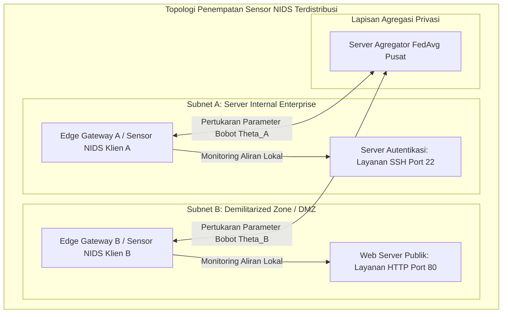
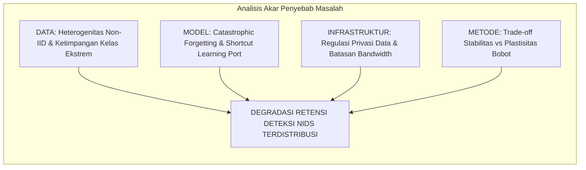
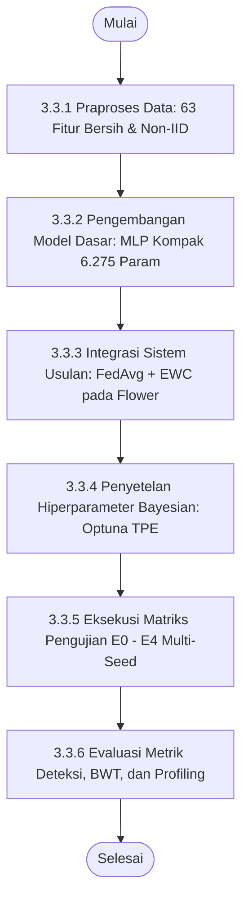
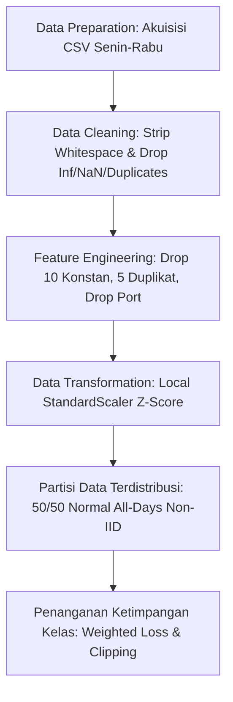
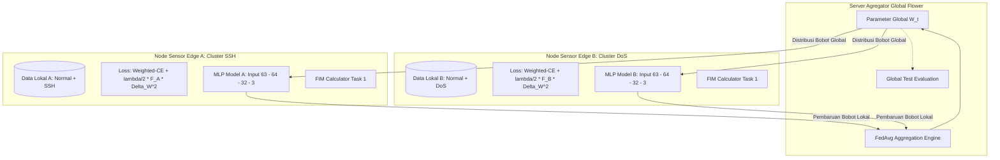
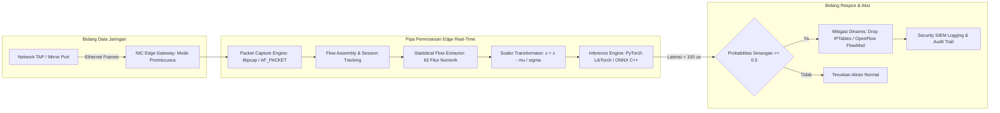
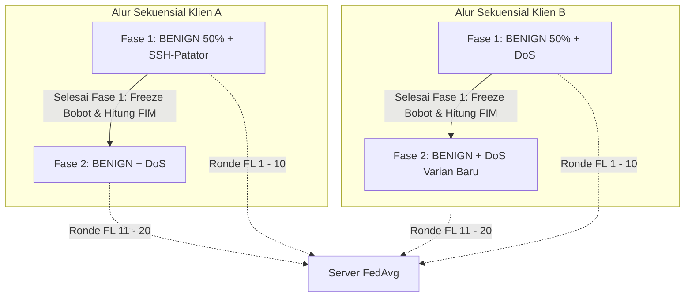

# BAB 3 METODOLOGI

Bab ini menguraikan metode yang digunakan, bahan dan peralatan penelitian, alur urutan pelaksanaan penelitian, tahapan praproses data, arsitektur sistem terdistribusi, perancangan konseptual penerapan waktu nyata, matriks skenario pengujian komparatif, dan jadwal pelaksanaan kegiatan penelitian. Penelitian ini berfokus pada evaluasi integrasi *Federated Learning* (FL) dan *Continual Learning* (CL) berbasis *Elastic Weight Consolidation* (EWC) pada sistem deteksi intrusi jaringan (*Network Intrusion Detection System* / NIDS). Struktur penyusunan bab ini diselaraskan secara penuh dengan format Buku Pedoman Penyusunan Laporan Tugas/Proyek Akhir Program Sarjana dan Sarjana Terapan Departemen Teknik Elektro, FTEIC, Institut Teknologi Sepuluh Nopember (ITS) berdasarkan SK Rektor No. 280/IT2/T/HK.00.01/2022 serta rujukan skripsi alumnus Departemen Teknik Elektro FTEIC ITS ([Referensi-Skripsi-Hafizh.pdf](../Proposal/Referensi-Skripsi-Hafizh.pdf))[14].

---

## 3.1 Metode yang Digunakan

Penelitian ini mengembangkan sistem deteksi intrusi jaringan terdistribusi dan adaptif berbasis *Federated Continual Learning* (FCL) yang menggabungkan algoritma *Federated Averaging* (FedAvg)[3] dan regularisasi *Elastic Weight Consolidation* (EWC)[5] dengan arsitektur *Multilayer Perceptron* (MLP) kompak untuk mengatasi degradasi memori katastrofik (*catastrophic forgetting*) pada kondisi data heterogen (*non-IID*) dan aliran serangan yang muncul secara sekuensial. Metodologi ini dirancang secara khusus untuk mengatasi dua dilema utama dalam keamanan siber modern:
1. **Dilema Privasi dan Isolasi Data:** Keharusan menjaga kerahasiaan data lalu lintas internal tanpa memindahkan rekaman paket mentah ke server eksternal, yang diselesaikan melalui paradigma *Federated Learning*.
2. **Dilema Stabilitas vs Plastisitas (*Stability-Plasticity Dilemma*):** Kecenderungan jaringan saraf tiruan untuk menimpa representasi serangan lama saat mempelajari serangan baru secara berkelanjutan, yang diselesaikan melalui regularisasi penalti kuadratik EWC berbasis Matriks Informasi Fisher diagonal tanpa memerlukan memori penyangga (*replay buffer*).

*Gambar 3.1 Arsitektur Penempatan Sensor NIDS Terdistribusi dalam Jaringan Enterprise.*

Untuk mengidentifikasi akar penyebab kegagalan NIDS terdistribusi dan merumuskan solusi teknis yang sistematis, disusun diagram sebab-akibat (*Fishbone Diagram*) sebagaimana diilustrasikan pada Gambar 3.2.

*Gambar 3.2 Fishbone Diagram Identifikasi Tantangan NIDS Terdistribusi.*

---

## 3.2 Bahan dan Peralatan yang Digunakan

### 3.2.1 Bahan Penelitian (Dataset Publik CIC-IDS2017)
Bahan utama yang digunakan dalam penelitian ini adalah dataset tolok ukur resmi **CIC-IDS2017** dari Canadian Institute for Cybersecurity[8]. Data merekam lalu lintas jaringan nyata selama lima hari kerja (Senin s.d. Jumat). Berkas yang digunakan secara spesifik adalah:
1. `Monday-WorkingHours.pcap_ISCX.csv`: 529.918 baris lalu lintas normal murni (BENIGN).
2. `Tuesday-WorkingHours.pcap_ISCX.csv`: 445.909 baris memuat serangan penetrasi autentikasi SSH (*SSH-Patator*).
3. `Wednesday-workingHours.pcap_ISCX.csv`: 692.703 baris memuat serangan *Denial of Service* (DoS Hulk, GoldenEye, slowloris, slowhttptest).

Berkas hari Kamis dan Jumat dieksklusi karena menderita desinkronisasi timestamp pelabelan yang parah serta kelangkaan sampel mikro ekstrem[6], [7].

### 3.2.2 Peralatan Penelitian (Perangkat Keras dan Perangkat Lunak)
Pengujian dijalankan pada lingkungan komputasi terstandarisasi untuk menjamin reproduktibilitas hasil eksperimen, dengan rincian spesifikasi perangkat keras dan perangkat lunak sebagaimana disajikan pada Tabel 3.1.

*Tabel 3.1 Spesifikasi Lingkungan Perangkat Keras dan Perangkat Lunak.*
| Kategori | Komponen | Spesifikasi Teknis |
| :--- | :--- | :--- |
| **Perangkat Keras** | Prosessor (CPU) | AMD Ryzen / Intel Core Multi-core ($\ge 8$ core) |
| | Memori Utama (RAM) | 16 GB DDR4/DDR5 |
| | Kartu Grafis (GPU) | NVIDIA GPU (VRAM $\ge 8$ GB dengan dukungan CUDA Cores) |
| | Media Penyimpanan | Solid State Drive (NVMe SSD) $\ge 512$ GB |
| **Perangkat Lunak** | Sistem Operasi | Linux Ubuntu 22.04 LTS / Windows 11 64-bit |
| | Lingkungan Eksekusi | Python 3.10+, PyTorch 2.2+, CUDA Toolkit 12.x |
| | Kerangka Kerja FL | Flower Framework (`flwr` $\ge 1.7.0$)[18] |
| | Penyetelan Bayesian | Optuna Framework ($\ge 3.5.0$)[19] |
| | Pustaka Analisis Data | Pandas, NumPy, Scikit-learn, PyArrow |

---

## 3.3 Urutan Pelaksanaan Penelitian

Alur urutan pelaksanaan penelitian disusun ke dalam tahapan yang sistematis dan terstruktur mulai dari persiapan data hingga analisis hasil akhir, sebagaimana disajikan pada diagram alir Gambar 3.3.

*Gambar 3.3 Diagram Alir Urutan Pelaksanaan Penelitian.*

### 3.3.1 Praproses Data dan Ekstraksi 63 Fitur Numerik
Tahapan praproses data dirancang secara ketat untuk mentransformasikan data mentah menjadi format masukan yang bersih, representatif, dan bebas bias *shortcut learning*.

*Gambar 3.4 Diagram Alur Global Data Preprocessing.*

1. **Pembersihan Data (*Data Cleaning*):** Nama kolom distandarisasi (*whitespace trimming*). Nilai `+Infinity`, `-Infinity`, dan nilai kosong dikonversi ke `NaN` lalu dieliminasi. Sebanyak 132.909 baris data duplikat identik dieliminasi secara penuh sehingga tersisa **1.529.677 baris aliran unik bersih**.
2. **Rekayasa Fitur (*Feature Engineering*):**
   - 10 fitur bernilai konstan 0 dieliminasi (`Bwd PSH Flags`, `Bwd URG Flags`, `Fwd Avg Bytes/Bulk`, `Fwd Avg Packets/Bulk`, `Fwd Avg Bulk Rate`, `Bwd Avg Bytes/Bulk`, `Bwd Avg Packets/Bulk`, `Bwd Avg Bulk Rate`, `CWE Flag Count`, `Fwd URG Flags`).
   - 5 kolom duplikat identik via hash dibuang (seperti `Fwd Header Length.1`, `Subflow Fwd Bytes`, `Subflow Fwd Packets`, `Subflow Bwd Packets`, `SYN Flag Count`).
   - **Eliminasi Destination Port:** Fitur `Destination Port` **secara sengaja dibuang** untuk memitigasi bias *port leakage* dan memaksa model mempelajari karakteristik statistik paket murni[9].
   - Dihasilkan **63 fitur statistik numerik bersih** ditambah 1 label (Tabel 3.2).
3. **Transformasi Data (*Scaling*):** Fitur numerik diskalakan menggunakan standardisasi Z-score lokal ($z = \frac{x - \mu}{\sigma}$) yang dihitung murni dari set data pelatihan lokal pada masing-masing klien untuk mencegah *data snooping*.
4. **Partisi Non-IID:** Seluruh aliran `BENIGN` digabungkan lalu dibagi acak tepat **50% untuk Klien A** dan **50% untuk Klien B** (*stratified split*) guna mencegah bias hari perekaman. Klien A memuat Task 1 (Normal + SSH-Patator), Klien B memuat Task 2 (Normal + DoS), dengan rasio internal 70% latih, 15% validasi, dan 15% uji.
5. **Penanganan Ketimpangan Kelas:** Perbandingan kelas Normal terhadap SSH-Patator mencapai $\approx 414 : 1$. Mengatasi hal ini, diterapkan **Weighted Cross-Entropy Loss** berbasis invers frekuensi kelas terkalibrasi dan pemotongan gradien (*Gradient Clipping* norm $\le 1.0$).

*Tabel 3.2 Ringkasan 63 Fitur Statistik Numerik Aliran Bersih CIC-IDS2017.*
| Kategori Fitur | Jumlah | Nama Fitur |
| :--- | :---: | :--- |
| **Statistik Waktu & Durasi** | 5 | `Flow Duration`, `Flow IAT Mean`, `Flow IAT Std`, `Flow IAT Max`, `Flow IAT Min` |
| **Inter-Arrival Time (IAT)** | 10 | `Fwd IAT Total`, `Fwd IAT Mean`, `Fwd IAT Std`, `Fwd IAT Max`, `Fwd IAT Min`, `Bwd IAT Total`, `Bwd IAT Mean`, `Bwd IAT Std`, `Bwd IAT Max`, `Bwd IAT Min` |
| **Statistik Paket Maju (Fwd)** | 8 | `Total Fwd Packets`, `Total Length of Fwd Packets`, `Fwd Packet Length Max`, `Fwd Packet Length Min`, `Fwd Packet Length Mean`, `Fwd Packet Length Std`, `Fwd Header Length`, `act_data_pkt_fwd` |
| **Statistik Paket Balik (Bwd)** | 7 | `Total Backward Packets`, `Total Length of Bwd Packets`, `Bwd Packet Length Max`, `Bwd Packet Length Min`, `Bwd Packet Length Mean`, `Bwd Packet Length Std`, `Bwd Header Length` |
| **Kecepatan Transfer (Rates)** | 4 | `Flow Bytes/s`, `Flow Packets/s`, `Fwd Packets/s`, `Bwd Packets/s` |
| **Statistik Ukuran Paket** | 7 | `Min Packet Length`, `Max Packet Length`, `Packet Length Mean`, `Packet Length Std`, `Packet Length Variance`, `Average Packet Size`, `Avg Fwd Segment Size` |
| **Bendera TCP (Flags)** | 7 | `FIN Flag Count`, `RST Flag Count`, `PSH Flag Count`, `ACK Flag Count`, `URG Flag Count`, `ECE Flag Count`, `Fwd PSH Flags` |
| **Karakteristik Segmen & Jendela** | 7 | `Down/Up Ratio`, `Avg Bwd Segment Size`, `min_seg_size_forward`, `Init_Win_bytes_forward`, `Init_Win_bytes_backward`, `Subflow Bwd Bytes`, `Fwd Act Data Pkts` |
| **Aktivitas Temporal Aktif** | 4 | `Active Mean`, `Active Std`, `Active Max`, `Active Min` |
| **Aktivitas Temporal Idle** | 4 | `Idle Mean`, `Idle Std`, `Idle Max`, `Idle Min` |
| **Total Fitur Input** | **63** | *Seluruhnya bertipe numerik kontinu / diskret* |

### 3.3.2 Arsitektur Sistem Terdistribusi yang Diusulkan
Model klasifikasi dirancang menggunakan **Multilayer Perceptron (MLP)** kompak tiga lapis terhubung penuh (`Input(63) → Linear(64) → ReLU → Linear(32) → ReLU → Linear(3)`). Model ini hanya memiliki 6.275 parameter bobot ($\approx 25,1$ KB) sehingga sangat ringan untuk pertukaran parameter jaringan pada perangkat *edge*.

Mekanisme mitigasi *catastrophic forgetting* diimplementasikan dengan menambahkan modul kalkulasi **Matriks Informasi Fisher (FIM) diagonal** pada klien lokal setelah menyelesaikan pelatihan Task 1[5]. Saat mempelajari Task 2, klien menambahkan penalti kuadratik EWC ke fungsi kerugian lokal sebelum bobot diagregasi oleh server pusat menggunakan algoritma *Federated Averaging* (FedAvg)[3], sebagaimana diilustrasikan pada Gambar 3.5.

*Gambar 3.5 Arsitektur Sistem Federated Continual Learning yang Diimplementasikan.*

### 3.3.3 Rancangan Sistem untuk Penerapan Real-Time
Rancangan konseptual alur penerapan model hasil *Federated Continual Learning* pada infrastruktur gerbang jaringan nyata (*edge gateway deployment*) disusun dengan mengadopsi kerangka kerja analisis sistem deteksi intrusi waktu nyata pada skripsi rujukan alumnus Departemen Teknik Elektro FTEIC ITS ([Referensi-Skripsi-Hafizh.pdf](../Proposal/Referensi-Skripsi-Hafizh.pdf) Sub-bab 3.3.2), sebagaimana disajikan pada Gambar 3.6[14]. Sesuai batasan masalah, eksperimen fisik dalam tugas akhir ini **tidak melakukan injeksi paket langsung (*live packet injection*) ke kabel fisik**, melainkan memetakan arsitektur pipa pemrosesan sebagai landasan transisi dari model teruji ke penerapan lapangan.

*Gambar 3.6 Rancangan Sistem Konseptual untuk Penerapan Real-Time pada Edge Gateway.*

### 3.3.4 Matriks Skenario Pengujian Komparatif E0–E4
Matriks pengujian komparatif dirancang mencakup lima skenario utama (E0 s.d. E4), sebagaimana disajikan pada Tabel 3.3.

*Tabel 3.3 Matriks Skenario Pengujian Eksperimen E0–E4.*
| Skenario | Topologi Pelatihan | Urutan Pembelajaran | Metode Mitigasi Forgetting | Tujuan Pengujian |
| :---: | :--- | :--- | :--- | :--- |
| **E0** | Sentralisasi Penuh | Simultan (Task 1 & Task 2 Bersama) | Tidak Perlu (*Joint*) | Batas atas (*upper bound*) performa model teoretis. |
| **E1** | Sentralisasi Penuh | Sekuensial (Task 1 $\to$ Task 2) | EWC vs Fine-tuning | Membuktikan fenomena *catastrophic forgetting* pada model sentral. |
| **E2** | Federated (2 Klien) | Terisolasi per Klien | Tanpa Proteksi CL | Mengukur dampak murni heterogenitas non-IID (*cross-silo isolation*). |
| **E3** | **Federated (2 Klien)** | **Sekuensial (Task 1 $\to$ Task 2)** | **EWC ($\lambda$ Optimal)** | **Inti Usulan:** Menguji retensi memori dan privasi model federasi. |
| **E4** | Federated (2 Klien) | Sekuensial (Task 1 $\to$ Task 2) | *Experience Replay* (Buffer 10%) | Pembanding *benchmark* akurasi, retensi BWT, dan alokasi memori RAM. |

*Gambar 3.7 Diagram Alir Skenario Pengujian Sekuensial Non-IID.*

### 3.3.5 Mekanisme Evaluasi Multi-Seed dan Profiling Komputasi
Setiap skenario dievaluasi melintasi lima *random seed* (42, 43, 44, 45, 46) menggunakan metrik:
1. **Performa Deteksi ML:** Macro-F1, per-class Precision, Recall, dan Akurasi dievaluasi pada *test set* independen di akhir setiap fase.
2. **Retensi Continual Learning:** Metrik *Backward Transfer* (BWT) dihitung untuk mengukur degradasi memori: $\text{BWT} = R_{2, 1} - R_{1, 1}$[10].
3. **Efisiensi Komputasi & Instance:**
   - *Inference Time:* Rata-rata durasi prediksi per aliran data dalam mikrodetik ($\mu\text{s/flow}$) menggunakan timer presisi tinggi (`time.perf_counter_ns()`), mengadopsi standar evaluasi skripsi terdahulu[14].
   - *Memory Footprint:* Alokasi RAM fisik puncak (*peak RAM usage*) selama fase pelatihan dan penyimpanan parameter.
   - *Communication Payload:* Total ukuran data parameter biner yang dikirimkan per ronde federasi ($2 \times |\theta| \times 4$ bita $\approx 50,2$ KB/ronde).

### 3.3.6 Evaluasi Penyetelan Hiperparameter Bayesian
Penyetelan hiperparameter dijalankan melalui 50 *trials* Optuna berbasis algoritma TPE[19] dengan fungsi objektif memaksimalkan rata-rata Macro-F1 pada subset validasi, menyeimbangkan trade-off antara plastisitas pembelajaran tugas baru dan stabilitas memori tugas lama melalui penyesuaian koefisien penalti $\lambda$.

---

## 3.4 Jadwal Pelaksanaan Penelitian

Rencana pelaksanaan penelitian dijadwalkan dalam durasi 14 minggu (1 semester) sebagaimana dirangkum pada jadwal kegiatan Tabel 3.4 mengacu pada format Lampiran 5 Buku Pedoman ITS 2022.

*Tabel 3.4 Jadwal Pelaksanaan Penelitian Tugas Akhir.*
| No | Nama Kegiatan | 1 | 2 | 3 | 4 | 5 | 6 | 7 | 8 | 9 | 10 | 11 | 12 | 13 | 14 |
| :---: | :--- | :---: | :---: | :---: | :---: | :---: | :---: | :---: | :---: | :---: | :---: | :---: | :---: | :---: | :---: | :---: |
| 1 | Studi Pustaka dan Perumusan Masalah | $\blacksquare$ | $\blacksquare$ | | | | | | | | | | | | |
| 2 | Akuisisi dan Audit Kritis Dataset CIC-IDS2017 | | $\blacksquare$ | $\blacksquare$ | | | | | | | | | | | |
| 3 | Praproses Data & Ekstraksi 63 Fitur Bebas Port Leakage | | | $\blacksquare$ | $\blacksquare$ | | | | | | | | | | |
| 4 | Pengembangan Model Dasar MLP & Lingkungan FL Flower | | | | $\blacksquare$ | $\blacksquare$ | | | | | | | | | |
| 5 | Implementasi Regularisasi EWC dan Matriks Fisher Lokal | | | | | $\blacksquare$ | $\blacksquare$ | | | | | | | | |
| 6 | Penyetelan Hiperparameter Bayesian (Optuna TPE) | | | | | | $\blacksquare$ | $\blacksquare$ | | | | | | | |
| 7 | Penyusunan dan Pelaksanaan Seminar Proposal Tugas Akhir | | | | | | | $\blacksquare$ | $\blacksquare$ | | | | | |
| 8 | Eksekusi Eksperimen Komparatif E0–E4 (5 Random Seeds) | | | | | | | | | $\blacksquare$ | $\blacksquare$ | $\blacksquare$ | | | |
| 9 | Evaluasi Metrik BWT, Latensi Inferensi, RAM, & Payload | | | | | | | | | | | $\blacksquare$ | $\blacksquare$ | | |
| 10 | Perancangan Konseptual Edge Real-Time Deployment | | | | | | | | | | | | $\blacksquare$ | $\blacksquare$ | |
| 11 | Penyusunan Laporan Akhir Skripsi dan Ujian Sidang Akhir | | | | | | | | | | | | | $\blacksquare$ | $\blacksquare$ |
