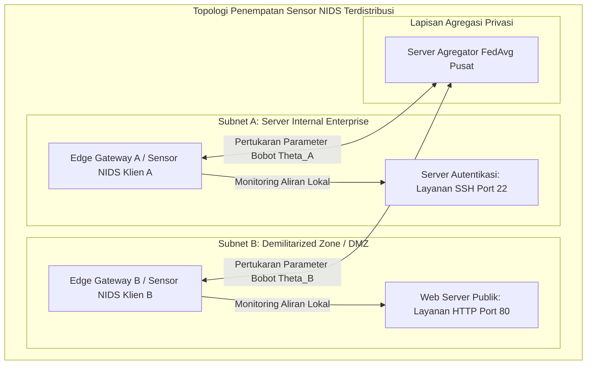
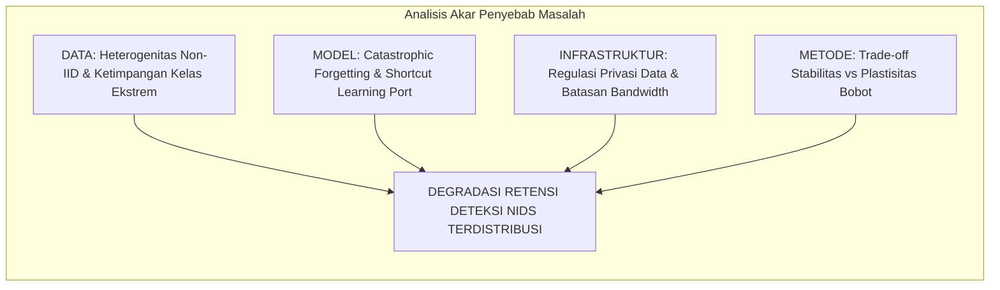
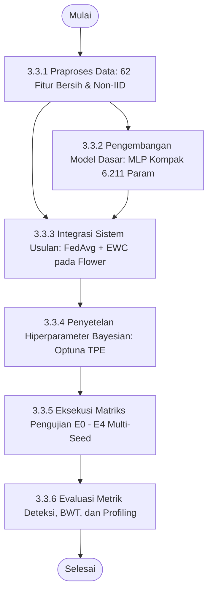
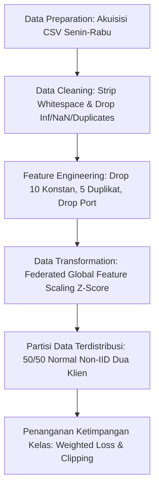
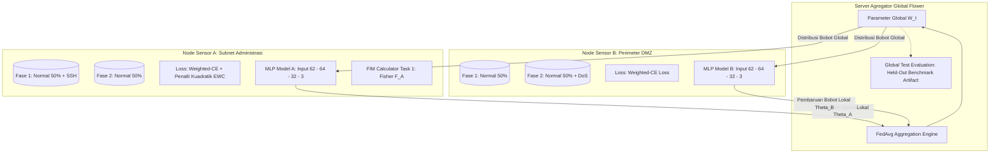

<!--
================================================================================
PROPOSAL TUGAS AKHIR MAHASISWA PROGRAM STUDI S-1 TEKNIK TELEKOMUNIKASI
DEPARTEMEN TEKNIK ELEKTRO
FAKULTAS TEKNOLOGI ELEKTRO DAN INFORMATIKA CERDAS (FTEIC)
INSTITUT TEKNOLOGI SEPULUH NOPEMBER (ITS) SURABAYA

STANDAR FORMAT: SK REKTOR ITS NO. 280/IT2/T/HK.00.01/2022
Ukuran Kertas: A4 HVS 80g | Spasi: 1 (Single)
Margin: Atas 3.0 cm, Bawah 2.5 cm, Kiri 3.0 cm, Kanan 2.0 cm
Font: Times New Roman 12 pt (Judul 14-18 pt Bold)
Sistem Penomoran Halaman:
- Halaman Awal: Romawi kecil (i, ii, iii, dst.) di kanan bawah
- Halaman Isi s.d. Daftar Pustaka: Angka Arab (1, 2, 3, dst.) di kanan bawah
================================================================================
-->


<!--
FORMAT SAMPUL PROPOSAL TUGAS AKHIR ITS (SK Rektor No. 280/IT2/T/HK.00.01/2022 - Lampiran 1)
Kertas: A4 HVS 80g | Spasi: 1 | Margin: Atas 3 cm, Bawah 2.5 cm, Kiri 3 cm, Kanan 2 cm
Tipografi: Trebuchet MS / Times New Roman, Bold, Center
-->

<div align="center">


<br><br>

### **PROPOSAL TUGAS AKHIR - EC234701**

<br>

## **ANALISIS KINERJA DETEKSI NETWORK TRAFFIC INTRUSION MENGGUNAKAN METODE FEDERATED-CONTINUAL LEARNING PADA TESTBED PRIVATE CLOUD SERVER**
### *Studi Pengaruh Elastic Weight Consolidation dan Federated Averaging pada Distribusi Data Non-IID Dua Client*

<br><br>

**RAFLI ALIF IHZA HARTONO**  
**NRP 5048231003**  

<br><br>

**Dosen Pembimbing:**  
**Dr. Ir. Achmad Affandi, DEA.**  
**NIP 196510141990021001**  

<br><br><br>

**Program Studi S-1 Teknik Telekomunikasi**  
**Departemen Teknik Elektro**  
**Fakultas Teknologi Elektro dan Informatika Cerdas**  
**INSTITUT TEKNOLOGI SEPULUH NOPEMBER**  
**SURABAYA**  
**2026**  

</div>

\newpage

<!--
FORMAT LEMBAR PENGESAHAN PROPOSAL TUGAS AKHIR ITS (SK Rektor No. 280/IT2/T/HK.00.01/2022 - Lampiran 2)
-->

<div align="center">

## **LEMBAR PENGESAHAN**

<br>

### **ANALISIS KINERJA DETEKSI NETWORK TRAFFIC INTRUSION MENGGUNAKAN METODE FEDERATED-CONTINUAL LEARNING PADA TESTBED PRIVATE CLOUD SERVER**
#### *Studi Pengaruh Elastic Weight Consolidation dan Federated Averaging pada Distribusi Data Non-IID Dua Client*

<br>

**PROPOSAL TUGAS AKHIR**  
Diajukan untuk memenuhi salah satu syarat  
memperoleh gelar Sarjana Teknik (S.T.) pada  
Program Studi S-1 Teknik Telekomunikasi  
Departemen Teknik Elektro  
Fakultas Teknologi Elektro dan Informatika Cerdas  
Institut Teknologi Sepuluh Nopember  

<br>

Oleh:  
**RAFLI ALIF IHZA HARTONO**  
NRP. 5048231003  

<br>

Disetujui oleh Tim Penguji Proposal Tugas Akhir:

</div>

<br>

1. **Dr. Ir. Achmad Affandi, DEA.**  
   NIP. 196510141990021001  
   *(Pembimbing)* : ............................................................

<br>

2. **Dosen Penguji 1**  
   NIP. ............................................................  
   *(Penguji)* : ............................................................

<br>

3. **Dosen Penguji 2**  
   NIP. ............................................................  
   *(Penguji)* : ............................................................

<br>

4. **Dosen Penguji 3**  
   NIP. ............................................................  
   *(Penguji)* : ............................................................

<br><br>

<div align="center">

**SURABAYA**  
**Oktober, 2026**

</div>

\newpage

# ABSTRAK

**ANALISIS KINERJA DETEKSI NETWORK TRAFFIC INTRUSION MENGGUNAKAN METODE FEDERATED-CONTINUAL LEARNING PADA TESTBED PRIVATE CLOUD SERVER**  
*(Studi Pengaruh Elastic Weight Consolidation dan Federated Averaging pada Distribusi Data Non-IID Dua Client)*

**Nama Mahasiswa / NRP** : Rafli Alif Ihza Hartono / 5048231003  
**Departemen** : Teknik Elektro (Program Studi S-1 Teknik Telekomunikasi) FTEIC - ITS  
**Dosen Pembimbing** : Dr. Ir. Achmad Affandi, DEA.  

#### Abstrak
Eskalasi serangan siber menuntut *Network Intrusion Detection System* (NIDS) mampu mendeteksi variasi ancaman baru tanpa mengorbankan privasi data pengguna. Namun, sentralisasi trafik melanggar regulasi privasi, sedangkan model terdistribusi sekuensial rentan mengalami *catastrophic forgetting* terhadap ancaman terdahulu. Penelitian ini bertujuan menganalisis kinerja deteksi intrusi berbasis *Federated Continual Learning* yang mengintegrasikan *Federated Averaging* (FedAvg) dan *Elastic Weight Consolidation* (EWC) pada data non-IID. Pengujian menggunakan dataset CIC-IDS2017 bersih (Senin-Rabu) dengan mengeksklusi *Destination Port* guna mencegah *shortcut learning* dan menghasilkan 62 fitur statistik numerik. Seluruh 1.529.677 aliran dipertahankan menggunakan *Weighted Cross-Entropy Loss* dan *gradient clipping* untuk memitigasi ketimpangan kelas ekstrem antara Normal, SSH-Patator, dan DoS. Skenario *Class-Incremental Learning* disimulasikan pada dua klien dengan partisi kelas Normal 50/50. Model klasifikasi menggunakan *Multilayer Perceptron* (MLP) kompak tiga lapis berkapasitas 6.211 parameter guna efisiensi komputasi *edge*. Klien lokal menghitung Matriks Informasi Fisher diagonal untuk memproteksi bobot kritis tugas terdahulu sebelum agregasi global Flower. Penerapan EWC diharapkan mampu menekan *catastrophic forgetting* dengan mempertahankan skor Macro-F1 dan *Backward Transfer* yang stabil mendekati nol. Penelitian ini berkontribusi menyediakan arsitektur NIDS adaptif yang aman privasi dan hemat bandwidth untuk gerbang jaringan enterprise.

**Kata kunci:** *Catastrophic Forgetting*, *Continual Learning*, *Elastic Weight Consolidation*, *Federated Learning*, *Network Intrusion Detection System*, *Non-IID*.

---

# ABSTRACT

**PERFORMANCE ANALYSIS OF NETWORK TRAFFIC INTRUSION DETECTION USING FEDERATED-CONTINUAL LEARNING ON A PRIVATE CLOUD SERVER TESTBED**  
*(Study on the Effects of Elastic Weight Consolidation and Federated Averaging under Two-Client Non-IID Data Distribution)*

**Student Name / NRP** : Rafli Alif Ihza Hartono / 5048231003  
**Department** : Electrical Engineering (Telecommunication Engineering Study Program) FTEIC - ITS  
**Advisor** : Dr. Ir. Achmad Affandi, DEA.  

#### Abstract
Escalating cyber threats require Network Intrusion Detection Systems (NIDS) to detect emerging attack variations without compromising user data privacy. However, centralizing raw traffic violates privacy regulations, while sequentially trained distributed models are prone to catastrophic forgetting regarding prior threats. This research aims to analyze intrusion detection performance using Federated Continual Learning integrating Federated Averaging (FedAvg) and Elastic Weight Consolidation (EWC) under non-IID data. Testing utilizes clean CIC-IDS2017 datasets (Monday-Wednesday) excluding Destination Port to prevent shortcut learning, yielding 62 clean numerical features. All 1,529,677 flows are preserved using Weighted Cross-Entropy Loss and gradient clipping to handle extreme class imbalance between Normal, SSH-Patator, and DoS. The Class-Incremental Learning scenario is simulated across two clients with a 50/50 Normal partition. The classification model adopts a compact three-layer Multilayer Perceptron (MLP) with 6,211 parameters for edge computational efficiency. Local clients compute diagonal Fisher Information Matrices to protect critical parameters of prior tasks before global Flower aggregation. Applying EWC is expected to mitigate catastrophic forgetting by sustaining stable Macro-F1 scores and near-zero Backward Transfer. This research contributes an adaptive, privacy-preserving, and bandwidth-efficient NIDS architecture for enterprise network security gateways.

**Keywords:** *Catastrophic Forgetting*, *Continual Learning*, *Elastic Weight Consolidation*, *Federated Learning*, *Network Intrusion Detection System*, *Non-IID*.

\newpage

# DAFTAR ISI

<br>

**LEMBAR PENGESAHAN** ............................................................................................................ ii  
**ABSTRAK** ................................................................................................................................... iii  
**ABSTRACT** ................................................................................................................................. iv  
**DAFTAR ISI** ................................................................................................................................. v  
**DAFTAR GAMBAR** ................................................................................................................... vii  
**DAFTAR TABEL** ....................................................................................................................... viii  
**DAFTAR SINGKATAN** .............................................................................................................. ix  

<br>

**BAB 1 PENDAHULUAN** ............................................................................................................... 1  
1.1 Latar Belakang .......................................................................................................................... 1  
1.2 Rumusan Masalah ...................................................................................................................... 3  
1.3 Batasan Masalah ....................................................................................................................... 3  
1.4 Tujuan ...................................................................................................................................... 4  
1.5 Manfaat .................................................................................................................................... 5  

**BAB 2 TINJAUAN PUSTAKA** ....................................................................................................... 6  
2.1 Keamanan Jaringan ................................................................................................................. 6  
2.2 Serangan Siber ................................................................................................................... 7  
2.3 Penelitian Terdahulu ............................................................................................................ 8  
2.4 Federated Learning .............................................................................................................. 10  
2.5 Continual Learning ................................................................................................................ 12  
2.6 Deteksi Intrusi ................................................................................................................. 13  
2.7 PyTorch ......................................................................................................................... 14  
2.8 Flower .......................................................................................................................... 14  
2.9 Multilayer Perceptron .......................................................................................................... 15  
2.10 Regularisasi EWC ............................................................................................................... 16  
2.11 Dataset .......................................................................................................................... 17  
2.12 Evaluasi Metrik ................................................................................................................. 19  
2.13 Hyperparameter Tuning ...................................................................................................... 20  
2.14 Optimizer .......................................................................................................................... 21  
2.15 Fungsi Aktivasi ................................................................................................................. 22  
**BAB 3 METODOLOGI** ................................................................................................................ 23  
3.1 Metode yang Digunakan .......................................................................................................... 23  
3.2 Bahan dan Peralatan yang Digunakan ....................................................................................... 25  
3.2.1 Bahan Penelitian .................................................................................................................... 25  
3.2.2 Peralatan Penelitian ............................................................................................................... 25  
3.3 Urutan Pelaksanaan Penelitian ................................................................................................. 26  
3.3.1 Praproses Data dan Ekstraksi 62 Fitur Numerik .................................................................... 26  
3.3.2 Pengembangan Model Dasar MLP Kompak .......................................................................... 29  
3.3.3 Integrasi Sistem Usulan: FedAvg dan EWC pada Lingkungan Terdistribusi ......................... 30  
3.3.4 Penyetelan Hiperparameter Bayesian (Optuna TPE) ............................................................. 31  
3.3.5 Matriks Skenario Pengujian Komparatif E0–E4 .................................................................... 32  
3.3.6 Mekanisme Evaluasi Multi-Seed dan Profiling Komputasi ................................................... 33  
3.4 Jadwal Pelaksanaan Penelitian ................................................................................................ 34  

**DAFTAR PUSTAKA** ................................................................................................................... 35  

---

# DAFTAR GAMBAR

<br>

Gambar 2.1 Model CIA Triad Keamanan Informasi ............................................................................ 6  
Gambar 2.2 Siklus Pelatihan dan Agregasi Bobot pada Federated Learning (FedAvg) .................... 10  
Gambar 2.3 Taksonomi Pendekatan Mitigasi Catastrophic Forgetting pada Continual Learning ...... 12  
Gambar 2.4 Perbandingan Topologi Arsitektur Penempatan NIDS dan HIDS ................................ 14  
Gambar 2.5 Struktur Arsitektur Jaringan Multilayer Perceptron (MLP) ............................................ 16  
Gambar 2.6 Mekanisme Regularisasi EWC Membatasi Pergeseran Bobot Kritis pada Kontur Kerugian 17  
Gambar 2.7 Struktur Dasar Confusion Matrix untuk Evaluasi Deteksi Biner dan Multi-kelas .......... 20  
Gambar 2.8 Pemodelan Distribusi Ketidakpastian pada Optimasi Bayesian ..................................... 21  
Gambar 3.1 Arsitektur Penempatan Sensor NIDS Terdistribusi dalam Jaringan Enterprise ............. 23  
Gambar 3.2 Fishbone Diagram Identifikasi Tantangan NIDS Terdistribusi ..................................... 24  
Gambar 3.3 Diagram Alir Urutan Pelaksanaan Penelitian .............................................................. 26  
Gambar 3.4 Diagram Alur Global Data Preprocessing ................................................................... 27  
Gambar 3.5 Arsitektur Sistem Federated Continual Learning yang Diimplementasikan ................. 30  
Gambar 3.6 Diagram Alir Skenario Pengujian Sekuensial Non-IID ................................................. 32  

---

# DAFTAR TABEL

<br>

Tabel 2.1 Perbandingan Penelitian Terdahulu dalam Domain FL, Continual Learning, dan NIDS ..... 8  
Tabel 3.1 Spesifikasi Lingkungan Perangkat Keras dan Perangkat Lunak ...................................... 25  
Tabel 3.2 Ringkasan 62 Fitur Statistik Numerik Aliran Bersih CIC-IDS2017 ................................. 28  
Tabel 3.3 Alokasi Partisi Data Non-IID dan Peran Klien pada Setiap Fase Pembelajaran ............ 29  
Tabel 3.4 Konfigurasi Parameter Pelatihan Baseline dan Ruang Pencarian Hiperparameter ..... 31  
Tabel 3.5 Matriks Skenario Pengujian Eksperimen E0–E4 .............................................................. 32  
Tabel 3.6 Jadwal Pelaksanaan Penelitian Tugas Akhir ................................................................... 34  

---

# DAFTAR SINGKATAN

<br>

| Singkatan | Kepanjangan / Definisi |
|---|---|
| **ABDS** | *Anomaly-Based Detection System* |
| **AdamW** | *Adam with Decoupled Weight Decay* |
| **AUC** | *Area Under the Curve* |
| **BWT** | *Backward Transfer* |
| **CIA** | *Confidentiality, Integrity, and Availability* |
| **CIC** | *Canadian Institute for Cybersecurity* |
| **CL** | *Continual Learning* |
| **CPU** | *Central Processing Unit* |
| **DMZ** | *Demilitarized Zone* |
| **DoS** | *Denial of Service* |
| **EWC** | *Elastic Weight Consolidation* |
| **FCL** | *Federated Continual Learning* |
| **FedAvg** | *Federated Averaging* |
| **FIM** | *Fisher Information Matrix* |
| **FL** | *Federated Learning* |
| **FN** | *False Negative* |
| **FP** | *False Positive* |
| **FNR** | *False Negative Rate* |
| **FPR** | *False Positive Rate* |
| **GDPR** | *General Data Protection Regulation* |
| **GPU** | *Graphics Processing Unit* |
| **gRPC** | *Google Remote Procedure Call* |
| **HIDS** | *Host-Based Intrusion Detection System* |
| **IAT** | *Inter-Arrival Time* |
| **IID** | *Independent and Identically Distributed* |
| **IP** | *Internet Protocol* |
| **ITS** | Institut Teknologi Sepuluh Nopember |
| **MLP** | *Multilayer Perceptron* |
| **NIC** | *Network Interface Card* |
| **NIDS** | *Network Intrusion Detection System* |
| **Non-IID** | *Non-Independent and Identically Distributed* |
| **ONNX** | *Open Neural Network Exchange* |
| **PR-AUC** | *Precision-Recall Area Under Curve* |
| **PVE** | *Proxmox Virtual Environment* |
| **RAM** | *Random Access Memory* |
| **ReLU** | *Rectified Linear Unit* |
| **ROC-AUC** | *Receiver Operating Characteristic - Area Under Curve* |
| **SGD** | *Stochastic Gradient Descent* |
| **SIDS** | *Signature-Based Intrusion Detection System* |
| **SIEM** | *Security Information and Event Management* |
| **SMOTE** | *Synthetic Minority Over-sampling Technique* |
| **SSH** | *Secure Shell* |
| **TAP** | *Test Access Point* |
| **TCP** | *Transmission Control Protocol* |
| **TN** | *True Negative* |
| **TP** | *True Positive* |
| **TPE** | *Tree-structured Parzen Estimator* |
| **UDP** | *User Datagram Protocol* |
| **UU PDP** | Undang-Undang Pelindungan Data Pribadi |

\newpage

# BAB 1 PENDAHULUAN

## 1.1 Latar Belakang

Perkembangan teknologi informasi dan transformasi digital yang kian pesat telah meningkatkan ketergantungan infrastruktur enterprise, institusi publik, dan layanan perbankan terhadap integritas jaringan komputer. Namun, eskalasi keterhubungan ini diiringi oleh lonjakan volume dan kompleksitas ancaman siber (*cyber threats*). Menurut laporan global *Check Point Research*, terjadi kenaikan serangan siber mingguan sebesar 47% secara tahun-ke-tahun (*year-over-year*) per organisasi di seluruh dunia, dengan sektor telekomunikasi, pendidikan, dan infrastruktur kritis menjadi sasaran eksploitasi utama[1]. Selain itu, laporan *FBI Internet Crime Complaint Center* (IC3) mencatat total kerugian ekonomi akibat pengaduan kejahatan siber di Amerika Serikat telah melampaui 12,5 miliar dolar pada laporan tahunan IC3, dengan vektor serangan intrusi jaringan seperti eksploitasi *brute-force* autentikasi (SSH) dan serangan penolakan layanan (*Denial of Service* / DoS) tetap mendominasi spektrum insiden keamanan operasional[2]. Peningkatan baik dari sisi jumlah maupun kompleksitas teknik serangan ini menuntut sistem pertahanan yang adaptif dan mampu mengamankan jaringan secara berkesinambungan.

Dalam menjaga integritas, kerahasiaan (*confidentiality*), dan ketersediaan (*availability*) aset jaringan, *Network Intrusion Detection System* (NIDS) bertindak sebagai garda pertahanan utama untuk memantau, mendeteksi, dan mengklasifikasikan anomali lalu lintas data secara *near real-time*. Pendekatan NIDS konvensional berbasis *signature* (*Signature-Based Intrusion Detection System* / SIDS) bekerja dengan mencocokkan pola aktivitas terhadap basis data tanda tangan serangan yang telah diketahui, namun rentan mengalami kegagalan deteksi terhadap varian serangan baru (*zero-day attacks*). Sebaliknya, sistem deteksi berbasis anomali menggunakan *Machine Learning* (ML) dan *Deep Learning* (DL) memiliki keunggulan adaptif dalam mengekstraksi representasi statistik aliran data (*bidirectional network flows*) guna mengenali anomali lalu lintas secara otomatis.

Meskipun model pembelajaran mesin terpusat (*centralized learning*) menunjukkan akurasi deteksi yang tinggi, paradigma pengumpulan data secara sentral menghadapi dua tantangan fundamental di dunia nyata, yaitu regulasi privasi data dan keterbatasan lebar pita (*bandwidth*). Lalu lintas jaringan memuat data internal yang sangat sensitif, seperti kredensial, identitas pengguna, dan struktur topologi intranet. Memusatkan rekaman paket mentah (*raw pcap* atau *flow logs*) dari berbagai cabang subnet ke satu server sentral berpotensi melanggar regulasi kepatuhan privasi data, seperti Undang-Undang Pelindungan Data Pribadi (UU PDP No. 27/2022) di Indonesia dan GDPR di tingkat global, serta menimbulkan risiko kerentanan titik kegagalan tunggal (*single point of failure*) terhadap insiden kebocoran data. Di samping itu, mentransfer jutaan aliran paket jaringan berskala gigabita secara berkesinambungan ke server analitik sentral menimbulkan *bandwidth bottleneck* yang membebani kapasitas jaringan operasional enterprise.

Untuk mengatasi batasan privasi dan transmisi data tersebut, paradigma *Federated Learning* (FL), khususnya algoritma *Federated Averaging* (FedAvg), muncul sebagai arsitektur pelatihan terdistribusi yang menjanjikan[3]. Melalui FL, setiap node sensor (klien) melatih model deteksi intrusi secara lokal menggunakan data lalu lintas di perimeter jaringannya sendiri. Node klien kemudian hanya mengirimkan pembaruan parameter bobot model (*gradient/weight updates*) ke server agregator terpusat, tanpa pernah membagikan data lalu lintas mentah.

Kendati demikian, implementasi FL pada domain deteksi intrusi jaringan memicu tantangan baru yang signifikan. Pada kondisi operasional nyata, distribusi data lalu lintas antar-node sensor bersifat sangat heterogen atau *non-Identical and Independently Distributed* (non-IID). Sebagai contoh, node sensor di perimeter subnet server autentikasi internal dominan menghadapi serangan *brute-force* SSH, sedangkan node sensor di zona publik (*Demilitarized Zone* / DMZ) dominan menghadapi serangan volumetrik web DoS (*label skew*). Zhao dkk. menunjukkan secara analitis dan empiris bahwa heterogenitas non-IID memicu divergensi bobot lokal (*weight divergence*) yang drastis, sehingga agregasi rata-rata konvensional pada FedAvg rentan mengalami degradasi akurasi yang signifikan[4].

Tantangan ini diperparah oleh dinamika temporal dari serangan jaringan. Serangan siber tidak terjadi secara serentak, melainkan muncul secara berkala dan berurutan dari waktu ke waktu (*continuous streaming data*). Ketika model deteksi intrusi dilatih menggunakan kelas serangan baru (seperti DoS pada Task 2) setelah sebelumnya mempelajari kelas serangan terdahulu (seperti SSH-Patator pada Task 1), pembaruan bobot jaringan saraf tiruan cenderung menimpa representasi laten yang telah dipelajari sebelumnya. Fenomena ini dikenal dalam literatur *Continual Learning* (CL) sebagai **catastrophic forgetting**[5]. Akibatnya, sistem IDS mengalami penurunan drastis pada kemampuan mengenali kembali serangan lawas yang sewaktu-waktu dapat dilancarkan kembali oleh penyerang.

Untuk menanggulangi *catastrophic forgetting*, salah satu pendekatan yang paling elegan dan ramah privasi adalah metode berbasis regularisasi parameter, yaitu **Elastic Weight Consolidation (EWC)**. EWC mengkalkulasi signifikansi parameter bobot terhadap tugas masa lalu menggunakan Matriks Informasi Fisher diagonal (*Fisher Information Matrix*). Saat model mempelajari tugas baru, EWC menambahkan fungsi penalti kuadratik yang mengekang perubahan bobot-bobot krusial tersebut. Berbeda dari metode *Experience Replay* yang mengharuskan penyimpanan *buffer* sampel data mentah di memori lokal (yang berpotensi melanggar privasi dan membebani kapasitas RAM perangkat sensor *edge*), EWC bekerja murni pada ruang parameter model, menjadikannya solusi ideal untuk integrasi *Federated Continual Learning* (FCL)[5].

Penelitian mengenai integrasi FL dan CL pada NIDS di bawah distribusi non-IID saat ini masih berada pada tahap eksplorasi awal dan menghadapi tantangan metodologis yang krusial. Sebagaimana diidentifikasi dalam survei literatur mutakhir oleh Hernandez-Ramos dkk.[31] serta Buyuktanir dkk.[32], sebagian studi FL-NIDS mengasumsikan data terdistribusi secara identik (IID), mengabaikan fenomena kebocoran fitur (*shortcut learning*) akibat penggunaan nomor port layanan, atau menerapkan pemangkasan data (*undersampling*) buatan yang mengaburkan realitas operasional ketimpangan kelas (*class imbalance*). 

Oleh karena itu, penelitian tugas akhir ini berfokus pada **analisis kinerja deteksi *network traffic intrusion* menggunakan metode *Federated-Continual Learning* pada *testbed private cloud server*, dengan studi pengaruh *Elastic Weight Consolidation* (EWC) dan *Federated Averaging* (FedAvg) pada distribusi data non-IID dua *client* guna memitigasi *catastrophic forgetting***. Penelitian ini menggunakan dataset tolok ukur resmi CIC-IDS2017 yang dikurasi secara ketat bebas dari kebocoran fitur *Destination Port*, mempertahankan representasi sebaran data bersih melalui fungsi *Weighted Cross-Entropy Loss*, serta dievaluasi melintasi lima *random seed* independen untuk memperkirakan variabilitas performa dan stabilitas model secara empiris.

---

## 1.2 Rumusan Masalah

Berdasarkan latar belakang yang telah diuraikan, maka rumusan masalah dalam penelitian tugas akhir ini adalah sebagai berikut:
1. Bagaimana kinerja deteksi intrusi model yang dilatih secara terdistribusi (*Federated Averaging* / FedAvg) dibandingkan dengan model yang dilatih secara lokal pada masing-masing klien dengan distribusi data non-IID?
2. Bagaimana pengaruh metode *Elastic Weight Consolidation* (EWC) terhadap mitigasi *catastrophic forgetting* saat model mempelajari kelas serangan baru secara sekuensial, baik pada skenario pelatihan lokal maupun terdistribusi (FedAvg + EWC)?

---

## 1.3 Batasan Masalah

Dalam merampungkan tugas akhir ini, penulis mengonsep batasan ruang lingkup masalah untuk memberikan arah yang lebih terfokus. Berikut merupakan batasan-batasan masalah yang diberikan:

1. Metrik evaluasi yang digunakan meliputi *Macro-averaged F1-Score*, *Precision*, *Recall*, *Accuracy*, *Backward Transfer* (BWT), waktu inferensi per aliran data, alokasi memori RAM *footprint*, dan *communication payload*.
2. Model deteksi intrusi yang dikembangkan berbasis arsitektur *Multilayer Perceptron* (MLP) kompak tiga lapis dengan masukan 62 fitur statistik numerik bersih.
3. Penelitian hanya menggunakan dataset publik *offline tabular flow* CIC-IDS2017 pada rekaman hari Senin (Normal murni), Selasa (SSH-Patator), dan Rabu (DoS GoldenEye, Hulk, slowloris, Slowhttptest). Berkas rekaman hari Kamis dan Jumat dieksklusi secara sengaja karena kelas serangan target (SSH-Patator dan DoS) hanya terdapat pada hari Selasa dan Rabu. Alur serangan FTP-Patator (Selasa) dan Heartbleed (Rabu) juga dieksklusi guna memfokuskan investigasi pada tiga kelas representatif (Normal, SSH-Patator, dan DoS) dengan eliminasi atribut `Destination Port` serta fitur bervariansi nol untuk mencegah bias *shortcut learning*.
4. Pendekatan pembelajaran berkelanjutan (*Continual Learning*) dibatasi pada skenario *Class-Incremental Learning* (Class-IL) tanpa penyediaan Task-ID saat inferensi, dengan metode mitigasi lupa berbasis *Elastic Weight Consolidation* (EWC).
5. Topologi pembelajaran terdistribusi menggunakan algoritma *Federated Averaging* (FedAvg) dengan kerangka kerja Flower, yang memodelkan 2 *node* klien terisolasi non-IID (Klien A: sensor subnet internal dengan serangan SSH-Patator, dan Klien B: sensor DMZ dengan serangan DoS) serta 1 server agregator global yang dilatih melintasi dua fase sekuensial.
6. Implementasi eksperimen dievaluasi melintasi 5 *random seed* independen (42, 43, 44, 45, dan 46) untuk mengukur variabilitas dan dispersi performa konvergensi model terhadap inisialisasi bobot dan partisi data.
7. Profil efisiensi komputasi model (latensi inferensi per alur menggunakan penanda waktu beresolusi nanodetik, jejak alokasi memori RAM instans klien, dan payload komunikasi jaringan) dievaluasi pada lingkungan komputasi prosesor serta testbed *private cloud server* berbasis klaster Proxmox VE sebagai analisis kelayakan operasional.
8. Penelitian ini tidak mencakup penangkapan paket langsung (*live packet capture*), injeksi lalu lintas aktif, maupun pengujian langsung di jaringan produksi enterprise.

---

## 1.4 Tujuan

Penelitian ini bertujuan untuk:
1. Menganalisis kinerja deteksi intrusi model yang dilatih secara terdistribusi (*Federated Averaging* / FedAvg) dibandingkan dengan model yang dilatih secara lokal pada masing-masing klien dengan distribusi data non-IID.
2. Menganalisis pengaruh metode *Elastic Weight Consolidation* (EWC) terhadap mitigasi *catastrophic forgetting* saat mempelajari kelas serangan baru secara sekuensial, baik pada skenario pelatihan lokal maupun terdistribusi (FedAvg + EWC), serta mengevaluasi efisiensi komputasi model (latensi inferensi per aliran data dalam mikrodetik, alokasi memori RAM *footprint*, dan *communication payload*) sebagai analisis pendukung penerapan pada *testbed private cloud server*.

---

## 1.5 Manfaat

Pelaksanaan penelitian ini diharapkan dapat memberikan kontribusi dan manfaat teoretis maupun praktis sebagai berikut:
1. **Manfaat Teoretis (Akademik):**
   - Memberikan kontribusi empiris dan analitis mengenai perilaku interaksi antara algoritma agregasi Federated Learning (FedAvg) dan regularisasi Continual Learning (EWC) pada domain keamanan siber di bawah kondisi heterogenitas data non-IID.
   - Memperkaya literatur NIDS mengenai metodologi evaluasi bebas bias *shortcut learning* melalui eliminasi fitur nomor port dan pengujian berbasis multi-seed.
2. **Manfaat Praktis (Teknologi & Industri):**
   - Menyediakan kerangka arsitektur deteksi intrusi adaptif yang aman privasi dan hemat *bandwidth* untuk diaplikasikan pada sensor *node* jaringan enterprise atau *smart campus*.
   - Membuktikan bahwa pembaruan model keamanan dapat dilakukan secara berkala dan berkesinambungan tanpa perlu mengirimkan log rekaman data mentah pengguna ke server eksternal dan tanpa kehilangan kapabilitas mendeteksi ancaman masa lalu.

\newpage

# BAB 2 TINJAUAN PUSTAKA

## 2.1 Keamanan Jaringan

Keamanan jaringan merupakan pilar fundamental dalam disiplin ilmu teknik komputer dan telekomunikasi yang berfokus pada perlindungan infrastruktur jaringan, kanal komunikasi, dan perangkat komputasi dari akses tidak sah (*unauthorized access*), modifikasi data ilegal, eksploitasi kerentanan, serta gangguan ketersediaan layanan[6]. Di era komputasi awan dan transformasi digital saat ini, keterhubungan antar-sistem semakin terbuka, yang secara bersamaan memperluas permukaan serangan (*attack surface*) dari pihak penyerang siber.

Dalam kerangka kerja keamanan jaringan, salah satu pilar konseptual paling fundamental yang dijadikan acuan perancangan sistem pertahanan adalah CIA Triad, yang mengintegrasikan tiga prinsip inti: kerahasiaan (*Confidentiality*), integritas (*Integrity*), dan ketersediaan (*Availability*)[6]. Prinsip kerahasiaan (*Confidentiality*) berfokus pada jaminan bahwa transmisi informasi serta rekaman data sensitif yang melintasi infrastruktur jaringan hanya dapat diakses dan diinterpretasikan oleh entitas yang memiliki hak akses (*authorization*). Perlindungan kerahasiaan ini umumnya ditegakkan melalui enkripsi protokol komunikasi *end-to-end* seperti TLS, IPsec, dan SSH, serta penerapan kebijakan kontrol akses berbasis identitas yang ketat, guna mencegah potensi intersepsi data ilegal seperti *packet sniffing* dan *eavesdropping*.

Selanjutnya, prinsip integritas (*Integrity*) menekankan pada keharusan menjaga keaslian dan konsistensi paket data agar tidak mengalami modifikasi, penyisipan muatan berbahaya, pemotongan, maupun manipulasi di tengah jalur transmisi (*man-in-the-middle tampering*). Integritas dipertahankan melalui mekanisme fungsi *hash* kriptografis, kode autentikasi pesan (*Message Authentication Code* / MAC), serta tanda tangan digital yang mampu memverifikasi keabsahan data secara presisi. Sementara itu, prinsip ketersediaan (*Availability*) menjamin bahwa seluruh sumber daya komputasi, kapasitas *bandwidth*, dan layanan aplikasi jaringan senantiasa siap sedia serta dapat diakses oleh pengguna yang berhak tanpa mengalami gangguan layanan (*downtime*). Aspek ketersediaan ini terancam secara langsung oleh serangan siber volumetrik seperti *Denial of Service* (DoS) yang berupaya menguras antrean soket dan kapasitas komputasi server.

Ketiga elemen dalam CIA Triad saling terikat secara sinergis dan tidak dapat dipisahkan satu sama lain. Untuk menegakkan prinsip tersebut secara holistik, infrastruktur jaringan enterprise mengadopsi model pertahanan berlapis (*Defense-in-Depth*). Dalam kerangka ini, sistem pertahanan tidak hanya mengandalkan perimeter luar (*firewall*), melainkan menyematkan kontrol keamanan pada setiap lapisan jaringan, mulai dari penyaringan paket, segmentasi jaringan (*Virtual LAN* / VLAN), hingga inspeksi aktif terhadap aliran lalu lintas data oleh sistem deteksi intrusi jaringan (*Network Intrusion Detection System*)[6].

  
*Gambar 2.1 Model CIA Triad Keamanan Informasi.*

---

## 2.2 Serangan Siber

Serangan siber terhadap jaringan komputer memiliki taksonomi yang luas berdasarkan tujuan penyerang, protokol yang dieksploitasi, dan mekanisme gangguan yang ditimbulkan. Dalam penelitian ini, analisis difokuskan pada tiga kategori utama perilaku lalu lintas data yang bersumber dari dataset tolok ukur CIC-IDS2017[7]:

### 2.2.1 Trafik Normal
Trafik normal merepresentasikan seluruh aliran komunikasi data sah yang dihasilkan oleh pengguna dan aplikasi resmi di dalam jaringan[7]. Aliran ini mencakup protokol web (HTTP/HTTPS), kueri *Domain Name System* (DNS), pertukaran surat elektronik (SMTP, IMAP), sinkronisasi waktu jaringan (NTP), serta lalu lintas manajemen internal. Karakteristik statistik dari trafik normal ditandai oleh distribusi panjang paket (*packet length*) yang heterogen, interval waktu kedatangan antar-paket (*inter-arrival time* / IAT) yang bervariasi sesuai interaksi manusia, serta rasio dua arah (*forward/backward packets*) yang proporsional sesuai standar protokol TCP/IP.

### 2.2.2 SSH-Patator
Protokol *Secure Shell* (SSH) yang beroperasi pada port standar 22 merupakan protokol *de facto* untuk administrasi jarak jauh pada server Linux dan perangkat jaringan enterprise. Dalam lanskap ancaman siber, serangan **SSH-Patator** merupakan bentuk serangan audit penetrasi otomatis multi-utas (*multi-threaded brute force tool*) yang mengeksekusi ribuan kombinasi *username* dan *password* dari basis data kamus (*dictionary attack*) secara masif guna membobol akun administrator sistem[7].

Dari sudut pandang analisis statistik aliran lalu lintas (*flow statistics*), serangan SSH-Patator meninggalkan karakteristik pola yang sangat distingtif dibandingkan dengan sesi interaktif normal. Serangan ini ditandai oleh lonjakan frekuensi inisiasi koneksi TCP menuju nomor port layanan autentikasi dalam jendela waktu yang sangat sempit. Sebagian besar aliran memiliki durasi yang sangat singkat (*short flow duration*), mengingat server target segera memutus sesi koneksi melalui transmisi *flag* TCP RST atau FIN sesaat setelah pertukaran *handshake* kredensial dinyatakan gagal. Di samping itu, ukuran paket data arah maju (*forward*) dan arah mundur (*backward*) menunjukkan konsistensi volume muatan yang seragam pada fase negosiasi kunci kriptografi awal sebelum pemutusan sesi berlangsung, membedakannya secara tajam dari dinamika aliran sesi interaktif pengguna yang sah[7].

### 2.2.3 Serangan DoS
Serangan **Denial of Service (DoS)** bertujuan melumpuhkan pilar ketersediaan (*availability*) sistem target dengan membanjiri sumber daya komputasi seperti CPU, memori, *bandwidth*, atau batas antrean soket koneksi server web, sehingga server target gagal melayani permintaan pengguna yang sah[7]. Dalam penelitian ini, analisis difokuskan pada empat subvarian serangan DoS lapisan aplikasi (*application-layer DoS*) yang merepresentasikan spektrum ancaman volumetrik agresif dan ancaman berkecepatan lambat (*low-and-slow attacks*).

Pada kelompok serangan volumetrik agresif, subvarian pertama adalah **DoS Hulk**, yang melancarkan pembanjiran permintaan HTTP GET bervolume masif dengan memanipulasi *header User-Agent* serta menyisipkan parameter unik acak pada URL guna menggagalkan sistem *caching* server web, memaksa server mengalokasikan siklus komputasi CPU dan memori secara berulang. Subvarian kedua adalah **DoS GoldenEye**, yang mengeksploitasi mekanisme koneksi persisten HTTP (*keep-alive*) dan perintah *Cache-Control: no-cache* secara simultan dalam jumlah besar untuk menahan *worker process* server web tetap terkunci hingga kapasitas *thread pool* server habis terpakai.

Sebaliknya, pada kelompok serangan berkecepatan lambat (*low-and-slow*), subvarian **DoS Slowloris** beroperasi secara *stealthy* dengan mengirimkan fragmen *header* HTTP parsial secara berkala dengan interval lambat. Server target dipaksa menahan soket koneksi tetap terbuka sambil menunggu *header* selesai, menghabiskan batas konkurensi koneksi server tanpa menimbulkan lonjakan volume trafik yang mencurigakan. Serupa dengan Slowloris, subvarian **DoS Slowhttptest** mengeksploitasi spesifikasi protokol HTTP dengan mengirimkan muatan badan (*body*) permintaan POST secara sangat lambat (misalnya 1 bita per interval waktu tertentu), mengunci sumber daya penerimaan data server web secara berkepanjangan dan mencegah pengguna lain untuk menjalin komunikasi[7].

---

## 2.3 Penelitian Terdahulu

Penelitian terkait penerapan kecerdasan buatan untuk deteksi intrusi jaringan terdistribusi dan adaptif telah berkembang pesat dalam beberapa tahun terakhir. Tinjauan kritis terhadap literatur ilmiah berfokus pada tiga kelompok kajian utama:

Pertama, pada domain pembelajaran terdistribusi, *Federated Learning* (FL) yang diperkenalkan oleh McMahan *et al.*[3] melalui algoritma *Federated Averaging* (FedAvg) telah menjadi fondasi utama pelatihan kolaboratif lintas node tanpa transmisi data mentah. Penerapan FedAvg pada NIDS telah diteliti oleh Popoola *et al.*[8] untuk mendeteksi serangan *zero-day botnet* pada perangkat *edge* IoT dan Ruzafa-Alcázar *et al.*[9] pada lingkungan *Industrial IoT* (IIoT) dengan mekanisme privasi diferensial. Selain itu, survei komprehensif oleh Hernandez-Ramos *et al.*[31] dan Buyuktanir *et al.*[32] menegaskan potensi besar FL dalam mengamankan lalu lintas jaringan heterogen. Namun, mayoritas studi FL-NIDS beroperasi dalam paradigma pelatihan batch/statis, mengasumsikan distribusi data IID atau hanya menguji variasi non-IID kuantitas sederhana, serta mengabaikan fenomena pergeseran konsep (*concept drift*) saat varian serangan baru muncul di jaringan secara sekuensial. Pada kondisi nyata, data lalu lintas jaringan bersifat *non-Identical and Independently Distributed* (non-IID), yang secara teoretis dan empiris dibuktikan oleh Zhao *et al.*[4] dapat memicu divergensi bobot (*weight divergence*) dan menurunkan akurasi model global.

Kedua, pada domain pembelajaran berkelanjutan (*Continual Learning* / CL), adaptasi model NIDS terhadap kelas serangan baru secara sekuensial menghadapi kendala berat berupa *catastrophic forgetting*[5]. Ketika model dilatih pada serangan baru, representasi bobot lama tertimpa sehingga kemampuan mendeteksi serangan terdahulu merosot drastis. Tinjauan sistematis oleh Hamedi *et al.*[34] memetakan tantangan mendasar pada *Federated Continual Learning* (FCL), di mana kelupaan katastropik teramplifikasi oleh heterogenitas data antar-klien. Berbagai metode mitigasi telah diajukan, seperti *Experience Replay* dan *Gradient Episodic Memory* (GEM) oleh Lopez-Paz dan Ranzato[10], serta integrasi *Federated Class-Incremental Learning* (FCIL) oleh Dong *et al.*[11] pada domain visi komputer. Dalam domain keamanan jaringan, pendekatan *incremental learning* terfederasi seperti FL-IIDS oleh Jin *et al.*[12] dan deteksi anomali bertahap IoT oleh Rehman *et al.*[33] mulai mengeksplorasi adaptasi ancaman sekuensial. Namun, pendekatan seperti FL-IIDS masih mengandalkan mekanisme penyimpanan sampel data historis (*replay memory buffer*) pada memori lokal klien yang memicu potensi risiko kebocoran privasi jika data tersimpan berhasil diekstraksi penyerang. Sebaliknya, metode regularisasi parameter *Elastic Weight Consolidation* (EWC) yang dirumuskan oleh Kirkpatrick *et al.*[5] menawarkan keunggulan proteksi memori murni pada ruang bobot melalui penalti kelengkungan Matriks Informasi Fisher diagonal tanpa memerlukan penyimpanan sampel lalu lintas masa lalu.

Ketiga, pada domain evaluasi dan integritas dataset tolok ukur CIC-IDS2017, studi audit mutakhir oleh Rosay *et al.*[13] mengungkap keberadaan *bug* logika ekstraksi fitur pada perangkat CICFlowMeter, terminasi alur TCP prematur, dan kesalahan pelabelan alur serangan. Selain itu, investigasi oleh Dube[14] membuktikan bahwa data ringkasan alur CSV dari CIC-IDS2017 terlalu kasar dan rentan menghasilkan model deteksi yang tidak memadai untuk implementasi jaringan produksi nyata. Di samping itu, investigasi kritis oleh Engelen *et al.*[15] mengungkap kelemahan mendasar konstruksi alur trafik pada CICFlowMeter serta memperingatkan potensi terjadinya *shortcut learning* pada atribut metadata alur. Berdasarkan fenomena tersebut, penelitian ini melakukan evaluasi empiris mandiri yang mengonfirmasi bahwa penggunaan fitur nomor port tujuan (`Destination Port`) menghasilkan akurasi semu akibat kebocoran port layanan (Macro-F1 port-only mencapai 96,44%), sehingga fitur tersebut dieksklusi secara ketat. Dalam konteks latensi operasional, penelitian tugas akhir terdahulu oleh Rinandri[16] menegaskan pentingnya pengukuran efisiensi inferensi tingkat mikrodetik per aliran data pada arsitektur pendeteksi anomali.

Berdasarkan kajian kritis tersebut, posisi ilmiah dan kebaruan (*novelty*) dari penelitian tugas akhir ini dirangkum dalam Tabel 2.1, yang mengintegrasikan paradigma FedAvg dan EWC di bawah distribusi non-IID dua klien, menerapkan pembersihan ketat bebas kebocoran fitur nomor port, serta mengukur ketahanan memori dan profil efisiensi komputasi model.

*Tabel 2.1 Perbandingan Penelitian Terdahulu dalam Domain FL, Continual Learning, dan NIDS.*

| No | Penulis & Tahun | Judul Penelitian | Metode / Algoritma | Dataset | Kontribusi Utama | Keterbatasan / Research Gap |
| :---: | :--- | :--- | :--- | :--- | :--- | :--- |
| 1 | Rosay *et al.* (2022)[13] | *Network Intrusion Detection: A Comprehensive Analysis of CIC-IDS2017* | Audit & ML Analysis | CIC-IDS2017 | Mengidentifikasi *bug* logika penanganan *flag* TCP pada CICFlowMeter, durasi flow anomali, dan kesalahan pelabelan | Hanya mengevaluasi kelemahan dataset mentah, tidak merancang arsitektur model deteksi atau mitigasi kelupaan. |
| 2 | Engelen *et al.* (2021)[15] | *Troubleshooting an Intrusion Detection Dataset: the CICIDS2017 Case Study* | Flow Construction & Feature Audit | CIC-IDS2017 | Mengidentifikasi kelemahan konstruksi alur TCP (FIN prematur, timeout 120s) dan memperingatkan bahaya *shortcut learning* | Hanya fokus pada analisis integritas flow, tidak menguji skenario terdistribusi atau pembelajaran kelas inkremental. |
| 3 | Dube (2024)[14] | *Faulty use of the CIC-IDS 2017 dataset in information security research* | Audit Kritis & Analisis Fitur | CIC-IDS2017 | Membuktikan bahwa fitur ringkasan CSV CIC-IDS2017 terlalu kasar (*too coarse*) dan tidak memadai untuk deteksi produksi | Evaluasi bersifat kritis analitis dataset, belum mengusulkan arsitektur model pertahanan terdistribusi terfederasi. |
| 4 | Kirkpatrick *et al.* (2017)[5] | *Overcoming catastrophic forgetting in neural networks* | EWC & Fisher Information | Permuted MNIST | Merumuskan fondasi matematis penalti kelengkungan kuadratik berbasis diagonal Matriks Informasi Fisher | Diuji terbatas pada domain visi komputer sederhana, belum diuji pada lalu lintas jaringan terdistribusi. |
| 5 | McMahan *et al.* (2017)[3] | *Communication-Efficient Learning of Deep Networks from Decentralized Data* | Federated Averaging (FedAvg) | MNIST, CIFAR-10 | Menetapkan standar arsitektur Federated Learning terdistribusi dan menganalisis konvergensi pada partisi non-IID | Dirancang untuk skenario batch/statis, tanpa proteksi *catastrophic forgetting* saat kelas baru muncul secara sekuensial. |
| 6 | Zhao *et al.* (2018)[4] | *Federated Learning with Non-IID Data* | Analisis Divergensi Bobot | CIFAR-10 | Membuktikan secara analitis dan empiris degradasi akurasi FedAvg akibat pergeseran distribusi data non-IID | Memerlukan penyebaran sebagian data publik ke seluruh klien untuk memitigasi divergensi bobot lokal. |
| 7 | Lopez-Paz & Ranzato (2017)[10] | *Gradient Episodic Memory for Continual Learning* | GEM / BWT Metric | CIFAR-100 | Merumuskan metrik evaluasi *Backward Transfer* (BWT) untuk mengukur retensi memori terhadap tugas terdahulu | Mengandalkan *episodic replay buffer* penyimpanan data mentah yang rentan terhadap pelanggaran privasi data. |
| 8 | Dong *et al.* (2022)[11] | *Federated Class-Incremental Learning* | FCIL & Model Consolidation | Visi Komputer | Mengintegrasikan federasi dan penambahan kelas inkremental tanpa akses terpusat pada data historis | Memerlukan pertukaran prototipe representasi data atau modul generator sintetis antar-klien dengan komputasi tinggi. |
| 9 | Ruzafa-Alcázar *et al.* (2023)[9] | *Intrusion Detection Based on Privacy-Preserving Federated Learning for the Industrial IoT* | FedAvg & Differential Privacy | ToN_IoT | Mengimplementasikan FL dengan mekanisme *Differential Privacy* pada lingkungan Industrial IoT di bawah non-IID | Model dievaluasi pada tugas klasifikasi statis, tidak menangani *catastrophic forgetting* pada skenario alur sekuensial. |
| 10 | Popoola *et al.* (2022)[8] | *Federated Deep Learning for Zero-Day Botnet Attack Detection in IoT-Edge Devices* | FedAvg DNN | BoT-IoT | Mendeteksi serangan *zero-day botnet* pada arsitektur terdistribusi perangkat *edge* tanpa agregasi trafik mentah | Tidak menyertakan mekanisme *continual learning*, sehingga performa rentan terdegradasi saat dilatih pada varian baru. |
| 11 | Jin *et al.* (2024)[12] | *FL-IIDS: A novel federated learning-based incremental intrusion detection system* | FL + Replay-based Incremental Learning | CSE-CIC-IDS2018 | Mengusulkan sistem deteksi intrusi inkremental terfederasi untuk mengadaptasi serangan baru secara berkala | Mengandalkan *memory buffer* untuk *replay* data historis yang memicu risiko kebocoran privasi lokal. |
| 12 | Rehman *et al.* (2026)[33] | *Incremental Federated Learning for Intrusion Detection in IoT Networks* | Incremental FL (IoV/IoT) | Edge-IIoTset | Mengembangkan pembelajaran terfederasi inkremental adaptif terhadap lanskap ancaman IoT yang berevolusi | Terbatas pada klasifikasi anomali biner perangkat bersumber daya mikro, belum mengkaji multi-kelas Class-IL komprehensif. |
| 13 | Hernandez-Ramos *et al.* (2025)[31] | *Intrusion Detection Based on Federated Learning: A Systematic Review* | Systematic Review & Taxonomy | Ragam Dataset NIDS | Menyusun taksonomi komprehensif tantangan arsitektur, privasi, dan heterogenitas data pada FL-NIDS | Merupakan studi survei literatur, tidak mengusulkan implementasi empiris algoritma mitigasi kelupaan katastropik. |
| 14 | Hamedi *et al.* (2025)[34] | *Federated Continual Learning: Concepts, Challenges, and Solutions* | Comprehensive Survey | Ragam Benchmark CL | Memetakan metodologi FCL dan membuktikan bahwa non-IID mengamplifikasi kelupaan katastropik terdistribusi | Merupakan tinjauan konseptual sistematis, belum menyajikan benchmark empiris NIDS pada trafik jaringan enterprise. |
| 15 | Sarhan *et al.* (2022)[17] | *Towards a Standard Feature Set for Network Intrusion Detection System Datasets* | NetFlow Feature Engineering | NetFlow-V2 | Menstandardisasi ekstraksi representasi fitur aliran berbasis alur NetFlow standar industri | Menggunakan format representasi tergeneralisasi yang mengabaikan investigasi mendalam terhadap artefak raw flow. |
| 16 | Rinandri (2025)[16] | *Pendekatan Semi-Supervised Learning GNN-AE pada Structemp* | Structemp GNN-AE | NF-UQ-NIDS-v2 | Menerapkan deteksi anomali *unsupervised* real-time berbasis graf dengan tolok ukur latensi mikrodetik ($\mu\text{s}$) | Arsitektur tersentralisasi statis pada server tunggal, tidak mengkaji privasi federasi terdistribusi dan adaptasi sekuensial. |
| 17 | **Penelitian Ini (2026)** | **Analisis Kinerja Deteksi Network Traffic Intrusion via FCL** | **FedAvg + EWC + Weighted Loss (62 Fitur)** | **CIC-IDS2017** | **Mengintegrasikan FedAvg & EWC bebas-replay, mitigasi port leakage, mitigasi non-IID & imbalanced class, evaluasi BWT, RAM, payload, dan latensi $\mu\text{s}$** | **Memberikan solusi FCL terpadu yang adaptif, aman privasi, hemat bandwidth, dan terverifikasi secara multi-seed.** |

Investigasi ilmiah mutakhir mengidentifikasi kelemahan mendasar dalam dataset mentah CIC-IDS2017 yang berpotensi menghasilkan evaluasi model yang bias apabila digunakan tanpa kurasi yang ketat[13], [14], [15]. Audit komprehensif oleh Rosay *et al.*[13] mengungkap bahwa perangkat ekstraksi fitur CICFlowMeter mengandung *bug* logika penanganan *flag* TCP (mengakhiri rekaman alur secara prematur pada deteksi *flag* FIN/RST pertama tanpa memperhatikan *handshake* penutupan dua arah) yang memecah koneksi normal sah menjadi beberapa fragmen alur tak lengkap, serta menghasilkan anomali perhitungan durasi alur dan fitur inter-arrival time. Selain itu, investigasi kritis oleh Dube[14] membuktikan bahwa sebagian besar riset NIDS menggunakan CIC-IDS2017 secara keliru (*faulty use*) karena fitur-fitur ringkasan CSV CIC-IDS2017 terlalu kasar (*too coarse*) dan tidak memadai untuk deteksi intrusi di lingkungan produksi (Dube, 2024, hlm. 203, 210), serta mengevaluasi model pada CSV ringkasan tanpa verifikasi pada trafik paket PCAP mentah atau komparasi dengan performa sistem deteksi/pencegahan intrusi (IDS/IPS) produksi nyata (hlm. 204). Di samping itu, kelangkaan sampel mikro ekstrem pada kelas Infiltration (hanya 36 alur dari total 2,8 juta) dan Sql Injection (hanya 21 alur) secara statistik tidak memadai untuk melatih representasi *deep learning* maupun menghitung Matriks Informasi Fisher yang stabil. Atas dasar pertimbangan integritas ilmiah tersebut, rekaman hari Kamis dan Jumat dieksklusi secara sengaja dari penelitian ini guna menjamin validitas eksperimental.

Lebih lanjut, studi audit oleh Engelen *et al.*[15] membuktikan adanya kelemahan mendasar konstruksi alur trafik pada CICFlowMeter (seperti terminasi alur prematur dan batas waktu alur 120 detik yang memotong koneksi normal secara artifisial, hlm. 3-4) serta memberikan peringatan terhadap potensi terjadinya *shortcut learning* pada fitur metadata alur. Berdasarkan peringatan tersebut, penelitian tugas akhir ini melakukan pengujian empiris mandiri yang mengonfirmasi bahwa model pembelajaran mesin yang hanya dilatih menggunakan fitur nomor port tujuan (`Destination Port`) mampu mencapai Macro-F1 sebesar 96,44%, membuktikan secara nyata terjadinya kebocoran jalan pintas port layanan (*port leakage*) pada dataset. Apabila fitur ini dipertahankan, model NIDS akan runtuh (*fail completely*) di lingkungan produksi nyata saat penyerang mengubah port target layanan ke port non-standar. Oleh karena itu, penelitian ini secara tegas mengeksklusi fitur `Destination Port` dari seluruh proses pelatihan dan inferensi, menyisakan tepat 62 fitur statistik alur numerik bersih.manan jaringan merupakan pilar fundamental dalam disiplin ilmu teknik komputer dan telekomunikasi yang berfokus pada perlindungan infrastruktur jaringan, kanal komunikasi, dan perangkat komputasi dari akses tidak sah (*unauthorized access*), modifikasi data ilegal, eksploitasi kerentanan, serta gangguan ketersediaan layanan[6]. Di era komputasi awan dan transformasi digital saat ini, keterhubungan antar-sistem semakin terbuka, yang secara bersamaan memperluas permukaan serangan (*attack surface*) dari pihak penyerang siber.

Dalam kerangka kerja keamanan jaringan, salah satu pilar konseptual paling fundamental yang dijadikan acuan perancangan sistem pertahanan adalah CIA Triad, yang mengintegrasikan tiga prinsip inti: kerahasiaan (*Confidentiality*), integritas (*Integrity*), dan ketersediaan (*Availability*)[6]. Prinsip kerahasiaan (*Confidentiality*) berfokus pada jaminan bahwa transmisi informasi serta rekaman data sensitif yang melintasi infrastruktur jaringan hanya dapat diakses dan diinterpretasikan oleh entitas yang memiliki hak akses (*authorization*). Perlindungan kerahasiaan ini umumnya ditegakkan melalui enkripsi protokol komunikasi *end-to-end* seperti TLS, IPsec, dan SSH, serta penerapan kebijakan kontrol akses berbasis identitas yang ketat, guna mencegah potensi intersepsi data ilegal seperti *packet sniffing* dan *eavesdropping*.

Selanjutnya, prinsip integritas (*Integrity*) menekankan pada keharusan menjaga keaslian dan konsistensi paket data agar tidak mengalami modifikasi, penyisipan muatan berbahaya, pemotongan, maupun manipulasi di tengah jalur transmisi (*man-in-the-middle tampering*). Integritas dipertahankan melalui mekanisme fungsi *hash* kriptografis, kode autentikasi pesan (*Message Authentication Code* / MAC), serta tanda tangan digital yang mampu memverifikasi keabsahan data secara presisi. Sementara itu, prinsip ketersediaan (*Availability*) menjamin bahwa seluruh sumber daya komputasi, kapasitas *bandwidth*, dan layanan aplikasi jaringan senantiasa siap sedia serta dapat diakses oleh pengguna yang berhak tanpa mengalami gangguan layanan (*downtime*). Aspek ketersediaan ini terancam secara langsung oleh serangan siber volumetrik seperti *Denial of Service* (DoS) yang berupaya menguras antrean soket dan kapasitas komputasi server.

Ketiga elemen dalam CIA Triad saling terikat secara sinergis dan tidak dapat dipisahkan satu sama lain. Untuk menegakkan prinsip tersebut secara holistik, infrastruktur jaringan enterprise mengadopsi model pertahanan berlapis (*Defense-in-Depth*). Dalam kerangka ini, sistem pertahanan tidak hanya mengandalkan perimeter luar (*firewall*), melainkan menyematkan kontrol keamanan pada setiap lapisan jaringan, mulai dari penyaringan paket, segmentasi jaringan (*Virtual LAN* / VLAN), hingga inspeksi aktif terhadap aliran lalu lintas data oleh sistem deteksi intrusi jaringan (*Network Intrusion Detection System*)[6].

  
*Gambar 2.1 Model CIA Triad Keamanan Informasi.*

---

## 2.2 Serangan Siber

Serangan siber terhadap jaringan komputer memiliki taksonomi yang luas berdasarkan tujuan penyerang, protokol yang dieksploitasi, dan mekanisme gangguan yang ditimbulkan. Dalam penelitian ini, analisis difokuskan pada tiga kategori utama perilaku lalu lintas data yang bersumber dari dataset tolok ukur CIC-IDS2017[7]:

### 2.2.1 Trafik Normal
Trafik normal merepresentasikan seluruh aliran komunikasi data sah yang dihasilkan oleh pengguna dan aplikasi resmi di dalam jaringan[7]. Aliran ini mencakup protokol web (HTTP/HTTPS), kueri *Domain Name System* (DNS), pertukaran surat elektronik (SMTP, IMAP), sinkronisasi waktu jaringan (NTP), serta lalu lintas manajemen internal. Karakteristik statistik dari trafik normal ditandai oleh distribusi panjang paket (*packet length*) yang heterogen, interval waktu kedatangan antar-paket (*inter-arrival time* / IAT) yang bervariasi sesuai interaksi manusia, serta rasio dua arah (*forward/backward packets*) yang proporsional sesuai standar protokol TCP/IP.

### 2.2.2 SSH-Patator
Protokol *Secure Shell* (SSH) yang beroperasi pada port standar 22 merupakan protokol *de facto* untuk administrasi jarak jauh pada server Linux dan perangkat jaringan enterprise. Dalam lanskap ancaman siber, serangan **SSH-Patator** merupakan bentuk serangan audit penetrasi otomatis multi-utas (*multi-threaded brute force tool*) yang mengeksekusi ribuan kombinasi *username* dan *password* dari basis data kamus (*dictionary attack*) secara masif guna membobol akun administrator sistem[7].

Dari sudut pandang analisis statistik aliran lalu lintas (*flow statistics*), serangan SSH-Patator meninggalkan karakteristik pola yang sangat distingtif dibandingkan dengan sesi interaktif normal. Serangan ini ditandai oleh lonjakan frekuensi inisiasi koneksi TCP menuju nomor port layanan autentikasi dalam jendela waktu yang sangat sempit. Sebagian besar aliran memiliki durasi yang sangat singkat (*short flow duration*), mengingat server target segera memutus sesi koneksi melalui transmisi *flag* TCP RST atau FIN sesaat setelah pertukaran *handshake* kredensial dinyatakan gagal. Di samping itu, ukuran paket data arah maju (*forward*) dan arah mundur (*backward*) menunjukkan konsistensi volume muatan yang seragam pada fase negosiasi kunci kriptografi awal sebelum pemutusan sesi berlangsung, membedakannya secara tajam dari dinamika aliran sesi interaktif pengguna yang sah[7].

### 2.2.3 Serangan DoS
Serangan **Denial of Service (DoS)** bertujuan melumpuhkan pilar ketersediaan (*availability*) sistem target dengan membanjiri sumber daya komputasi seperti CPU, memori, *bandwidth*, atau batas antrean soket koneksi server web, sehingga server target gagal melayani permintaan pengguna yang sah[7]. Dalam penelitian ini, analisis difokuskan pada empat subvarian serangan DoS lapisan aplikasi (*application-layer DoS*) yang merepresentasikan spektrum ancaman volumetrik agresif dan ancaman berkecepatan lambat (*low-and-slow attacks*).

Pada kelompok serangan volumetrik agresif, subvarian pertama adalah **DoS Hulk**, yang melancarkan pembanjiran permintaan HTTP GET bervolume masif dengan memanipulasi *header User-Agent* serta menyisipkan parameter unik acak pada URL guna menggagalkan sistem *caching* server web, memaksa server mengalokasikan siklus komputasi CPU dan memori secara berulang. Subvarian kedua adalah **DoS GoldenEye**, yang mengeksploitasi mekanisme koneksi persisten HTTP (*keep-alive*) dan perintah *Cache-Control: no-cache* secara simultan dalam jumlah besar untuk menahan *worker process* server web tetap terkunci hingga kapasitas *thread pool* server habis terpakai.

Sebaliknya, pada kelompok serangan berkecepatan lambat (*low-and-slow*), subvarian **DoS Slowloris** beroperasi secara *stealthy* dengan mengirimkan fragmen *header* HTTP parsial secara berkala dengan interval lambat. Server target dipaksa menahan soket koneksi tetap terbuka sambil menunggu *header* selesai, menghabiskan batas konkurensi koneksi server tanpa menimbulkan lonjakan volume trafik yang mencurigakan. Serupa dengan Slowloris, subvarian **DoS Slowhttptest** mengeksploitasi spesifikasi protokol HTTP dengan mengirimkan muatan badan (*body*) permintaan POST secara sangat lambat (misalnya 1 bita per interval waktu tertentu), mengunci sumber daya penerimaan data server web secara berkepanjangan dan mencegah pengguna lain untuk menjalin komunikasi[7].

---

## 2.3 Penelitian Terdahulu

Penelitian terkait penerapan kecerdasan buatan untuk deteksi intrusi jaringan terdistribusi dan adaptif telah berkembang pesat dalam beberapa tahun terakhir. Tinjauan kritis terhadap literatur ilmiah berfokus pada tiga kelompok kajian utama:

Pertama, pada domain pembelajaran terdistribusi, *Federated Learning* (FL) yang diperkenalkan oleh McMahan *et al.*[3] melalui algoritma *Federated Averaging* (FedAvg) telah menjadi fondasi utama pelatihan kolaboratif lintas node tanpa transmisi data mentah. Penerapan FedAvg pada NIDS telah diteliti oleh Popoola *et al.*[8] untuk mendeteksi serangan *zero-day botnet* pada perangkat *edge* IoT dan Ruzafa-Alcázar *et al.*[9] pada lingkungan *Industrial IoT* (IIoT) dengan mekanisme privasi diferensial. Selain itu, survei komprehensif oleh Hernandez-Ramos *et al.*[31] dan Buyuktanir *et al.*[32] menegaskan potensi besar FL dalam mengamankan lalu lintas jaringan heterogen. Namun, mayoritas studi FL-NIDS beroperasi dalam paradigma pelatihan batch/statis, mengasumsikan distribusi data IID atau hanya menguji variasi non-IID kuantitas sederhana, serta mengabaikan fenomena pergeseran konsep (*concept drift*) saat varian serangan baru muncul di jaringan secara sekuensial. Pada kondisi nyata, data lalu lintas jaringan bersifat *non-Identical and Independently Distributed* (non-IID), yang secara teoretis dan empiris dibuktikan oleh Zhao *et al.*[4] dapat memicu divergensi bobot (*weight divergence*) dan menurunkan akurasi model global.

Kedua, pada domain pembelajaran berkelanjutan (*Continual Learning* / CL), adaptasi model NIDS terhadap kelas serangan baru secara sekuensial menghadapi kendala berat berupa *catastrophic forgetting*[5]. Ketika model dilatih pada serangan baru, representasi bobot lama tertimpa sehingga kemampuan mendeteksi serangan terdahulu merosot drastis. Tinjauan sistematis oleh Hamedi *et al.*[34] memetakan tantangan mendasar pada *Federated Continual Learning* (FCL), di mana kelupaan katastropik teramplifikasi oleh heterogenitas data antar-klien. Berbagai metode mitigasi telah diajukan, seperti *Experience Replay* dan *Gradient Episodic Memory* (GEM) oleh Lopez-Paz dan Ranzato[10], serta integrasi *Federated Class-Incremental Learning* (FCIL) oleh Dong *et al.*[11] pada domain visi komputer. Dalam domain keamanan jaringan, pendekatan *incremental learning* terfederasi seperti FL-IIDS oleh Jin *et al.*[12] dan deteksi anomali bertahap IoT oleh Rehman *et al.*[33] mulai mengeksplorasi adaptasi ancaman sekuensial. Namun, pendekatan seperti FL-IIDS masih mengandalkan mekanisme penyimpanan sampel data historis (*replay memory buffer*) pada memori lokal klien yang memicu potensi risiko kebocoran privasi jika data tersimpan berhasil diekstraksi penyerang. Sebaliknya, metode regularisasi parameter *Elastic Weight Consolidation* (EWC) yang dirumuskan oleh Kirkpatrick *et al.*[5] menawarkan keunggulan proteksi memori murni pada ruang bobot melalui penalti kelengkungan Matriks Informasi Fisher diagonal tanpa memerlukan penyimpanan sampel lalu lintas masa lalu.

Ketiga, pada domain evaluasi dan integritas dataset tolok ukur CIC-IDS2017, studi audit mutakhir oleh Rosay *et al.*[13] mengungkap keberadaan *bug* logika ekstraksi fitur pada perangkat CICFlowMeter, terminasi alur TCP prematur, dan kesalahan pelabelan alur serangan. Selain itu, investigasi oleh Dube[14] membuktikan bahwa data ringkasan alur CSV dari CIC-IDS2017 terlalu kasar dan rentan menghasilkan model deteksi yang tidak memadai untuk implementasi jaringan produksi nyata. Di samping itu, investigasi kritis oleh Engelen *et al.*[15] mengungkap kelemahan mendasar konstruksi alur trafik pada CICFlowMeter serta memperingatkan potensi terjadinya *shortcut learning* pada atribut metadata alur. Berdasarkan fenomena tersebut, penelitian ini melakukan evaluasi empiris mandiri yang mengonfirmasi bahwa penggunaan fitur nomor port tujuan (`Destination Port`) menghasilkan akurasi semu akibat kebocoran port layanan (Macro-F1 port-only mencapai 96,44%), sehingga fitur tersebut dieksklusi secara ketat. Dalam konteks latensi operasional, penelitian tugas akhir terdahulu oleh Rinandri[16] menegaskan pentingnya pengukuran efisiensi inferensi tingkat mikrodetik per aliran data pada arsitektur pendeteksi anomali.

Berdasarkan kajian kritis tersebut, posisi ilmiah dan kebaruan (*novelty*) dari penelitian tugas akhir ini dirangkum dalam Tabel 2.1, yang mengintegrasikan paradigma FedAvg dan EWC di bawah distribusi non-IID dua klien, menerapkan pembersihan ketat bebas kebocoran fitur nomor port, serta mengukur ketahanan memori dan profil efisiensi komputasi model.

*Tabel 2.1 Perbandingan Penelitian Terdahulu dalam Domain FL, Continual Learning, dan NIDS.*

| No | Penulis & Tahun | Judul Penelitian | Metode / Algoritma | Dataset | Kontribusi Utama | Keterbatasan / Research Gap |
| :---: | :--- | :--- | :--- | :--- | :--- | :--- |
| 1 | Rosay *et al.* (2022)[13] | *Network Intrusion Detection: A Comprehensive Analysis of CIC-IDS2017* | Audit & ML Analysis | CIC-IDS2017 | Mengidentifikasi *bug* logika penanganan *flag* TCP pada CICFlowMeter, durasi flow anomali, dan kesalahan pelabelan | Hanya mengevaluasi kelemahan dataset mentah, tidak merancang arsitektur model deteksi atau mitigasi kelupaan. |
| 2 | Engelen *et al.* (2021)[15] | *Troubleshooting an Intrusion Detection Dataset: the CICIDS2017 Case Study* | Flow Construction & Feature Audit | CIC-IDS2017 | Mengidentifikasi kelemahan konstruksi alur TCP (FIN prematur, timeout 120s) dan memperingatkan bahaya *shortcut learning* | Hanya fokus pada analisis integritas flow, tidak menguji skenario terdistribusi atau pembelajaran kelas inkremental. |
| 3 | Dube (2024)[14] | *Faulty use of the CIC-IDS 2017 dataset in information security research* | Audit Kritis & Analisis Fitur | CIC-IDS2017 | Membuktikan bahwa fitur ringkasan CSV CIC-IDS2017 terlalu kasar (*too coarse*) dan tidak memadai untuk deteksi produksi | Evaluasi bersifat kritis analitis dataset, belum mengusulkan arsitektur model pertahanan terdistribusi terfederasi. |
| 4 | Kirkpatrick *et al.* (2017)[5] | *Overcoming catastrophic forgetting in neural networks* | EWC & Fisher Information | Permuted MNIST | Merumuskan fondasi matematis penalti kelengkungan kuadratik berbasis diagonal Matriks Informasi Fisher | Diuji terbatas pada domain visi komputer sederhana, belum diuji pada lalu lintas jaringan terdistribusi. |
| 5 | McMahan *et al.* (2017)[3] | *Communication-Efficient Learning of Deep Networks from Decentralized Data* | Federated Averaging (FedAvg) | MNIST, CIFAR-10 | Menetapkan standar arsitektur Federated Learning terdistribusi dan menganalisis konvergensi pada partisi non-IID | Dirancang untuk skenario batch/statis, tanpa proteksi *catastrophic forgetting* saat kelas baru muncul secara sekuensial. |
| 6 | Zhao *et al.* (2018)[4] | *Federated Learning with Non-IID Data* | Analisis Divergensi Bobot | CIFAR-10 | Membuktikan secara analitis dan empiris degradasi akurasi FedAvg akibat pergeseran distribusi data non-IID | Memerlukan penyebaran sebagian data publik ke seluruh klien untuk memitigasi divergensi bobot lokal. |
| 7 | Lopez-Paz & Ranzato (2017)[10] | *Gradient Episodic Memory for Continual Learning* | GEM / BWT Metric | CIFAR-100 | Merumuskan metrik evaluasi *Backward Transfer* (BWT) untuk mengukur retensi memori terhadap tugas terdahulu | Mengandalkan *episodic replay buffer* penyimpanan data mentah yang rentan terhadap pelanggaran privasi data. |
| 8 | Dong *et al.* (2022)[11] | *Federated Class-Incremental Learning* | FCIL & Model Consolidation | Visi Komputer | Mengintegrasikan federasi dan penambahan kelas inkremental tanpa akses terpusat pada data historis | Memerlukan pertukaran prototipe representasi data atau modul generator sintetis antar-klien dengan komputasi tinggi. |
| 9 | Ruzafa-Alcázar *et al.* (2023)[9] | *Intrusion Detection Based on Privacy-Preserving Federated Learning for the Industrial IoT* | FedAvg & Differential Privacy | ToN_IoT | Mengimplementasikan FL dengan mekanisme *Differential Privacy* pada lingkungan Industrial IoT di bawah non-IID | Model dievaluasi pada tugas klasifikasi statis, tidak menangani *catastrophic forgetting* pada skenario alur sekuensial. |
| 10 | Popoola *et al.* (2022)[8] | *Federated Deep Learning for Zero-Day Botnet Attack Detection in IoT-Edge Devices* | FedAvg DNN | BoT-IoT | Mendeteksi serangan *zero-day botnet* pada arsitektur terdistribusi perangkat *edge* tanpa agregasi trafik mentah | Tidak menyertakan mekanisme *continual learning*, sehingga performa rentan terdegradasi saat dilatih pada varian baru. |
| 11 | Jin *et al.* (2024)[12] | *FL-IIDS: A novel federated learning-based incremental intrusion detection system* | FL + Replay-based Incremental Learning | CSE-CIC-IDS2018 | Mengusulkan sistem deteksi intrusi inkremental terfederasi untuk mengadaptasi serangan baru secara berkala | Mengandalkan *memory buffer* untuk *replay* data historis yang memicu risiko kebocoran privasi lokal. |
| 12 | Rehman *et al.* (2026)[33] | *Incremental Federated Learning for Intrusion Detection in IoT Networks* | Incremental FL (IoV/IoT) | Edge-IIoTset | Mengembangkan pembelajaran terfederasi inkremental adaptif terhadap lanskap ancaman IoT yang berevolusi | Terbatas pada klasifikasi anomali biner perangkat bersumber daya mikro, belum mengkaji multi-kelas Class-IL komprehensif. |
| 13 | Hernandez-Ramos *et al.* (2025)[31] | *Intrusion Detection Based on Federated Learning: A Systematic Review* | Systematic Review & Taxonomy | Ragam Dataset NIDS | Menyusun taksonomi komprehensif tantangan arsitektur, privasi, dan heterogenitas data pada FL-NIDS | Merupakan studi survei literatur, tidak mengusulkan implementasi empiris algoritma mitigasi kelupaan katastropik. |
| 14 | Hamedi *et al.* (2025)[34] | *Federated Continual Learning: Concepts, Challenges, and Solutions* | Comprehensive Survey | Ragam Benchmark CL | Memetakan metodologi FCL dan membuktikan bahwa non-IID mengamplifikasi kelupaan katastropik terdistribusi | Merupakan tinjauan konseptual sistematis, belum menyajikan benchmark empiris NIDS pada trafik jaringan enterprise. |
| 15 | Sarhan *et al.* (2022)[17] | *Towards a Standard Feature Set for Network Intrusion Detection System Datasets* | NetFlow Feature Engineering | NetFlow-V2 | Menstandardisasi ekstraksi representasi fitur aliran berbasis alur NetFlow standar industri | Menggunakan format representasi tergeneralisasi yang mengabaikan investigasi mendalam terhadap artefak raw flow. |
| 16 | Rinandri (2025)[16] | *Pendekatan Semi-Supervised Learning GNN-AE pada Structemp* | Structemp GNN-AE | NF-UQ-NIDS-v2 | Menerapkan deteksi anomali *unsupervised* real-time berbasis graf dengan tolok ukur latensi mikrodetik ($\mu\text{s}$) | Arsitektur tersentralisasi statis pada server tunggal, tidak mengkaji privasi federasi terdistribusi dan adaptasi sekuensial. |
| 17 | **Penelitian Ini (2026)** | **Analisis Kinerja Deteksi Network Traffic Intrusion via FCL** | **FedAvg + EWC + Weighted Loss (62 Fitur)** | **CIC-IDS2017** | **Mengintegrasikan FedAvg & EWC bebas-replay, mitigasi port leakage, mitigasi non-IID & imbalanced class, evaluasi BWT, RAM, payload, dan latensi $\mu\text{s}$** | **Memberikan solusi FCL terpadu yang adaptif, aman privasi, hemat bandwidth, dan terverifikasi secara multi-seed.** |

\newpage

# BAB 3 METODOLOGI

Bab ini menguraikan metode yang digunakan, bahan dan peralatan penelitian, alur urutan pelaksanaan penelitian, tahapan praproses data, arsitektur sistem terdistribusi yang diusulkan, penyetelan hiperparameter Bayesian, matriks skenario pengujian komparatif, mekanisme evaluasi, dan jadwal pelaksanaan kegiatan penelitian. Penelitian ini berfokus pada evaluasi integrasi *Federated Learning* (FL) dan *Continual Learning* (CL) berbasis *Elastic Weight Consolidation* (EWC) pada sistem deteksi intrusi jaringan (*Network Intrusion Detection System* / NIDS). Struktur penyusunan bab ini diselaraskan secara penuh dengan format Buku Pedoman Penyusunan Laporan Tugas/Proyek Akhir Program Sarjana dan Sarjana Terapan Departemen Teknik Elektro, FTEIC, Institut Teknologi Sepuluh Nopember (ITS) berdasarkan SK Rektor No. 280/IT2/T/HK.00.01/2022 serta rujukan tugas akhir alumnus Departemen Teknik Elektro FTEIC ITS ([Referensi-Skripsi-Hafizh.pdf](../Proposal/Referensi-Skripsi-Hafizh.pdf))[16].

---

## 3.1 Metode yang Digunakan

Penelitian ini mengembangkan sistem deteksi intrusi jaringan terdistribusi dan adaptif berbasis *Federated Continual Learning* (FCL) yang menggabungkan algoritma *Federated Averaging* (FedAvg)[3] dan regularisasi *Elastic Weight Consolidation* (EWC)[5] dengan arsitektur *Multilayer Perceptron* (MLP) kompak untuk mengatasi degradasi memori katastrofik (*catastrophic forgetting*) pada kondisi data heterogen (*non-IID*) dan aliran serangan yang muncul secara sekuensial. Metodologi ini dirancang secara khusus untuk mengatasi dua dilema utama dalam keamanan siber modern:
1. **Dilema Privasi dan Isolasi Data:** Keharusan menjaga kerahasiaan data lalu lintas internal tanpa memindahkan rekaman paket mentah ke server eksternal, yang diselesaikan melalui paradigma *Federated Learning*.
2. **Dilema Stabilitas vs Plastisitas (*Stability-Plasticity Dilemma*):** Kecenderungan jaringan saraf tiruan untuk menimpa representasi serangan lama saat mempelajari serangan baru secara berkelanjutan, yang diselesaikan melalui regularisasi penalti kuadratik EWC berbasis Matriks Informasi Fisher diagonal tanpa memerlukan memori penyangga (*replay buffer*).


*Gambar 3.1 Arsitektur Penempatan Sensor NIDS Terdistribusi dalam Jaringan Enterprise.*

Untuk mengidentifikasi akar penyebab kegagalan NIDS terdistribusi dan merumuskan solusi teknis yang sistematis, disusun diagram sebab-akibat (*Fishbone Diagram*) sebagaimana diilustrasikan pada Gambar 3.2.


*Gambar 3.2 Fishbone Diagram Identifikasi Tantangan NIDS Terdistribusi.*

---

## 3.2 Bahan dan Peralatan yang Digunakan

### 3.2.1 Bahan Penelitian (Dataset Publik CIC-IDS2017)
Bahan utama yang digunakan dalam penelitian ini adalah dataset tolok ukur resmi **CIC-IDS2017** dari Canadian Institute for Cybersecurity[7]. Data merekam lalu lintas jaringan nyata selama lima hari kerja (Senin s.d. Jumat). Berkas yang digunakan secara spesifik adalah:
1. `Monday-WorkingHours.pcap_ISCX.csv`: 529.918 baris lalu lintas normal murni (BENIGN).
2. `Tuesday-WorkingHours.pcap_ISCX.csv`: 445.909 baris memuat serangan penetrasi autentikasi SSH (*SSH-Patator*).
3. `Wednesday-workingHours.pcap_ISCX.csv`: 692.703 baris memuat serangan *Denial of Service* (DoS Hulk, GoldenEye, slowloris, slowhttptest).

Berkas hari Kamis dan Jumat dieksklusi karena menderita desinkronisasi timestamp pelabelan yang parah serta kelangkaan sampel mikro ekstrem[13], [14].

### 3.2.2 Peralatan Penelitian (Perangkat Keras dan Perangkat Lunak)
Pengujian dan evaluasi performa sistem dalam penelitian ini dirancang melalui strategi evaluasi dua tahap progresif (*two-stage progressive evaluation strategy*):
1. **Tahap 1: Pengujian dan Validasi Simulasi Lokal (*Local Simulation and Algorithm Verification*):** Dilaksanakan pada mesin kerja pengembang untuk memvalidasi fungsionalitas algoritma, prapengolahan 62 fitur numerik bersih, simulasi multi-klien secara *in-memory* menggunakan Flower *Virtual Client Engine*, penalaan hiperparameter Bayesian EWC ($\lambda$) via Optuna TPE, serta memastikan stabilitas gradien dan konvergensi model sebelum diimplementasikan pada lingkungan klaster server fisik.
2. **Tahap 2: Pengujian Implementasi Testbed Terdistribusi (*Distributed Private Cloud Server Testbed*):** Dilaksanakan pada klaster *private cloud* Proxmox Virtual Environment (PVE) 3-node *bare-metal*. Mengacu pada batasan masalah dan kesepakatan ruang lingkup penelitian, implementasi testbed server **secara khusus menggunakan tiga (3) instans komputasi inti**, yaitu satu Server Agregator dan dua Klien Sensor Terdistribusi. Peniadaan injeksi lalu lintas aktif dan penangkapan paket waktu nyata (*live sniffing*) bertujuan mengeliminasi faktor pengganggu (*confounding variables*) seperti hilangnya paket (*packet drops*), *buffer overrun*, dan fluktuasi latensi (*jitter*), sehingga seluruh node klien membaca data partisi tabular CIC-IDS2017 bersih langsung dari media penyimpanan lokal masing-masing secara terisolasi dan deterministik.

Rincian spesifikasi perangkat keras dan perangkat lunak untuk kedua lingkungan pengujian tersebut disajikan pada Tabel 3.1.

*Tabel 3.1 Spesifikasi Lingkungan Perangkat Keras dan Perangkat Lunak.*

| Lingkungan / Node | Komponen | Spesifikasi Teknis | Peran dan Fungsi Utama |
| :--- | :--- | :--- | :--- |
| **A. Lingkungan Pengujian Lokal (Mesin Pengembang)** | Unit Perangkat | Laptop Komputasi Pengembang | Pengembangan, validasi unit, dan simulasi algoritma awal |
| | Prosesor (CPU) | Intel® Core™ i5-8350U @ 1.70 GHz (4 Cores, 8 Threads, Turbo 3.60 GHz, 6 MB Cache) | Komputasi pelatihan lokal dan kalkulasi FIM berbasis CPU (AVX2) |
| | Memori Utama (RAM) | 16 GB DDR4 (15.84 GB usable, 2400 MHz) | Penyimpanan data latih in-memory dan eksekusi virtual client FL |
| | Kartu Grafis (GPU) | Intel® UHD Graphics 620 (Shared memory) | Rendering visualisasi metrik dan evaluasi grafik analitik |
| | Media Penyimpanan | 512 GB NVMe M.2 SSD | Penyimpanan lokal repositori kode, cache data, dan checkpoint |
| | Sistem Operasi | Microsoft Windows 11 Pro 64-bit | Sistem operasi host pengembangan |
| | Lingkungan & Runtime | Python 3.10+ / 3.11 dalam Virtual Environment (`venv`) | Eksekusi skrip praproses, pemodelan PyTorch, dan optimasi |
| | Kerangka Kerja DL & FL | PyTorch 2.2+[21], Flower (`flwr` $\ge 1.7.0$)[22] | Pembangun arsitektur MLP dan simulasi federasi in-process |
| | Penyetelan Bayesian | Optuna Framework ($\ge 3.5.0$)[25] | Optimasi hiperparameter $\lambda$ EWC dan laju pembelajaran |
| | Pustaka Analisis Data | Pandas, NumPy, Scikit-learn, Matplotlib, Seaborn | Pembersihan data, scaling Z-score, dan kalkulasi metrik evaluasi |
| **B. Lingkungan Testbed Private Cloud Server (Proxmox VE Cluster)** | Infrastruktur Fisik Klaster (*Bare-Metal*) | 3 Node Server Fisik: 2x Dell PowerEdge R630 dan 1x Dell PowerEdge R760xs | Penyedia komputasi tervirtualisasi multi-node terdistribusi |
| | Pengendali Penyimpanan | Dell PERC H755 Adp / H730 RAID Controller, LVM-Thin pools 1.20 TB NVMe/SSD | Provisi disk dinamis dan mekanisme snapshot/rollback |
| | Infrastruktur Jaringan | Dual LACP Bond, Bridge internal L2 datar (subnet `10.10.0.0/16`), Bridge manajemen (`192.168.30.0/24`) | Komunikasi gRPC berlatensi rendah dan isolasi data jaringan |
| | **Server Agregator Global** | Ubuntu Server 24.04 LTS (LXC Container), 4 vCPU, 8 GB RAM, 2 GB Swap, 50 GB Disk | Menjalankan Flower Server (FedAvg), orkestrasi gRPC over TLS (port 8080), agregasi parameter, dan checkpoint model global |
| | **Sensor NIDS Klien A** | Ubuntu Server 24.04 LTS (KVM Virtual Machine), 8 vCPU, 16 GB RAM, 100 GB SCSI Disk | Menjalankan Flower Client Klien A, PyTorch MLP, pelatihan lokal Fase 1 (Normal + SSH-Patator) dan Fase 2 (Normal dengan penalti EWC), serta kalkulasi FIM |
| | **Sensor NIDS Klien B** | Ubuntu Server 24.04 LTS (KVM Virtual Machine), 8 vCPU, 16 GB RAM, 100 GB SCSI Disk | Menjalankan Flower Client Klien B, PyTorch MLP, pelatihan lokal Fase 1 (Normal) dan Fase 2 (Normal + DoS) |
| | Penyimpanan Data Klien | Partisi data offline tabular CIC-IDS2017 pada disk lokal masing-masing VM (~670K sampel Klien A, ~860K sampel Klien B) | Meniadakan risiko dropped-packet dan memastikan replikasi data identik bebas interferensi jaringan eksternal |
| | Pustaka Eksekusi & ML | Python 3.11+, PyTorch 2.x[21], Flower (`flwr` $\ge 1.7.0$)[22], Scikit-learn, Pandas | Runtime eksekusi pelatihan lokal dan pertukaran parameter gRPC |
| *Catatan Batasan Sistem:* | *Eksklusi Komponen Tambahan* | *Pembangkit lalu lintas aktif sintetis dan penangkapan paket live ditiadakan* | *Fokus murni pada optimasi algoritma FL-CL berbasis dataset benchmark terkalibrasi* |

---

## 3.3 Urutan Pelaksanaan Penelitian

Alur urutan pelaksanaan penelitian disusun ke dalam tahapan yang sistematis dan terstruktur mulai dari persiapan data hingga analisis hasil akhir, sebagaimana disajikan pada diagram alir Gambar 3.3.


*Gambar 3.3 Diagram Alir Urutan Pelaksanaan Penelitian.*

### 3.3.1 Praproses Data dan Ekstraksi 62 Fitur Numerik
Tahapan praproses data dirancang secara ketat untuk mentransformasikan data mentah menjadi format masukan yang bersih, representatif, dan bebas bias *shortcut learning*.


*Gambar 3.4 Diagram Alur Global Data Preprocessing.*

1. **Pembersihan Data (*Data Cleaning*):** Nama kolom distandardisasi (*whitespace trimming*). Nilai `+Infinity`, `-Infinity`, dan nilai kosong dikonversi ke `NaN` lalu dieliminasi. Sebanyak 132.909 baris data duplikat identik dieliminasi secara penuh sehingga tersisa **1.529.677 baris aliran unik bersih**.
2. **Rekayasa Fitur (*Feature Engineering*):**
   - 10 fitur bernilai konstan 0 dieliminasi (`Bwd PSH Flags`, `Fwd URG Flags`, `Bwd URG Flags`, `CWE Flag Count`, `Fwd Avg Bytes/Bulk`, `Fwd Avg Packets/Bulk`, `Fwd Avg Bulk Rate`, `Bwd Avg Bytes/Bulk`, `Bwd Avg Packets/Bulk`, `Bwd Avg Bulk Rate`).
   - 5 kolom duplikat identik via hash dibuang (`Fwd Header Length.1`, `Subflow Fwd Bytes`, `Subflow Fwd Packets`, `Subflow Bwd Packets`, `SYN Flag Count`).
   - **Eliminasi Destination Port:** Fitur `Destination Port` **secara sengaja dibuang** untuk memitigasi bias *port leakage* dan memaksa model mempelajari karakteristik statistik dinamika paket murni[15].
   - Dihasilkan **62 fitur statistik numerik bersih** ditambah 1 label (Tabel 3.2).
3. **Transformasi Data (*Scaling*):** Pada lingkungan pembelajaran terdistribusi yang menjaga privasi, data mentah tidak boleh disatukan. Untuk menghindari disparitas ruang fitur (*feature space mismatch*) akibat perbedaan sebaran statistik non-IID antar-klien, standardisasi Z-score ($z = \frac{x - \mu}{\sigma}$) dihitung melalui **Federated Global Feature Scaling** berbasis ringkasan statistik agregat terdesentralisasi:
   - Sebelum pelatihan dimulai (Ronde 0), setiap klien $k \in \{A, B\}$ menghitung ringkasan statistik lokal tanpa mentransfer data mentah: jumlah sampel $n_k$, jumlah nilai tiap fitur $S_{1, k} = \sum_{j=1}^{n_k} x_{j}$, dan jumlah kuadrat nilai tiap fitur $S_{2, k} = \sum_{j=1}^{n_k} x_{j}^2$.
   - Server agregator menghitung rata-rata global $\mu_{\text{global}} = \frac{S_{1, A} + S_{1, B}}{n_A + n_B}$ dan variansi global $\sigma_{\text{global}}^2 = \frac{S_{2, A} + S_{2, B}}{n_A + n_B} - \mu_{\text{global}}^2$.
   - Vektor parameter $\mu_{\text{global}}$ dan $\sigma_{\text{global}}$ disiarkan kembali ke seluruh klien untuk mentransformasikan data latih lokal serta disimpan pada server untuk menskalakan *test set* evaluasi global. Seluruh node mengevaluasi model pada ruang representasi fitur yang identik secara seragam tanpa pernah membocorkan data lalu lintas mentah.
4. **Partisi Non-IID dan Alokasi Fase Pembelajaran:** Seluruh aliran `BENIGN` digabungkan lalu dibagi acak tepat **50% untuk Klien A** (666.355 aliran) dan **50% untuk Klien B** (666.355 aliran) guna mencegah bias hari perekaman. Klien A bertindak sebagai sensor perimeter subnet internal yang memegang seluruh data serangan **SSH-Patator** (3.219 aliran). Klien B bertindak sebagai sensor perimeter DMZ yang memegang seluruh data serangan **DoS** (193.748 aliran). Pembagian data per fase pembelajaran sekuensial dirangkum pada Tabel 3.3.
5. **Penanganan Ketimpangan Kelas:** Rasio perbandingan kelas Normal terhadap SSH-Patator mencapai $\approx 414 : 1$. Guna mencegah model terbias terhadap kelas mayoritas, diterapkan **Weighted Cross-Entropy Loss** yang dipadukan dengan pemotongan gradien (*Gradient Clipping* norm $\le 1.0$). Bobot penalti kelas $w_c$ **dihitung secara global** dari agregasi total jumlah alur tiap kelas lintas seluruh klien ($N_c = \sum_k n_{k,c}$):

$$
w_c = \frac{N_{\text{total}}}{C \cdot N_c}
$$

di mana $N_{\text{total}} = \sum_{c=0}^{C-1} N_c$ dan $C=3$. Penghitungan bobot secara global ini mutlak diperlukan karena pada partisi non-IID ekstrem, klien tertentu (seperti Klien B pada Fase 1 yang hanya memegang alur Normal) tidak memiliki sampel kelas serangan SSH-Patator, sehingga penghitungan bobot secara lokal akan menghasilkan nilai bobot yang tidak seimbang atau terdefinisi tunggal (inversi frekuensi lokal Normal bernilai 1,0, mengabaikan kelas lainnya).

*Tabel 3.2 Ringkasan 62 Fitur Statistik Numerik Aliran Bersih CIC-IDS2017.*

| Kategori Fitur | Jumlah | Nama Fitur |
| :--- | :---: | :--- |
| **Statistik Waktu & Durasi** | 5 | `Flow Duration`, `Flow IAT Mean`, `Flow IAT Std`, `Flow IAT Max`, `Flow IAT Min` |
| **Inter-Arrival Time (IAT)** | 10 | `Fwd IAT Total`, `Fwd IAT Mean`, `Fwd IAT Std`, `Fwd IAT Max`, `Fwd IAT Min`, `Bwd IAT Total`, `Bwd IAT Mean`, `Bwd IAT Std`, `Bwd IAT Max`, `Bwd IAT Min` |
| **Statistik Paket Maju (Fwd)** | 8 | `Total Fwd Packets`, `Total Length of Fwd Packets`, `Fwd Packet Length Max`, `Fwd Packet Length Min`, `Fwd Packet Length Mean`, `Fwd Packet Length Std`, `Fwd Header Length`, `act_data_pkt_fwd` |
| **Statistik Paket Balik (Bwd)** | 7 | `Total Backward Packets`, `Total Length of Bwd Packets`, `Bwd Packet Length Max`, `Bwd Packet Length Min`, `Bwd Packet Length Mean`, `Bwd Packet Length Std`, `Bwd Header Length` |
| **Kecepatan Transfer (Rates)** | 4 | `Flow Bytes/s`, `Flow Packets/s`, `Fwd Packets/s`, `Bwd Packets/s` |
| **Statistik Ukuran Paket** | 7 | `Min Packet Length`, `Max Packet Length`, `Packet Length Mean`, `Packet Length Std`, `Packet Length Variance`, `Average Packet Size`, `Avg Fwd Segment Size` |
| **Bendera TCP (Flags)** | 7 | `FIN Flag Count`, `RST Flag Count`, `PSH Flag Count`, `ACK Flag Count`, `URG Flag Count`, `ECE Flag Count`, `Fwd PSH Flags` |
| **Karakteristik Segmen & Jendela** | 6 | `Down/Up Ratio`, `Avg Bwd Segment Size`, `Subflow Bwd Bytes`, `Init_Win_bytes_forward`, `Init_Win_bytes_backward`, `min_seg_size_forward` |
| **Aktivitas Temporal Aktif** | 4 | `Active Mean`, `Active Std`, `Active Max`, `Active Min` |
| **Aktivitas Temporal Idle** | 4 | `Idle Mean`, `Idle Std`, `Idle Max`, `Idle Min` |
| **Total Fitur Input** | **62** | *Seluruhnya bertipe numerik kontinu / diskret* |

*Tabel 3.3 Alokasi Partisi Data Non-IID dan Peran Klien pada Setiap Fase Pembelajaran.*

| Entitas / Node | Karakteristik Perimeter Sensor | Fase 1 (Task 1: Penetrasi Autentikasi SSH) | Fase 2 (Task 2: Serangan Volumetrik DoS) | Peran Modul EWC & Retensi Memori |
| :--- | :--- | :--- | :--- | :--- |
| **Klien A** | Sensor Subnet Administrasi Internal | Data Latih: **Normal (50%) + SSH-Patator (100%)** (~670 ribu sampel) | Data Latih: **Normal (50%)** (~666 ribu sampel) | Menghitung Matriks Informasi Fisher diagonal $F_A$ pada akhir Fase 1; menerapkan penalti kuadratik EWC pada Fase 2 untuk membatasi pergeseran bobot representasi SSH-Patator. |
| **Klien B** | Sensor Perimeter DMZ / Web Server | Data Latih: **Normal (50%)** (~666 ribu sampel) | Data Latih: **Normal (50%) + DoS (100%)** (~860 ribu sampel) | Mempelajari representasi lalu lintas Normal pada Fase 1; mempelajari representasi serangan DoS pada Fase 2; menjaga stabilitas model bersama saat menerima penalti gradien dari model global. |
| **Server Agregator** | Server Agregasi Terpusat (Flower FedAvg) | Mengagregasi pembaruan bobot $\theta_r^A$ dan $\theta_r^B$ selama $R_1$ ronde | Mengagregasi pembaruan bobot $\theta_r^A$ dan $\theta_r^B$ selama $R_2$ ronde | Menghasilkan model global terpadu $\theta$ yang menguasai deteksi Normal, SSH-Patator, dan DoS secara simultan. |

### 3.3.2 Pengembangan Model Dasar MLP Kompak
Model klasifikasi dirancang menggunakan **Multilayer Perceptron (MLP)** kompak tiga lapis terhubung penuh (`Input(62) → Linear(64) → ReLU → Linear(32) → ReLU → Linear(3)`). Model ini hanya memiliki 6.211 parameter bobot ($\approx 24,8$ KB) sehingga sangat ringan untuk pertukaran parameter jaringan pada node klien terdistribusi tanpa membebani kapasitas komputasi maupun *bandwidth* komunikasi.

### 3.3.3 Integrasi Sistem Usulan: FedAvg dan EWC pada Lingkungan Terdistribusi
Mekanisme mitigasi *catastrophic forgetting* diimplementasikan dengan menambahkan modul kalkulasi **Matriks Informasi Fisher (FIM) diagonal** pada klien lokal setelah menyelesaikan pelatihan Task 1[5]. Saat mempelajari Task 2, klien menambahkan penalti kuadratik EWC ke fungsi kerugian lokal sebelum bobot diagregasi oleh server pusat menggunakan algoritma *Federated Averaging* (FedAvg)[3], sebagaimana diilustrasikan pada Gambar 3.5.


*Gambar 3.5 Arsitektur Sistem Federated Continual Learning yang Diimplementasikan.*

**Klarifikasi Evaluasi Global (*Evaluation Benchmark Artifact*):**
Komponen evaluasi global (*Global Test Evaluation*) pada server Flower bukanlah data operasional yang dimiliki oleh server dalam skenario implementasi nyata, melainkan merupakan **artefak tolok ukur eksperimental (*experimental benchmark artifact*)** yang dibentuk dari gabungan 15% data uji terstratifikasi (*held-out test set*) dari Klien A dan Klien B. Data uji ini disimpan terisolasi di sisi server murni untuk mengukur metrik ilmiah (Macro-F1, Recall per-kelas, dan BWT) terhadap representasi model global $\theta_r$ di setiap akhir ronde atau fase, mengadopsi standar metodologis tolok ukur *Federated Learning* (McMahan et al., 2017; Caldas et al., 2018).

**Hipotesis Pengenceran EWC oleh FedAvg (*EWC Dilution Effect*) & Analisis Sensitivitas:**
Karena penalti Fisher $F_A$ ditambatkan pada Klien A, sedangkan Klien B melakukan pembaruan gradien terhadap kelas serangan baru (DoS) dengan volume data yang lebih besar ($n_B \approx 860.000 > n_A \approx 666.000$), proses agregasi rata-rata tertimbang FedAvg di server berpotensi mengencerkan (*dilute*) efek pengekangan bobot EWC pada model global. Untuk menginvestigasi fenomena ini, penelitian menyertakan **analisis sensitivitas** terhadap: (1) magnitudo hiperparameter penalti $\lambda$ (menguji apakah diperlukan nilai $\lambda$ yang lebih agresif pada FL terdistribusi dibanding sentralisasi untuk mempertahankan retensi memori), dan (2) skema bobot agregasi federasi.

Secara matematis dan algoritmik, prosedur eksekusi *Federated Continual Learning* memadukan mekanisme agregasi FedAvg dan regularisasi penalti Fisher lokal EWC, sebagaimana dirumuskan pada Algoritma 3.1.

#### **Algoritma 3.1: Prosedur Pelatihan Federated Continual Learning (FedAvg + EWC)**

```text
Masukan:
  - Partisi Data Klien: D_{A, Fase1} (Normal + SSH), D_{A, Fase2} (Normal),
                        D_{B, Fase1} (Normal), D_{B, Fase2} (Normal + DoS)
  - Ronde Federasi: R1 (Fase 1: SSH-Patator) dan R2 (Fase 2: DoS)
  - Hiperparameter Lokal: Epoch E, Ukuran Batch B, Laju Pembelajaran eta, Penalti EWC lambda

FASE 1: Pelatihan Kolaboratif Terdistribusi Penetrasi Autentikasi SSH
 1: Server menginisialisasi parameter bobot global theta_0
 2: Untuk setiap ronde federasi r = 0, 1, ..., R1 - 1:
 3:     Server menyiarkan parameter global theta_r ke Klien A dan Klien B
 4:     Klien A mengeksekusi: theta_{r+1}^A <- LocalUpdate(A, theta_r, Loss_WCE(D_{A, Fase1}))
 5:     Klien B mengeksekusi: theta_{r+1}^B <- LocalUpdate(B, theta_r, Loss_CE(D_{B, Fase1}))
 6:     Klien A dan B mengirimkan theta_{r+1}^k kembali ke Server
 7:     Server memperbarui bobot global via agregasi FedAvg:
            theta_{r+1} <- (n_A / n) * theta_{r+1}^A + (n_B / n) * theta_{r+1}^B
 8: Server menetapkan parameter referensi optimal Fase 1: theta_1* <- theta_{R1}
 9: Server mengirimkan theta_1* ke Klien A
10: Klien A membekukan theta_1* dan menghitung Matriks Informasi Fisher diagonal F_A:
        F_{A, i} <- (1 / N_fisher) * sum_{n=1}^{N_fisher} [ (d Loss_CE(f(x_n; theta_1*), y_n) / d theta_i) ]^2

FASE 2: Pelatihan Kolaboratif Terdistribusi Serangan Volumetrik DoS dengan Proteksi EWC
11: Untuk setiap ronde federasi r = R1, R1 + 1, ..., R1 + R2 - 1:
12:     Server menyiarkan parameter global theta_r ke Klien A dan Klien B
13:     Klien A mengeksekusi pelatihan lokal dengan penalti kuadratik EWC:
            Loss_total^A(theta) = Loss_CE(theta; D_{A, Fase2}) + (lambda / 2) * sum_i F_{A, i} (theta_i - theta_{1, i}^{\ast})^2
            theta_{r+1}^A <- LocalUpdate(A, theta_r, Loss_total^A)
14:     Klien B mengeksekusi pelatihan lokal serangan DoS:
            Loss_total^B(theta) = Loss_WCE(theta; D_{B, Fase2})
            theta_{r+1}^B <- LocalUpdate(B, theta_r, Loss_total^B)
15:     Klien A dan B mengirimkan theta_{r+1}^k kembali ke Server
16:     Server memperbarui bobot global via agregasi FedAvg:
            theta_{r+1} <- (n_A / n) * theta_{r+1}^A + (n_B / n) * theta_{r+1}^B

Keluaran:
  - Model global terpadu theta_final = theta_{R1 + R2} yang tangguh mendeteksi Normal, SSH-Patator, dan DoS.
```

### 3.3.4 Penyetelan Hiperparameter Bayesian (Optuna TPE)
Penyetelan hiperparameter dijalankan menggunakan kerangka kerja Optuna berbasis algoritma *Tree-structured Parzen Estimator* (TPE)[25] dengan fungsi objektif memaksimalkan Macro-F1 pada subset validasi. Anggaran komputasi (*computational budget*) dialokasikan secara seragam, yaitu tepat **30 trials** untuk masing-masing skenario pengujian (skenario baseline E0, E1, E2, E3 serta skenario EWC E2b dan E4) guna menjamin komparasi yang adil (*fair comparison*). Penyetelan hiperparameter Bayesian ini dijalankan pada satu *random seed* representatif (seed 42) pada subset data validasi *held-out* lokal (20% dari partisi latih). Konfigurasi hiperparameter optimal terbaik yang diperoleh kemudian **dikunci dan diterapkan secara konsisten melintasi seluruh lima *random seed* pengujian independen (42, 43, 44, 45, dan 46)**. Hal ini menjamin bahwa variabilitas skor performa yang diamati pada evaluasi akhir murni mencerminkan stabilitas intrinsik algoritma terhadap perbedaan inisialisasi bobot dan partisi data acak, bukan akibat dari penyesuaian parameter per-seed.

*Tabel 3.4 Konfigurasi Parameter Pelatihan Baseline dan Ruang Pencarian Hiperparameter.*

| Komponen | Hiperparameter | Simbol | Nilai Default Baseline | Ruang Pencarian (*Search Space*) Optuna |
| :--- | :--- | :---: | :---: | :--- |
| **Optimasi Lokal** | Algoritma Optimizer | - | AdamW | AdamW |
| | Laju Pembelajaran | $\eta$ | $10^{-3}$ | $\{10^{-4}, 5 \times 10^{-4}, 10^{-3}\}$ |
| | Peluruhan Bobot (*Weight Decay*) | $\lambda_{\text{wd}}$ | $10^{-4}$ | $\{0, 10^{-5}, 10^{-4}\}$ |
| **Batching & Epoch** | Ukuran Batch | $B$ | 128 | $\{64, 128, 256\}$ |
| | Epoch Lokal Klien | $E$ | 3 | $\{1, 3, 5\}$ |
| **Arsitektur Model** | Dropout Rate | $p$ | 0,2 | $\{0,1, \ 0,2, \ 0,3\}$ |
| **Regularisasi EWC** | Penalti Fisher | $\lambda$ | $10^3$ | $\{10^1, 10^2, 10^3, 10^4, 10^5\}$ |
| | Sampel Estimasi Fisher | $N_{\text{fisher}}$ | 1.000 / kelas | $\{500, 1.000, 2.000\}$ / kelas |
| **Federated Learning** | Ronde Komunikasi Task 1 | $R_1$ | 10 | $\{10, 20\}$ |
| | Ronde Komunikasi Task 2 | $R_2$ | 10 | $\{10, 20\}$ |
| **Stabilitas Gradien** | Batas Pemotongan Gradien | $\gamma$ | 1,0 | Tetap 1,0 (*Norm L2*) |

### 3.3.5 Matriks Skenario Pengujian Komparatif E0–E4
Matriks pengujian komparatif dirancang secara sistematis mencakup lima skenario utama (E0 s.d. E4) untuk menjawab secara langsung Rumusan Masalah 1 (RM1) dan Rumusan Masalah 2 (RM2), sebagaimana disajikan pada Tabel 3.5.

*Tabel 3.5 Matriks Skenario Pengujian Eksperimen E0-E4.*

| Skenario | Topologi Pelatihan | Urutan Data & Tugas | Metode Mitigasi Forgetting | Target Pembuktian Ilmiah & Relevansi Rumusan Masalah |
| :---: | :--- | :--- | :--- | :--- |
| **E0** | Sentralisasi Penuh (1 Node Sentral) | Simultan (Normal, SSH, DoS digabung bersamaan) | Tanpa Proteksi CL (*Joint Training*) | **Batas Atas Teoretis (*Upper Bound*):** Mengukur performa klasifikasi ideal jika seluruh data disatukan tanpa batasan privasi dan tanpa penahapan sekuensial. |
| **E1** | **Lokal Mandiri (Isolated Single-Client)** | Data lokal per klien tanpa komunikasi jaringan | Pelatihan lokal murni | **Menjawab RM1 (Baseline Data Silo):**<br>- **E1a (Klien A Mandiri):** Melatih Normal + SSH-Patator (Fase 1: Normal+SSH, Fase 2: Normal murni).<br>- **E1b (Klien B Mandiri):** Melatih Normal + DoS (Fase 1: Normal murni, Fase 2: Normal+DoS).<br>Membuktikan kelemahan fundamental isolasi data lokal mandiri terhadap kelas ancaman di node lain. |
| **E2** | Sentralisasi Sekuensial (1 Node Sentral) | Sekuensial:<br>Fase 1 (Normal + SSH) $\to$<br>Fase 2 (Normal + DoS) | **E2a:** *Naive Fine-Tuning*<br>**E2b:** Regularisasi EWC ($\lambda$ optimal) | **Isolasi Efek EWC Sentral (Relevansi RM2):** Mengukur degradasi kelupaan katastropik murni (*naive*) dan efektivitas penalti EWC mempertahankan memori lama pada lingkungan terpusat tanpa gangguan heterogenitas jaringan federasi. |
| **E3** | **Federated (2 Klien Non-IID)** | Sekuensial:<br>Fase 1 $\to$ Fase 2 | ***Naive* FedAvg** (tanpa mitigasi EWC) | **Menjawab RM1 & Baseline RM2:**<br>- Membuktikan keunggulan kolaborasi FedAvg dibanding model lokal E1 (kedua serangan berhasil dikenali oleh model global).<br>- Membuktikan terjadinya *catastrophic forgetting* terdistribusi ($BWT \ll 0$) saat Fase 2 menimpa memori SSH-Patator. |
| **E4** | **Federated (2 Klien Non-IID)** | Sekuensial:<br>Fase 1 $\to$ Fase 2 | **FedAvg + EWC (Sistem Usulan TA)** | **Menjawab RM2 (Metode Usulan FCL):** Mengevaluasi efektivitas regularisasi penalti Fisher EWC dalam mempertahankan memori kelas serangan lama (SSH-Patator) di bawah agregasi FedAvg non-IID ($BWT \approx 0$). |

Untuk mencegah bias evaluasi yang meremehkan model lokal E1 (di mana pada pengujian global, model E1a pasti memiliki Recall DoS bernilai 0% karena tidak pernah melihat kelas tersebut), evaluasi performa model dilakukan pada **dua set pengujian terpisah (*Dual-Domain Evaluation*)**:
1. **Global Held-Out Benchmark Test Set (20% gabungan data uji independen):** Mengukur kemampuan generalisasi komprehensif model terpadu dalam mendeteksi seluruh kelas (Normal, SSH-Patator, dan DoS) secara simultan.
2. **Local Client Test Set (20% held-out lokal masing-masing klien):** Mengukur apakah kolaborasi federasi global (E3 dan E4) mampu mempertahankan performa deteksi pada domain spesialis lokal (akurasi Klien A pada trafik lokal Normal+SSH, dan akurasi Klien B pada trafik lokal Normal+DoS) dibandingkan performa model lokal mandiri (E1a dan E1b).

```mermaid
flowchart TD
    subgraph Timeline_Klien_A [Alur Sekuensial Klien A: Subnet Administrasi]
        A1["Fase 1 (Ronde 1 - R1):<br/>Normal 50% + SSH-Patator"] -->|Selesai Fase 1: Kunci Bobot Theta_1* & Hitung Fisher F_A| A2["Fase 2 (Ronde R1+1 - R1+R2):<br/>Normal 50% + Penalti EWC"]
    end
    subgraph Timeline_Klien_B [Alur Sekuensial Klien B: Perimeter DMZ]
        B1["Fase 1 (Ronde 1 - R1):<br/>Normal 50%"] -->|Selesai Fase 1: Terima Bobot Global Theta_1*| B2["Fase 2 (Ronde R1+1 - R1+R2):<br/>Normal 50% + DoS"]
    end
    subgraph Server_FL [Server Agregator FedAvg]
        S1["Agregasi FedAvg Fase 1<br/>Model Global Mampu Deteksi SSH"]
        S2["Agregasi FedAvg Fase 2<br/>Model Global Terpadu Multi-Kelas"]
    end
    A1 -.->|Pembaruan Bobot Theta_A| S1
    B1 -.->|Pembaruan Bobot Theta_B| S1
    S1 -.->|Siarkan Bobot Global Theta_1*| A2
    S1 -.->|Siarkan Bobot Global Theta_1*| B2
    A2 -.->|Pembaruan Bobot Theta_A (EWC)| S2
    B2 -.->|Pembaruan Bobot Theta_B| S2
```
*Gambar 3.6 Diagram Alir Skenario Pengujian Sekuensial Non-IID.*

### 3.3.6 Mekanisme Evaluasi Multi-Seed dan Profiling Komputasi
Setiap skenario dievaluasi melintasi lima *random seed* independen (42, 43, 44, 45, 46) menggunakan metrik evaluasi yang komprehensif:

1. **Performa Deteksi ML:** Macro-F1, *Precision*, *Recall*, dan *Accuracy* dievaluasi pada *test set* global maupun *test set* lokal klien di akhir setiap fase pembelajaran. Indikator $Recall_{\text{SSH-Patator}}$ ditetapkan sebagai metrik evaluasi utama untuk mendeteksi tingkat keparahan *catastrophic forgetting*.
2. **Retensi Continual Learning:** Metrik *Backward Transfer* (BWT) dihitung untuk mengukur retensi memori terhadap tugas masa lalu[10]. Pada paradigma pembelajaran sekuensial dengan $T$ tugas, didefinisikan matriks evaluasi performa $R \in \mathbb{R}^{T \times T}$, di mana elemen $R_{i, j}$ merepresentasikan skor evaluasi (Macro-F1 atau Recall kelas lama) pada data uji Tugas $j$ setelah model menyelesaikan pembelajaran pada Tugas $i$ ($i \ge j$). Formulasi umum BWT dinyatakan sebagai[10]:

$$
\text{BWT} = \frac{1}{T-1} \sum_{j=1}^{T-1} (R_{T, j} - R_{j, j})
$$

Pada skenario dua fase sekuensial penelitian ini ($T=2$), formulasi tereduksi menjadi:

$$
\text{BWT} = R_{2, 1} - R_{1, 1}
$$

di mana $R_{1, 1}$ adalah skor performa pada data uji Task 1 (SSH-Patator) segera setelah Fase 1 selesai, dan $R_{2, 1}$ adalah skor performa pada data uji Task 1 yang sama setelah model menyelesaikan pelatihan Fase 2. Nilai $\text{BWT} < 0$ merefleksikan tingkat keparahan kelupaan katastropik, sedangkan $\text{BWT} \approx 0$ membuktikan keberhasilan retensi representasi memori.

3. **Efisiensi Komputasi & Instance Testbed:**
   - *Inference Time:* Pengukuran waktu inferensi diawali dengan fase pemanasan (*warm-up phase*) sebanyak 100 sampel pertama untuk menstabilkan alokasi *cache* CPU. Selanjutnya, model mengeksekusi inferensi pada 10.000 aliran data uji independen secara sekuensial. Waktu pemrosesan dicatat menggunakan penanda waktu berpresisi tinggi monotonic nanosecond clock (`time.perf_counter_ns()`), dan dilaporkan dalam rata-rata mikrodetik per aliran data ($\mu\text{s/flow}$) beserta deviasi standarnya[16].
   - *Memory Footprint:* Alokasi RAM fisik puncak (*peak RAM usage*) selama fase pelatihan lokal, kalkulasi Matriks Fisher, dan penalti regularisasi diukur menggunakan modul `tracemalloc` dan monitoring kontainer Proxmox VE.
   - *Communication Payload:* Ukuran muatan komunikasi dihitung secara eksak dari representasi bobot numerik Float32 (4 bita per parameter):
     * Model tunggal ($|\theta| = 6.211$ parameter): $6.211 \times 4\text{ B} = 24.844\text{ B} \approx \mathbf{24,84\text{ KB}}$ per transmisi satu arah.
     * Beban per klien per ronde (unduh model global downlink + unggah pembaruan lokal uplink): $2 \times 24,84\text{ KB} = \mathbf{49,69\text{ KB/klien/ronde}}$.
     * Beban komunikasi agregasi server untuk dua klien: $2 \times 49,69\text{ KB} = \mathbf{99,38\text{ KB/ronde}}$.
4. **Estimasi Waktu Komputasi (*Computational Runtime*):**
   Dengan alokasi 3 epoch lokal per ronde federasi pada *batch size* 128, komputasi lokal membutuhkan waktu $\approx 45$–70 detik per ronde per klien pada prosesor multi-core. Total durasi 20 ronde federasi (10 ronde Fase 1 + 10 ronde Fase 2) berkisar $\approx 75$–100 menit per seed. Total waktu eksekusi eksperimen untuk seluruh matriks E0 s.d. E4 melintasi 5 *random seed* diperkirakan mencapai $\approx 35$–45 jam komputasi CPU, yang dijadwalkan secara bertahap pada Minggu ke-9 hingga ke-11.

## 3.4 Jadwal Pelaksanaan Penelitian

Rencana pelaksanaan penelitian dijadwalkan dalam durasi 14 minggu (1 semester) sebagaimana dirangkum pada jadwal kegiatan Tabel 3.6 mengacu pada format Lampiran 5 Buku Pedoman ITS 2022.

*Tabel 3.6 Jadwal Pelaksanaan Penelitian Tugas Akhir.*

| No | Nama Kegiatan | 1 | 2 | 3 | 4 | 5 | 6 | 7 | 8 | 9 | 10 | 11 | 12 | 13 | 14 |
|:---:|:---|:---:|:---:|:---:|:---:|:---:|:---:|:---:|:---:|:---:|:---:|:---:|:---:|:---:|:---:|
| 1 | Studi Pustaka dan Perumusan Masalah | ■ | ■ | | | | | | | | | | | | |
| 2 | Akuisisi dan Audit Kritis Dataset CIC-IDS2017 | | ■ | ■ | | | | | | | | | | | |
| 3 | Praproses Data & Ekstraksi 62 Fitur Bebas Port Leakage | | | ■ | ■ | | | | | | | | | | |
| 4 | Pengembangan Model Dasar MLP & Lingkungan FL Flower | | | | ■ | ■ | | | | | | | | | |
| 5 | Implementasi Regularisasi EWC dan Matriks Fisher Lokal | | | | | ■ | ■ | | | | | | | | |
| 6 | Penyetelan Hiperparameter Bayesian (Optuna TPE) | | | | | | ■ | ■ | | | | | | | |
| 7 | Penyusunan dan Pelaksanaan Seminar Proposal Tugas Akhir | | | | | | | ■ | ■ | | | | | | |
| 8 | Eksekusi Eksperimen Komparatif E0–E4 (5 Random Seeds) | | | | | | | | | ■ | ■ | ■ | | | |
| 9 | Evaluasi Metrik BWT, Latensi Inferensi, RAM, & Payload | | | | | | | | | | | ■ | ■ | | |
| 10 | Pengujian pada Testbed Server Terdistribusi Proxmox VE | | | | | | | | | | | | ■ | ■ | |
| 11 | Penyusunan Laporan Akhir Skripsi dan Ujian Sidang Akhir | | | | | | | | | | | | | ■ | ■ |

\newpage

# DAFTAR PUSTAKA

[1] Check Point Research, “Q1 2025 Global Cyber Attack Report: An almost 50% surge in cyber threats worldwide,” Check Point Software Technologies, 2025. [Daring]. Tersedia pada: https://blog.checkpoint.com/research/q1-2025-global-cyber-attack-report

[2] Federal Bureau of Investigation, “2023 Internet Crime Report (IC3),” Washington, D.C., 2024. [Daring]. Tersedia pada: https://www.ic3.gov/Media/PDF/AnnualReport/2023_IC3Report.pdf

[3] B. McMahan, E. Moore, D. Ramage, S. Hampson, dan B. A. y Arcas, “Communication-Efficient Learning of Deep Networks from Decentralized Data,” dalam *Proceedings of the 20th International Conference on Artificial Intelligence and Statistics (AISTATS)*, PMLR, vol. 54, hlm. 1273–1282, 2017.

[4] Y. Zhao, M. Li, L. Lai, N. Suda, D. Civin, dan V. Chandra, “Federated Learning with Non-IID Data,” *arXiv preprint arXiv:1806.00582*, 2018.

[5] J. Kirkpatrick, R. Pascanu, N. Rabinowitz, J. Veness, G. Desjardins, A. A. Rusu, K. Milan, J. Quan, T. Ramalho, A. Grabska-Barwinska, D. Hassabis, C. Clopath, D. Kumaran, dan R. Hadsell, “Overcoming catastrophic forgetting in neural networks,” *Proceedings of the National Academy of Sciences (PNAS)*, vol. 114, no. 13, hlm. 3521–3526, 2017. doi: 10.1073/pnas.1611835114.

[6] W. Stallings, *Cryptography and Network Security: Principles and Practice*, edisi ke-7. Boston, MA, USA: Pearson Education, 2017.

[7] I. Sharafaldin, A. H. Lashkari, dan A. A. Ghorbani, “Toward Generating a New Intrusion Detection Dataset and Intrusion Traffic Characterization,” dalam *Proceedings of the 4th International Conference on Information Systems Security and Privacy (ICISSP)*, hlm. 108–116, 2018. doi: 10.5220/0006639801080116.

[8] S. I. Popoola, R. Ande, B. Adebisi, G. Gui, M. Hammoudeh, dan O. Jogunola, “Federated Deep Learning for Zero-Day Botnet Attack Detection in IoT-Edge Devices,” *IEEE Internet of Things Journal*, vol. 9, no. 5, hlm. 3930–3944, 2022. doi: 10.1109/JIOT.2021.3100755.

[9] P. Ruzafa-Alcázar, P. Fernández-Saura, E. Mármol-Campos, A. González-Vidal, J. L. Hernández-Ramos, J. Bernal-Bernabe, dan A. F. Skarmeta, “Intrusion Detection Based on Privacy-Preserving Federated Learning for the Industrial IoT,” *IEEE Transactions on Industrial Informatics*, vol. 19, no. 2, hlm. 1145–1154, 2023. doi: 10.1109/TII.2021.3126728.

[10] D. Lopez-Paz dan M. Ranzato, “Gradient Episodic Memory for Continual Learning,” dalam *Advances in Neural Information Processing Systems (NeurIPS)*, vol. 30, hlm. 6467–6476, 2017.

[11] J. Dong, L. Wang, Z. Fang, G. Sun, S. Xu, X. Wang, dan Q. Zhu, “Federated Class-Incremental Learning,” dalam *Proceedings of the IEEE/CVF Conference on Computer Vision and Pattern Recognition (CVPR)*, hlm. 10164–10173, 2022. doi: 10.1109/CVPR52688.2022.00992.

[12] Z. Jin, J. Zhou, B. Li, X. Wu, dan C. Duan, “FL-IIDS: A novel federated learning-based incremental intrusion detection system,” *Future Generation Computer Systems*, vol. 151, hlm. 57–70, 2024. doi: 10.1016/j.future.2023.09.019.

[13] A. Rosay, É. Cheval, F. Carlier, dan P. Leroux, “Network Intrusion Detection: A Comprehensive Analysis of CIC-IDS2017,” dalam *Proceedings of the 8th International Conference on Information Systems Security and Privacy (ICISSP)*, hlm. 25–36, 2022. doi: 10.5220/0010774000003120.

[14] R. Dube, “Faulty use of the CIC-IDS 2017 dataset in information security research,” *Journal of Computer Virology and Hacking Techniques*, vol. 20, no. 1, hlm. 203–211, 2024. doi: 10.1007/s11416-023-00509-7.

[15] G. Engelen, V. Rimmer, dan W. Joosen, “Troubleshooting an Intrusion Detection Dataset: the CICIDS2017 Case Study,” dalam *2021 IEEE Security and Privacy Workshops (SPW)*, San Francisco, CA, USA, hlm. 7–12, 2021. doi: 10.1109/SPW53761.2021.00009.

[16] H. A. Rinandri, “Pendekatan Semi-Supervised Learning untuk Sistem Deteksi Intrusi Jaringan Real-Time Berbasis GNN-AE pada Arsitektur Structemp,” Tugas Akhir, Program Studi Sarjana Teknik Elektro, Departemen Teknik Elektro, Fakultas Teknologi Elektro dan Informatika Cerdas, Institut Teknologi Sepuluh Nopember, Surabaya, 2025.

[17] M. Sarhan, S. Layeghy, dan M. Portmann, “Towards a Standard Feature Set for Network Intrusion Detection System Datasets,” *Mobile Networks and Applications*, vol. 27, no. 1, hlm. 357–370, 2022. doi: 10.1007/s11036-021-01843-0.

[18] G. M. van de Ven, T. Tuytelaars, dan A. S. Tolias, “Three types of incremental learning,” *Nature Machine Intelligence*, vol. 4, hlm. 1185–1197, 2022. doi: 10.1038/s42256-022-00568-3.

[19] H. Ghallab, M. Nasr, dan H. Fahmy, “Mitigating Catastrophic Forgetting in Continual Learning Using the Gradient-Based Approach: A Literature Review,” *International Journal of Advanced Computer Science and Applications (IJACSA)*, vol. 16, no. 4, hlm. 120–130, 2025. doi: 10.14569/IJACSA.2025.0160414.

[20] M. Ring, S. Wunderlich, D. Scheuring, D. Landes, dan A. Hotho, “A survey of network-based intrusion detection data sets,” *Computers & Security*, vol. 86, hlm. 147–167, 2019. doi: 10.1016/j.cose.2019.06.005.

[21] A. Paszke, S. Gross, F. Massa, A. Lerer, J. Bradbury, G. Chanan, T. Killeen, Z. Lin, N. Gimelshteyn, L. Antiga, A. Desmaison, A. Kopf, E. Yang, Z. DeVito, M. Raison, A. Tejani, S. Chilamkurthy, B. Steiner, L. Fang, J. Bai, dan S. Chintala, “PyTorch: An Imperative Style, High-Performance Deep Learning Library,” dalam *Advances in Neural Information Processing Systems (NeurIPS)*, vol. 32, hlm. 8024–8035, 2019.

[22] D. J. Beutel, T. Topal, A. Mathur, X. Qiu, T. Parcollet, P. P. B. de Gusmao, dan N. D. Lane, “Flower: A Friendly Federated Learning Research Framework,” *arXiv preprint arXiv:2007.14390*, 2020.

[23] I. Goodfellow, Y. Bengio, dan A. Courville, *Deep Learning*. Cambridge, MA, USA: MIT Press, 2016.

[24] T. Fawcett, “An introduction to ROC analysis,” *Pattern Recognition Letters*, vol. 27, no. 8, hlm. 861–874, 2006. doi: 10.1016/j.patrec.2005.10.010.

[25] J. Bergstra, R. Bardenet, Y. Bengio, dan B. Kégl, “Algorithms for Hyper-Parameter Optimization,” dalam *Advances in Neural Information Processing Systems (NeurIPS)*, vol. 24, hlm. 2546–2554, 2011.

[26] F. Hutter, L. Kotthoff, dan J. Vanschoren, *Automated Machine Learning: Methods, Systems, Challenges*. Cham, Switzerland: Springer International Publishing, 2019. doi: 10.1007/978-3-030-05318-5.

[27] R. M. Schmidt, F. Schneider, dan P. Hennig, “Descending through a Crowded Valley – Benchmarking Deep Learning Optimizers,” dalam *Proceedings of the 38th International Conference on Machine Learning (ICML)*, PMLR, vol. 139, hlm. 9367–9376, 2021.

[28] I. Loshchilov dan F. Hutter, “Decoupled Weight Decay Regularization,” dalam *International Conference on Learning Representations (ICLR)*, hlm. 1–11, 2019.

[29] V. Nair dan G. E. Hinton, “Rectified Linear Units Improve Restricted Boltzmann Machines,” dalam *Proceedings of the 27th International Conference on Machine Learning (ICML)*, hlm. 807–814, 2010.

[30] S. R. Dubey, S. K. Singh, dan B. B. Chaudhuri, “Activation Functions in Deep Learning: A Comprehensive Survey and Benchmark,” *Neurocomputing*, vol. 503, hlm. 92–108, 2022. doi: 10.1016/j.neucom.2022.06.111.

[31] J. L. Hernandez-Ramos, G. Karopoulos, E. Chatzoglou, V. Kouliaridis, E. Marmol, A. Gonzalez-Vidal, dan G. Kambourakis, “Intrusion Detection Based on Federated Learning: A Systematic Review,” *ACM Computing Surveys*, vol. 57, no. 12, hlm. 1–65, 2025. doi: 10.1145/3731596.

[32] B. Buyuktanir, S. Altinkaya, G. Karatas Baydogmus, dan K. Yildiz, “Federated learning in intrusion detection: advancements, applications, and future directions,” *Cluster Computing*, vol. 28, no. 7, 2025. doi: 10.1007/s10586-025-05325-w.

[33] M. U. Rehman, H. Bahsi, dan R. Kalakoti, “Incremental Federated Learning for Intrusion Detection in IoT Networks under Evolving Threat Landscape,” *arXiv preprint arXiv:2603.10776*, 2026.

[34] P. Hamedi, R. Razavi-Far, dan E. Hallaji, “Federated Continual Learning: Concepts, Challenges, and Solutions,” *arXiv preprint arXiv:2502.07059*, 2025.
