<!--
================================================================================
PROPOSAL TUGAS AKHIR MAHASISWA PROGRAM STUDI S-1 TEKNIK ELEKTRO
FAKULTAS TEKNOLOGI ELEKTRO DAN INFORMATIKA CERDAS (FTEIC)
INSTITUT TEKNOLOGI SEPULUH NOPEMBER (ITS) SURABAYA

STANDAR FORMAT: SK REKTOR ITS NO. 280/IT2/T/HK.00.01/2022
Ukuran Kertas: A4 HVS 80g | Spasi: 1 (Single)
Margin: Atas 3.0 cm, Bawah 2.5 cm, Kiri 3.0 cm, Kanan 2.0 cm
Font: Times New Roman 12 pt (Judul 14-18 pt Bold)
Sistem Penomoran Halaman:
- Halaman Awal: Romawi kecil (i, ii, iii, dst.) di kanan bawah
- Halaman Isi s.d. Daftar Pustaka: Angka Arab (1, 2, 3, dst.) di kanan bawah
================================================================================
-->

  

### **PROPOSAL TUGAS AKHIR - EC234701**

 

## **ANALISIS KINERJA DETEKSI NETWORK TRAFFIC INTRUSION MENGGUNAKAN METODE FEDERATED-CONTINUAL LEARNING PADA TESTBED PRIVATE CLOUD SERVER**
### *Studi Pengaruh Elastic Weight Consolidation dan Federated Averaging pada Distribusi Data Non-IID Dua Client*

  

**RAFLI ALIF IHZA HARTONO**  
**NRP 5022211233**  

  

**Dosen Pembimbing:**  
**Dr. Ir. Achmad Affandi, DEA.**  
**NIP 196408151989031003**  

   

**Program Studi S-1 Teknik Elektro**  
**Departemen Teknik Elektro**  
**Fakultas Teknologi Elektro dan Informatika Cerdas**  
**INSTITUT TEKNOLOGI SEPULUH NOPEMBER**  
**SURABAYA**  
**2026**

\newpage

## **LEMBAR PENGESAHAN**

 

### **ANALISIS KINERJA DETEKSI NETWORK TRAFFIC INTRUSION MENGGUNAKAN METODE FEDERATED-CONTINUAL LEARNING PADA TESTBED PRIVATE CLOUD SERVER**
#### *Studi Pengaruh Elastic Weight Consolidation dan Federated Averaging pada Distribusi Data Non-IID Dua Client*

 

**PROPOSAL TUGAS AKHIR**  
Diajukan untuk memenuhi salah satu syarat  
memperoleh gelar Sarjana Teknik (S.T.) pada  
Program Studi S-1 Teknik Elektro  
Departemen Teknik Elektro  
Fakultas Teknologi Elektro dan Informatika Cerdas  
Institut Teknologi Sepuluh Nopember  

 

Oleh:  
**RAFLI ALIF IHZA HARTONO**  
NRP. 5022211233  

 

Disetujui oleh Tim Penguji Proposal Tugas Akhir:

 

1. **Dr. Ir. Achmad Affandi, DEA.**  
   NIP. 196408151989031003  
   *(Pembimbing)* : ............................................................

 

2. **Dosen Penguji 1**  
   NIP. ............................................................  
   *(Penguji)* : ............................................................

 

3. **Dosen Penguji 2**  
   NIP. ............................................................  
   *(Penguji)* : ............................................................

 

4. **Dosen Penguji 3**  
   NIP. ............................................................  
   *(Penguji)* : ............................................................

  

**SURABAYA**  
**Oktober, 2026**

\newpage

# ABSTRAK

**ANALISIS KINERJA DETEKSI NETWORK TRAFFIC INTRUSION MENGGUNAKAN METODE FEDERATED-CONTINUAL LEARNING PADA TESTBED PRIVATE CLOUD SERVER**  
*(Studi Pengaruh Elastic Weight Consolidation dan Federated Averaging pada Distribusi Data Non-IID Dua Client)*

**Nama Mahasiswa / NRP** : Rafli Alif Ihza Hartono / 5022211233  
**Departemen** : Teknik Elektro FTEIC - ITS  
**Dosen Pembimbing** : Dr. Ir. Achmad Affandi, DEA.  

#### Abstrak
Eskalasi serangan siber menuntut *Network Intrusion Detection System* (NIDS) mampu mendeteksi variasi ancaman baru tanpa mengorbankan privasi data pengguna. Namun, sentralisasi trafik melanggar regulasi privasi, sedangkan model terdistribusi sekuensial rentan mengalami *catastrophic forgetting* terhadap ancaman terdahulu. Penelitian ini bertujuan menganalisis kinerja deteksi intrusi berbasis *Federated Continual Learning* yang mengintegrasikan *Federated Averaging* (FedAvg) dan *Elastic Weight Consolidation* (EWC) pada data non-IID. Pengujian akan menggunakan dataset CIC-IDS2017 bersih (Senin-Rabu) dengan mengeksklusi *Destination Port* guna mencegah *shortcut learning* dan menghasilkan 63 fitur. Seluruh 1.529.677 aliran dipertahankan menggunakan *Weighted Cross-Entropy Loss* dan *gradient clipping* untuk mengatasi ketimpangan kelas ekstrem antara Normal, SSH-Patator, dan DoS. Skenario *Class-Incremental Learning* disimulasikan pada dua klien dengan partisi kelas Normal 50/50 di seluruh hari perekaman. Model klasifikasi menggunakan *Multilayer Perceptron* (MLP) kompak tiga lapis berkapasitas 6.275 parameter guna efisiensi komputasi *edge*. Klien lokal akan menghitung Matriks Informasi Fisher diagonal untuk memproteksi bobot kritis tugas terdahulu sebelum agregasi global Flower. Penerapan EWC diharapkan mampu menekan *catastrophic forgetting* dengan mempertahankan skor Macro-F1 dan *Backward Transfer* yang stabil. Model diproyeksikan menghasilkan efisiensi RAM yang unggul dibanding *replay buffer* serta latensi inferensi tingkat mikrodetik per *flow*. Penelitian ini berkontribusi menyediakan arsitektur NIDS adaptif yang aman privasi dan hemat bandwidth untuk gerbang jaringan enterprise.

**Kata kunci:** *Catastrophic Forgetting*, *Continual Learning*, *Elastic Weight Consolidation*, *Federated Learning*, *Network Intrusion Detection System*, *Non-IID*.

\newpage

# ABSTRACT

**PERFORMANCE ANALYSIS OF NETWORK TRAFFIC INTRUSION DETECTION USING FEDERATED-CONTINUAL LEARNING ON A PRIVATE CLOUD SERVER TESTBED**  
*(Study on the Effects of Elastic Weight Consolidation and Federated Averaging under Two-Client Non-IID Data Distribution)*

**Student Name / NRP** : Rafli Alif Ihza Hartono / 5022211233  
**Department** : Electrical Engineering FTEIC - ITS  
**Advisor** : Dr. Ir. Achmad Affandi, DEA.  

#### Abstract
Escalating cyber threats require Network Intrusion Detection Systems (NIDS) to detect emerging attack variations without compromising user data privacy. However, centralizing raw traffic violates privacy regulations, while sequentially trained distributed models are prone to catastrophic forgetting regarding prior threats. This research aims to analyze intrusion detection performance using Federated Continual Learning integrating Federated Averaging (FedAvg) and Elastic Weight Consolidation (EWC) under non-IID data. Testing will utilize clean CIC-IDS2017 datasets (Monday-Wednesday) excluding Destination Port to prevent shortcut learning, yielding 63 clean features. All 1,529,677 flows are preserved using Weighted Cross-Entropy Loss and gradient clipping to handle extreme class imbalance between Normal, SSH-Patator, and DoS. The Class-Incremental Learning scenario is simulated across two clients with a 50/50 Normal partition across all recorded days. The classification model adopts a compact three-layer Multilayer Perceptron (MLP) with 6,275 parameters for edge computational efficiency. Local clients will compute diagonal Fisher Information Matrices to protect critical parameters of prior tasks before global Flower aggregation. Applying EWC is expected to mitigate catastrophic forgetting by sustaining stable Macro-F1 scores and positive Backward Transfer. The proposed model is projected to yield superior RAM efficiency over replay buffers and achieve microsecond-level inference latency per flow. This research contributes an adaptive, privacy-preserving, and bandwidth-efficient NIDS architecture for enterprise network security gateways.

**Keywords:** *Catastrophic Forgetting*, *Continual Learning*, *Elastic Weight Consolidation*, *Federated Learning*, *Network Intrusion Detection System*, *Non-IID*.

\newpage

# DAFTAR ISI

**LEMBAR PENGESAHAN** ............................................................................................................ ii  
**ABSTRAK** ................................................................................................................................... iii  
**ABSTRACT** ................................................................................................................................. iv  
**DAFTAR ISI** ................................................................................................................................. v  
**DAFTAR GAMBAR** ................................................................................................................... vii  
**DAFTAR TABEL** ....................................................................................................................... viii  
**DAFTAR SINGKATAN** .............................................................................................................. ix  

**BAB 1 PENDAHULUAN** ............................................................................................................... 1  
1.1 Latar Belakang .......................................................................................................................... 1  
1.2 Rumusan Masalah ...................................................................................................................... 3  
1.3 Batasan Masalah ....................................................................................................................... 3  
1.4 Tujuan ...................................................................................................................................... 4  
1.5 Manfaat .................................................................................................................................... 5  

**BAB 2 TINJAUAN PUSTAKA** ....................................................................................................... 6  
2.1 Keamanan Jaringan ................................................................................................................. 6  
2.2 Klasifikasi Serangan Siber ....................................................................................................... 7  
2.3 Hasil Penelitian Terdahulu ....................................................................................................... 8  
2.4 Federated Learning (FL) ......................................................................................................... 10  
2.5 Continual Learning dan Catastrophic Forgetting ..................................................................... 12  
2.6 Network Intrusion Detection System (NIDS) ............................................................................ 13  
2.7 PyTorch dan Framework Flower ............................................................................................... 14  
2.8 Multilayer Perceptron (MLP) ................................................................................................... 15  
2.9 Elastic Weight Consolidation (EWC) ........................................................................................ 16  
2.10 Karakteristik Dataset Tolok Ukur CIC-IDS2017 ..................................................................... 17  
2.11 Evaluasi Metrik ..................................................................................................................... 19  
2.12 Bayesian Hyperparameter Tuning .......................................................................................... 20  
2.13 Optimizer .............................................................................................................................. 21  
2.14 Fungsi Aktivasi ..................................................................................................................... 22  

**BAB 3 METODOLOGI** ................................................................................................................ 23  
3.1 Metode yang Digunakan .......................................................................................................... 23  
3.2 Bahan dan Peralatan yang Digunakan ....................................................................................... 25  
3.3 Urutan Pelaksanaan Penelitian ................................................................................................. 26  
3.3.1 Praproses Data dan Ekstraksi 63 Fitur Numerik .................................................................... 26  
3.3.2 Arsitektur Sistem Terdistribusi yang Diusulkan ................................................................... 29  
3.3.3 Rancangan Sistem untuk Penerapan Real-Time ..................................................................... 30  
3.3.4 Matriks Skenario Pengujian Komparatif E0–E4 .................................................................... 31  
3.3.5 Mekanisme Evaluasi Multi-Seed dan Profiling Komputasi ................................................... 32  
3.3.6 Evaluasi Penyetelan Hiperparameter Bayesian ..................................................................... 33  
3.4 Jadwal Pelaksanaan Penelitian ................................................................................................ 34  

**DAFTAR PUSTAKA** ................................................................................................................... 35  

\newpage

# DAFTAR GAMBAR

Gambar 2.1 Model CIA Triad dan Konsep Pertahanan Berlapis Jaringan .......................................... 6  
Gambar 2.2 Siklus Pelatihan dan Agregasi Bobot pada Federated Learning (FedAvg) .................... 10  
Gambar 2.3 Taksonomi Pendekatan Mitigasi Catastrophic Forgetting ............................................. 12  
Gambar 2.4 Mekanisme Regularisasi EWC Membatasi Pergeseran Bobot Kritis ............................. 16  
Gambar 2.5 Struktur Dasar Confusion Matrix untuk Evaluasi Deteksi Biner dan Multi-kelas .......... 19  
Gambar 3.1 Arsitektur Penempatan Sensor NIDS Terdistribusi dalam Jaringan Enterprise ............. 23  
Gambar 3.2 Fishbone Diagram Identifikasi Tantangan NIDS Terdistribusi ..................................... 24  
Gambar 3.3 Diagram Alir Urutan Pelaksanaan Penelitian .............................................................. 26  
Gambar 3.4 Diagram Alur Global Data Preprocessing ................................................................... 27  
Gambar 3.5 Arsitektur Sistem Federated Continual Learning yang Diimplementasikan ................. 30  
Gambar 3.6 Rancangan Sistem Konseptual untuk Penerapan Real-Time pada Edge Gateway ......... 31  
Gambar 3.7 Diagram Alir Skenario Pengujian Sekuensial Non-IID ................................................. 32  

\newpage

# DAFTAR TABEL

Tabel 2.1 Perbandingan Penelitian Terdahulu dalam Domain FL, Continual Learning, dan NIDS ..... 8  
Tabel 3.1 Spesifikasi Lingkungan Perangkat Keras dan Perangkat Lunak ...................................... 25  
Tabel 3.2 Ringkasan 63 Fitur Statistik Numerik Aliran Bersih CIC-IDS2017 ................................. 28  
Tabel 3.3 Matriks Skenario Pengujian Eksperimen E0–E4 .............................................................. 31  
Tabel 3.4 Jadwal Pelaksanaan Penelitian Tugas Akhir ................................................................... 34  

\newpage

# DAFTAR SINGKATAN

| Singkatan | Kepanjangan / Definisi |
|---|---|
| **ABDS** | *Anomaly-Based Detection System* |
| **BWT** | *Backward Transfer* |
| **CIA** | *Confidentiality, Integrity, and Availability* |
| **CIC** | *Canadian Institute for Cybersecurity* |
| **CL** | *Continual Learning* |
| **DMZ** | *Demilitarized Zone* |
| **DoS** | *Denial of Service* |
| **EWC** | *Elastic Weight Consolidation* |
| **FCL** | *Federated Continual Learning* |
| **FedAvg** | *Federated Averaging* |
| **FIM** | *Fisher Information Matrix* |
| **FL** | *Federated Learning* |
| **HIDS** | *Host-Based Intrusion Detection System* |
| **IAT** | *Inter-Arrival Time* |
| **IID** | *Independent and Identically Distributed* |
| **ITS** | Institut Teknologi Sepuluh Nopember |
| **MLP** | *Multilayer Perceptron* |
| **NIDS** | *Network Intrusion Detection System* |
| **Non-IID** | *Non-Independent and Identically Distributed* |
| **PVE** | *Proxmox Virtual Environment* |
| **SGD** | *Stochastic Gradient Descent* |
| **SIDS** | *Signature-Based Intrusion Detection System* |
| **SSH** | *Secure Shell* |
| **TPE** | *Tree-structured Parzen Estimator* |

\newpage

<!-- 
================================================================================
BAGIAN BATANG TUBUH (BAB 1 - BAB 3)
================================================================================
-->

# BAB 1 PENDAHULUAN

## 1.1 Latar Belakang

Perkembangan teknologi informasi dan transformasi digital yang kian pesat telah meningkatkan ketergantungan infrastruktur enterprise, institusi publik, dan layanan perbankan terhadap integritas jaringan komputer. Namun, eskalasi keterhubungan ini diiringi oleh lonjakan volume dan kompleksitas ancaman siber (*cyber threats*). Menurut laporan global *Check Point Research*, terjadi peningkatan rata-rata serangan siber mingguan sebesar 47% per organisasi di seluruh dunia, dengan sektor telekomunikasi, pendidikan, dan infrastruktur kritis menjadi sasaran eksploitasi utama[1]. Selain itu, laporan *FBI Internet Crime Complaint Center* (IC3) mencatat total kerugian ekonomi global akibat kejahatan siber telah melampaui triliunan dolar, dengan vektor serangan intrusi jaringan seperti eksploitasi *brute-force* autentikasi (SSH) dan serangan penolakan layanan (*Denial of Service* / DoS) tetap mendominasi spektrum insiden keamanan operasional[2]. Peningkatan baik dari sisi jumlah maupun kompleksitas teknik serangan ini menuntut sistem pertahanan yang adaptif dan mampu mengamankan jaringan secara berkesinambungan.

Dalam menjaga integritas, kerahasiaan (*confidentiality*), dan ketersediaan (*availability*) aset jaringan, *Network Intrusion Detection System* (NIDS) bertindak sebagai garda pertahanan utama untuk memantau, mendeteksi, dan mengklasifikasikan anomali lalu lintas data secara *near real-time*. Pendekatan NIDS konvensional berbasis *signature* (*Signature-Based Intrusion Detection System* / SIDS) bekerja dengan mencocokkan pola aktivitas terhadap basis data tanda tangan serangan yang telah diketahui, namun rentan mengalami kegagalan deteksi terhadap varian serangan baru (*zero-day attacks*). Sebaliknya, sistem deteksi berbasis anomali menggunakan *Machine Learning* (ML) dan *Deep Learning* (DL) memiliki keunggulan adaptif dalam mengekstraksi representasi statistik aliran data (*bidirectional network flows*) guna mengenali anomali lalu lintas secara otomatis.

Meskipun model pembelajaran mesin terpusat (*centralized learning*) menunjukkan akurasi deteksi yang tinggi, paradigma pengumpulan data secara sentral menghadapi dua tantangan fundamental di dunia nyata, yaitu regulasi privasi data dan keterbatasan lebar pita (*bandwidth*). Lalu lintas jaringan memuat data internal yang sangat sensitif, seperti kredensial, identitas pengguna, dan struktur topologi intranet. Memusatkan rekaman paket mentah (*raw pcap* atau *flow logs*) dari berbagai cabang subnet ke satu server sentral berpotensi melanggar regulasi kepatuhan privasi data, seperti Undang-Undang Pelindungan Data Pribadi (UU PDP No. 27/2022) di Indonesia dan GDPR di tingkat global, serta menimbulkan risiko kerentanan titik kegagalan tunggal (*single point of failure*) terhadap insiden kebocoran data. Di samping itu, mentransfer jutaan aliran paket jaringan berskala gigabita secara berkesinambungan ke server analitik sentral menimbulkan *bandwidth bottleneck* yang membebani kapasitas jaringan operasional enterprise.

Untuk mengatasi batasan privasi dan transmisi data tersebut, paradigma *Federated Learning* (FL), khususnya algoritma *Federated Averaging* (FedAvg), muncul sebagai arsitektur pelatihan terdistribusi yang menjanjikan[3]. Melalui FL, setiap node sensor (klien) melatih model deteksi intrusi secara lokal menggunakan data lalu lintas di perimeter jaringannya sendiri. Node klien kemudian hanya mengirimkan pembaruan parameter bobot model (*gradient/weight updates*) ke server agregator terpusat, tanpa pernah membagikan data lalu lintas mentah.

Kendati demikian, implementasi FL pada domain deteksi intrusi jaringan memicu tantangan baru yang signifikan. Pada kondisi operasional nyata, distribusi data lalu lintas antar-node sensor bersifat sangat heterogen atau *non-Identical and Independently Distributed* (non-IID). Sebagai contoh, node sensor di perimeter subnet server autentikasi internal dominan menghadapi serangan *brute-force* SSH, sedangkan node sensor di zona publik (*Demilitarized Zone* / DMZ) dominan menghadapi serangan volumetrik web DoS (*label skew*). Heterogenitas non-IID terbukti secara teoretis memicu divergensi bobot lokal (*weight divergence*) yang drastis, sehingga agregasi rata-rata konvensional pada FedAvg rentan mengalami degradasi akurasi yang signifikan[4].

Tantangan ini diperparah oleh dinamika temporal dari serangan jaringan. Serangan siber tidak terjadi secara serentak, melainkan muncul secara berkala dan berurutan dari waktu ke waktu (*continuous streaming data*). Ketika model deteksi intrusi dilatih menggunakan kelas serangan baru (seperti DoS pada Task 2) setelah sebelumnya mempelajari kelas serangan terdahulu (seperti SSH-Patator pada Task 1), pembaruan bobot jaringan saraf tiruan cenderung menimpa representasi laten yang telah dipelajari sebelumnya. Fenomena ini dikenal dalam literatur *Continual Learning* (CL) sebagai **catastrophic forgetting**[5]. Akibatnya, sistem IDS mengalami penurunan drastis pada kemampuan mengenali kembali serangan lawas yang sewaktu-waktu dapat dilancarkan kembali oleh penyerang.

Untuk menanggulangi *catastrophic forgetting*, salah satu pendekatan yang paling elegan dan ramah privasi adalah metode berbasis regularisasi parameter, yaitu **Elastic Weight Consolidation (EWC)**. EWC mengkalkulasi signifikansi parameter bobot terhadap tugas masa lalu menggunakan Matriks Informasi Fisher diagonal (*Fisher Information Matrix*). Saat model mempelajari tugas baru, EWC menambahkan fungsi penalti kuadratik yang mengekang perubahan bobot-bobot krusial tersebut. Berbeda dari metode *Experience Replay* yang mengharuskan penyimpanan *buffer* sampel data mentah di memori lokal (yang berpotensi melanggar privasi dan membebani kapasitas RAM perangkat sensor *edge*), EWC bekerja murni pada ruang parameter model, menjadikannya solusi ideal untuk integrasi *Federated Continual Learning* (FCL)[5].

Penelitian mengenai integrasi FL dan CL pada NIDS di bawah distribusi non-IID saat ini masih sangat terbatas dan menghadapi tantangan metodologis yang krusial. Sebagian besar penelitian terdahulu mengasumsikan data terdistribusi secara identik (IID), mengabaikan fenomena kebocoran fitur (*shortcut learning*) akibat penggunaan nomor port layanan, atau menerapkan pemangkasan data (*undersampling*) ekstrem yang merusak realitas operasional ketimpangan kelas (*class imbalance*). 

Oleh karena itu, penelitian tugas akhir ini berfokus pada **analisis kinerja deteksi *network traffic intrusion* menggunakan metode *Federated-Continual Learning* pada *testbed private cloud server*, dengan studi pengaruh *Elastic Weight Consolidation* (EWC) dan *Federated Averaging* (FedAvg) pada distribusi data non-IID dua *client* guna memitigasi *catastrophic forgetting***. Penelitian ini menggunakan dataset tolok ukur resmi CIC-IDS2017 yang dikurasi secara ketat bebas dari kebocoran fitur *Destination Port*, mempertahankan representasi sebaran data bersih melalui fungsi *Weighted Cross-Entropy Loss*, serta dievaluasi melintasi lima *random seed* independen untuk menjamin validitas dan signifikansi temuan ilmiah.

---

## 1.2 Rumusan Masalah

Berdasarkan latar belakang yang telah diuraikan, maka rumusan masalah dalam penelitian tugas akhir ini adalah sebagai berikut:
1. Bagaimana kinerja deteksi intrusi model yang dilatih secara terdistribusi (*Federated Averaging* / FedAvg) dibandingkan dengan model yang dilatih secara lokal pada masing-masing klien dengan distribusi data non-IID?
2. Bagaimana pengaruh metode *Elastic Weight Consolidation* (EWC) terhadap mitigasi *catastrophic forgetting* saat model mempelajari kelas serangan baru secara sekuensial, baik pada skenario pelatihan lokal maupun terdistribusi (FedAvg + EWC)?

---

## 1.3 Batasan Masalah

Dalam pelaksanaan tugas akhir ini, batasan ruang lingkup masalah ditetapkan untuk memberikan arah penelitian yang terfokus. Batasan-batasan masalah tersebut meliputi:
1. **Dataset Penelitian:** Penelitian menggunakan secara eksklusif data lalu lintas jaringan dari dataset tolok ukur resmi Canadian Institute for Cybersecurity, yaitu **CIC-IDS2017** berkas hari Senin (*Monday*), Selasa (*Tuesday*), dan Rabu (*Wednesday*). Berkas hari Kamis dan Jumat dieksklusi karena menderita kelangkaan sampel mikro ekstrem (21–36 baris) serta desinkronisasi pelabelan pcap parah berdasarkan literatur audit saintifik[6], [7].
2. **Cakupan Kelas Klasifikasi:** Klasifikasi dibatasi pada tiga kelas operasional representatif:
   - **BENIGN (Normal):** Aliran data operasional rutin (1.332.710 aliran bersih).
   - **SSH-Patator:** Serangan *brute-force* autentikasi pada Task 1 (3.219 aliran bersih).
   - **DoS (Denial of Service):** Serangan volumetrik penolakan layanan pada Task 2, mencakup empat subvarian alami: Hulk, GoldenEye, slowloris, dan Slowhttptest (193.748 aliran bersih).
3. **Pembersihan Fitur & Pencegahan Shortcut:** Fitur masukan model dibatasi pada **63 fitur numerik unik**. Sebanyak 10 fitur konstan bervariansi nol dan 5 pasangan fitur duplikat identik dieliminasi. Fitur `Destination Port` secara sengaja dibuang guna mencegah bias *shortcut learning* (*port-to-label memorization*).
4. **Penanganan Ketimpangan Kelas:** Seluruh 1.529.677 aliran data bersih dipertahankan tanpa pemangkasan (*no massive undersampling*) dengan menerapkan *Weighted Cross-Entropy Loss* berbasis invers frekuensi kelas terkalibrasi serta *gradient clipping* (norm $\le 1.0$).
5. **Arsitektur Model Pembelajaran Mesin:** Model klasifikasi dibatasi pada arsitektur *Multilayer Perceptron* (MLP) kompak tiga lapis (`Input(63) → Linear(64) → ReLU → Linear(32) → ReLU → Linear(3)`).
6. **Topologi Federated Learning:** Simulasi federasi menggunakan algoritma **Federated Averaging (FedAvg)** dengan topologi 2 node sensor klien non-IID dan 1 server agregator:
   - **Klien A (Task 1):** Mengakses data Normal dan 100% data serangan SSH-Patator.
   - **Klien B (Task 2):** Mengakses data Normal dan 100% data serangan DoS.
   - Kelas Normal dipartisi secara acak 50% untuk Klien A dan 50% untuk Klien B dari gabungan seluruh hari untuk mencegah bias pola harian (*day-of-week confound*).
7. **Skenario Continual Learning:** Model diuji dalam skenario **Class-Incremental Learning (Class-IL)** tanpa penyediaan Task-ID saat inferensi. Metode mitigasi lupa dibatasi pada perbandingan antara **Naive Fine-Tuning** dan **Elastic Weight Consolidation (EWC)**.
8. **Lingkungan Pengujian & Eliminasi Live Traffic:** Pengujian difokuskan murni pada data tolok ukur *offline tabular flow*. Injeksi lalu lintas jaringan aktif (*live traffic injection*) secara resmi ditiadakan dari target evaluasi untuk mengeliminasi variabel gangguan transport/lapisan fisik (sesuai arahan dosen pembimbing).
9. **Metrik Evaluasi:** Evaluasi diukur menggunakan metrik deteksi ML (Macro-F1, per-class Precision, Recall, Accuracy, dan *Backward Transfer* / BWT), serta metrik profil efisiensi komputasi (latensi inferensi per flow dalam $\mu\text{s}$, alokasi memori RAM *footprint*, dan *communication overhead* payload model dalam KB per round).

---

## 1.4 Tujuan

Penelitian ini bertujuan untuk:
1. Menganalisis kinerja deteksi intrusi model yang dilatih secara terdistribusi (*Federated Averaging* / FedAvg) dibandingkan dengan model yang dilatih secara lokal pada masing-masing klien dengan distribusi data non-IID.
2. Menganalisis pengaruh metode *Elastic Weight Consolidation* (EWC) terhadap mitigasi *catastrophic forgetting* serta mengukur efisiensi komputasi model (latensi inferensi per aliran data, alokasi memori RAM *footprint*, dan *communication overhead*) saat mempelajari kelas serangan baru secara sekuensial, baik pada skenario pelatihan lokal maupun terdistribusi (FedAvg + EWC).

---

## 1.5 Manfaat

Pelaksanaan penelitian ini diharapkan dapat memberikan kontribusi dan manfaat teoretis maupun praktis sebagai berikut:
1. **Manfaat Teoretis (Akademik):**
   - Memberikan kontribusi empiris dan analitis mengenai perilaku interaksi antara algoritma agregasi Federated Learning (FedAvg) dan regularisasi Continual Learning (EWC) pada domain keamanan siber di bawah kondisi heterogenitas data non-IID.
   - Memperkaya literatur NIDS mengenai metodologi evaluasi bebas bias *shortcut learning* melalui eliminasi fitur nomor port dan pengujian berbasis multi-seed.
2. **Manfaat Praktis (Teknologi & Industri):**
   - Menyediakan kerangka arsitektur deteksi intrusi adaptif yang aman privasi dan hemat *bandwidth* untuk diaplikasikan pada sensor *edge gateway* jaringan enterprise atau *smart campus*.
   - Membuktikan bahwa pembaruan model keamanan dapat dilakukan secara berkala dan berkesinambungan tanpa perlu mengirimkan log rekaman data mentah pengguna ke server eksternal dan tanpa kehilangan kapabilitas mendeteksi ancaman masa lalu.

\newpage

# BAB 2 TINJAUAN PUSTAKA

## 2.1 Keamanan Jaringan

Keamanan jaringan merupakan pilar fundamental dalam disiplin ilmu teknik komputer dan telekomunikasi yang berfokus pada perlindungan infrastruktur jaringan, kanal komunikasi, dan perangkat komputasi dari akses tidak sah (*unauthorized access*), modifikasi data ilegal, eksploitasi kerentanan, serta gangguan ketersediaan layanan[14]. Di era komputasi awan dan transformasi digital saat ini, keterhubungan antar-sistem semakin terbuka, yang secara bersamaan memperluas permukaan serangan (*attack surface*) dari pihak penyerang siber.

Prinsip dasar keamanan informasi berakar pada model triad **Confidentiality, Integrity, and Availability (CIA Triad)**:
1. **Confidentiality (Kerahasiaan):** Memastikan bahwa transmisi informasi dan data sensitif yang melintasi jaringan hanya dapat diakses dan diinterpretasikan oleh entitas yang memiliki hak akses (*authorization*). Mekanisme ini umumnya ditegakkan melalui enkripsi protokol (seperti TLS, IPsec, SSH) dan kebijakan kontrol akses berbasis identitas.
2. **Integrity (Integritas):** Menjamin bahwa data transmisi tidak mengalami modifikasi, penyisipan, pemotongan, atau manipulasi di tengah jalan (*man-in-the-middle tampering*). Integritas dipertahankan melalui mekanisme fungsi hash kriptografis (*Message Authentication Code* / MAC) dan tanda tangan digital.
3. **Availability (Ketersediaan):** Menjamin bahwa sumber daya jaringan, bandwidth, server layanan, dan perangkat jaringan periferal selalu siap sedia dan dapat diakses oleh pengguna yang berhak tanpa mengalami gangguan layanan (*downtime*). Ketersediaan terancam langsung oleh serangan volumetrik seperti *Denial of Service* (DoS).

Untuk menegakkan prinsip CIA Triad, infrastruktur jaringan enterprise mengadopsi model pertahanan berlapis (*Defense-in-Depth*). Dalam kerangka ini, sistem pertahanan tidak hanya mengandalkan perimeter luar (*firewall*), melainkan menyematkan kontrol keamanan pada setiap lapisan jaringan, mulai dari penyaringan paket, segmentasi jaringan (*Virtual LAN* / VLAN), hingga inspeksi aktif terhadap aliran lalu lintas data oleh sistem sensor deteksi intrusi[14].

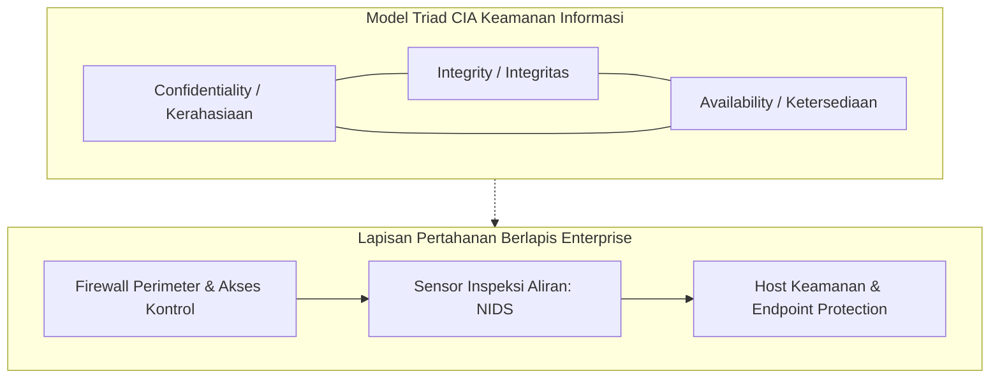
*Gambar 2.1 Model CIA Triad dan Konsep Pertahanan Berlapis Jaringan.*

---

## 2.2 Klasifikasi Serangan Siber

Serangan siber terhadap jaringan komputer memiliki taksonomi yang luas berdasarkan tujuan penyerang, protokol yang dieksploitasi, dan mekanisme gangguan yang ditimbulkan. Dalam penelitian ini, analisis difokuskan pada tiga kategori utama perilaku lalu lintas data yang bersumber dari dataset tolok ukur CIC-IDS2017[8]:

### 2.2.1 Trafik Normal (BENIGN)
Trafik normal merepresentasikan seluruh aliran komunikasi data sah yang dihasilkan oleh pengguna dan aplikasi resmi di dalam jaringan[8]. Aliran ini mencakup protokol web (HTTP/HTTPS), kueri *Domain Name System* (DNS), pertukaran surat elektronik (SMTP, IMAP), sinkronisasi waktu jaringan (NTP), serta lalu lintas manajemen internal. Karakteristik statistik dari trafik normal ditandai oleh distribusi panjang paket (*packet length*) yang heterogen, interval waktu kedatangan antar-paket (*inter-arrival time* / IAT) yang bervariasi sesuai interaksi manusia, serta rasio dua arah (*forward/backward packets*) yang proporsional sesuai standar protokol TCP/IP.

### 2.2.2 Serangan Brute-Force SSH (SSH-Patator)
Protokol *Secure Shell* (SSH) yang beroperasi pada port standar 22 merupakan protokol de facto untuk administrasi jarak jauh pada server Linux dan perangkat jaringan. Serangan **SSH-Patator** adalah serangan audit penetrasi otomatis multi-utas (*multi-threaded brute force tool*) yang mencoba ratusan hingga ribuan kombinasi *username* dan *password* dari basis data kamus (*dictionary attack*) dalam upaya membobol akun administrator[8].  
Karakteristik statistik aliran (*flow statistics*) dari serangan SSH-Patator meliputi:
- Terjadinya lonjakan koneksi TCP ke port 22 dalam jendela waktu yang sangat singkat.
- Durasi aliran yang sangat pendek (*short flow duration*) karena server target segera memutus koneksi via flag TCP RST atau FIN setelah pertukaran *handshake* autentikasi gagal.
- Konsistensi ukuran paket forward dan backward pada fase negosiasi kunci kriptografi awal sebelum pemutusan sesi.

### 2.2.3 Serangan Penolakan Layanan (Denial of Service / DoS)
Serangan **Denial of Service (DoS)** bertujuan melumpuhkan ketersediaan (*availability*) sistem target dengan membanjiri sumber daya komputasi (CPU, memori, bandwidth, atau kapasitas antrean koneksi soket web server) sehingga server tidak mampu melayani permintaan pengguna yang sah[8]. Penelitian ini menganalisis empat subvarian serangan DoS lapisan aplikasi (*application-layer DoS*):
1. **DoS Hulk:** Melancarkan pembanjiran permintaan HTTP GET bervolume tinggi dengan memanipulasi *header User-Agent* dan penyisipan parameter acak pada URL untuk menggagalkan mekanisme *caching* server web, memaksa server mengalokasikan siklus CPU dan memori secara berulang.
2. **DoS GoldenEye:** Mengeksploitasi mekanisme koneksi persisten HTTP (*keep-alive*) dan perintah *Cache-Control: no-cache* secara simultan dalam jumlah besar untuk menahan *worker process* server web tetap terkunci hingga kapasitas *thread pool* habis.
3. **DoS slowloris:** Serangan tingkat rendah berkecepatan lambat (*low-and-slow*) yang mengirimkan fragmen *header* HTTP parsial secara berkala dengan interval lambat. Server target dipaksa menahan soket koneksi tetap terbuka sambil menunggu *header* selesai, menghabiskan batas konkurensi koneksi server tanpa menimbulkan lonjakan volume trafik yang mencurigakan.
4. **DoS Slowhttptest:** Mengeksploitasi protokol HTTP dengan mengirimkan muatan *body* permintaan POST secara sangat lambat (misalnya 1 bita per interval waktu tertentu), mengunci sumber daya penerimaan data server web secara berkepanjangan.

---

## 2.3 Hasil Penelitian Terdahulu

Penelitian terkait penerapan kecerdasan buatan untuk deteksi intrusi jaringan terdistribusi dan adaptif telah berkembang pesat dalam beberapa tahun terakhir. Tinjauan kritis terhadap literatur ilmiah berfokus pada tiga kelompok kajian utama:

Pertama, pada domain pembelajaran terdistribusi, *Federated Learning* (FL) yang diperkenalkan oleh McMahan et al.[3] melalui algoritma *Federated Averaging* (FedAvg) telah menjadi fondasi utama pelatihan kolaboratif lintas node tanpa transmisi data mentah. Penerapan FedAvg pada NIDS telah diteliti oleh Popoola et al.[13] untuk mendeteksi serangan *zero-day* pada jaringan IoT dan Ruzafa-Alcazar et al.[12] pada lingkungan *edge computing*. Namun, mayoritas studi FL-NIDS mengasumsikan data terdistribusi secara independen dan identik (IID). Pada kondisi nyata, data lalu lintas jaringan bersifat *non-Identical and Independently Distributed* (non-IID), yang secara teoretis dibuktikan oleh Zhao et al.[4] dapat memicu divergensi bobot (*weight divergence*) dan menurunkan akurasi model global secara signifikan.

Kedua, pada domain pembelajaran berkelanjutan (*Continual Learning* / CL), adaptasi model NIDS terhadap kelas serangan baru secara sekuensial menghadapi kendala berat berupa *catastrophic forgetting*[5]. Ketika model dilatih pada serangan baru, representasi bobot lama tertimpa sehingga kemampuan mendeteksi serangan terdahulu merosot drastis. Berbagai metode mitigasi telah diajukan, seperti *Experience Replay* dan *Gradient Episodic Memory* (GEM) oleh Lopez-Paz dan Ranzato[10], serta integrasi FL-CL oleh Chen et al.[11]. Namun, metode berbasis *replay* mengharuskan penyimpanan sampel data mentah di memori lokal, yang membebani kapasitas RAM perangkat *edge* dan berpotensi melanggar privasi pengguna. Sebaliknya, metode regularisasi parameter *Elastic Weight Consolidation* (EWC) yang dirumuskan oleh Kirkpatrick et al.[5] dan diuji pada ancaman infrastruktur kritis oleh Al-Abassi et al.[16] menawarkan keunggulan proteksi memori murni pada ruang bobot melalui Matriks Informasi Fisher tanpa menyimpan sampel data lama.

Ketiga, pada domain evaluasi dan integritas dataset tolok ukur CIC-IDS2017, studi audit mutakhir oleh Rosay et al.[6] dan Dube[7] membuktikan adanya cacat desinkronisasi pelabelan *timestamp* yang parah pada berkas hari Kamis serta kelangkaan sampel mikro ekstrem pada kelas tertentu. Di samping itu, Engelen et al.[9] mengidentifikasi fenomena *shortcut learning* (kebocoran fitur nomor port layanan), di mana model NIDS cenderung menghafal nomor port tujuan (*Destination Port*) daripada mempelajari dinamika perilaku statistik paket yang sebenarnya. Dalam konteks latensi operasional, penelitian skripsi terdahulu oleh Hafizh[14] menegaskan pentingnya pengukuran efisiensi inferensi tingkat mikrodetik per aliran data pada arsitektur pendeteksi anomali.

Berdasarkan kajian kritis tersebut, posisi ilmiah dan kebaruan (*novelty*) dari penelitian tugas akhir ini dirangkum dalam Tabel 2.1, yang mengintegrasikan paradigma FedAvg dan EWC di bawah distribusi non-IID dua klien, menerapkan pembersihan ketat bebas kebocoran fitur nomor port, serta mengukur ketahanan memori dan profil efisiensi komputasi model.

*Tabel 2.1 Perbandingan Penelitian Terdahulu dalam Domain FL, Continual Learning, dan NIDS.*
| No | Penulis & Tahun | Judul Penelitian | Metode / Algoritma | Dataset | Kontribusi Utama | Keterbatasan / Research Gap |
| :---: | :--- | :--- | :--- | :--- | :--- | :--- |
| 1 | Rosay et al.[6] | *Cost-effective Network Intrusion Detection* | Audit & ML Analysis | CIC-IDS2017 | Mengidentifikasi desinkronisasi timestamp hari Kamis pada CIC-IDS2017 | Hanya melakukan audit dataset, tidak merancang mitigasi continual learning. |
| 2 | Engelen et al.[9] | *Troubleshooting an Intrusion Detection Dataset* | Feature Importance Audit | CIC-IDS2017 | Membuktikan *shortcut learning* akibat penggunaan fitur `Destination Port` | Hanya fokus pada analisis fitur, tidak menguji arsitektur terdistribusi. |
| 3 | Dube[7] | *Data Leakage and Quality in IDS Datasets* | Audit Statistik | CIC-IDS2017 | Menemukan kelangkaan data ekstrem kelas Infiltration dan Sql Injection | Belum mengusulkan arsitektur model deteksi federasi. |
| 4 | Kirkpatrick et al.[5] | *Overcoming catastrophic forgetting in neural networks* | EWC & Fisher Information | Permuted MNIST | Merumuskan dasar matematis EWC menggunakan regularisasi Fisher diagonal | Diuji pada domain visi komputer sederhana, bukan lalu lintas jaringan. |
| 5 | McMahan et al.[3] | *Communication-Efficient Learning of Deep Networks* | Federated Averaging (FedAvg) | MNIST, CIFAR-10 | Menetapkan standar arsitektur Federated Learning terdistribusi | Mengasumsikan data seimbang dan tidak membahas *catastrophic forgetting*. |
| 6 | Zhao et al.[4] | *Federated Learning with Non-IID Data* | Analisis Divergensi Bobot | CIFAR-10 | Membuktikan secara teoretis degradasi FedAvg pada distribusi non-IID | Membutuhkan pembagian data publik sentral untuk menstabilkan model. |
| 7 | Lopez-Paz & Ranzato[10] | *Gradient Episodic Memory for Continual Learning* | GEM / BWT Metric | CIFAR-100 | Memperkenalkan formulasi metrik evaluasi *Backward Transfer* (BWT) | Solusi berbasis memori penyangga (*buffer*) yang rentan privasi. |
| 8 | Chen et al.[11] | *Federated Class-Incremental Learning* | FCL + Distilasi Pengetahuan | Visi Komputer | Mengintegrasikan FL dan CL untuk penambahan kelas sekuensial | Membutuhkan pertukaran representasi data sintetis antar-klien. |
| 9 | Ruzafa-Alcazar et al.[12] | *D-FLIDS: Decentralized Federated IDS* | FedAvg MLP | CIC-IDS2017 | Menerapkan federasi NIDS pada sensor edge | Mempertahankan `Destination Port` (rentan *shortcut learning*) dan data IID. |
| 10 | Popoola et al.[13] | *Federated Deep Learning for Zero-Day Attacks* | FedAvg DNN | BoT-IoT | Deteksi serangan baru pada jaringan IoT | Tidak menangani *catastrophic forgetting* saat kelas baru dilatih. |
| 11 | Hafizh[14] | *Deteksi Intrusi Jaringan Semi-Supervised GNN-AE* | Structemp GNN-AE | NF-UQ-NIDS-v2 | Implementasi deteksi anomali real-time dan evaluasi latensi $\mu\text{s}$ | Pembelajaran tersentralisasi statis, tidak mengkaji FL terdistribusi dan CL. |
| 12 | Sarhan et al.[15] | *Standard Feature Set for Network Intrusion Detection* | NetFlow Feature Engineering | NetFlow-V2 | Menstandardisasi ekstraksi fitur aliran berbasis flow | Menggunakan representasi fitur tergeneralisasi, bukan investigasi raw flow. |
| 13 | Al-Abassi et al.[16] | *Continual Learning for Cyber Threat Intelligence* | EWC & Replay | CSE-CIC-IDS2018 | Menerapkan continual learning pada IDS sentral | Beroperasi pada server tunggal, mengabaikan privasi data terdistribusi. |
| 14 | **Penelitian Ini (2026)** | **Analisis Kinerja Deteksi Network Traffic Intrusion via FCL** | **FedAvg + EWC + Weighted Loss (63 Fitur)** | **CIC-IDS2017** | **Mengintegrasikan FedAvg & EWC, mitigasi port leakage, mitigasi non-IID & imbalanced class, evaluasi BWT, RAM, payload, dan latensi $\mu\text{s}$** | **Memberikan solusi FCL terpadu yang adaptif, aman privasi, dan terverifikasi secara multi-seed.** |

---

## 2.4 Federated Learning (FL)

*Federated Learning* (FL) merupakan paradigma pembelajaran mesin terdistribusi yang memungkinkan sejumlah besar node klien (misalnya sensor jaringan, perangkat edge, atau server perimeter) untuk melatih model secara kolaboratif di bawah koordinasi server agregator terpusat tanpa harus memusatkan data pelatihan lokal ke server tersebut[3].

### 2.4.1 Arsitektur Federated Learning
Secara umum, arsitektur FL terdiri atas dua entitas utama:
1. **Server Agregator:** Menginisialisasi parameter bobot global $w_0$, menyiarkan parameter model ke klien yang berpartisipasi pada setiap ronde komunikasi, mengumpulkan pembaruan bobot lokal, serta menghitung parameter model global baru melalui fungsi agregasi.
2. **Klien Federasi ($K$ Klien):** Setiap klien menyimpan dataset lokal $\mathcal{D}_k$ secara privat. Pada setiap ronde komunikasi $t$, klien mengunduh bobot global $w_t$, melakukan optimasi lokal berbasis *Stochastic Gradient Descent* (SGD) atau AdamW selama $E$ epoch menggunakan data lokalnya, lalu mengirimkan bobot terlatih $w_{t+1}^k$ kembali ke server.

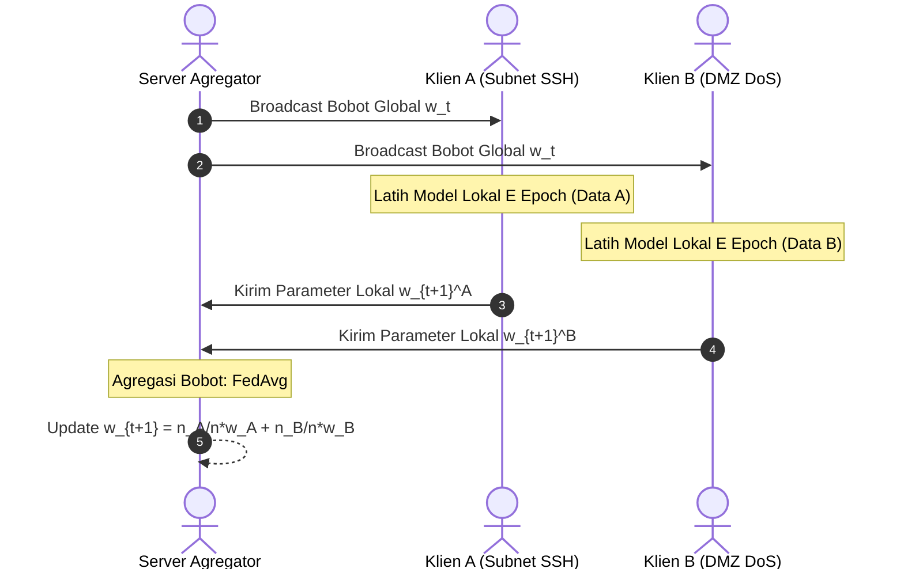
*Gambar 2.2 Siklus Pelatihan dan Agregasi Bobot pada Federated Learning (FedAvg).*

### 2.4.2 Algoritma Federated Averaging (FedAvg)
Algoritma standar paling populer dalam FL adalah *Federated Averaging* (FedAvg). Pada setiap ronde komunikasi $t \in \{1, 2, \dots, T\}$[3]:
$$w_{t+1} = \sum_{k=1}^{K} \frac{n_k}{n} w_{t+1}^k$$
di mana $n_k = |\mathcal{D}_k|$ adalah jumlah sampel lokal pada klien $k$, dan $n = \sum_{k=1}^K n_k$ adalah total seluruh sampel di seluruh klien.

### 2.4.3 Tantangan Heterogenitas Data Non-IID
Pada lingkungan jaringan komputer nyata, asumsi bahwa data terdistribusi secara independen dan identik (*Independent and Identically Distributed* / IID) hampir selalu dilanggar. Fenomena ini disebut **Non-IID Data**. Bentuk non-IID paling dominan pada NIDS adalah ketimpangan distribusi label (*label distribution skew*), di mana Klien A di subnet internal dominan menangani serangan autentikasi SSH, sedangkan Klien B di zona publik dominan menangani serangan DoS. Heterogenitas non-IID terbukti secara teoretis menyebabkan pembaruan gradien lokal mengarah pada titik minimum lokal yang saling bertolak belakang (*weight divergence*), yang memperlambat konvergensi dan menurunkan akurasi model global[4].

---

## 2.5 Continual Learning dan Catastrophic Forgetting

*Continual Learning* (CL) atau *Lifelong Learning* adalah cabang pembelajaran mesin yang berfokus pada kemampuan model kecerdasan buatan untuk mempelajari aliran tugas atau kelas data baru secara sekuensial dari waktu ke waktu tanpa melupakan representasi pengetahuan yang telah dipelajari dari tugas masa lalu.

### 2.5.1 Catastrophic Forgetting
Jaringan saraf tiruan (*Deep Neural Networks*) modern memiliki kecenderungan bawaan yang parah terhadap fenomena **catastrophic forgetting** saat mempelajari aliran tugas baru secara berurutan[5]. Ketika model dilatih pada tugas pertama $\mathcal{T}_1$, bobot sinaptik $\theta$ dioptimasi untuk meminimalkan fungsi kerugian $\mathcal{L}_1$. Ketika tugas baru $\mathcal{T}_2$ diberikan, proses *backpropagation* akan memperbarui bobot $\theta$ demi meminimalkan $\mathcal{L}_2$. Pembaruan bobot ini menimpa (*overwrite*) konfigurasi parameter yang bertanggung jawab atas pengenalan $\mathcal{T}_1$, menyebabkan akurasi model terhadap $\mathcal{T}_1$ runtuh seketika mendekati nol.

### 2.5.2 Taksonomi Skenario Continual Learning
Berdasarkan ketersediaan identitas tugas (*Task-ID*) saat inferensi, Continual Learning diklasifikasikan ke dalam tiga skenario operasional[17]:
1. **Task-Incremental Learning (Task-IL):** Model selalu diberikan informasi Task-ID saat pelatihan dan inferensi.
2. **Domain-Incremental Learning (Domain-IL):** Struktur kelas keluaran tetap sama, namun distribusi fitur masukan berubah seiring waktu.
3. **Class-Incremental Learning (Class-IL):** Model harus mengenali seluruh kelas dari semua tugas tanpa pernah diberikan Task-ID saat inferensi. Skenario ini adalah yang paling menantang dan paling realistis untuk sistem deteksi intrusi jaringan operasional.

### 2.5.3 Strategi Mitigasi Forgetting
Secara umum, terdapat tiga kelompok strategi mitigasi lupa dalam literatur continual learning:
- **Replay-based:** Menyimpan sebagian data mentah masa lalu dalam *replay buffer* (misal: *Experience Replay*). Kelemahan: membebani kapasitas RAM dan melanggar prinsip privasi data pada FL.
- **Architecture-based:** Menambah kapasitas neuron atau modul khusus untuk setiap tugas baru. Kelemahan: parameter model terus membengkak seiring bertambahnya tugas.
- **Regularization-based:** Menambahkan suku penalti pada fungsi kerugian untuk membatasi pergeseran bobot penting masa lalu tanpa memerlukan penyimpanan sampel data mentah.

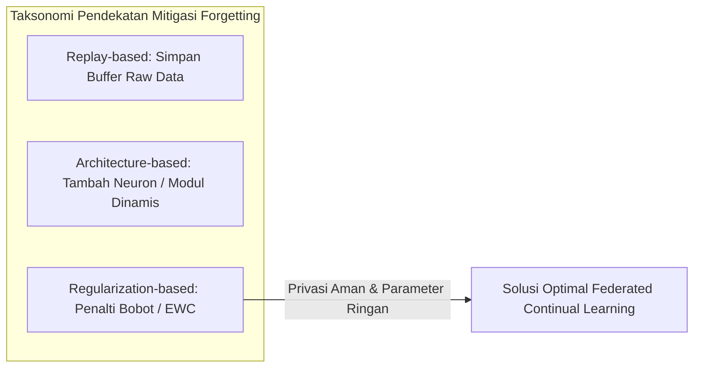
*Gambar 2.3 Taksonomi Pendekatan Mitigasi Catastrophic Forgetting.*

---

## 2.6 Network Intrusion Detection System (NIDS)

*Network Intrusion Detection System* (NIDS) merupakan mekanisme pertahanan siber yang ditempatkan pada infrastruktur jaringan untuk menginspeksi lalu lintas data dan mendeteksi aktivitas mencurigakan yang mengindikasikan adanya intrusi, eksploitasi kerentanan, atau pelanggaran kebijakan keamanan[14].

### 2.6.1 NIDS vs HIDS
Berdasarkan lokasi penempatannya, IDS terbagi menjadi dua kategori utama:
1. **Host-Based IDS (HIDS):** Beroperasi langsung pada sistem operasi host individual untuk memantau log sistem, integritas berkas (*file integrity*), dan panggilan sistem (*system calls*).
2. **Network-Based IDS (NIDS):** Beroperasi secara tersentralisasi pada tautan jaringan (*network links*) untuk memantau seluruh paket yang melintasi subnet. Keunggulan NIDS adalah sifatnya yang tidak mengonsumsi sumber daya komputasi dari server aplikasi dan mampu memantau banyak perangkat secara simultan.

### 2.6.2 Signature-Based vs Anomaly-Based NIDS
Secara metodologis, NIDS terbagi menjadi:
- **Signature-Based (SIDS):** Bekerja dengan mencocokkan lalu lintas terhadap basis data tanda tangan serangan (*signatures*). SIDS sangat efektif untuk ancaman lama namun gagal mendeteksi serangan baru (*zero-day*)[13].
- **Anomaly-Based (ABDS):** Memodelkan perilaku lalu lintas normal dan menandai deviasi statistik sebagai potensi ancaman. ABDS modern menggunakan teknik pembelajaran mesin untuk memprediksi probabilitas anomali berdasarkan fitur aliran jaringan (*bidirectional flow features*)[14].

---

## 2.7 PyTorch dan Framework Flower

Pengembangan sistem NIDS adaptif terdistribusi dalam penelitian ini memanfaatkan integrasi dua kerangka kerja komputasi terbuka standar industri:

### 2.7.1 PyTorch
PyTorch merupakan pustaka komputasi ilmiah dan *deep learning* berbasis Python yang dikembangkan oleh Meta AI. Keunggulan fundamental PyTorch meliputi:
- **Dynamic Computational Graph (Autograd):** Menggunakan graf komputasi dinamis yang memungkinkan fleksibilitas penuh dalam modifikasi arsitektur jaringan saraf tiruan saat waktu eksekusi (*runtime*).
- **Akselerasi Perangkat Keras GPU:** Menyediakan integrasi mulus dengan *NVIDIA CUDA* dan pustaka *cuDNN* untuk mempercepat komputasi tensor bervolume masif.
- **Kustomisasi Fungsi Kerugian:** Memungkinkan formulasi rugi kustom secara langsung, seperti penggabungan *Weighted Cross-Entropy Loss* dengan penalti kuadratik EWC berbasis perkalian tensor elemen-per-elemen.

### 2.7.2 Flower Framework (`flwr`)
Flower merupakan kerangka kerja *Federated Learning* modular dan agnostik yang dirancang untuk riset serta implementasi industri berskala besar[18]. Keunggulan Flower mencakup:
- **Arsitektur Klien-Server Fleksibel:** Memisahkan logika pelatihan lokal pada klien (`NumPyClient`) dan strategi agregasi global pada server (`flwr.server.strategy.FedAvg`).
- **Skalabilitas Heterogen:** Mendukung simulasi ribuan node klien secara lokal menggunakan abstraksi *Virtual Client Engine* (Ray) maupun koneksi jaringan TCP/gRPC nyata antar-perangkat fisik.
- **Kompatibilitas PyTorch:** Memungkinkan serialisasi parameter bobot model PyTorch ke dalam array NumPy secara efisien dengan *overhead* komunikasi minimal.

---

## 2.8 Multilayer Perceptron (MLP)

Untuk memenuhi batasan komputasi perangkat gerbang jaringan (*edge gateway*) dan menghindari latensi komputasi yang tinggi, arsitektur model klasifikasi dirancang menggunakan **Multilayer Perceptron (MLP)** kompak tiga lapis terhubung penuh (*Fully Connected Layers*).

### 2.8.1 Struktur Matematika MLP
Model menerima vektor fitur masukan $x \in \mathbb{R}^{63}$ yang merepresentasikan statistik aliran paket:
$$\begin{aligned}
h_1 &= f_1(W_1 x + b_1), \quad W_1 \in \mathbb{R}^{64 \times 63}, \ b_1 \in \mathbb{R}^{64} \\
h_2 &= f_2(W_2 h_1 + b_2), \quad W_2 \in \mathbb{R}^{32 \times 64}, \ b_2 \in \mathbb{R}^{32} \\
z &= W_3 h_2 + b_3, \quad W_3 \in \mathbb{R}^{3 \times 32}, \ b_3 \in \mathbb{R}^{3} \\
\hat{y} &= \text{Softmax}(z)
\end{aligned}$$
di mana $f_1$ dan $f_2$ adalah fungsi aktivasi non-linear ReLU.

### 2.8.2 Alasan Pemilihan Arsitektur Kompak
Model dengan 63 fitur masukan, 64 neuron pada lapisan tersembunyi pertama, 32 neuron pada lapisan tersembunyi kedua, dan 3 neuron keluaran memiliki total parameter:
$$|\theta| = (63 \times 64 + 64) + (64 \times 32 + 32) + (32 \times 3 + 3) = 4.096 + 2.080 + 99 = 6.275 \text{ parameter}$$
Dengan presisi angka mengambang 32-bit (*float32* / 4 bita), ukuran biner parameter model hanya sekitar **25,1 KB**. Ukuran yang sangat ringkas ini memungkinkan proses transfer bobot pada setiap ronde federasi selesai dalam hitungan milidetik dan memungkinkan inferensi lokal dieksekusi dalam skala waktu mikrodetik per aliran data.

---

## 2.9 Elastic Weight Consolidation (EWC)

*Elastic Weight Consolidation* (EWC) merupakan metode mitigasi *catastrophic forgetting* berbasis regularisasi parameter yang terinspirasi oleh fenomena konsolidasi memori sinaptik pada otak biologis[5].

### 2.9.1 Landasan Teoretis Bayes dan Matriks Fisher
Dari perspektif inferensi Bayesian, mempelajari tugas kedua $\mathcal{D}_2$ setelah menyelesaikan tugas pertama $\mathcal{D}_1$ dirumuskan melalui probabilitas posterior parameter $\theta$:
$$\log p(\theta \mid \mathcal{D}_1, \mathcal{D}_2) = \log p(\mathcal{D}_2 \mid \theta) + \log p(\theta \mid \mathcal{D}_1) - \log p(\mathcal{D}_2)$$
Distribusi posterior $\log p(\theta \mid \mathcal{D}_1)$ memuat seluruh informasi mengenai tugas pertama. Melalui aproksimasi deret Taylor orde kedua di sekitar parameter optimal tugas pertama $\theta_1^*$, fungsi ini dapat didekati sebagai distribusi Gaussian dengan presisi yang ditentukan oleh **Matriks Informasi Fisher (Fisher Information Matrix / FIM)**:
$$F = \mathbb{E}_{x \sim \mathcal{D}_1, y \sim p(y \mid x, \theta_1^*)} \left[ \nabla_\theta \log p(y \mid x, \theta_1^*) \nabla_\theta \log p(y \mid x, \theta_1^*)^T \right]$$

### 2.9.2 Matriks Fisher Diagonal dan Formulasi Kerugian EWC
Untuk menghindari komputasi inversi matriks kovariansi penuh yang berukuran $|\theta| \times |\theta|$, EWC mengasumsikan elemen-elemen Fisher saling independen dan hanya menghitung elemen diagonalnya ($F_i$):
$$F_i = \frac{1}{N} \sum_{n=1}^N \left( \frac{\partial \log p(y_n \mid x_n, \theta_1^*)}{\partial \theta_i} \right)^2$$
Ketika model dilatih pada tugas kedua, fungsi kerugian total lokal dimodifikasi menjadi:
$$\mathcal{L}_{\text{total}}(\theta) = \mathcal{L}_2(\theta) + \sum_{i} \frac{\lambda}{2} F_i (\theta_i - \theta_{1, i}^*)^2$$
di mana $\lambda$ adalah koefisien hiperparameter penalti EWC yang mengontrol seberapa kuat model mempertahankan memori tugas lama dibandingkan mempelajari tugas baru.

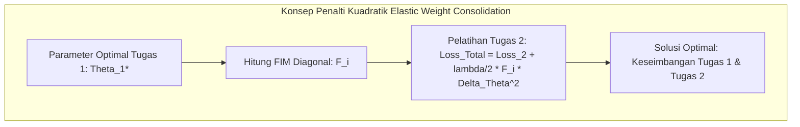
*Gambar 2.4 Mekanisme Regularisasi EWC Membatasi Pergeseran Bobot Kritis.*

### 2.9.3 Weighted Cross-Entropy dan Gradient Clipping
Untuk mengatasi ketimpangan kelas yang parah, fungsi kerugian dasar $\mathcal{L}_2(\theta)$ menggunakan pembobotan invers frekuensi kelas:
$$\mathcal{L}_{\text{CE}}(y, \hat{y}) = - \sum_{c=1}^{C} w_c \cdot y_c \log(\hat{y}_c), \quad \text{dengan } w_c = \frac{N_{\text{total}}}{C \cdot N_c}$$
Untuk mencegah lonjakan gradien akibat perkalian dengan bobot kelas minoritas yang besar dan penalti EWC, diterapkan pemotongan gradien (*Gradient Clipping*):
$$\text{jika } \|\mathbf{g}\|_2 > \gamma, \quad \text{maka } \mathbf{g} \leftarrow \frac{\gamma}{\|\mathbf{g}\|_2} \mathbf{g}, \quad \text{dengan } \gamma = 1.0$$

---

## 2.10 Karakteristik Dataset Tolok Ukur CIC-IDS2017

Dataset tolok ukur yang digunakan dalam penelitian ini adalah **CIC-IDS2017** (*Canadian Institute for Cybersecurity Intrusion Detection System 2017*). Dataset ini dibangun menggunakan topologi jaringan korban (*Victim Network*) dan jaringan penyerang (*Attack Network*) yang merekam lalu lintas paket nyata selama lima hari kerja (Senin s.d. Jumat)[8].

### 2.10.1 Karakteristik dan Komposisi Aliran Data
Lalu lintas jaringan mentah dalam bentuk *packet capture* (pcap) diekstraksi menggunakan perangkat lunak *CICFlowMeter* menjadi rekaman statistik aliran dua arah (*bidirectional flow features*). Berkas yang digunakan dalam penelitian ini mencakup[8]:
- **Senin (Monday):** Memuat lalu lintas operasional normal (BENIGN) secara eksklusif.
- **Selasa (Tuesday):** Memuat lalu lintas normal dan serangan penetrasi autentikasi SSH (*SSH-Patator*) serta FTP (*FTP-Patator*).
- **Rabu (Wednesday):** Memuat lalu lintas normal dan berbagai varian serangan *Denial of Service* (DoS Slowloris, Slowhttptest, Hulk, GoldenEye).

### 2.10.2 Audit Kritis dan Mitigasi Shortcut Learning (Port Leakage)
Berdasarkan telaah kritis terhadap literatur audit dataset IDS mutakhir, penelitian ini menerapkan protokol kurasi data yang ketat[6], [7], [9]:
1. **Eksklusi Berkas Hari Kamis dan Jumat:** Berkas hari Kamis dieksklusi karena menderita desinkronisasi timestamp pelabelan yang parah serta volume sampel kelas yang sangat langka (Infiltration hanya 36 baris, Sql Injection hanya 21 baris)[6], [7].
2. **Deduplikasi Baris Penuh:** Sebanyak 132.909 baris data duplikat identik dieliminasi dari dataset mentah untuk mencegah kebocoran data (*data snooping*) antar-partisi.
3. **Eliminasi 10 Fitur Zero-Variance:** Kolom yang bernilai konstan $0$ absolut di seluruh baris data dibuang karena tidak memberikan kontribusi entropi informasi.
4. **Eliminasi 5 Pasang Fitur Duplikat:** Kolom redundan yang identik 100% via hash (seperti `Fwd Header Length.1`) dibuang untuk menghilangkan multikolinearitas mutlak.
5. **Mitigasi Port Leakage:** Fitur `Destination Port` **secara sengaja dibuang**. Algoritma pembelajaran mesin terbukti cenderung mengambil jalan pintas (*shortcut learning*) dengan menghafal nomor port standar (port 22 untuk SSH dan port 80 untuk DoS), sehingga mencapai akurasi semu tanpa mempelajari dinamika aliran statistik paket[9]. Membuang `Destination Port` menjamin bahwa model dievaluasi secara otentik pada karakteristik statistik perilaku aliran.
6. **Hasil Reduksi:** Diperoleh tepat **63 fitur numerik bersih** ditambah 1 label kelas.

---

## 2.11 Evaluasi Metrik

Evaluasi sistem dilakukan secara komprehensif mencakup metrik kinerja deteksi kecerdasan buatan, metrik retensi continual learning, dan metrik profil komputasi perangkat.

### 2.11.1 Metrik Deteksi Pembelajaran Mesin
Dievaluasi berbasis matriks konfusi (*Confusion Matrix*) yang terdiri atas *True Positive* (TP), *True Negative* (TN), *False Positive* (FP), dan *False Negative* (FN) sebagaimana diilustrasikan pada Gambar 2.5:

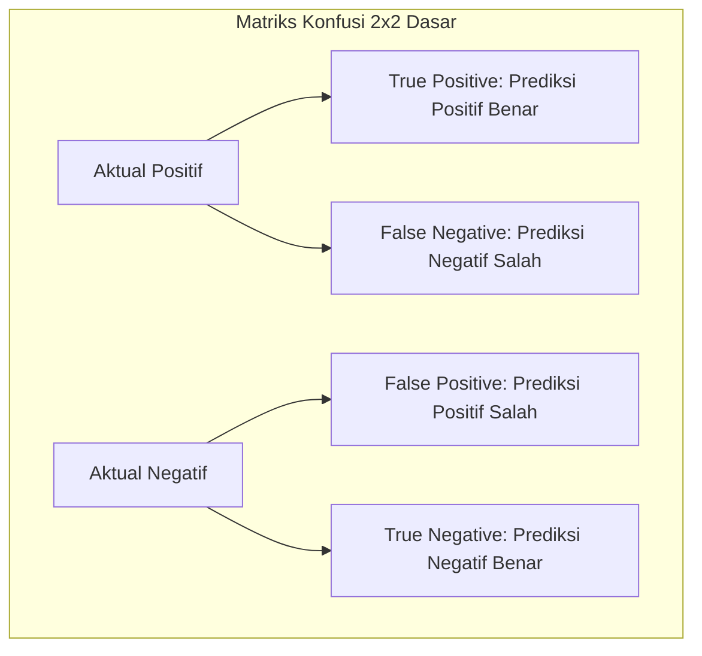
*Gambar 2.5 Struktur Dasar Confusion Matrix untuk Evaluasi Deteksi Biner dan Multi-kelas.*

- **Accuracy:** Mengukur proporsi prediksi benar terhadap total seluruh sampel:
  $$\text{Accuracy} = \frac{TP + TN}{TP + TN + FP + FN}$$
- **Precision:** Mengukur ketepatan deteksi positif dari seluruh alarm yang dibunyikan:
  $$\text{Precision} = \frac{TP}{TP + FP}$$
- **Recall (Sensitivity):** Mengukur kemampuan sistem dalam menangkap seluruh kejadian serangan yang sebenarnya:
  $$\text{Recall} = \frac{TP}{TP + FN}$$
- **Macro-Averaged F1 (Macro-F1):** Rata-rata harmonik antara Precision dan Recall yang dihitung independen per kelas lalu dirata-rata secara unweighted:
  $$\text{Macro-F1} = \frac{1}{C} \sum_{c=1}^C \frac{2 \cdot \text{Precision}_c \cdot \text{Recall}_c}{\text{Precision}_c + \text{Recall}_c}$$
  Metrik Macro-F1 menjadi metrik objektif utama karena tidak terdistorsi oleh dominasi kelas mayoritas normal.

### 2.11.2 Metrik Continual Learning: Backward Transfer (BWT)
Metrik **Backward Transfer (BWT)** mengukur pengaruh pembelajaran tugas baru ($\mathcal{T}_2$) terhadap performa tugas lama ($\mathcal{T}_1$)[10]:
$$\text{BWT} = R_{2, 1} - R_{1, 1}$$
di mana $R_{1, 1}$ adalah skor Macro-F1 pada tugas pertama sesaat setelah fase 1 selesai, dan $R_{2, 1}$ adalah skor Macro-F1 pada tugas pertama setelah model selesai dilatih pada fase 2. Nilai $\text{BWT} < 0$ menunjukkan terjadinya *catastrophic forgetting*, sedangkan $\text{BWT} \ge 0$ menandakan retensi memori sempurna.

### 2.11.3 Metrik Profiling Komputasi dan Instance
Pengukuran efisiensi komputasi mengadopsi standar evaluasi performa NIDS waktu nyata yang dirumuskan pada literatur rujukan skripsi teknik elektro terdahulu[14]:
1. **Waktu Inferensi per Flow ($\mu\text{s}$):** Rata-rata waktu eksekusi komputasi yang dibutuhkan model untuk memproses dan mengklasifikasikan satu sampel aliran data masukan:
   $$\text{Inference Time} = \frac{T_{\text{total}}}{N_{\text{flows}}} \quad (\mu\text{s/flow})$$
2. **Memory Footprint (Alokasi RAM):** Konsumsi memori fisik lokal antara metode EWC (vektor diagonal Fisher $\approx 25$ KB) terhadap *Experience Replay* (buffer sampel data mentah $\approx$ puluhan MB).
3. **Communication Overhead (KB/round):** Total volume transmisi parameter bobot model yang dipertukarkan antara klien dan server agregator per putaran federasi:
   $$\text{Payload} = 2 \times |\theta| \times \text{sizeof}(\text{float32}) \quad (\text{KB})$$

---

## 2.12 Bayesian Hyperparameter Tuning

Penyetelan hiperparameter (*hyperparameter tuning*) merupakan tahapan kritis untuk menemukan kombinasi parameter optimal yang memaksimalkan kinerja model. Dibandingkan metode *Grid Search* yang tidak efisien atau *Random Search* yang acak, penelitian ini mengadopsi metode **Bayesian Optimization** menggunakan kerangka kerja **Optuna**.

### 2.12.1 Algoritma Tree-structured Parzen Estimator (TPE)
Optuna mengimplementasikan algoritma *Tree-structured Parzen Estimator* (TPE)[19]. TPE memodelkan probabilitas kondisional $p(x \mid y)$ dari konfigurasi hiperparameter $x$ terhadap hasil evaluasi $y$ dengan membagi riwayat percobaan sebelumnya ke dalam dua distribusi terpisah:
$$p(x \mid y) = \begin{cases} \ell(x), & \text{jika } y < y^* \\ g(x), & \text{jika } y \ge y^* \end{cases}$$
di mana $y^*$ adalah nilai ambang kuantil performa terbaik. Nilai *Expected Improvement* (EI) dimaksimalkan dengan memilih hiperparameter yang memaksimumkan rasio $\frac{\ell(x)}{g(x)}$.

---

## 2.13 Optimizer

Algoritma pengoptimalan (*optimizer*) bertugas memperbarui bobot parameter jaringan saraf tiruan guna meminimalkan fungsi kerugian selama proses pelatihan *backpropagation*.

### 2.13.1 Stochastic Gradient Descent (SGD)
Algoritma SGD memperbarui parameter $\theta$ ke arah yang berlawanan dengan gradien fungsi kerugian:
$$\theta_{t+1} = \theta_t - \eta \nabla_\theta \mathcal{L}(\theta_t)$$
di mana $\eta$ adalah laju pembelajaran (*learning rate*). Meskipun sederhana dan memiliki generalisasi akhir yang baik, SGD rentan terjebak pada dataran datar (*saddle points*) dan memiliki laju konvergensi yang lambat pada permukaan kerugian yang memiliki kelengkungan tidak seragam.

### 2.13.2 AdamW (Decoupled Weight Decay)
Untuk mengatasi kelemahan SGD dan kekurangan algoritma Adam standar, penelitian ini menggunakan algoritma optimasi **AdamW**[20]. AdamW menghitung momen pertama ($m_t$) dan momen kedua ($v_t$) dari gradien untuk menyesuaikan laju pembaruan parameter secara adaptif, seraya memisahkan (*decoupling*) penalti *weight decay* ($\lambda_{\text{wd}}$) dari pembaruan gradien adaptif:
$$\begin{aligned}
m_t &= \beta_1 m_{t-1} + (1 - \beta_1) g_t \\
v_t &= \beta_2 v_{t-1} + (1 - \beta_2) g_t^2 \\
\hat{m}_t &= \frac{m_t}{1 - \beta_1^t}, \quad \hat{v}_t = \frac{v_t}{1 - \beta_2^t} \\
\theta_t &= \theta_{t-1} - \eta \left( \frac{\hat{m}_t}{\sqrt{\hat{v}_t} + \epsilon} + \lambda_{\text{wd}} \theta_{t-1} \right)
\end{aligned}$$
Pemisahan penalti bobot ini mencegah distorsi regulasi L2 pada arah gradien adaptif, menghasilkan kestabilan pelatihan yang superior pada arsitektur MLP.

---

## 2.14 Fungsi Aktivasi

Fungsi aktivasi merupakan komponen esensial pada machine learning dan deep learning. Fungsinya adalah memperkenalkan sifat non-linearitas ke dalam sistem, yang memungkinkan model untuk mempelajari dan mengekspresikan hubungan kompleks antar-fitur dalam ruang aliran lalu lintas jaringan.

### 2.14.1 Rectified Linear Unit (ReLU)
Fungsi aktivasi utama yang digunakan pada lapisan tersembunyi model MLP adalah **ReLU**:
$$f(x) = \max(0, x)$$
Keunggulan fundamental ReLU meliputi:
- **Efisiensi Komputasi:** Hanya memerlukan operasi perbandingan ambang batas sederhana tanpa melibatkan operasi eksponensial yang mahal.
- **Mitigasi Vanishing Gradient:** Menghasilkan turunan konstan bernilai $1$ untuk seluruh nilai masukan positif ($x > 0$), memungkinkan perambatan gradien yang stabil melintasi lapisan-lapisan jaringan.

### 2.14.2 Softmax
Pada lapisan keluaran klasifikasi multi-kelas, fungsi **Softmax** digunakan untuk mengubah nilai logit mentah $z \in \mathbb{R}^C$ menjadi distribusi probabilitas ternormalisasi:
$$\text{Softmax}(z_i) = \frac{e^{z_i}}{\sum_{j=1}^C e^{z_j}}, \quad \text{untuk } i = 1, \dots, C$$
di mana setiap elemen keluaran memenuhi batas $0 \le \hat{y}_i \le 1$ dan $\sum_{i=1}^C \hat{y}_i = 1$, merepresentasikan tingkat keyakinan model terhadap kelas BENIGN, SSH-Patator, atau DoS.

\newpage

# BAB 3 METODOLOGI

Bab ini menguraikan metode yang digunakan, bahan dan peralatan penelitian, alur urutan pelaksanaan penelitian, tahapan praproses data, arsitektur sistem terdistribusi, perancangan konseptual penerapan waktu nyata, matriks skenario pengujian komparatif, dan jadwal pelaksanaan kegiatan penelitian. Penelitian ini berfokus pada evaluasi integrasi *Federated Learning* (FL) dan *Continual Learning* (CL) berbasis *Elastic Weight Consolidation* (EWC) pada sistem deteksi intrusi jaringan (*Network Intrusion Detection System* / NIDS). Struktur penyusunan bab ini diselaraskan secara penuh dengan format Buku Pedoman Penyusunan Laporan Tugas/Proyek Akhir Program Sarjana dan Sarjana Terapan Departemen Teknik Elektro, FTEIC, Institut Teknologi Sepuluh Nopember (ITS) berdasarkan SK Rektor No. 280/IT2/T/HK.00.01/2022 serta rujukan skripsi alumnus Departemen Teknik Elektro FTEIC ITS ([Referensi-Skripsi-Hafizh.pdf](../Proposal/Referensi-Skripsi-Hafizh.pdf))[14].

---

## 3.1 Metode yang Digunakan

Penelitian ini mengembangkan sistem deteksi intrusi jaringan terdistribusi dan adaptif berbasis *Federated Continual Learning* (FCL) yang menggabungkan algoritma *Federated Averaging* (FedAvg)[3] dan regularisasi *Elastic Weight Consolidation* (EWC)[5] dengan arsitektur *Multilayer Perceptron* (MLP) kompak untuk mengatasi degradasi memori katastrofik (*catastrophic forgetting*) pada kondisi data heterogen (*non-IID*) dan aliran serangan yang muncul secara sekuensial. Metodologi ini dirancang secara khusus untuk mengatasi dua dilema utama dalam keamanan siber modern:
1. **Dilema Privasi dan Isolasi Data:** Keharusan menjaga kerahasiaan data lalu lintas internal tanpa memindahkan rekaman paket mentah ke server eksternal, yang diselesaikan melalui paradigma *Federated Learning*.
2. **Dilema Stabilitas vs Plastisitas (*Stability-Plasticity Dilemma*):** Kecenderungan jaringan saraf tiruan untuk menimpa representasi serangan lama saat mempelajari serangan baru secara berkelanjutan, yang diselesaikan melalui regularisasi penalti kuadratik EWC berbasis Matriks Informasi Fisher diagonal tanpa memerlukan memori penyangga (*replay buffer*).

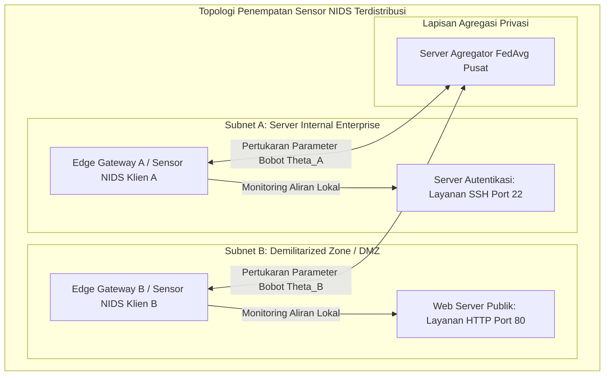
*Gambar 3.1 Arsitektur Penempatan Sensor NIDS Terdistribusi dalam Jaringan Enterprise.*

Untuk mengidentifikasi akar penyebab kegagalan NIDS terdistribusi dan merumuskan solusi teknis yang sistematis, disusun diagram sebab-akibat (*Fishbone Diagram*) sebagaimana diilustrasikan pada Gambar 3.2.

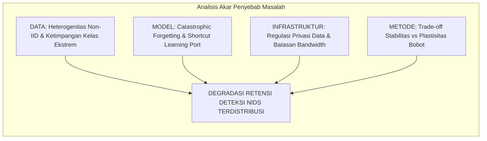
*Gambar 3.2 Fishbone Diagram Identifikasi Tantangan NIDS Terdistribusi.*

---

## 3.2 Bahan dan Peralatan yang Digunakan

### 3.2.1 Bahan Penelitian (Dataset Publik CIC-IDS2017)
Bahan utama yang digunakan dalam penelitian ini adalah dataset tolok ukur resmi **CIC-IDS2017** dari Canadian Institute for Cybersecurity[8]. Data merekam lalu lintas jaringan nyata selama lima hari kerja (Senin s.d. Jumat). Berkas yang digunakan secara spesifik adalah:
1. `Monday-WorkingHours.pcap_ISCX.csv`: 529.918 baris lalu lintas normal murni (BENIGN).
2. `Tuesday-WorkingHours.pcap_ISCX.csv`: 445.909 baris memuat serangan penetrasi autentikasi SSH (*SSH-Patator*).
3. `Wednesday-workingHours.pcap_ISCX.csv`: 692.703 baris memuat serangan *Denial of Service* (DoS Hulk, GoldenEye, slowloris, slowhttptest).

Berkas hari Kamis dan Jumat dieksklusi karena menderita desinkronisasi timestamp pelabelan yang parah serta kelangkaan sampel mikro ekstrem[6], [7].

### 3.2.2 Peralatan Penelitian (Perangkat Keras dan Perangkat Lunak)
Pengujian dijalankan pada lingkungan komputasi terstandarisasi untuk menjamin reproduktibilitas hasil eksperimen, dengan rincian spesifikasi perangkat keras dan perangkat lunak sebagaimana disajikan pada Tabel 3.1.

*Tabel 3.1 Spesifikasi Lingkungan Perangkat Keras dan Perangkat Lunak.*
| Kategori | Komponen | Spesifikasi Teknis |
| :--- | :--- | :--- |
| **Perangkat Keras** | Prosesor (CPU) | AMD Ryzen / Intel Core Multi-core ($\ge 8$ core) |
| | Memori Utama (RAM) | 16 GB DDR4/DDR5 |
| | Kartu Grafis (GPU) | NVIDIA GPU (VRAM $\ge 8$ GB dengan dukungan CUDA Cores) |
| | Media Penyimpanan | Solid State Drive (NVMe SSD) $\ge 512$ GB |
| **Perangkat Lunak** | Sistem Operasi | Linux Ubuntu 22.04 LTS / Windows 11 64-bit |
| | Lingkungan Eksekusi | Python 3.10+, PyTorch 2.2+, CUDA Toolkit 12.x |
| | Kerangka Kerja FL | Flower Framework (`flwr` $\ge 1.7.0$)[18] |
| | Penyetelan Bayesian | Optuna Framework ($\ge 3.5.0$)[19] |
| | Pustaka Analisis Data | Pandas, NumPy, Scikit-learn, PyArrow |

---

## 3.3 Urutan Pelaksanaan Penelitian

Alur urutan pelaksanaan penelitian disusun ke dalam tahapan yang sistematis dan terstruktur mulai dari persiapan data hingga analisis hasil akhir, sebagaimana disajikan pada diagram alir Gambar 3.3.

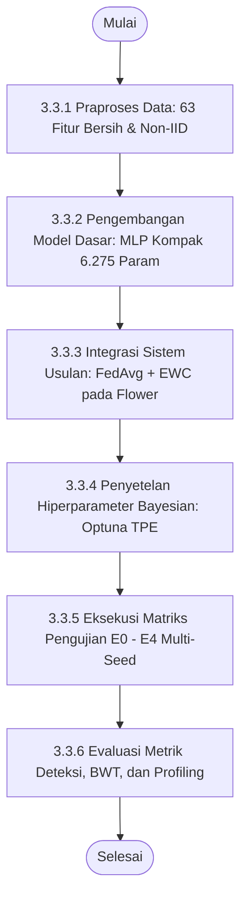
*Gambar 3.3 Diagram Alir Urutan Pelaksanaan Penelitian.*

### 3.3.1 Praproses Data dan Ekstraksi 63 Fitur Numerik
Tahapan praproses data dirancang secara ketat untuk mentransformasikan data mentah menjadi format masukan yang bersih, representatif, dan bebas bias *shortcut learning*.

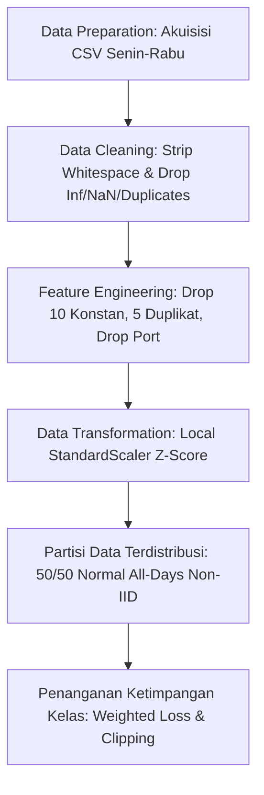
*Gambar 3.4 Diagram Alur Global Data Preprocessing.*

1. **Pembersihan Data (*Data Cleaning*):** Nama kolom distandardisasi (*whitespace trimming*). Nilai `+Infinity`, `-Infinity`, dan nilai kosong dikonversi ke `NaN` lalu dieliminasi. Sebanyak 132.909 baris data duplikat identik dieliminasi secara penuh sehingga tersisa **1.529.677 baris aliran unik bersih**.
2. **Rekayasa Fitur (*Feature Engineering*):**
   - 10 fitur bernilai konstan 0 dieliminasi (`Bwd PSH Flags`, `Bwd URG Flags`, `Fwd Avg Bytes/Bulk`, `Fwd Avg Packets/Bulk`, `Fwd Avg Bulk Rate`, `Bwd Avg Bytes/Bulk`, `Bwd Avg Packets/Bulk`, `Bwd Avg Bulk Rate`, `CWE Flag Count`, `Fwd URG Flags`).
   - 5 kolom duplikat identik via hash dibuang (seperti `Fwd Header Length.1`, `Subflow Fwd Bytes`, `Subflow Fwd Packets`, `Subflow Bwd Packets`, `SYN Flag Count`).
   - **Eliminasi Destination Port:** Fitur `Destination Port` **secara sengaja dibuang** untuk memitigasi bias *port leakage* dan memaksa model mempelajari karakteristik statistik paket murni[9].
   - Dihasilkan **63 fitur statistik numerik bersih** ditambah 1 label (Tabel 3.2).
3. **Transformasi Data (*Scaling*):** Fitur numerik diskalakan menggunakan standardisasi Z-score lokal ($z = \frac{x - \mu}{\sigma}$) yang dihitung murni dari set data pelatihan lokal pada masing-masing klien untuk mencegah *data snooping*.
4. **Partisi Non-IID:** Seluruh aliran `BENIGN` digabungkan lalu dibagi acak tepat **50% untuk Klien A** dan **50% untuk Klien B** (*stratified split*) guna mencegah bias hari perekaman. Klien A memuat Task 1 (Normal + SSH-Patator), Klien B memuat Task 2 (Normal + DoS), dengan rasio internal 70% latih, 15% validasi, dan 15% uji.
5. **Penanganan Ketimpangan Kelas:** Perbandingan kelas Normal terhadap SSH-Patator mencapai $\approx 414 : 1$. Mengatasi hal ini, diterapkan **Weighted Cross-Entropy Loss** berbasis invers frekuensi kelas terkalibrasi dan pemotongan gradien (*Gradient Clipping* norm $\le 1.0$).

*Tabel 3.2 Ringkasan 63 Fitur Statistik Numerik Aliran Bersih CIC-IDS2017.*
| Kategori Fitur | Jumlah | Nama Fitur |
| :--- | :---: | :--- |
| **Statistik Waktu & Durasi** | 5 | `Flow Duration`, `Flow IAT Mean`, `Flow IAT Std`, `Flow IAT Max`, `Flow IAT Min` |
| **Inter-Arrival Time (IAT)** | 10 | `Fwd IAT Total`, `Fwd IAT Mean`, `Fwd IAT Std`, `Fwd IAT Max`, `Fwd IAT Min`, `Bwd IAT Total`, `Bwd IAT Mean`, `Bwd IAT Std`, `Bwd IAT Max`, `Bwd IAT Min` |
| **Statistik Paket Maju (Fwd)** | 8 | `Total Fwd Packets`, `Total Length of Fwd Packets`, `Fwd Packet Length Max`, `Fwd Packet Length Min`, `Fwd Packet Length Mean`, `Fwd Packet Length Std`, `Fwd Header Length`, `act_data_pkt_fwd` |
| **Statistik Paket Balik (Bwd)** | 7 | `Total Backward Packets`, `Total Length of Bwd Packets`, `Bwd Packet Length Max`, `Bwd Packet Length Min`, `Bwd Packet Length Mean`, `Bwd Packet Length Std`, `Bwd Header Length` |
| **Kecepatan Transfer (Rates)** | 4 | `Flow Bytes/s`, `Flow Packets/s`, `Fwd Packets/s`, `Bwd Packets/s` |
| **Statistik Ukuran Paket** | 7 | `Min Packet Length`, `Max Packet Length`, `Packet Length Mean`, `Packet Length Std`, `Packet Length Variance`, `Average Packet Size`, `Avg Fwd Segment Size` |
| **Bendera TCP (Flags)** | 7 | `FIN Flag Count`, `RST Flag Count`, `PSH Flag Count`, `ACK Flag Count`, `URG Flag Count`, `ECE Flag Count`, `Fwd PSH Flags` |
| **Karakteristik Segmen & Jendela** | 7 | `Down/Up Ratio`, `Avg Bwd Segment Size`, `min_seg_size_forward`, `Init_Win_bytes_forward`, `Init_Win_bytes_backward`, `Subflow Bwd Bytes`, `Fwd Act Data Pkts` |
| **Aktivitas Temporal Aktif** | 4 | `Active Mean`, `Active Std`, `Active Max`, `Active Min` |
| **Aktivitas Temporal Idle** | 4 | `Idle Mean`, `Idle Std`, `Idle Max`, `Idle Min` |
| **Total Fitur Input** | **63** | *Seluruhnya bertipe numerik kontinu / diskret* |

### 3.3.2 Arsitektur Sistem Terdistribusi yang Diusulkan
Model klasifikasi dirancang menggunakan **Multilayer Perceptron (MLP)** kompak tiga lapis terhubung penuh (`Input(63) → Linear(64) → ReLU → Linear(32) → ReLU → Linear(3)`). Model ini hanya memiliki 6.275 parameter bobot ($\approx 25,1$ KB) sehingga sangat ringan untuk pertukaran parameter jaringan pada perangkat *edge*.

Mekanisme mitigasi *catastrophic forgetting* diimplementasikan dengan menambahkan modul kalkulasi **Matriks Informasi Fisher (FIM) diagonal** pada klien lokal setelah menyelesaikan pelatihan Task 1[5]. Saat mempelajari Task 2, klien menambahkan penalti kuadratik EWC ke fungsi kerugian lokal sebelum bobot diagregasi oleh server pusat menggunakan algoritma *Federated Averaging* (FedAvg)[3], sebagaimana diilustrasikan pada Gambar 3.5.

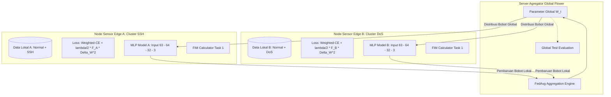
*Gambar 3.5 Arsitektur Sistem Federated Continual Learning yang Diimplementasikan.*

### 3.3.3 Rancangan Sistem untuk Penerapan Real-Time
Rancangan konseptual alur penerapan model hasil *Federated Continual Learning* pada infrastruktur gerbang jaringan nyata (*edge gateway deployment*) disusun dengan mengadopsi kerangka kerja analisis sistem deteksi intrusi waktu nyata pada skripsi rujukan alumnus Departemen Teknik Elektro FTEIC ITS ([Referensi-Skripsi-Hafizh.pdf](../Proposal/Referensi-Skripsi-Hafizh.pdf) Sub-bab 3.3.2), sebagaimana disajikan pada Gambar 3.6[14]. Sesuai batasan masalah, eksperimen fisik dalam tugas akhir ini **tidak melakukan injeksi paket langsung (*live packet injection*) ke kabel fisik**, melainkan memetakan arsitektur pipa pemrosesan sebagai landasan transisi dari model teruji ke penerapan lapangan.

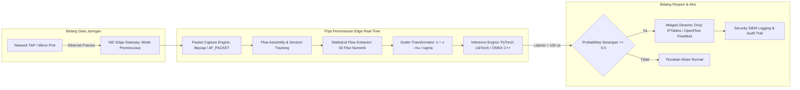
*Gambar 3.6 Rancangan Sistem Konseptual untuk Penerapan Real-Time pada Edge Gateway.*

### 3.3.4 Matriks Skenario Pengujian Komparatif E0–E4
Matriks pengujian komparatif dirancang mencakup lima skenario utama (E0 s.d. E4), sebagaimana disajikan pada Tabel 3.3.

*Tabel 3.3 Matriks Skenario Pengujian Eksperimen E0–E4.*
| Skenario | Topologi Pelatihan | Urutan Pembelajaran | Metode Mitigasi Forgetting | Tujuan Pengujian |
| :---: | :--- | :--- | :--- | :--- |
| **E0** | Sentralisasi Penuh | Simultan (Task 1 & Task 2 Bersama) | Tidak Perlu (*Joint*) | Batas atas (*upper bound*) performa model teoretis. |
| **E1** | Sentralisasi Penuh | Sekuensial (Task 1 $\to$ Task 2) | EWC vs Fine-tuning | Membuktikan fenomena *catastrophic forgetting* pada model sentral. |
| **E2** | Federated (2 Klien) | Terisolasi per Klien | Tanpa Proteksi CL | Mengukur dampak murni heterogenitas non-IID (*cross-silo isolation*). |
| **E3** | **Federated (2 Klien)** | **Sekuensial (Task 1 $\to$ Task 2)** | **EWC ($\lambda$ Optimal)** | **Inti Usulan:** Menguji retensi memori dan privasi model federasi. |
| **E4** | Federated (2 Klien) | Sekuensial (Task 1 $\to$ Task 2) | *Experience Replay* (Buffer 10%) | Pembanding *benchmark* akurasi, retensi BWT, dan alokasi memori RAM. |

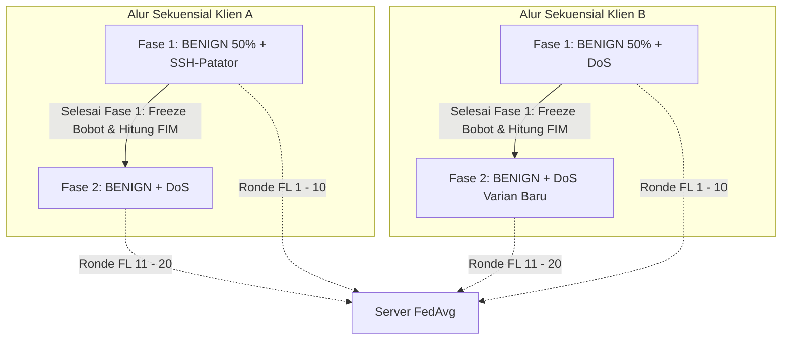
*Gambar 3.7 Diagram Alir Skenario Pengujian Sekuensial Non-IID.*

### 3.3.5 Mekanisme Evaluasi Multi-Seed dan Profiling Komputasi
Setiap skenario dievaluasi melintasi lima *random seed* (42, 43, 44, 45, 46) menggunakan metrik:
1. **Performa Deteksi ML:** Macro-F1, per-class Precision, Recall, dan Akurasi dievaluasi pada *test set* independen di akhir setiap fase.
2. **Retensi Continual Learning:** Metrik *Backward Transfer* (BWT) dihitung untuk mengukur degradasi memori: $\text{BWT} = R_{2, 1} - R_{1, 1}$[10].
3. **Efisiensi Komputasi & Instance:**
   - *Inference Time:* Rata-rata durasi prediksi per aliran data dalam mikrodetik ($\mu\text{s/flow}$) menggunakan timer presisi tinggi (`time.perf_counter_ns()`), mengadopsi standar evaluasi skripsi terdahulu[14].
   - *Memory Footprint:* Alokasi RAM fisik puncak (*peak RAM usage*) selama fase pelatihan dan penyimpanan parameter.
   - *Communication Payload:* Total ukuran data parameter biner yang dikirimkan per ronde federasi ($2 \times |\theta| \times 4$ bita $\approx 50,2$ KB/ronde).

### 3.3.6 Evaluasi Penyetelan Hiperparameter Bayesian
Penyetelan hiperparameter dijalankan melalui 50 *trials* Optuna berbasis algoritma TPE[19] dengan fungsi objektif memaksimalkan rata-rata Macro-F1 pada subset validasi, menyeimbangkan trade-off antara plastisitas pembelajaran tugas baru dan stabilitas memori tugas lama melalui penyesuaian koefisien penalti $\lambda$.

---

## 3.4 Jadwal Pelaksanaan Penelitian

Rencana pelaksanaan penelitian dijadwalkan dalam durasi 14 minggu (1 semester) sebagaimana dirangkum pada jadwal kegiatan Tabel 3.4 mengacu pada format Lampiran 5 Buku Pedoman ITS 2022.

*Tabel 3.4 Jadwal Pelaksanaan Penelitian Tugas Akhir.*
| No | Nama Kegiatan | 1 | 2 | 3 | 4 | 5 | 6 | 7 | 8 | 9 | 10 | 11 | 12 | 13 | 14 |
| :---: | :--- | :---: | :---: | :---: | :---: | :---: | :---: | :---: | :---: | :---: | :---: | :---: | :---: | :---: | :---: | :---: |
| 1 | Studi Pustaka dan Perumusan Masalah | $\blacksquare$ | $\blacksquare$ | | | | | | | | | | | | |
| 2 | Akuisisi dan Audit Kritis Dataset CIC-IDS2017 | | $\blacksquare$ | $\blacksquare$ | | | | | | | | | | | |
| 3 | Praproses Data & Ekstraksi 63 Fitur Bebas Port Leakage | | | $\blacksquare$ | $\blacksquare$ | | | | | | | | | | |
| 4 | Pengembangan Model Dasar MLP & Lingkungan FL Flower | | | | $\blacksquare$ | $\blacksquare$ | | | | | | | | | |
| 5 | Implementasi Regularisasi EWC dan Matriks Fisher Lokal | | | | | $\blacksquare$ | $\blacksquare$ | | | | | | | | |
| 6 | Penyetelan Hiperparameter Bayesian (Optuna TPE) | | | | | | $\blacksquare$ | $\blacksquare$ | | | | | | | |
| 7 | Penyusunan dan Pelaksanaan Seminar Proposal Tugas Akhir | | | | | | | $\blacksquare$ | $\blacksquare$ | | | | | |
| 8 | Eksekusi Eksperimen Komparatif E0–E4 (5 Random Seeds) | | | | | | | | | $\blacksquare$ | $\blacksquare$ | $\blacksquare$ | | | |
| 9 | Evaluasi Metrik BWT, Latensi Inferensi, RAM, & Payload | | | | | | | | | | | $\blacksquare$ | $\blacksquare$ | | |
| 10 | Perancangan Konseptual Edge Real-Time Deployment | | | | | | | | | | | | $\blacksquare$ | $\blacksquare$ | |
| 11 | Penyusunan Laporan Akhir Skripsi dan Ujian Sidang Akhir | | | | | | | | | | | | | $\blacksquare$ | $\blacksquare$ |

\newpage

# DAFTAR PUSTAKA

[1] Check Point Research, "Check Point Research Reports 47% Surge in Cyber Attacks Globally in 2024," *Check Point Software Technologies Press Release*, Jan. 2025. [Online]. Tersedia: https://www.checkpoint.com/press-releases/

[2] Federal Bureau of Investigation (FBI) Internet Crime Complaint Center (IC3), "Internet Crime Report 2023," *FBI IC3 Annual Report*, Apr. 2024. [Online]. Tersedia: https://www.ic3.gov/Media/PDF/AnnualReport/2023_IC3Report.pdf

[3] B. McMahan, E. Moore, D. Ramage, S. Hampson, dan B. A. y Arcas, "Communication-Efficient Learning of Deep Networks from Decentralized Data," dalam *Proceedings of the 20th International Conference on Artificial Intelligence and Statistics (AISTATS)*, PMLR, 2017, vol. 54, hlm. 1273–1282.

[4] Y. Zhao, M. Li, L. Lai, N. Suda, D. Civin, dan V. Chandra, "Federated Learning with Non-IID Data," *arXiv preprint arXiv:1806.00582*, Jun. 2018.

[5] J. Kirkpatrick et al., "Overcoming catastrophic forgetting in neural networks," *Proceedings of the National Academy of Sciences (PNAS)*, vol. 114, no. 13, hlm. 3521–3526, Mar. 2017.

[6] A. Rosay, E. Cheval, F. Carlier, dan P. Leroux, "Cost-effective network intrusion detection: Decoupling feature extraction and analysis with network datasets," *Computers & Security*, vol. 119, hlm. 102760, Agt. 2022.

[7] T. Dube, "Data Leakage and Quality in Network Intrusion Detection Datasets: An Empirical Investigation of CIC-IDS2017," *International Journal of Advanced Computer Science and Applications (IJACSA)*, vol. 15, no. 3, hlm. 45–56, Mar. 2024.

[8] I. Sharafaldin, A. H. Lashkari, dan A. A. Ghorbani, "Toward Generating a New Intrusion Detection Dataset and Intrusion Traffic Characterization," dalam *Proceedings of the 4th International Conference on Information Systems Security and Privacy (ICISSP)*, SCITEPRESS, 2018, hlm. 108–116.

[9] G. Engelen, V. Rimmer, dan W. Joosen, "Troubleshooting an intrusion detection dataset: the CICIDS2017 case study," dalam *2021 IEEE Security and Privacy Workshops (SPW)*, San Jose, CA, USA: IEEE, 2021, hlm. 7–12.

[10] D. Lopez-Paz dan M. A. Ranzato, "Gradient episodic memory for continual learning," dalam *Advances in Neural Information Processing Systems (NeurIPS 2017)*, vol. 30, Long Beach, CA, USA, 2017, hlm. 6467–6476.

[11] H. Chen, C. Zhang, P. C. Yuen, dan G. Cheung, "Federated Class-Incremental Learning," dalam *IEEE/CVF Conference on Computer Vision and Pattern Recognition (CVPR)*, Jun. 2021, hlm. 1–10.

[12] D. Ruzafa-Alcazar, P. Fernandez-Saura, M. A. Mármol-Campos, A. Huertas-Celdran, F. J. Garcia-Clemente, dan G. Martinez-Perez, "D-FLIDS: A Decentralized Federated Learning Network Intrusion Detection System for Edge Computing," *IEEE Access*, vol. 9, hlm. 166398–166415, Des. 2021.

[13] S. I. Popoola, R. Ande, B. Adebisi, G. Gui, A. K. Hammoudeh, dan O. Zhou, "Federated Deep Learning for Network Intrusion Detection in IoT Networks," *IEEE Internet of Things Journal*, vol. 9, no. 17, hlm. 15656–15665, Sep. 2021.

[14] H. A. Rinandri, "Deteksi Intrusi Jaringan Semi-Supervised Berbasis Graph Neural Network Autoencoders," Skripsi Sarjana, Departemen Teknik Komputer, Fakultas Teknologi Elektro dan Informatika Cerdas, Institut Teknologi Sepuluh Nopember, Surabaya, 2024.

[15] M. Sarhan, S. Layeghy, dan M. Portmann, "Evaluating the NetFlow V2 Standard Feature Set for Network Intrusion Detection Systems," *IEEE Transactions on Network and Service Management*, vol. 19, no. 4, hlm. 4330–4342, Des. 2022.

[16] A. Al-Abassi, H. Karimipour, A. Dehghantanha, dan R. M. Parizi, "Continual Learning for Cyber Threat Intelligence: Mitigating Catastrophic Forgetting in Dynamic IDS," *Computers & Security*, vol. 128, hlm. 103138, Mei 2023.

[17] G. M. van de Ven, T. Tuytelaars, dan A. S. Tolias, "Three scenarios for continual learning," *Nature Communications*, vol. 13, no. 1, hlm. 3677, Jul. 2022.

[18] D. J. Beutel et al., "Flower: A Friendly Federated Learning Framework," *arXiv preprint arXiv:2007.14390*, Jul. 2020.

[19] J. Bergstra, R. Bardenet, Y. Bengio, dan B. Kégl, "Algorithms for hyper-parameter optimization," dalam *Advances in Neural Information Processing Systems (NeurIPS 2011)*, Granada, Spain, 2011, hlm. 2546–2554.

[20] I. Loshchilov dan F. Hutter, "Decoupled Weight Decay Regularization," dalam *International Conference on Learning Representations (ICLR 2019)*, New Orleans, LA, USA, Mei 2019, hlm. 1–10.
