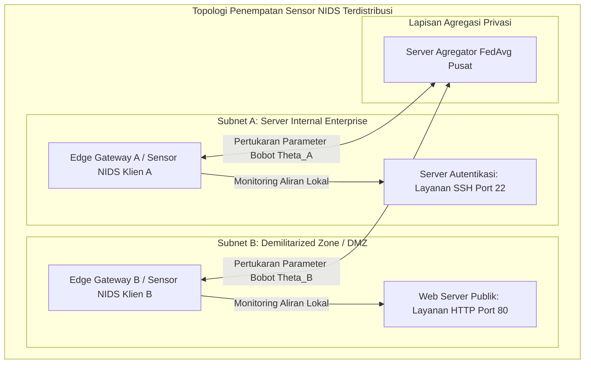
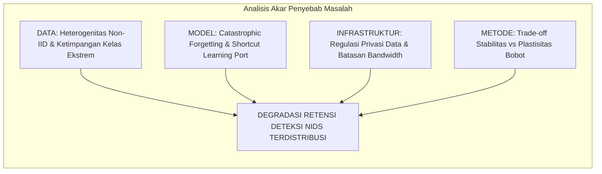
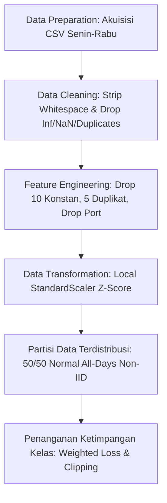
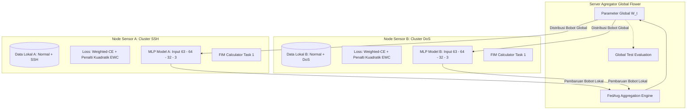
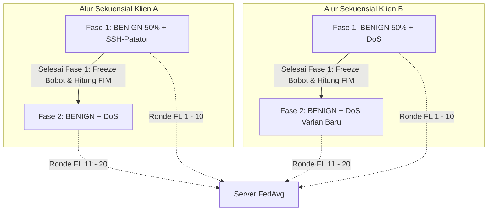

<!--
================================================================================
PROPOSAL TUGAS AKHIR MAHASISWA PROGRAM STUDI S-1 TEKNIK TELEKOMUNIKASI
DEPARTEMEN TEKNIK ELEKTRO
FAKULTAS TEKNOLOGI ELEKTRO DAN INFORMATIKA CERDAS (FTEIC)
INSTITUT TEKNOLOGI SEPULUH NOPEMBER (ITS) SURABAYA

STANDAR FORMAT: SK REKTOR ITS NO. 280/IT2/T/HK.00.01/2022
Ukuran Kertas: A4 HVS 80g | Spasi: 1 (Single)
Margin: Atas 3.0 cm, Bawah 2.5 cm, Kiri 3.0 cm, Kanan 2.0 cm
Font: Times New Roman 12 pt (Judul 14-18 pt Bold)
Sistem Penomoran Halaman:
- Halaman Awal: Romawi kecil (i, ii, iii, dst.) di kanan bawah
- Halaman Isi s.d. Daftar Pustaka: Angka Arab (1, 2, 3, dst.) di kanan bawah
================================================================================
-->

<!--
FORMAT SAMPUL PROPOSAL TUGAS AKHIR ITS (SK Rektor No. 280/IT2/T/HK.00.01/2022 - Lampiran 1)
Kertas: A4 HVS 80g | Spasi: 1 | Margin: Atas 3 cm, Bawah 2.5 cm, Kiri 3 cm, Kanan 2 cm
Tipografi: Trebuchet MS / Times New Roman, Bold, Center
-->

<div align="center">


<br><br>

### **PROPOSAL TUGAS AKHIR - EC234701**
*(14 pt Bold)*

<br>

## **ANALISIS KINERJA DETEKSI NETWORK TRAFFIC INTRUSION MENGGUNAKAN METODE FEDERATED-CONTINUAL LEARNING PADA TESTBED PRIVATE CLOUD SERVER**
### *Studi Pengaruh Elastic Weight Consolidation dan Federated Averaging pada Distribusi Data Non-IID Dua Client*
*(18 pt Bold)*

<br><br>

**RAFLI ALIF IHZA HARTONO**  
**NRP 5048231003**  
*(14 pt Bold)*

<br><br>

**Dosen Pembimbing:**  
**Dr. Ir. Achmad Affandi, DEA.**  
**NIP 196510141990021001**  
*(14 pt Bold)*

<br><br><br>

**Program Studi S-1 Teknik Telekomunikasi**  
**Departemen Teknik Elektro**  
**Fakultas Teknologi Elektro dan Informatika Cerdas**  
**INSTITUT TEKNOLOGI SEPULUH NOPEMBER**  
**SURABAYA**  
**2026**  
*(12 pt)*

</div>

\newpage

<!--
FORMAT LEMBAR PENGESAHAN PROPOSAL TUGAS AKHIR ITS (SK Rektor No. 280/IT2/T/HK.00.01/2022 - Lampiran 2)
-->

<div align="center">

## **LEMBAR PENGESAHAN**

<br>

### **ANALISIS KINERJA DETEKSI NETWORK TRAFFIC INTRUSION MENGGUNAKAN METODE FEDERATED-CONTINUAL LEARNING PADA TESTBED PRIVATE CLOUD SERVER**
#### *Studi Pengaruh Elastic Weight Consolidation dan Federated Averaging pada Distribusi Data Non-IID Dua Client*

<br>

**PROPOSAL TUGAS AKHIR**  
Diajukan untuk memenuhi salah satu syarat  
memperoleh gelar Sarjana Teknik (S.T.) pada  
Program Studi S-1 Teknik Telekomunikasi  
Departemen Teknik Elektro  
Fakultas Teknologi Elektro dan Informatika Cerdas  
Institut Teknologi Sepuluh Nopember  

<br>

Oleh:  
**RAFLI ALIF IHZA HARTONO**  
NRP. 5048231003  

<br>

Disetujui oleh Tim Penguji Proposal Tugas Akhir:

</div>

<br>

1. **Dr. Ir. Achmad Affandi, DEA.**  
   NIP. 196510141990021001  
   *(Pembimbing)* : ............................................................

<br>

2. **Dosen Penguji 1**  
   NIP. ............................................................  
   *(Penguji)* : ............................................................

<br>

3. **Dosen Penguji 2**  
   NIP. ............................................................  
   *(Penguji)* : ............................................................

<br>

4. **Dosen Penguji 3**  
   NIP. ............................................................  
   *(Penguji)* : ............................................................

<br><br>

<div align="center">

**SURABAYA**  
**Oktober, 2026**

</div>

\newpage

# ABSTRAK

**ANALISIS KINERJA DETEKSI NETWORK TRAFFIC INTRUSION MENGGUNAKAN METODE FEDERATED-CONTINUAL LEARNING PADA TESTBED PRIVATE CLOUD SERVER**  
*(Studi Pengaruh Elastic Weight Consolidation dan Federated Averaging pada Distribusi Data Non-IID Dua Client)*

**Nama Mahasiswa / NRP** : Rafli Alif Ihza Hartono / 5048231003  
**Departemen** : Teknik Elektro (Program Studi S-1 Teknik Telekomunikasi) FTEIC - ITS  
**Dosen Pembimbing** : Dr. Ir. Achmad Affandi, DEA.  

#### Abstrak
Eskalasi serangan siber menuntut *Network Intrusion Detection System* (NIDS) mampu mendeteksi variasi ancaman baru tanpa mengorbankan privasi data pengguna. Namun, sentralisasi trafik melanggar regulasi privasi, sedangkan model terdistribusi sekuensial rentan mengalami *catastrophic forgetting* terhadap ancaman terdahulu. Penelitian ini bertujuan menganalisis kinerja deteksi intrusi berbasis *Federated Continual Learning* yang mengintegrasikan *Federated Averaging* (FedAvg) dan *Elastic Weight Consolidation* (EWC) pada data non-IID. Pengujian akan menggunakan dataset CIC-IDS2017 bersih (Senin-Rabu) dengan mengeksklusi *Destination Port* guna mencegah *shortcut learning* dan menghasilkan 63 fitur. Seluruh 1.529.677 aliran dipertahankan menggunakan *Weighted Cross-Entropy Loss* dan *gradient clipping* untuk mengatasi ketimpangan kelas ekstrem antara Normal, SSH-Patator, dan DoS. Skenario *Class-Incremental Learning* disimulasikan pada dua klien dengan partisi kelas Normal 50/50 di seluruh hari perekaman. Model klasifikasi menggunakan *Multilayer Perceptron* (MLP) kompak tiga lapis berkapasitas 6.275 parameter guna efisiensi komputasi *edge*. Klien lokal akan menghitung Matriks Informasi Fisher diagonal untuk memproteksi bobot kritis tugas terdahulu sebelum agregasi global Flower. Penerapan EWC diharapkan mampu menekan *catastrophic forgetting* dengan mempertahankan skor Macro-F1 dan *Backward Transfer* yang stabil. Model diproyeksikan menghasilkan efisiensi RAM yang unggul dibanding *replay buffer* serta latensi inferensi tingkat mikrodetik per *flow*. Penelitian ini berkontribusi menyediakan arsitektur NIDS adaptif yang aman privasi dan hemat bandwidth untuk gerbang jaringan enterprise.

**Kata kunci:** *Catastrophic Forgetting*, *Continual Learning*, *Elastic Weight Consolidation*, *Federated Learning*, *Network Intrusion Detection System*, *Non-IID*.

\newpage

# ABSTRACT

**PERFORMANCE ANALYSIS OF NETWORK TRAFFIC INTRUSION DETECTION USING FEDERATED-CONTINUAL LEARNING ON A PRIVATE CLOUD SERVER TESTBED**  
*(Study on the Effects of Elastic Weight Consolidation and Federated Averaging under Two-Client Non-IID Data Distribution)*

**Student Name / NRP** : Rafli Alif Ihza Hartono / 5048231003  
**Department** : Electrical Engineering (Telecommunication Engineering Study Program) FTEIC - ITS  
**Advisor** : Dr. Ir. Achmad Affandi, DEA.  

#### Abstract
Escalating cyber threats require Network Intrusion Detection Systems (NIDS) to detect emerging attack variations without compromising user data privacy. However, centralizing raw traffic violates privacy regulations, while sequentially trained distributed models are prone to catastrophic forgetting regarding prior threats. This research aims to analyze intrusion detection performance using Federated Continual Learning integrating Federated Averaging (FedAvg) and Elastic Weight Consolidation (EWC) under non-IID data. Testing will utilize clean CIC-IDS2017 datasets (Monday-Wednesday) excluding Destination Port to prevent shortcut learning, yielding 63 clean features. All 1,529,677 flows are preserved using Weighted Cross-Entropy Loss and gradient clipping to handle extreme class imbalance between Normal, SSH-Patator, and DoS. The Class-Incremental Learning scenario is simulated across two clients with a 50/50 Normal partition across all recorded days. The classification model adopts a compact three-layer Multilayer Perceptron (MLP) with 6,275 parameters for edge computational efficiency. Local clients will compute diagonal Fisher Information Matrices to protect critical parameters of prior tasks before global Flower aggregation. Applying EWC is expected to mitigate catastrophic forgetting by sustaining stable Macro-F1 scores and positive Backward Transfer. The proposed model is projected to yield superior RAM efficiency over replay buffers and achieve microsecond-level inference latency per flow. This research contributes an adaptive, privacy-preserving, and bandwidth-efficient NIDS architecture for enterprise network security gateways.

**Keywords:** *Catastrophic Forgetting*, *Continual Learning*, *Elastic Weight Consolidation*, *Federated Learning*, *Network Intrusion Detection System*, *Non-IID*.

\newpage

# DAFTAR ISI

<br>

**LEMBAR PENGESAHAN** ............................................................................................................ ii  
**ABSTRAK** ................................................................................................................................... iii  
**ABSTRACT** ................................................................................................................................. iv  
**DAFTAR ISI** ................................................................................................................................. v  
**DAFTAR GAMBAR** ................................................................................................................... vii  
**DAFTAR TABEL** ....................................................................................................................... viii  
**DAFTAR SINGKATAN** .............................................................................................................. ix  

<br>

**BAB 1 PENDAHULUAN** ............................................................................................................... 1  
1.1 Latar Belakang .......................................................................................................................... 1  
1.2 Rumusan Masalah ...................................................................................................................... 3  
1.3 Batasan Masalah ....................................................................................................................... 3  
1.4 Tujuan ...................................................................................................................................... 4  
1.5 Manfaat .................................................................................................................................... 5  

**BAB 2 TINJAUAN PUSTAKA** ....................................................................................................... 6  
2.1 Keamanan Jaringan ................................................................................................................. 6  
2.2 Serangan Siber ................................................................................................................... 7  
2.3 Penelitian Terdahulu ............................................................................................................ 8  
2.4 Federated Learning .............................................................................................................. 10  
2.5 Continual Learning ................................................................................................................ 12  
2.6 Deteksi Intrusi ................................................................................................................. 13  
2.7 PyTorch ......................................................................................................................... 14  
2.8 Flower .......................................................................................................................... 14  
2.9 Multilayer Perceptron .......................................................................................................... 15  
2.10 Regularisasi EWC ............................................................................................................... 16  
2.11 Dataset .......................................................................................................................... 17  
2.12 Evaluasi Metrik ................................................................................................................. 19  
2.13 Hyperparameter Tuning ...................................................................................................... 20  
2.14 Optimizer .......................................................................................................................... 21  
2.15 Fungsi Aktivasi ................................................................................................................. 22  
**BAB 3 METODOLOGI** ................................................................................................................ 23  
3.1 Metode yang Digunakan .......................................................................................................... 23  
3.2 Bahan dan Peralatan yang Digunakan ....................................................................................... 25  
3.2.1 Bahan Penelitian .................................................................................................................... 25  
3.2.2 Peralatan Penelitian ............................................................................................................... 25  
3.3 Urutan Pelaksanaan Penelitian ................................................................................................. 26  
3.3.1 Praproses Data dan Ekstraksi 63 Fitur Numerik .................................................................... 26  
3.3.2 Pengembangan Model Dasar MLP Kompak .......................................................................... 29  
3.3.3 Integrasi Sistem Usulan: FedAvg dan EWC pada Lingkungan Terdistribusi ......................... 30  
3.3.4 Penyetelan Hiperparameter Bayesian (Optuna TPE) ............................................................. 31  
3.3.5 Matriks Skenario Pengujian Komparatif E0–E4 .................................................................... 32  
3.3.6 Mekanisme Evaluasi Multi-Seed dan Profiling Komputasi ................................................... 33  
3.4 Jadwal Pelaksanaan Penelitian ................................................................................................ 34  

**DAFTAR PUSTAKA** ................................................................................................................... 35

\newpage

# DAFTAR GAMBAR

<br>

Gambar 2.1 Model CIA Triad Keamanan Informasi ............................................................................ 6  
Gambar 2.2 Siklus Pelatihan dan Agregasi Bobot pada Federated Learning (FedAvg) .................... 10  
Gambar 2.3 Taksonomi Pendekatan Mitigasi Catastrophic Forgetting pada Continual Learning ...... 12  
Gambar 2.4 Perbandingan Topologi Arsitektur Penempatan NIDS dan HIDS ................................ 14  
Gambar 2.5 Struktur Arsitektur Jaringan Multilayer Perceptron (MLP) ............................................ 16  
Gambar 2.6 Mekanisme Regularisasi EWC Membatasi Pergeseran Bobot Kritis pada Kontur Kerugian 17  
Gambar 2.7 Struktur Dasar Confusion Matrix untuk Evaluasi Deteksi Biner dan Multi-kelas .......... 20  
Gambar 2.8 Pemodelan Distribusi Ketidakpastian pada Optimasi Bayesian ..................................... 21  
Gambar 3.1 Arsitektur Penempatan Sensor NIDS Terdistribusi dalam Jaringan Enterprise ............. 23  
Gambar 3.2 Fishbone Diagram Identifikasi Tantangan NIDS Terdistribusi ..................................... 24  
Gambar 3.3 Diagram Alir Urutan Pelaksanaan Penelitian .............................................................. 26  
Gambar 3.4 Diagram Alur Global Data Preprocessing ................................................................... 27  
Gambar 3.5 Arsitektur Sistem Federated Continual Learning yang Diimplementasikan ................. 30  
Gambar 3.6 Diagram Alir Skenario Pengujian Sekuensial Non-IID ................................................. 32

\newpage

# DAFTAR TABEL

<br>

Tabel 2.1 Perbandingan Penelitian Terdahulu dalam Domain FL, Continual Learning, dan NIDS ..... 8  
Tabel 3.1 Spesifikasi Lingkungan Perangkat Keras dan Perangkat Lunak ...................................... 25  
Tabel 3.2 Ringkasan 63 Fitur Statistik Numerik Aliran Bersih CIC-IDS2017 ................................. 28  
Tabel 3.3 Konfigurasi Parameter Pelatihan Baseline dan Ruang Pencarian Hiperparameter ..... 31  
Tabel 3.4 Matriks Skenario Pengujian Eksperimen E0–E4 .............................................................. 32  
Tabel 3.5 Jadwal Pelaksanaan Penelitian Tugas Akhir ................................................................... 34

\newpage

# DAFTAR SINGKATAN

<br>

| Singkatan | Kepanjangan / Definisi |
|---|---|
| **ABDS** | *Anomaly-Based Detection System* |
| **AdamW** | *Adam with Decoupled Weight Decay* |
| **AUC** | *Area Under the Curve* |
| **BWT** | *Backward Transfer* |
| **CIA** | *Confidentiality, Integrity, and Availability* |
| **CIC** | *Canadian Institute for Cybersecurity* |
| **CL** | *Continual Learning* |
| **CPU** | *Central Processing Unit* |
| **DMZ** | *Demilitarized Zone* |
| **DoS** | *Denial of Service* |
| **EWC** | *Elastic Weight Consolidation* |
| **FCL** | *Federated Continual Learning* |
| **FedAvg** | *Federated Averaging* |
| **FIM** | *Fisher Information Matrix* |
| **FL** | *Federated Learning* |
| **FN** | *False Negative* |
| **FP** | *False Positive* |
| **FNR** | *False Negative Rate* |
| **FPR** | *False Positive Rate* |
| **GDPR** | *General Data Protection Regulation* |
| **GPU** | *Graphics Processing Unit* |
| **gRPC** | *Google Remote Procedure Call* |
| **HIDS** | *Host-Based Intrusion Detection System* |
| **IAT** | *Inter-Arrival Time* |
| **IID** | *Independent and Identically Distributed* |
| **IP** | *Internet Protocol* |
| **ITS** | Institut Teknologi Sepuluh Nopember |
| **MLP** | *Multilayer Perceptron* |
| **NIC** | *Network Interface Card* |
| **NIDS** | *Network Intrusion Detection System* |
| **Non-IID** | *Non-Independent and Identically Distributed* |
| **ONNX** | *Open Neural Network Exchange* |
| **PR-AUC** | *Precision-Recall Area Under Curve* |
| **PVE** | *Proxmox Virtual Environment* |
| **RAM** | *Random Access Memory* |
| **ReLU** | *Rectified Linear Unit* |
| **ROC-AUC** | *Receiver Operating Characteristic - Area Under Curve* |
| **SGD** | *Stochastic Gradient Descent* |
| **SIDS** | *Signature-Based Intrusion Detection System* |
| **SIEM** | *Security Information and Event Management* |
| **SMOTE** | *Synthetic Minority Over-sampling Technique* |
| **SSH** | *Secure Shell* |
| **TAP** | *Test Access Point* |
| **TCP** | *Transmission Control Protocol* |
| **TN** | *True Negative* |
| **TP** | *True Positive* |
| **TPE** | *Tree-structured Parzen Estimator* |
| **UDP** | *User Datagram Protocol* |
| **UU PDP** | Undang-Undang Pelindungan Data Pribadi |

\newpage

<!-- 
================================================================================
BAGIAN BATANG TUBUH (BAB 1 - BAB 3)
================================================================================
-->

# BAB 1 PENDAHULUAN

## 1.1 Latar Belakang

Perkembangan teknologi informasi dan transformasi digital yang kian pesat telah meningkatkan ketergantungan infrastruktur enterprise, institusi publik, dan layanan perbankan terhadap integritas jaringan komputer. Namun, eskalasi keterhubungan ini diiringi oleh lonjakan volume dan kompleksitas ancaman siber (*cyber threats*). Menurut laporan global *Check Point Research*, terjadi peningkatan rata-rata serangan siber mingguan sebesar 47% per organisasi di seluruh dunia, dengan sektor telekomunikasi, pendidikan, dan infrastruktur kritis menjadi sasaran eksploitasi utama[1]. Selain itu, laporan *FBI Internet Crime Complaint Center* (IC3) mencatat total kerugian ekonomi global akibat kejahatan siber telah melampaui triliunan dolar, dengan vektor serangan intrusi jaringan seperti eksploitasi *brute-force* autentikasi (SSH) dan serangan penolakan layanan (*Denial of Service* / DoS) tetap mendominasi spektrum insiden keamanan operasional[2]. Peningkatan baik dari sisi jumlah maupun kompleksitas teknik serangan ini menuntut sistem pertahanan yang adaptif dan mampu mengamankan jaringan secara berkesinambungan.

Dalam menjaga integritas, kerahasiaan (*confidentiality*), dan ketersediaan (*availability*) aset jaringan, *Network Intrusion Detection System* (NIDS) bertindak sebagai garda pertahanan utama untuk memantau, mendeteksi, dan mengklasifikasikan anomali lalu lintas data secara *near real-time*. Pendekatan NIDS konvensional berbasis *signature* (*Signature-Based Intrusion Detection System* / SIDS) bekerja dengan mencocokkan pola aktivitas terhadap basis data tanda tangan serangan yang telah diketahui, namun rentan mengalami kegagalan deteksi terhadap varian serangan baru (*zero-day attacks*). Sebaliknya, sistem deteksi berbasis anomali menggunakan *Machine Learning* (ML) dan *Deep Learning* (DL) memiliki keunggulan adaptif dalam mengekstraksi representasi statistik aliran data (*bidirectional network flows*) guna mengenali anomali lalu lintas secara otomatis.

Meskipun model pembelajaran mesin terpusat (*centralized learning*) menunjukkan akurasi deteksi yang tinggi, paradigma pengumpulan data secara sentral menghadapi dua tantangan fundamental di dunia nyata, yaitu regulasi privasi data dan keterbatasan lebar pita (*bandwidth*). Lalu lintas jaringan memuat data internal yang sangat sensitif, seperti kredensial, identitas pengguna, dan struktur topologi intranet. Memusatkan rekaman paket mentah (*raw pcap* atau *flow logs*) dari berbagai cabang subnet ke satu server sentral berpotensi melanggar regulasi kepatuhan privasi data, seperti Undang-Undang Pelindungan Data Pribadi (UU PDP No. 27/2022) di Indonesia dan GDPR di tingkat global, serta menimbulkan risiko kerentanan titik kegagalan tunggal (*single point of failure*) terhadap insiden kebocoran data. Di samping itu, mentransfer jutaan aliran paket jaringan berskala gigabita secara berkesinambungan ke server analitik sentral menimbulkan *bandwidth bottleneck* yang membebani kapasitas jaringan operasional enterprise.

Untuk mengatasi batasan privasi dan transmisi data tersebut, paradigma *Federated Learning* (FL), khususnya algoritma *Federated Averaging* (FedAvg), muncul sebagai arsitektur pelatihan terdistribusi yang menjanjikan[3]. Melalui FL, setiap node sensor (klien) melatih model deteksi intrusi secara lokal menggunakan data lalu lintas di perimeter jaringannya sendiri. Node klien kemudian hanya mengirimkan pembaruan parameter bobot model (*gradient/weight updates*) ke server agregator terpusat, tanpa pernah membagikan data lalu lintas mentah.

Kendati demikian, implementasi FL pada domain deteksi intrusi jaringan memicu tantangan baru yang signifikan. Pada kondisi operasional nyata, distribusi data lalu lintas antar-node sensor bersifat sangat heterogen atau *non-Identical and Independently Distributed* (non-IID). Sebagai contoh, node sensor di perimeter subnet server autentikasi internal dominan menghadapi serangan *brute-force* SSH, sedangkan node sensor di zona publik (*Demilitarized Zone* / DMZ) dominan menghadapi serangan volumetrik web DoS (*label skew*). Heterogenitas non-IID terbukti secara teoretis memicu divergensi bobot lokal (*weight divergence*) yang drastis, sehingga agregasi rata-rata konvensional pada FedAvg rentan mengalami degradasi akurasi yang signifikan[4].

Tantangan ini diperparah oleh dinamika temporal dari serangan jaringan. Serangan siber tidak terjadi secara serentak, melainkan muncul secara berkala dan berurutan dari waktu ke waktu (*continuous streaming data*). Ketika model deteksi intrusi dilatih menggunakan kelas serangan baru (seperti DoS pada Task 2) setelah sebelumnya mempelajari kelas serangan terdahulu (seperti SSH-Patator pada Task 1), pembaruan bobot jaringan saraf tiruan cenderung menimpa representasi laten yang telah dipelajari sebelumnya. Fenomena ini dikenal dalam literatur *Continual Learning* (CL) sebagai **catastrophic forgetting**[5]. Akibatnya, sistem IDS mengalami penurunan drastis pada kemampuan mengenali kembali serangan lawas yang sewaktu-waktu dapat dilancarkan kembali oleh penyerang.

Untuk menanggulangi *catastrophic forgetting*, salah satu pendekatan yang paling elegan dan ramah privasi adalah metode berbasis regularisasi parameter, yaitu **Elastic Weight Consolidation (EWC)**. EWC mengkalkulasi signifikansi parameter bobot terhadap tugas masa lalu menggunakan Matriks Informasi Fisher diagonal (*Fisher Information Matrix*). Saat model mempelajari tugas baru, EWC menambahkan fungsi penalti kuadratik yang mengekang perubahan bobot-bobot krusial tersebut. Berbeda dari metode *Experience Replay* yang mengharuskan penyimpanan *buffer* sampel data mentah di memori lokal (yang berpotensi melanggar privasi dan membebani kapasitas RAM perangkat sensor *edge*), EWC bekerja murni pada ruang parameter model, menjadikannya solusi ideal untuk integrasi *Federated Continual Learning* (FCL)[5].

Penelitian mengenai integrasi FL dan CL pada NIDS di bawah distribusi non-IID saat ini masih sangat terbatas dan menghadapi tantangan metodologis yang krusial. Sebagian besar penelitian terdahulu mengasumsikan data terdistribusi secara identik (IID), mengabaikan fenomena kebocoran fitur (*shortcut learning*) akibat penggunaan nomor port layanan, atau menerapkan pemangkasan data (*undersampling*) ekstrem yang merusak realitas operasional ketimpangan kelas (*class imbalance*). 

Oleh karena itu, penelitian tugas akhir ini berfokus pada **analisis kinerja deteksi *network traffic intrusion* menggunakan metode *Federated-Continual Learning* pada *testbed private cloud server*, dengan studi pengaruh *Elastic Weight Consolidation* (EWC) dan *Federated Averaging* (FedAvg) pada distribusi data non-IID dua *client* guna memitigasi *catastrophic forgetting***. Penelitian ini menggunakan dataset tolok ukur resmi CIC-IDS2017 yang dikurasi secara ketat bebas dari kebocoran fitur *Destination Port*, mempertahankan representasi sebaran data bersih melalui fungsi *Weighted Cross-Entropy Loss*, serta dievaluasi melintasi lima *random seed* independen untuk menjamin validitas dan signifikansi temuan ilmiah.

---

## 1.2 Rumusan Masalah

Berdasarkan latar belakang yang telah diuraikan, maka rumusan masalah dalam penelitian tugas akhir ini adalah sebagai berikut:
1. Bagaimana kinerja deteksi intrusi model yang dilatih secara terdistribusi (*Federated Averaging* / FedAvg) dibandingkan dengan model yang dilatih secara lokal pada masing-masing klien dengan distribusi data non-IID?
2. Bagaimana pengaruh metode *Elastic Weight Consolidation* (EWC) terhadap mitigasi *catastrophic forgetting* saat model mempelajari kelas serangan baru secara sekuensial, baik pada skenario pelatihan lokal maupun terdistribusi (FedAvg + EWC)?

---

## 1.3 Batasan Masalah

Dalam merampungkan tugas akhir ini, penulis mengonsep batasan ruang lingkup masalah untuk memberikan arah yang lebih terfokus. Berikut merupakan batasan-batasan masalah yang diberikan:

1. Metrik evaluasi yang digunakan meliputi *Macro-averaged F1-Score*, *Precision*, *Recall*, *Accuracy*, *Backward Transfer* (BWT), waktu inferensi per aliran data, alokasi memori RAM *footprint*, dan *communication payload*.
2. Model deteksi intrusi yang dikembangkan berbasis arsitektur *Multilayer Perceptron* (MLP) kompak tiga lapis dengan masukan 63 fitur statistik numerik bersih.
3. Penelitian hanya menggunakan dataset publik *offline tabular flow* CIC-IDS2017 (hari Senin, Selasa, dan Rabu), dengan mengeliminasi atribut `Destination Port` dan fitur bervariansi nol untuk mencegah bias *shortcut learning*.
4. Pendekatan pembelajaran berkelanjutan (*Continual Learning*) dibatasi pada skenario *Class-Incremental Learning* (Class-IL) tanpa penyediaan Task-ID saat inferensi, dengan metode mitigasi lupa berbasis *Elastic Weight Consolidation* (EWC).
5. Topologi pembelajaran terdistribusi menggunakan algoritma *Federated Averaging* (FedAvg) dengan kerangka kerja Flower, yang memodelkan 2 *node* klien terisolasi non-IID (Klien A: SSH-Patator dan Klien B: DoS) serta 1 server agregator global.
6. Implementasi dan evaluasi eksperimen dilakukan pada lingkungan komputasi prosesor (CPU) dengan validitas statistik melintasi 5 *random seed* independen (42, 43, 44, 45, dan 46).
7. Penelitian ini tidak mencakup penangkapan paket langsung (*live packet capture*), injeksi lalu lintas aktif, maupun pengujian langsung di jaringan produksi.

---

## 1.4 Tujuan

Penelitian ini bertujuan untuk:
1. Menganalisis kinerja deteksi intrusi model yang dilatih secara terdistribusi (*Federated Averaging* / FedAvg) dibandingkan dengan model yang dilatih secara lokal pada masing-masing klien dengan distribusi data non-IID.
2. Menganalisis pengaruh metode *Elastic Weight Consolidation* (EWC) terhadap mitigasi *catastrophic forgetting* serta mengukur efisiensi komputasi model (latensi inferensi per aliran data dalam mikrodetik, alokasi memori RAM *footprint*, dan efisiensi *communication overhead* transmisi parameter melalui protokol gRPC) saat mempelajari kelas serangan baru secara sekuensial, baik pada skenario pelatihan lokal maupun terdistribusi (FedAvg + EWC).

---

## 1.5 Manfaat

Pelaksanaan penelitian ini diharapkan dapat memberikan kontribusi dan manfaat teoretis maupun praktis sebagai berikut:
1. **Manfaat Teoretis (Akademik):**
   - Memberikan kontribusi empiris dan analitis mengenai perilaku interaksi antara algoritma agregasi Federated Learning (FedAvg) dan regularisasi Continual Learning (EWC) pada domain keamanan siber di bawah kondisi heterogenitas data non-IID.
   - Memperkaya literatur NIDS mengenai metodologi evaluasi bebas bias *shortcut learning* melalui eliminasi fitur nomor port dan pengujian berbasis multi-seed.
2. **Manfaat Praktis (Teknologi & Industri):**
   - Menyediakan kerangka arsitektur deteksi intrusi adaptif yang aman privasi dan hemat *bandwidth* untuk diaplikasikan pada sensor *node* jaringan enterprise atau *smart campus*.
   - Membuktikan bahwa pembaruan model keamanan dapat dilakukan secara berkala dan berkesinambungan tanpa perlu mengirimkan log rekaman data mentah pengguna ke server eksternal dan tanpa kehilangan kapabilitas mendeteksi ancaman masa lalu.

\newpage

# BAB 2 TINJAUAN PUSTAKA

## 2.1 Keamanan Jaringan

Keamanan jaringan merupakan pilar fundamental dalam disiplin ilmu teknik komputer dan telekomunikasi yang berfokus pada perlindungan infrastruktur jaringan, kanal komunikasi, dan perangkat komputasi dari akses tidak sah (*unauthorized access*), modifikasi data ilegal, eksploitasi kerentanan, serta gangguan ketersediaan layanan[6]. Di era komputasi awan dan transformasi digital saat ini, keterhubungan antar-sistem semakin terbuka, yang secara bersamaan memperluas permukaan serangan (*attack surface*) dari pihak penyerang siber.

Dalam kerangka kerja keamanan jaringan, salah satu pilar konseptual paling fundamental yang dijadikan acuan perancangan sistem pertahanan adalah CIA Triad, yang mengintegrasikan tiga prinsip inti: kerahasiaan (*Confidentiality*), integritas (*Integrity*), dan ketersediaan (*Availability*)[6]. Prinsip kerahasiaan (*Confidentiality*) berfokus pada jaminan bahwa transmisi informasi serta rekaman data sensitif yang melintasi infrastruktur jaringan hanya dapat diakses dan diinterpretasikan oleh entitas yang memiliki hak akses (*authorization*). Perlindungan kerahasiaan ini umumnya ditegakkan melalui enkripsi protokol komunikasi *end-to-end* seperti TLS, IPsec, dan SSH, serta penerapan kebijakan kontrol akses berbasis identitas yang ketat, guna mencegah potensi intersepsi data ilegal seperti *packet sniffing* dan *eavesdropping*.

Selanjutnya, prinsip integritas (*Integrity*) menekankan pada keharusan menjaga keaslian dan konsistensi paket data agar tidak mengalami modifikasi, penyisipan muatan berbahaya, pemotongan, maupun manipulasi di tengah jalur transmisi (*man-in-the-middle tampering*). Integritas dipertahankan melalui mekanisme fungsi *hash* kriptografis, kode autentikasi pesan (*Message Authentication Code* / MAC), serta tanda tangan digital yang mampu memverifikasi keabsahan data secara presisi. Sementara itu, prinsip ketersediaan (*Availability*) menjamin bahwa seluruh sumber daya komputasi, kapasitas *bandwidth*, dan layanan aplikasi jaringan senantiasa siap sedia serta dapat diakses oleh pengguna yang berhak tanpa mengalami gangguan layanan (*downtime*). Aspek ketersediaan ini terancam secara langsung oleh serangan siber volumetrik seperti *Denial of Service* (DoS) yang berupaya menguras antrean soket dan kapasitas komputasi server.

Ketiga elemen dalam CIA Triad saling terikat secara sinergis dan tidak dapat dipisahkan satu sama lain. Untuk menegakkan prinsip tersebut secara holistik, infrastruktur jaringan enterprise mengadopsi model pertahanan berlapis (*Defense-in-Depth*). Dalam kerangka ini, sistem pertahanan tidak hanya mengandalkan perimeter luar (*firewall*), melainkan menyematkan kontrol keamanan pada setiap lapisan jaringan, mulai dari penyaringan paket, segmentasi jaringan (*Virtual LAN* / VLAN), hingga inspeksi aktif terhadap aliran lalu lintas data oleh sistem deteksi intrusi jaringan (*Network Intrusion Detection System*)[6].

  
*Gambar 2.1 Model CIA Triad Keamanan Informasi.*

---

## 2.2 Serangan Siber

Serangan siber terhadap jaringan komputer memiliki taksonomi yang luas berdasarkan tujuan penyerang, protokol yang dieksploitasi, dan mekanisme gangguan yang ditimbulkan. Dalam penelitian ini, analisis difokuskan pada tiga kategori utama perilaku lalu lintas data yang bersumber dari dataset tolok ukur CIC-IDS2017[7]:

### 2.2.1 Trafik Normal
Trafik normal merepresentasikan seluruh aliran komunikasi data sah yang dihasilkan oleh pengguna dan aplikasi resmi di dalam jaringan[7]. Aliran ini mencakup protokol web (HTTP/HTTPS), kueri *Domain Name System* (DNS), pertukaran surat elektronik (SMTP, IMAP), sinkronisasi waktu jaringan (NTP), serta lalu lintas manajemen internal. Karakteristik statistik dari trafik normal ditandai oleh distribusi panjang paket (*packet length*) yang heterogen, interval waktu kedatangan antar-paket (*inter-arrival time* / IAT) yang bervariasi sesuai interaksi manusia, serta rasio dua arah (*forward/backward packets*) yang proporsional sesuai standar protokol TCP/IP.

### 2.2.2 SSH-Patator
Protokol *Secure Shell* (SSH) yang beroperasi pada port standar 22 merupakan protokol *de facto* untuk administrasi jarak jauh pada server Linux dan perangkat jaringan enterprise. Dalam lanskap ancaman siber, serangan **SSH-Patator** merupakan bentuk serangan audit penetrasi otomatis multi-utas (*multi-threaded brute force tool*) yang mengeksekusi ribuan kombinasi *username* dan *password* dari basis data kamus (*dictionary attack*) secara masif guna membobol akun administrator sistem[7].

Dari sudut pandang analisis statistik aliran lalu lintas (*flow statistics*), serangan SSH-Patator meninggalkan karakteristik pola yang sangat distingtif dibandingkan dengan sesi interaktif normal. Serangan ini ditandai oleh lonjakan frekuensi inisiasi koneksi TCP menuju nomor port layanan autentikasi dalam jendela waktu yang sangat sempit. Sebagian besar aliran memiliki durasi yang sangat singkat (*short flow duration*), mengingat server target segera memutus sesi koneksi melalui transmisi *flag* TCP RST atau FIN sesaat setelah pertukaran *handshake* kredensial dinyatakan gagal. Di samping itu, ukuran paket data arah maju (*forward*) dan arah mundur (*backward*) menunjukkan konsistensi volume muatan yang seragam pada fase negosiasi kunci kriptografi awal sebelum pemutusan sesi berlangsung, membedakannya secara tajam dari dinamika aliran sesi interaktif pengguna yang sah[7].

### 2.2.3 Serangan DoS
Serangan **Denial of Service (DoS)** bertujuan melumpuhkan pilar ketersediaan (*availability*) sistem target dengan membanjiri sumber daya komputasi seperti CPU, memori, *bandwidth*, atau batas antrean soket koneksi server web, sehingga server target gagal melayani permintaan pengguna yang sah[7]. Dalam penelitian ini, analisis difokuskan pada empat subvarian serangan DoS lapisan aplikasi (*application-layer DoS*) yang merepresentasikan spektrum ancaman volumetrik agresif dan ancaman berkecepatan lambat (*low-and-slow attacks*).

Pada kelompok serangan volumetrik agresif, subvarian pertama adalah **DoS Hulk**, yang melancarkan pembanjiran permintaan HTTP GET bervolume masif dengan memanipulasi *header User-Agent* serta menyisipkan parameter unik acak pada URL guna menggagalkan sistem *caching* server web, memaksa server mengalokasikan siklus komputasi CPU dan memori secara berulang. Subvarian kedua adalah **DoS GoldenEye**, yang mengeksploitasi mekanisme koneksi persisten HTTP (*keep-alive*) dan perintah *Cache-Control: no-cache* secara simultan dalam jumlah besar untuk menahan *worker process* server web tetap terkunci hingga kapasitas *thread pool* server habis terpakai.

Sebaliknya, pada kelompok serangan berkecepatan lambat (*low-and-slow*), subvarian **DoS Slowloris** beroperasi secara *stealthy* dengan mengirimkan fragmen *header* HTTP parsial secara berkala dengan interval lambat. Server target dipaksa menahan soket koneksi tetap terbuka sambil menunggu *header* selesai, menghabiskan batas konkurensi koneksi server tanpa menimbulkan lonjakan volume trafik yang mencurigakan. Serupa dengan Slowloris, subvarian **DoS Slowhttptest** mengeksploitasi spesifikasi protokol HTTP dengan mengirimkan muatan badan (*body*) permintaan POST secara sangat lambat (misalnya 1 bita per interval waktu tertentu), mengunci sumber daya penerimaan data server web secara berkepanjangan dan mencegah pengguna lain untuk menjalin komunikasi[7].

---

## 2.3 Penelitian Terdahulu

Penelitian terkait penerapan kecerdasan buatan untuk deteksi intrusi jaringan terdistribusi dan adaptif telah berkembang pesat dalam beberapa tahun terakhir. Tinjauan kritis terhadap literatur ilmiah berfokus pada tiga kelompok kajian utama:

Pertama, pada domain pembelajaran terdistribusi, *Federated Learning* (FL) yang diperkenalkan oleh McMahan *et al.*[3] melalui algoritma *Federated Averaging* (FedAvg) telah menjadi fondasi utama pelatihan kolaboratif lintas node tanpa transmisi data mentah. Penerapan FedAvg pada NIDS telah diteliti oleh Popoola *et al.*[8] untuk mendeteksi serangan *zero-day* pada jaringan IoT dan Ruzafa-Alcazar *et al.*[9] pada lingkungan *edge computing*. Namun, mayoritas studi FL-NIDS mengasumsikan data terdistribusi secara independen dan identik (IID). Pada kondisi nyata, data lalu lintas jaringan bersifat *non-Identical and Independently Distributed* (non-IID), yang secara teoretis dibuktikan oleh Zhao *et al.*[4] dapat memicu divergensi bobot (*weight divergence*) dan menurunkan akurasi model global secara signifikan.

Kedua, pada domain pembelajaran berkelanjutan (*Continual Learning* / CL), adaptasi model NIDS terhadap kelas serangan baru secara sekuensial menghadapi kendala berat berupa *catastrophic forgetting*[5]. Ketika model dilatih pada serangan baru, representasi bobot lama tertimpa sehingga kemampuan mendeteksi serangan terdahulu merosot drastis. Berbagai metode mitigasi telah diajukan, seperti *Experience Replay* dan *Gradient Episodic Memory* (GEM) oleh Lopez-Paz dan Ranzato[10], serta integrasi FL-CL oleh Chen *et al.*[11]. Namun, metode berbasis *replay* mengharuskan penyimpanan sampel data mentah di memori lokal, yang membebani kapasitas RAM perangkat *edge* dan berpotensi melanggar privasi pengguna. Sebaliknya, metode regularisasi parameter *Elastic Weight Consolidation* (EWC) yang dirumuskan oleh Kirkpatrick *et al.*[5] dan diuji pada ancaman infrastruktur kritis oleh Al-Abassi *et al.*[12] menawarkan keunggulan proteksi memori murni pada ruang bobot melalui Matriks Informasi Fisher tanpa menyimpan sampel data lama.

Ketiga, pada domain evaluasi dan integritas dataset tolok ukur CIC-IDS2017, studi audit mutakhir oleh Rosay *et al.*[13] dan Dube[14] membuktikan adanya cacat desinkronisasi pelabelan *timestamp* yang parah pada berkas hari Kamis serta kelangkaan sampel mikro ekstrem pada kelas tertentu. Di samping itu, Engelen *et al.*[15] mengidentifikasi fenomena *shortcut learning* (kebocoran fitur nomor port layanan), di mana model NIDS cenderung menghafal nomor port tujuan (*Destination Port*) daripada mempelajari dinamika perilaku statistik paket yang sebenarnya. Dalam konteks latensi operasional, penelitian tugas akhir terdahulu oleh Rinandri[16] menegaskan pentingnya pengukuran efisiensi inferensi tingkat mikrodetik per aliran data pada arsitektur pendeteksi anomali.

Berdasarkan kajian kritis tersebut, posisi ilmiah dan kebaruan (*novelty*) dari penelitian tugas akhir ini dirangkum dalam Tabel 2.1, yang mengintegrasikan paradigma FedAvg dan EWC di bawah distribusi non-IID dua klien, menerapkan pembersihan ketat bebas kebocoran fitur nomor port, serta mengukur ketahanan memori dan profil efisiensi komputasi model.

*Tabel 2.1 Perbandingan Penelitian Terdahulu dalam Domain FL, Continual Learning, dan NIDS.*

| No | Penulis & Tahun | Judul Penelitian | Metode / Algoritma | Dataset | Kontribusi Utama | Keterbatasan / Research Gap |
| :---: | :--- | :--- | :--- | :--- | :--- | :--- |
| 1 | Rosay *et al.*[13] | *Cost-effective Network Intrusion Detection* | Audit & ML Analysis | CIC-IDS2017 | Mengidentifikasi desinkronisasi timestamp hari Kamis pada CIC-IDS2017 | Hanya melakukan audit dataset, tidak merancang mitigasi continual learning. |
| 2 | Engelen *et al.*[15] | *Troubleshooting an Intrusion Detection Dataset* | Feature Importance Audit | CIC-IDS2017 | Membuktikan *shortcut learning* akibat penggunaan fitur `Destination Port` | Hanya fokus pada analisis fitur, tidak menguji arsitektur terdistribusi. |
| 3 | Dube[14] | *Data Leakage and Quality in IDS Datasets* | Audit Statistik | CIC-IDS2017 | Menemukan kelangkaan data ekstrem kelas Infiltration dan Sql Injection | Belum mengusulkan arsitektur model deteksi federasi. |
| 4 | Kirkpatrick *et al.*[5] | *Overcoming catastrophic forgetting in neural networks* | EWC & Fisher Information | Permuted MNIST | Merumuskan dasar matematis EWC menggunakan regularisasi Fisher diagonal | Diuji pada domain visi komputer sederhana, bukan lalu lintas jaringan. |
| 5 | McMahan *et al.*[3] | *Communication-Efficient Learning of Deep Networks* | Federated Averaging (FedAvg) | MNIST, CIFAR-10 | Menetapkan standar arsitektur Federated Learning terdistribusi | Mengasumsikan data seimbang dan tidak membahas *catastrophic forgetting*. |
| 6 | Zhao *et al.*[4] | *Federated Learning with Non-IID Data* | Analisis Divergensi Bobot | CIFAR-10 | Membuktikan secara teoretis degradasi FedAvg pada distribusi non-IID | Membutuhkan pembagian data publik sentral untuk menstabilkan model. |
| 7 | Lopez-Paz & Ranzato[10] | *Gradient Episodic Memory for Continual Learning* | GEM / BWT Metric | CIFAR-100 | Memperkenalkan formulasi metrik evaluasi *Backward Transfer* (BWT) | Solusi berbasis memori penyangga (*buffer*) yang rentan privasi. |
| 8 | Chen *et al.*[11] | *Federated Class-Incremental Learning* | FCL + Distilasi Pengetahuan | Visi Komputer | Mengintegrasikan FL dan CL untuk penambahan kelas sekuensial | Membutuhkan pertukaran representasi data sintetis antar-klien. |
| 9 | Ruzafa-Alcazar *et al.*[9] | *D-FLIDS: Decentralized Federated IDS* | FedAvg MLP | CIC-IDS2017 | Menerapkan federasi NIDS pada sensor edge | Mempertahankan `Destination Port` (rentan *shortcut learning*) dan data IID. |
| 10 | Popoola *et al.*[8] | *Federated Deep Learning for Zero-Day Attacks* | FedAvg DNN | BoT-IoT | Deteksi serangan baru pada jaringan IoT | Tidak menangani *catastrophic forgetting* saat kelas baru dilatih. |
| 11 | Rinandri (2025)[16] | *Semi-Supervised Learning GNN-AE pada Structemp* | Structemp GNN-AE | NF-UQ-NIDS-v2 | Implementasi deteksi anomali real-time dan evaluasi latensi $\mu\text{s}$ | Pembelajaran tersentralisasi statis, tidak mengkaji FL terdistribusi dan CL. |
| 12 | Sarhan *et al.*[17] | *Standard Feature Set for Network Intrusion Detection* | NetFlow Feature Engineering | NetFlow-V2 | Menstandardisasi ekstraksi fitur aliran berbasis flow | Menggunakan representasi fitur tergeneralisasi, bukan investigasi raw flow. |
| 13 | Al-Abassi *et al.*[12] | *Continual Learning for Cyber Threat Intelligence* | EWC & Replay | CSE-CIC-IDS2018 | Menerapkan continual learning pada IDS sentral | Beroperasi pada server tunggal, mengabaikan privasi data terdistribusi. |
| 14 | **Penelitian Ini (2026)** | **Analisis Kinerja Deteksi Network Traffic Intrusion via FCL** | **FedAvg + EWC + Weighted Loss (63 Fitur)** | **CIC-IDS2017** | **Mengintegrasikan FedAvg & EWC, mitigasi port leakage, mitigasi non-IID & imbalanced class, evaluasi BWT, RAM, payload, dan latensi $\mu\text{s}$** | **Memberikan solusi FCL terpadu yang adaptif, aman privasi, dan terverifikasi secara multi-seed.** |

---

## 2.4 Federated Learning

*Federated Learning* (FL) merupakan paradigma pembelajaran mesin terdistribusi yang memungkinkan sejumlah besar node klien (seperti sensor jaringan, perangkat gerbang *edge*, atau server perimeter) untuk melatih model secara kolaboratif di bawah koordinasi server agregator terpusat tanpa harus memusatkan data pelatihan lokal ke server tersebut[3]. Arsitektur federasi dibangun atas interaksi terkoordinasi antara Server Agregator sebagai koordinator global dan $K$ node Klien Federasi yang mengelola partisi data lalu lintas lokal secara privat. Pada setiap siklus komunikasi, klien mengunduh parameter model global terbaru, mengeksekusi pelatihan lokal menggunakan data privatnya, lalu mentransmisikan kembali parameter bobot terbarui ke server agregator tanpa pernah mengirimkan paket data mentah, sebagaimana diilustrasikan pada Gambar 2.2.

  
*Gambar 2.2 Siklus Pelatihan dan Agregasi Bobot pada Federated Learning (FedAvg)[3].*

Secara matematis, tujuan dari optimasi federasi (*Federated Optimization*) adalah menyelesaikan permasalahan minimisasi risiko empiris terdistribusi (*distributed empirical risk minimization*)[3]:

$$
\min_{w \in \mathbb{R}^d} f(w) = \sum_{k=1}^K \frac{n_k}{n} F_k(w)
$$

dengan fungsi kerugian lokal $F_k(w)$ pada klien $k$ dirumuskan sebagai:

$$
F_k(w) = \frac{1}{n_k} \sum_{i \in \mathcal{D}_k} \ell(f(x_i; w), y_i)
$$

di mana parameter ukuran sampel lokal pada masing-masing klien dan keseluruhan jaringan dinyatakan sebagai:

$$
n_k = |\mathcal{D}_k|, \quad n = \sum_{k=1}^K n_k
$$

dengan $n_k$ menyatakan volume sampel lokal pada klien $k$, dan $n$ merepresentasikan total seluruh sampel data di jaringan. Pada setiap ronde komunikasi $t \in \{1, 2, \dots, T\}$, server menyiarkan parameter global $w_t$ ke klien terpilih. Klien mengeksekusi optimasi lokal berbasis *gradient descent* sebanyak $E$ *epoch* lokal untuk menghasilkan bobot lokal terbarui:

$$
w_{t+1}^k \leftarrow w_t - \eta \nabla F_k(w_t)
$$

Server agregator kemudian menghitung model global baru melalui agregasi rata-rata berbobot *Federated Averaging* (FedAvg)[3]:

$$
w_{t+1} = \sum_{k=1}^K \frac{n_k}{n} w_{t+1}^k
$$

Meskipun FedAvg terbukti efisien pada data yang homogen, penerapannya pada infrastruktur jaringan riil dihadapkan pada pelanggaran asumsi independen dan berdistribusi identik (*Independent and Identically Distributed* / IID). Fenomena **Non-IID Data**, khususnya ketimpangan distribusi label (*label distribution skew*) di mana probabilitas kemunculan kelas serangan antarklien berbeda secara tajam:

$$
\mathcal{P}_k(y) \neq \mathcal{P}_j(y), \quad \text{untuk } k \ne j
$$

menyebabkan gradien lokal klien mengarah ke titik optimum lokal yang saling bertolak belakang. Kondisi ini memicu divergensi bobot (*client drift*)[4]:

$$
\| w_{t+1}^k - w^{\ast} \| \gg 0
$$

yang memperlambat konvergensi dan menurunkan akurasi model global secara signifikan dalam mendeteksi variasi serangan baru.

---

## 2.5 Continual Learning

*Continual Learning* (CL) atau *Lifelong Learning* merupakan cabang pembelajaran mesin adaptif yang berfokus pada kemampuan model kecerdasan buatan untuk mempelajari aliran tugas atau kelas data baru $\mathcal{T} = \{\mathcal{T}_1, \mathcal{T}_2, \dots, \mathcal{T}_T\}$ secara sekuensial tanpa mengalami degradasi performa pada pengetahuan yang telah diakuisisi sebelumnya. Dalam proses pembelajaran berkelanjutan ini, model dihadapkan pada dilema stabilitas-plastisitas (*stability-plasticity dilemma*), yaitu tuntutan mempertahankan plastisitas untuk mengintegrasikan pola ancaman baru seraya menjaga stabilitas representasi serangan lampau[5]. Jaringan saraf tiruan modern memiliki kerentanan parah terhadap fenomena **catastrophic forgetting**. Ketika model dilatih pada tugas pertama $\mathcal{T}_1$ dengan data $\mathcal{D}_1$, parameter optimal $\theta_1^{\ast}$ diperoleh melalui minimisasi fungsi kerugian $\mathcal{L}_1$:

$$
\theta_1^{\ast} = \arg\min_\theta \mathcal{L}_1(\theta; \mathcal{D}_1)
$$

Saat tugas baru $\mathcal{T}_2$ dengan data $\mathcal{D}_2$ masuk, proses *backpropagation* memperbarui bobot parameter menuju nilai optimal tugas kedua:

$$
\theta_2^{\ast} = \arg\min_\theta \mathcal{L}_2(\theta; \mathcal{D}_2)
$$

Pembaruan parameter ini menimpa (*overwrite*) bobot-bobot sinaptik yang merepresentasikan $\mathcal{T}_1$, menyebabkan lonjakan kerugian pada tugas pertama:

$$
\mathcal{L}_1(\theta_2^{\ast}; \mathcal{D}_1) \gg \mathcal{L}_1(\theta_1^{\ast}; \mathcal{D}_1)
$$

sehingga akurasi deteksi terhadap jenis serangan lama runtuh seketika mendekati nol[5].

Ditinjau dari ketersediaan informasi identitas tugas (*Task-ID*) saat inferensi, literatur Continual Learning mengklasifikasikan skenario pembelajaran inkremental ke dalam tiga domain utama, yaitu *Task-Incremental Learning* (Task-IL), *Domain-Incremental Learning* (Domain-IL), dan *Class-Incremental Learning* (Class-IL)[17]. Pada Task-IL, model diberikan identitas tugas $t$ sehingga prediksi terbatas pada sub-ruang kelas $\mathcal{Y}_t$. Sebaliknya, penelitian ini mengadopsi skenario **Class-Incremental Learning (Class-IL)** yang merepresentasikan kondisi operasional NIDS paling realistis sekaligus paling menantang. Pada skenario Class-IL, model tidak pernah diberikan informasi *Task-ID* saat inferensi dan dituntut memprediksi label dari seluruh ruang kelas gabungan secara otonom[18]:

$$
\hat{y} = \arg\max_{c \in \bigcup_{t=1}^T \mathcal{Y}_t} f_c(x; \theta)
$$

Tuntutan mendiskriminasi seluruh kelas secara simultan tanpa *task oracle* ini memperparah ambiguitas antar-tugas (*inter-task interference*) dan mempercepat laju kelupaan model.

Guna mengatasi tantangan *catastrophic forgetting* pada skenario Class-IL, literatur mengklasifikasikan strategi pertahanan ke dalam beberapa paradigma metodologis sebagaimana diilustrasikan pada Gambar 2.3[19]. Paradigma *Replay-Based* menyimpan rekaman lalu lintas lama ke dalam *buffer* fisik (*Experience Replay*) atau merekonstruksi data masa lalu secara generatif (*Generative Replay*), namun paradigma ini melanggar privasi transmisi dan menuntut kapasitas memori besar[10]. Paradigma *Architecture-Based* mengalokasikan parameter modular baru per tugas, namun menyebabkan ukuran model membengkak. Sebaliknya, paradigma **Regularization-Based** melindungi memori lama secara murni pada ruang bobot dengan menambahkan suku penalti regularisasi ke dalam fungsi kerugian:

$$
\mathcal{L}_{\text{total}}(\theta) = \mathcal{L}_t(\theta) + \sum_{j < t} \Omega_j (\theta - \theta_j^{\ast})^2
$$

di mana $\Omega_j$ menyatakan matriks kepentingan parameter terhadap tugas-tugas masa lalu. Pendekatan regularisasi seperti *Elastic Weight Consolidation* (EWC) menjadi pilihan paling optimal untuk sistem deteksi intrusi jaringan terdistribusi karena mampu mempertahankan privasi data secara penuh dan menjaga efisiensi jejak memori pada perangkat sensor *edge*[5], [19].

  
*Gambar 2.3 Taksonomi Pendekatan Mitigasi Catastrophic Forgetting pada Continual Learning[19].*

---

## 2.6 Deteksi Intrusi

*Network Intrusion Detection System* (NIDS) merupakan mekanisme pertahanan siber yang ditempatkan pada infrastruktur jaringan untuk menginspeksi lalu lintas data dan mendeteksi aktivitas mencurigakan yang mengindikasikan adanya intrusi, eksploitasi kerentanan, atau pelanggaran kebijakan keamanan[20].

### 2.6.1 Arsitektur Penempatan
Berdasarkan arsitektur penempatan dan cakupan monitoringnya, sistem deteksi intrusi secara mendasar terbagi menjadi dua kategori utama, yaitu *Host-Based IDS* (HIDS) dan *Network-Based IDS* (NIDS)[20]. HIDS beroperasi secara langsung pada tingkat sistem operasi dari perangkat *endpoint* atau server individual untuk mengawasi integritas berkas sistem (*file integrity*), log autentikasi, serta pemanggilan instruksi sistem (*system calls*). Karakteristik HIDS sangat efektif untuk mengidentifikasi ancaman internal atau eksploitasi hak akses di tingkat lokal, namun memerlukan instalasi agen pada setiap mesin dan mengonsumsi sumber daya komputasi dari server aplikasi target. Sebaliknya, NIDS ditempatkan secara strategis pada tautan jaringan (*network links*), seperti *switch*, *gateway*, atau port agregasi, guna memantau seluruh paket dan aliran data yang melintasi segmen jaringan secara non-invasif. Keunggulan utama NIDS terletak pada kemampuannya mengawasi puluhan hingga ratusan perangkat sekaligus secara simultan tanpa membebani performa komputasi server aplikasi serta mampu mendeteksi pola serangan yang bergerak lintas subnet jaringan[20], sebagaimana diilustrasikan pada Gambar 2.4.

  
*Gambar 2.4 Perbandingan Topologi Arsitektur Penempatan NIDS dan HIDS pada Infrastruktur Jaringan (Sumber: Stephen, 2023 [Medium](https://medium.com/@cybersecuritystephen/hids-vs-nids-whats-the-difference-and-why-should-i-care-64b37f7a1f0e)).*

### 2.6.2 Metode Deteksi
Ditinjau dari metodologi deteksi yang diimplementasikan, NIDS terbagi menjadi pendekatan berbasis tanda tangan (*Signature-Based IDS* / SIDS) dan pendekatan berbasis anomali (*Anomaly-Based IDS* / ABDS)[20]. SIDS beroperasi dengan mencocokkan setiap muatan paket atau pola lalu lintas terhadap basis data tanda tangan serangan (*attack signatures*) yang telah didefinisikan sebelumnya oleh analis keamanan. Pendekatan SIDS memiliki keunggulan dalam kecepatan komputasi dan menghasilkan tingkat alarm palsu (*false positive*) yang sangat rendah untuk ancaman lama yang telah terdaftar, namun mengalami kegagalan mutlak ketika berhadapan dengan serangan baru (*zero-day attacks*) atau varian serangan yang telah dimodifikasi polanya. Sebaliknya, ABDS memodelkan perilaku lalu lintas normal sebagai profil tolok ukur (*baseline*), sehingga setiap penyimpangan statistik yang signifikan akan ditandai sebagai indikasi anomali intrusi. ABDS modern mengandalkan model pembelajaran mesin dan jaringan saraf tiruan untuk mengevaluasi fitur statistik aliran dua arah (*bidirectional flow features*), memberikan kemampuan generalisasi yang tangguh dalam mengidentifikasi pola ancaman baru yang belum pernah terpetakan sebelumnya[8], [20].

---

## 2.7 PyTorch

PyTorch merupakan pustaka komputasi ilmiah dan *deep learning* sumber terbuka berbasis Python yang dikembangkan oleh Meta AI, yang telah menjadi standar *de facto* dalam riset kecerdasan buatan modern[21]. Keunggulan fundamental PyTorch bersumber dari mekanisme graf komputasi dinamis (*Dynamic Computational Graph* berbasis paradigma *Define-by-Run* melalui mesin diferensiasi otomatis Autograd), yang memungkinkan struktur jaringan saraf tiruan dieksekusi dan dimodifikasi secara interaktif selama waktu eksekusi (*runtime*) tanpa memerlukan kompilasi graf statis terlebih dahulu[21]. Pendekatan dinamis ini mempermudah pelacakan alur gradien (*backpropagation*) dan proses *debugging* tensor secara langsung menggunakan pustaka bawaan Python.

Di samping itu, PyTorch menyediakan antarmuka tensor multi-dimensi berperforma tinggi yang terintegrasi secara mulus dengan akselerasi perangkat keras GPU melalui pustaka *NVIDIA CUDA* dan *cuDNN*, serta optimasi aljabar linear pada prosesor CPU[21]. Arsitektur modular PyTorch, khususnya abstraksi `torch.nn` dan `torch.optim`, memberikan keleluasaan penuh dalam menyusun fungsi kerugian kustom (*custom loss function*)[21]. Fleksibilitas manipulasi gradien ini sangat krusial dalam penelitian ini untuk merekayasa fungsi objektif lokal yang menggabungkan *Weighted Cross-Entropy Loss* dengan suku penalti kuadratik EWC berbasis perkalian tensor elemen-per-elemen secara langsung pada ruang bobot parameter tanpa menimbulkan *overhead* komputasi graf statis yang kaku[5], [21].

---

## 2.8 Flower

Dalam mengimplementasikan paradigma pembelajaran terdistribusi, penelitian ini memanfaatkan Flower (`flwr`), yaitu kerangka kerja *Federated Learning* sumber terbuka yang dirancang modular, terukur, dan agnostik terhadap berbagai pustaka *machine learning*[22]. Arsitektur komunikasi Flower memisahkan tanggung jawab sistem secara tegas antara modul koordinator terpusat (`Server`) dan simpul komputasi lokal (`Client`), yang berinteraksi melalui protokol komunikasi berkecepatan tinggi *Google Remote Procedure Call* (gRPC) di atas lapisan transport HTTP/2 pada port standar TCP 8080[22]. Protokol ini menjamin pertukaran pesan asinkron yang andal, efisien, dan memiliki latensi minimal pada kanal jaringan terdistribusi.

Dalam setiap siklus federasi, Flower mengorkestrasi pertukaran parameter model secara efisien tanpa mentransmisikan data mentah milik klien[22]. Parameter bobot model PyTorch pada setiap simpul klien diekstraksi ke dalam larik terindeks NumPy berpresisi 32-bit (*float32*), kemudian diserialisasi ke dalam format biner terkompresi *Protocol Buffers* (`Parameters` proto) sebelum dikirimkan ke server melalui instruksi `fit_res`[22]. Server agregator kemudian menerapkan strategi federasi seperti *Federated Averaging* (FedAvg) untuk menggabungkan parameter lokal menjadi model global baru[3], [22]. Penggunaan arsitektur model MLP kompak dalam penelitian ini (memuat 6.275 parameter *float32*) menghasilkan ukuran muatan biner parameter hanya sebesar $\approx 25,1$ KB per transmisi klien. Dengan total pertukaran parameter untuk dua klien sebesar $100,4$ KB per ronde komunikasi, Flower menghasilkan penghematan lebar pita jaringan sebesar $99,48\%$ dibandingkan skenario sentralisasi yang mentransmisikan data mentah berukuran gigabita, seraya mendukung emulasi klien virtual maupun penerapan nyata pada simpul *edge* fisik (*cross-silo deployment*)[22].

---

## 2.9 Multilayer Perceptron

*Multilayer Perceptron* (MLP) merupakan arsitektur dasar jaringan saraf tiruan umpan-maju (*feedforward neural network*) yang terdiri dari sekurang-kurangnya tiga lapisan neuron komputasi terstruktur: satu lapisan masukan (*input layer*), satu atau lebih lapisan tersembunyi (*hidden layers*), dan satu lapisan keluaran (*output layer*)[23]. Pada arsitektur MLP terhubung penuh (*fully connected layers*), setiap neuron pada suatu lapisan menerima kombinasi linear terbobot dari seluruh neuron pada lapisan sebelumnya, menambahkan skalar bias, dan memetakan hasilnya melalui fungsi aktivasi non-linear guna membentuk batas keputusan (*decision boundaries*) yang mampu memisahkan kelas-kelas data yang tidak dapat dipisahkan secara linear (*linearly non-separable*)[23].

Untuk memenuhi batasan komputasi perangkat gerbang jaringan (*edge gateway*) dan menghindari latensi komputasi yang tinggi pada sistem deteksi intrusi waktu nyata, arsitektur model klasifikasi dalam penelitian ini dirancang menggunakan konfigurasi MLP kompak 63-64-32-3[23]. Model menerima vektor fitur masukan $x \in \mathbb{R}^{63}$ yang merepresentasikan statistik aliran paket jaringan, dan memprosesnya secara matematis melalui tahapan propagasi maju (*forward pass*)[23]:

$$
\begin{aligned}
h_1 &= f_1(W_1 x + b_1), \quad W_1 \in \mathbb{R}^{64 \times 63}, \ b_1 \in \mathbb{R}^{64} \\
h_2 &= f_2(W_2 h_1 + b_2), \quad W_2 \in \mathbb{R}^{32 \times 64}, \ b_2 \in \mathbb{R}^{32} \\
z &= W_3 h_2 + b_3, \quad W_3 \in \mathbb{R}^{3 \times 32}, \ b_3 \in \mathbb{R}^{3} \\
\hat{y} &= \text{Softmax}(z)
\end{aligned}
$$

di mana $f_1$ dan $f_2$ merupakan fungsi aktivasi non-linear *Rectified Linear Unit* (ReLU), $z$ adalah vektor logit klasifikasi, dan $\hat{y}$ merepresentasikan estimasi probabilitas posterior kelas aliran lalu lintas jaringan (BENIGN, SSH-Patator, atau DoS)[23].

Pemilihan topologi MLP kompak ini didasarkan pada pertimbangan kritis terhadap keterbatasan sumber daya komputasi simpul sensor jaringan (*edge gateways*) dan tuntutan latensi inspeksi paket berkecepatan tinggi[23]. Dengan 63 fitur masukan, 64 neuron pada lapisan tersembunyi pertama, 32 neuron pada lapisan tersembunyi kedua, dan 3 neuron keluaran, total parameter teroptimasi model dihitung secara eksak sebagai[23]:

$$
|\theta| = (63 \times 64 + 64) + (64 \times 32 + 32) + (32 \times 3 + 3) = 4.096 + 2.080 + 99 = 6.275 \text{ parameter}
$$

Dengan representasi bilangan mengambang 32-bit (*single precision float32* berukuran 4 bita), ukuran biner parameter model hanya mencapai sekitar **25,1 KB** ($6.275 \times 4$ bita). Jejak memori (*memory footprint*) yang sangat ringkas ini memberikan dua keuntungan operasional yang krusial. Pertama, proses serialisasi dan transmisi bobot melalui protokol gRPC Flower pada setiap ronde federasi dapat diselesaikan dalam orde milidetik tanpa membebani kapasitas lebar pita jaringan terdistribusi. Kedua, model mampu mengeksekusi inferensi klasifikasi aliran data secara lokal dalam skala mikrodetik per sampel aliran ($\mu\text{s/flow}$), memastikan sistem mampu mengimbangi laju paket pada tautan jaringan berkecepatan tinggi tanpa memicu penumpukan antrean (*buffer bloat*) yang berisiko menyebabkan hilangnya paket data (*packet drop*)[22], [23]. Struktur arsitektur jaringan MLP yang dirancang diilustrasikan pada Gambar 2.5.

  
*Gambar 2.5 Struktur Arsitektur Jaringan Multilayer Perceptron (MLP) dengan Lapisan Tersembunyi.*

---

## 2.10 Regularisasi EWC

*Elastic Weight Consolidation* (EWC) merupakan metode mitigasi *catastrophic forgetting* berbasis regularisasi parameter yang diperkenalkan oleh Kirkpatrick *et al.*[5], yang terinspirasi oleh fenomena konsolidasi memori sinaptik pada otak biologis mamalia di mana plastisitas sinapsis ditekan secara selektif untuk mempertahankan keterampilan yang telah dipelajari sebelumnya. Dari perspektif inferensi Bayesian, proses pembelajaran tugas kedua $\mathcal{D}_2$ setelah menyelesaikan pelatihan tugas pertama $\mathcal{D}_1$ dirumuskan melalui distribusi probabilitas posterior parameter $\theta$ [5]:

$$
\log p(\theta \mid \mathcal{D}_1, \mathcal{D}_2) = \log p(\mathcal{D}_2 \mid \theta) + \log p(\theta \mid \mathcal{D}_1) - \log p(\mathcal{D}_2)
$$

Distribusi prior $p(\theta \mid \mathcal{D}_1)$ memuat seluruh akumulasi pengetahuan mengenai tugas pertama. Karena bentuk eksak distribusi posterior pada jaringan saraf tiruan non-linear bersifat rumit dan tidak dapat dihitung secara analitis, EWC mengaproksimasi $\log p(\theta \mid \mathcal{D}_1)$ menggunakan ekspansi deret Taylor orde kedua di sekitar titik parameter optimal tugas pertama $\theta_1^{\ast}$ sebagai distribusi Gaussian multivariat, dengan presisi kelengkungan yang ditentukan oleh **Matriks Informasi Fisher (Fisher Information Matrix / FIM)**[5]:

$$
F = \mathbb{E}_{x \sim \mathcal{D}_1, y \sim p(y \mid x, \theta_1^{\ast})} \left[ \nabla_\theta \log p(y \mid x, \theta_1^{\ast}) \nabla_\theta \log p(y \mid x, \theta_1^{\ast})^T \right]
$$

Guna menghindari kompleksitas komputasi inversi matriks kovariansi penuh yang berukuran $|\theta| \times |\theta|$, EWC mengasumsikan independensi kuasi antar-parameter dan hanya mengevaluasi elemen-elemen diagonal matriks Fisher ($F_i$)[5]. Dalam penerapan praktis *machine learning*, ekspektasi analitis tersebut didekati melalui **Empirical Fisher Information Matrix**, di mana gradien kuadratik dihitung terhadap label kebenaran dasar (*ground truth*) dari $N$ sampel data tugas pertama[5]:

$$
F_i = \frac{1}{N} \sum_{n=1}^N \left( \left. \frac{\partial \mathcal{L}_{\text{CE}}(f(x_n; \theta), y_n)}{\partial \theta_i} \right|_{\theta = \theta_1^{\ast}} \right)^2
$$

Saat model melanjutkan pembelajaran pada alur data tugas kedua, fungsi kerugian total lokal diintegrasikan dengan penalti kuadratik terbobot Fisher terhadap deviasi parameter optimal lama[5]:

$$
\mathcal{L}_{\text{total}}(\theta) = \mathcal{L}_2(\theta) + \sum_{i} \frac{\lambda}{2} F_i (\theta_i - {\theta_{1, i}}^*)^2
$$

di mana $\lambda$ merupakan koefisien hiperparameter penalti EWC yang mengontrol keseimbangan (*trade-off*) antara plastisitas terhadap tugas baru dan stabilitas retensi memori terhadap tugas lama, ${\theta_{1, i}}^*$ adalah nilai parameter optimal tugas pertama yang dibekukan, dan $F_i$ mengukur seberapa sensitif kinerja tugas pertama terhadap pergeseran parameter $i$ [5]. Parameter dengan nilai $F_i$ besar dilindungi dari pembaruan gradien besar, sedangkan parameter dengan $F_i$ mendekati nol leluasa dimodifikasi oleh data baru, sebagaimana diilustrasikan pada Gambar 2.6.

  
*Gambar 2.6 Mekanisme Regularisasi EWC Membatasi Pergeseran Bobot Kritis pada Kontur Kerugian[5].*

Dalam mengoperasikan model pada kondisi lalu lintas jaringan dengan ketimpangan kelas yang parah, fungsi kerugian dasar $\mathcal{L}_2(\theta)$ distabilkan menggunakan pembobotan invers frekuensi kelas (*Weighted Cross-Entropy Loss*)[5]:

$$
\mathcal{L}_{\text{CE}}(y, \hat{y}) = - \sum_{c=1}^{C} w_c \cdot y_c \log(\hat{y}_c), \quad \text{dengan } w_c = \frac{N_{\text{total}}}{C \cdot N_c}
$$

Selain itu, guna mencegah ledakan magnitudo gradien (*exploding gradients*) yang dipicu oleh akumulasi penalti EWC berbobot besar dan ketimpangan bobot kelas minoritas, mekanisme pemotongan gradien (*Gradient Clipping*) berbasis norma L2 diterapkan sebelum langkah pembaruan bobot dijalankan[5]:

$$
\text{jika } \|\mathbf{g}\|_2 > \gamma, \quad \text{maka } \mathbf{g} \leftarrow \frac{\gamma}{\|\mathbf{g}\|_2} \mathbf{g}, \quad \text{dengan } \gamma = 1.0
$$

---

## 2.11 Dataset

Dataset tolok ukur yang digunakan dalam penelitian ini adalah **CIC-IDS2017** (*Canadian Institute for Cybersecurity Intrusion Detection System 2017*). Dataset ini dibangun menggunakan topologi jaringan korban (*Victim Network*) dan jaringan penyerang (*Attack Network*) yang merekam lalu lintas paket nyata selama lima hari kerja (Senin s.d. Jumat)[7].

### 2.11.1 Karakteristik Aliran
Seluruh lalu lintas jaringan mentah dalam format *packet capture* (pcap) diekstraksi menggunakan perangkat lunak *CICFlowMeter* menjadi rekaman statistik aliran dua arah (*bidirectional flow features*). Berkas lalu lintas yang dianalisis dalam penelitian ini mencakup berkas hari Senin (*Monday*) yang merepresentasikan lalu lintas operasional normal (BENIGN) secara eksklusif, berkas hari Selasa (*Tuesday*) yang memuat aktivitas normal dan serangan penetrasi autentikasi SSH (*SSH-Patator*), serta berkas hari Rabu (*Wednesday*) yang memuat lalu lintas normal dan varian serangan *Denial of Service* (DoS Slowloris, Slowhttptest, Hulk, dan GoldenEye)[7].

### 2.11.2 Kurasi Fitur
Meskipun CIC-IDS2017 merupakan tolok ukur standar dalam riset NIDS, sejumlah studi audit saintifik mutakhir mengidentifikasi kelemahan mendasar dalam dataset mentah yang berpotensi menghasilkan evaluasi model yang bias[13], [14], [15]. Audit oleh Rosay *et al.*[13] dan Dube[14] membuktikan bahwa berkas hari Kamis menderita desinkronisasi penanda waktu (*timestamp labeling error*) yang parah antara file rekaman pcap dan file CSV, serta memiliki kelangkaan sampel kelas ekstrem (seperti serangan Infiltration yang hanya terdiri dari 36 baris dan Sql Injection sebanyak 21 baris). Kondisi ini menyebabkan berkas hari Kamis dan Jumat dieksklusi secara sengaja dari penelitian ini guna menjamin validitas dan reliabilitas eksperimen.

Lebih lanjut, studi audit oleh Engelen *et al.*[15] membuktikan adanya fenomena *shortcut learning* atau kebocoran fitur (*feature leakage*) akibat keberadaan atribut nomor port tujuan (`Destination Port`). Ketika fitur nomor port diikutsertakan, algoritma pembelajaran mesin cenderung mengambil jalan pintas dengan menghafal nomor port layanan standar (misalnya port 22 untuk SSH dan port 80 untuk DoS), sehingga menghasilkan akurasi klasifikasi yang tinggi semu tanpa pernah mempelajari pola statistik lalu lintas paket yang sebenarnya. Menjawab tantangan tersebut, penelitian ini menerapkan protokol kurasi yang ketat dengan membuang fitur `Destination Port` secara definitif, mengeliminasi 132.909 baris data duplikat identik, membuang 10 fitur konstan bervariansi nol, serta mengeliminasi 5 pasangan fitur duplikat mutlak. Melalui prosedur praproses ini, diperoleh tepat **63 fitur statistik numerik bersih** yang memastikan model dievaluasi secara otentik atas dinamika perilaku aliran jaringan[15], [17].

---

## 2.12 Evaluasi Metrik

Evaluasi sistem dilakukan secara komprehensif mencakup metrik kinerja deteksi kecerdasan buatan, metrik retensi continual learning, dan metrik profil komputasi perangkat.

### 2.12.1 Kinerja Klasifikasi
Kinerja deteksi model dievaluasi secara menyeluruh menggunakan matriks konfusi (*Confusion Matrix*) yang mengelompokkan prediksi model ke dalam empat kuadran hasil: *True Positive* (TP), *True Negative* (TN), *False Positive* (FP), dan *False Negative* (FN) sebagaimana diilustrasikan pada Gambar 2.7[24].

  
*Gambar 2.7 Struktur Dasar Confusion Matrix untuk Evaluasi Deteksi Biner dan Multi-kelas.*

Metrik pertama adalah **Akurasi (*Accuracy*)**, yang mengukur proporsi keseluruhan prediksi yang benar terhadap total sampel data yang dievaluasi:

$$
\text{Accuracy} = \frac{TP + TN}{TP + TN + FP + FN}
$$

Meskipun akurasi memberikan gambaran umum efektivitas model, metrik ini rentan menghasilkan interpretasi yang menyesatkan pada dataset deteksi intrusi yang memiliki ketimpangan kelas ekstrem di mana kelas normal mendominasi secara absolut. Oleh karena itu, metrik **Presisi (*Precision*)** digunakan untuk mengukur ketepatan deteksi positif dari seluruh peringatan yang dibunyikan oleh model, yang dirumuskan sebagai:

$$
\text{Precision} = \frac{TP}{TP + FP}
$$

Presisi yang tinggi menjamin bahwa sistem meminimalkan frekuensi alarm palsu (*false alarm rate*), sehingga tidak membebani operator keamanan jaringan dengan peringatan keliru. Selanjutnya, metrik **Recall (*Sensitivity*)** mengevaluasi kemampuan sistem dalam menjaring seluruh insiden serangan yang sebenarnya terjadi di dalam jaringan:

$$
\text{Recall} = \frac{TP}{TP + FN}
$$

Nilai *Recall* yang tinggi memastikan sistem memiliki tingkat deteksi lolos (*false negative*) yang rendah, sehingga serangan berbahaya tidak menyusup tanpa terdeteksi. Sebagai penyeimbang trade-off antara Presisi dan Recall, evaluasi utama dalam penelitian ini mengadopsi metrik **Macro-Averaged F1 (Macro-F1)**, yang menghitung rata-rata harmonik F1-score secara mandiri pada setiap kelas tanpa dipengaruhi oleh bobot proporsi jumlah sampel:

$$
\text{Macro-F1} = \frac{1}{C} \sum_{c=1}^C \frac{2 \cdot \text{Precision}_c \cdot \text{Recall}_c}{\text{Precision}_c + \text{Recall}_c}
$$

Dengan menghitung rata-rata secara unweighted antar-kelas, Macro-F1 memberikan bobot evaluasi yang setara pada kelas minoritas (seperti SSH-Patator) maupun kelas mayoritas (BENIGN), menjadikannya metrik objektif paling andal untuk mengukur performa NIDS pada kondisi distribusi data yang timpang[24].

### 2.12.2 Retensi Memori
Dalam skenario pembelajaran berkelanjutan (*Continual Learning*), retensi pengetahuan model terhadap tugas lampau setelah mempelajari tugas baru diukur secara matematis menggunakan metrik **Backward Transfer (BWT)**[10]:

$$
\text{BWT} = R_{2, 1} - R_{1, 1}
$$

di mana $R_{1, 1}$ menyatakan skor Macro-F1 pada tugas pertama sesaat setelah fase pelatihan pertama selesai, sedangkan $R_{2, 1}$ merepresentasikan skor Macro-F1 pada tugas pertama setelah model menyelesaikan pelatihan pada tugas kedua. Nilai $\text{BWT} < 0$ mengindikasikan terjadinya degradasi representasi memori atau *catastrophic forgetting*, di mana semakin negatif nilai BWT maka semakin parah derajat kepunahan memori model terhadap ancaman lampau. Sebaliknya, nilai $\text{BWT} \ge 0$ membuktikan bahwa model mampu mempertahankan representasi tugas lama secara stabil atau bahkan mengalami transfer pengetahuan positif (*positive backward transfer*)[10].

### 2.12.3 Efisiensi Sumberdaya
Di samping evaluasi kinerja klasifikasi, pengukuran efisiensi komputasi menjadi parameter penentu kelayakan sistem NIDS saat dioperasikan secara nyata pada perangkat jaringan, mengadopsi standar profiling yang dirumuskan pada penelitian teknik elektro terdahulu[16]. Profiling ini mencakup tiga parameter utama. Parameter pertama adalah **Waktu Inferensi per Aliran (*Inference Time*)**, yang mengukur rata-rata durasi eksekusi algoritma dalam memproses dan mengklasifikasikan satu sampel aliran data jaringan:

$$
\text{Inference Time} = \frac{T_{\text{total}}}{N_{\text{flows}}} \quad (\mu\text{s/flow})
$$

Pengukuran waktu inferensi dilakukan dengan menerapkan fase pemanasan (*warm-up phase*) untuk menstabilkan alokasi memori *cache*, kemudian waktu diukur secara presisi menggunakan pewaktu resolusi nanodetik (`time.perf_counter_ns()`) melintasi 10.000 aliran data uji independen. Parameter kedua adalah **Konsumsi Memori RAM (*Memory Footprint*)**, yang mengukur alokasi memori fisik puncak selama fase pelatihan lokal dan penyimpanan bobot, membuktikan efisiensi memori EWC (hanya menyimpan vektor diagonal Fisher $\approx 25$ KB) dibandingkan metode *Experience Replay* yang membutuhkan *buffer* data mentah puluhan megabita. Parameter ketiga adalah **Beban Komunikasi Jaringan (*Communication Overhead*)**, yang menghitung total volume biner parameter model yang ditransmisikan antara node klien dan server agregator per putaran federasi:

$$
\text{Payload} = 2 \times |\theta| \times \text{sizeof}(\text{float32}) \quad (\text{KB})
$$

Parameter ini menunjukkan efisiensi protokol gRPC Flower dalam meminimalkan overhead lebar pita jaringan selama kolaborasi terdistribusi berlangsung[16], [22].

---

## 2.13 Hyperparameter Tuning

Penyetelan hiperparameter (*hyperparameter tuning*) merupakan tahapan metodologis yang sangat kritis dalam menentukan stabilitas konvergensi, kapasitas generalisasi, dan efektivitas retensi memori model deteksi intrusi[25], [26]. Berbeda dengan bobot parameter internal yang dioptimasi secara otomatis melalui propagasi balik gradien, hiperparameter (seperti koefisien penalti regularisasi EWC $\lambda$, laju pembelajaran $\eta$, ukuran *batch*, dan *weight decay*) berada di luar jangkauan gradien langsung dan harus dikonfigurasi sebelum proses pelatihan dimulai[25]. Metode pencarian konvensional seperti *Grid Search* menderita kutukan dimensi (*curse of dimensionality*) karena jumlah evaluasi meningkat secara eksponensial terhadap jumlah variabel, sedangkan *Random Search* tidak memanfaatkan riwayat evaluasi masa lalu untuk memandu penelusuran ruang parameter berikutnya[25], [26].

Untuk mengatasi keterbatasan tersebut, penelitian ini mengadopsi metode **Bayesian Optimization** terotomatisasi menggunakan kerangka kerja **Optuna** berbasis algoritma *Tree-structured Parzen Estimator* (TPE)[25], [26]. Berbeda dengan optimasi Bayesian berbasis Proses Gaussian (*Gaussian Process*) yang memodelkan fungsi objektif $p(y \mid x)$ secara langsung dengan kompleksitas kubik $\mathcal{O}(n^3)$, algoritma TPE memodelkan probabilitas kondisional konfigurasi parameter $x$ terhadap metrik performa validasi $y$ secara non-parametrik dengan membagi riwayat observasi menjadi dua fungsi densitas terpisah[25]:

$$
p(x \mid y) = \begin{cases} \ell(x), & \text{jika } y < y^{\ast} \\ g(x), & \text{jika } y \ge y^{\ast} \end{cases}
$$

di mana $y^{\ast}$ merepresentasikan nilai ambang kuantil performa objektif (misalnya persentil ke-15 terbaik), $\ell(x)$ adalah densitas probabilitas konfigurasi hiperparameter yang menghasilkan performa superior, dan $g(x)$ adalah densitas probabilitas konfigurasi yang menghasilkan performa inferior[25], [26]. Algoritma TPE kemudian memaksimalkan fungsi perolehan harapan (*Expected Improvement* / EI) dengan memilih kandidat konfigurasi $x$ yang memaksimumkan rasio perbandingan[25]:

$$
\text{EI}_{y^{\ast}}(x) = \frac{\gamma y^{\ast} \ell(x) - \ell(x) \int_{-\infty}^{y^{\ast}} p(y) dy}{\gamma \ell(x) + (1-\gamma) g(x)} \propto \left( \gamma + \frac{g(x)}{\ell(x)}(1-\gamma) \right)^{-1}
$$

Dengan memaksimalkan rasio $\frac{\ell(x)}{g(x)}$, TPE secara cerdas mengarahkan penelusuran ke wilayah ruang pencarian yang berpeluang tinggi menghasilkan skor Macro-F1 tertinggi pada subset validasi, menyeimbangkan secara presisi nilai koefisien penalti EWC $\lambda$ dan laju pembelajaran federasi dalam jumlah iterasi percobaan (*trials*) yang minimal[25], [26], sebagaimana diilustrasikan pada Gambar 2.8.

  
*Gambar 2.8 Pemodelan Distribusi Ketidakpastian pada Optimasi Bayesian Berbasis Estimator Parzen (TPE)[25].*

---

## 2.14 Optimizer

Algoritma pengoptimalan (*optimizer*) bertugas memperbarui bobot parameter dan bias jaringan saraf tiruan $\theta$ di sepanjang permukaan fungsi kerugian empiris guna meminimalkan nilai galat prediksi selama proses perambatan balik (*backpropagation*)[27], [28]. Efisiensi konvergensi, ketahanan terhadap minima lokal, dan stabilitas representasi bobot model deteksi intrusi jaringan sangat bergantung pada pemilihan mekanisme optimasi gradien yang tepat[27].

### 2.14.1 Algoritma SGD
Algoritma *Stochastic Gradient Descent* (SGD) memperbarui parameter $\theta$ secara iteratif ke arah yang berlawanan dengan gradien fungsi kerugian yang dievaluasi pada *mini-batch* data[27]:

$$
\theta_{t+1} = \theta_t - \eta \nabla_\theta \mathcal{L}(\theta_t)
$$

di mana $\eta$ adalah laju pembelajaran (*learning rate*). Meskipun memiliki sifat teoritis yang elegan dan menghasilkan generalisasi akhir yang baik pada data IID, SGD murni rentan mengalami osilasi destruktif pada jurang permukaan fungsi kerugian yang memiliki kelengkungan tajam (*ravines*) dan bergerak sangat lambat pada dataran datar (*saddle points*)[27]. Guna memitigasi keterbatasan ini, mekanisme momentum klasik ($\beta$) diintegrasikan untuk mengakumulasi vektor kecepatan historis $v_t = \beta v_{t-1} + \eta \nabla_\theta \mathcal{L}(\theta_t)$, yang meredam osilasi melintang dan mempercepat laju konvergensi di sepanjang lembah fungsi kerugian[27].

### 2.14.2 Algoritma AdamW
Untuk mengatasi lambatnya adaptasi laju pembelajaran seragam pada SGD dan menyempurnakan kelemahan algoritma Adam standar, penelitian ini memanfaatkan algoritma optimasi **AdamW** (*Adam with Decoupled Weight Decay*)[28]. Algoritma Adam standar mengadaptasikan laju pembelajaran secara individual untuk setiap parameter berdasarkan estimasi momen pertama (rerata bergerak gradien $m_t$) dan momen kedua (rerata bergerak kuadratik gradien $v_t$)[27], [28]. Namun, sebagaimana dibuktikan oleh Loshchilov & Hutter[28], penerapan regularisasi penalti L2 konvensional pada Adam bercampur secara keliru dengan momen kedua gradien adaptif, yang menyebabkan parameter dengan gradien historis besar mengalami penyusutan bobot (*weight decay*) yang jauh lebih kecil daripada yang seharusnya. AdamW memecahkan masalah ini dengan memisahkan penalti pembusukan bobot (*decoupled weight decay*) $\lambda_{\text{wd}}$ secara langsung dari langkah pembaruan momen adaptif[28]:

$$
\begin{aligned}
m_t &= \beta_1 m_{t-1} + (1 - \beta_1) g_t \\
v_t &= \beta_2 v_{t-1} + (1 - \beta_2) g_t^2 \\
\hat{m}_t &= \frac{m_t}{1 - \beta_1^t}, \quad \hat{v}_t = \frac{v_t}{1 - \beta_2^t} \\
\theta_t &= \theta_{t-1} - \eta \left( \frac{\hat{m}_t}{\sqrt{\hat{v}_t} + \epsilon} + \lambda_{\text{wd}} \theta_{t-1} \right)
\end{aligned}
$$

Sebagaimana dibuktikan dalam studi tolok ukur komprehensif oleh Schmidt *et al.*[27], pemisahan pembusukan bobot pada AdamW memberikan stabilitas pelatihan yang superior, mencegah pembesaran magnitudo bobot yang tak terkendali, dan memfasilitasi konvergensi yang lebih cepat dan tangguh pada arsitektur jaringan terdistribusi.

---

## 2.15 Fungsi Aktivasi

Fungsi aktivasi merupakan komponen non-linear esensial dalam jaringan saraf tiruan yang memetakan kombinasi linear dari masukan terbobot pada setiap neuron menuju ruang representasi berikutnya[29], [30]. Tanpa keberadaan fungsi aktivasi non-linear, berapapun jumlah lapisan tersembunyi yang ditumpuk dalam arsitektur jaringan akan selalu dapat direduksi secara matematis menjadi satu transformasi linear tunggal ($W_3(W_2(W_1 x + b_1) + b_2) + b_3 = W'x + b'$), yang melenyapkan kemampuan model dalam mempelajari batas keputusan klasifikasi non-linear yang kompleks pada ruang fitur lalu lintas jaringan[23], [30].

### 2.15.1 Fungsi ReLU
Fungsi aktivasi utama yang diimplementasikan pada lapisan tersembunyi arsitektur MLP adalah *Rectified Linear Unit* (ReLU), yang diperkenalkan secara formal oleh Nair & Hinton[29] dan menjadi standar acuan arsitektur pembelajaran mendalam modern[30]:

$$
f(x) = \max(0, x)
$$

Keunggulan fundamental ReLU terletak pada efisiensi komputasinya yang sangat tinggi, di mana evaluasi fungsi aktivasi hanya membutuhkan operasi perbandingan ambang batas biner sederhana tanpa melibatkan fungsi transendental eksponensial yang membutuhkan daya komputasi intensif[29], [30]. Di samping itu, sebagaimana dianalisis oleh Dubey *et al.*[30], ReLU mengatasi fenomena hilangnya gradien (*vanishing gradient problem*) pada daerah masukan positif ($x > 0$) dengan mempertahankan turunan parsial konstan bernilai $1$ ($\frac{df}{dx} = 1$), memungkinkan sinyal gradien kesalahan merambat secara utuh melintasi lapisan-lapisan jaringan selama fase perambatan balik. Pemotongan nilai masukan negatif tepat pada angka nol ($0$) juga menghasilkan representasi aktivasi yang renggang (*sparse representation*), yang secara efektif menyaring fluktuasi derau (*noise*) pada aliran lalu lintas jaringan dan mempercepat laju konvergensi pelatihan[29], [30].

### 2.15.2 Fungsi Softmax
Pada lapisan keluaran klasifikasi, fungsi **Softmax** diterapkan untuk mentransformasikan vektor logit tak-ternormalisasi $z \in \mathbb{R}^C$ menjadi distribusi probabilitas posterior diskret $\hat{y} \in [0, 1]^C$ yang memenuhi aksioma probabilitas total[30]:

$$
\text{Softmax}(z_i) = \frac{e^{z_i}}{\sum_{j=1}^C e^{z_j}}, \quad \text{dengan } 0 \le \hat{y}_i \le 1 \quad \text{dan} \quad \sum_{j=1}^C \hat{y}_j = 1
$$

Operasi eksponensial pada Softmax memperbesar kontras pembeda antar-skor logit keluaran, sedangkan penyebut normalisasinya menjamin bahwa setiap elemen keluaran merepresentasikan estimasi probabilitas keyakinan model terhadap kelas alur lalu lintas jaringan (BENIGN, SSH-Patator, atau varian serangan DoS)[23], [30].

\newpage

# BAB 3 METODOLOGI

Bab ini menguraikan metode yang digunakan, bahan dan peralatan penelitian, alur urutan pelaksanaan penelitian, tahapan praproses data, arsitektur sistem terdistribusi yang diusulkan, penyetelan hiperparameter Bayesian, matriks skenario pengujian komparatif, mekanisme evaluasi, dan jadwal pelaksanaan kegiatan penelitian. Penelitian ini berfokus pada evaluasi integrasi *Federated Learning* (FL) dan *Continual Learning* (CL) berbasis *Elastic Weight Consolidation* (EWC) pada sistem deteksi intrusi jaringan (*Network Intrusion Detection System* / NIDS). Struktur penyusunan bab ini diselaraskan secara penuh dengan format Buku Pedoman Penyusunan Laporan Tugas/Proyek Akhir Program Sarjana dan Sarjana Terapan Departemen Teknik Elektro, FTEIC, Institut Teknologi Sepuluh Nopember (ITS) berdasarkan SK Rektor No. 280/IT2/T/HK.00.01/2022 serta rujukan tugas akhir alumnus Departemen Teknik Elektro FTEIC ITS ([Referensi-Skripsi-Hafizh.pdf](../Proposal/Referensi-Skripsi-Hafizh.pdf))[16].

---

## 3.1 Metode yang Digunakan

Penelitian ini mengembangkan sistem deteksi intrusi jaringan terdistribusi dan adaptif berbasis *Federated Continual Learning* (FCL) yang menggabungkan algoritma *Federated Averaging* (FedAvg)[3] dan regularisasi *Elastic Weight Consolidation* (EWC)[5] dengan arsitektur *Multilayer Perceptron* (MLP) kompak untuk mengatasi degradasi memori katastrofik (*catastrophic forgetting*) pada kondisi data heterogen (*non-IID*) dan aliran serangan yang muncul secara sekuensial. Metodologi ini dirancang secara khusus untuk mengatasi dua dilema utama dalam keamanan siber modern:
1. **Dilema Privasi dan Isolasi Data:** Keharusan menjaga kerahasiaan data lalu lintas internal tanpa memindahkan rekaman paket mentah ke server eksternal, yang diselesaikan melalui paradigma *Federated Learning*.
2. **Dilema Stabilitas vs Plastisitas (*Stability-Plasticity Dilemma*):** Kecenderungan jaringan saraf tiruan untuk menimpa representasi serangan lama saat mempelajari serangan baru secara berkelanjutan, yang diselesaikan melalui regularisasi penalti kuadratik EWC berbasis Matriks Informasi Fisher diagonal tanpa memerlukan memori penyangga (*replay buffer*).


*Gambar 3.1 Arsitektur Penempatan Sensor NIDS Terdistribusi dalam Jaringan Enterprise.*

Untuk mengidentifikasi akar penyebab kegagalan NIDS terdistribusi dan merumuskan solusi teknis yang sistematis, disusun diagram sebab-akibat (*Fishbone Diagram*) sebagaimana diilustrasikan pada Gambar 3.2.


*Gambar 3.2 Fishbone Diagram Identifikasi Tantangan NIDS Terdistribusi.*

---

## 3.2 Bahan dan Peralatan yang Digunakan

### 3.2.1 Bahan Penelitian (Dataset Publik CIC-IDS2017)
Bahan utama yang digunakan dalam penelitian ini adalah dataset tolok ukur resmi **CIC-IDS2017** dari Canadian Institute for Cybersecurity[7]. Data merekam lalu lintas jaringan nyata selama lima hari kerja (Senin s.d. Jumat). Berkas yang digunakan secara spesifik adalah:
1. `Monday-WorkingHours.pcap_ISCX.csv`: 529.918 baris lalu lintas normal murni (BENIGN).
2. `Tuesday-WorkingHours.pcap_ISCX.csv`: 445.909 baris memuat serangan penetrasi autentikasi SSH (*SSH-Patator*).
3. `Wednesday-workingHours.pcap_ISCX.csv`: 692.703 baris memuat serangan *Denial of Service* (DoS Hulk, GoldenEye, slowloris, slowhttptest).

Berkas hari Kamis dan Jumat dieksklusi karena menderita desinkronisasi timestamp pelabelan yang parah serta kelangkaan sampel mikro ekstrem[13], [14].

### 3.2.2 Peralatan Penelitian (Perangkat Keras dan Perangkat Lunak)
Pengujian dan evaluasi performa sistem dalam penelitian ini dirancang melalui strategi evaluasi dua tahap progresif (*two-stage progressive evaluation strategy*):
1. **Tahap 1: Pengujian dan Validasi Simulasi Lokal (*Local Simulation and Algorithm Verification*):** Dilaksanakan langsung pada mesin laptop pengembang untuk memvalidasi fungsionalitas algoritma, prapengolahan 63 fitur numerik bersih, simulasi multi-klien secara *in-memory* menggunakan Flower *Virtual Client Engine*, penalaan hiperparameter Bayesian EWC ($\lambda$) via Optuna TPE, serta memastikan stabilitas gradien dan konvergensi model sebelum diimplementasikan pada klaster server fisik.
2. **Tahap 2: Pengujian Implementasi Testbed Terdistribusi (*Distributed Private Cloud Server Testbed*):** Dilaksanakan pada klaster *private cloud* Proxmox Virtual Environment (PVE) 3-node *bare-metal* yang mengadopsi arsitektur dari repositori proyek FCL (`E:/projects/fcl`). Mengacu pada batasan masalah dan kesepakatan ruang lingkup penelitian pada dokumen acuan tugas akhir ([Briefing-Scope-TA.md](../Proposal/Briefing-Scope-TA.md)), implementasi testbed server **secara khusus hanya menggunakan tiga (3) instans mesin virtual/kontainer inti**, yaitu satu Server Agregator dan dua Klien Terdistribusi, dengan **mengesampingkan mesin pembangkit lalu lintas (*traffic generator* VM 400) maupun host target (*target hosts* VM 311 dan VM 321)**. Peniadaan injeksi lalu lintas aktif dan penangkapan paket waktu nyata (*live sniffing*) bertujuan mengeliminasi faktor pengganggu (*confounding variables*) seperti hilangnya paket (*packet drops*), *buffer overrun*, dan fluktuasi latensi (*jitter*), sehingga seluruh node klien membaca data partisi tabular CIC-IDS2017 bersih langsung dari media penyimpanan lokal masing-masing secara terisolasi dan deterministik.

Rincian spesifikasi perangkat keras dan perangkat lunak untuk kedua lingkungan pengujian tersebut disajikan pada Tabel 3.1.

*Tabel 3.1 Spesifikasi Lingkungan Perangkat Keras dan Perangkat Lunak.*

| Lingkungan / Node | Komponen | Spesifikasi Teknis | Peran dan Fungsi Utama |
| :--- | :--- | :--- | :--- |
| **A. Lingkungan Pengujian Lokal (Laptop Pengembang)** | Unit Perangkat | Laptop Fisik Pengembang | *Development*, validasi unit, dan simulasi algoritma awal |
| | Prosesor (CPU) | Intel® Core™ i5-8350U @ 1.70 GHz (4 Cores, 8 Threads, Turbo 3.60 GHz, 6 MB Cache) | Komputasi pelatihan lokal dan kalkulasi FIM berbasis CPU (AVX2) |
| | Memori Utama (RAM) | 16 GB DDR4 (15.84 GB usable, 2400 MHz) | Penyimpanan data latih in-memory dan eksekusi virtual client FL |
| | Kartu Grafis (GPU) | Intel® UHD Graphics 620 (Shared memory) | Rendering visualisasi metrik dan evaluasi grafik analitik |
| | Media Penyimpanan | 512 GB NVMe M.2 SSD | Penyimpanan lokal repositori kode, cache CSV, dan checkpoint |
| | Sistem Operasi | Microsoft Windows 11 Pro 64-bit (Build 26100) | Sistem operasi host pengembangan |
| | Lingkungan & Runtime | Python 3.10+ / 3.13 dalam Virtual Environment (`venv`) | Eksekusi skrip praproses, pemodelan PyTorch, dan optimasi |
| | Kerangka Kerja DL & FL | PyTorch 2.2+ (CPU engine), Flower (`flwr` $\ge 1.7.0$)[19] | Pembangun arsitektur MLP dan simulasi federasi in-process |
| | Penyetelan Bayesian | Optuna Framework ($\ge 3.5.0$)[25] | Optimasi hiperparameter $\lambda$ EWC dan laju pembelajaran |
| | Pustaka Analisis Data | Pandas, NumPy, Scikit-learn, Matplotlib, Seaborn | Pembersihan data, scaling Z-score, dan kalkulasi metrik evaluasi |
| **B. Lingkungan Testbed Private Cloud Server (Proxmox VE Cluster)** | Infrastruktur Fisik Klaster (*Bare-Metal*) | 3 Node Server Fisik: 2x Dell PowerEdge R630 (node `its` & `node2`) dan 1x Dell PowerEdge R760xs (node `pve`) | Penyedia komputasi tervirtualisasi multi-node terdistribusi |
| | Pengendali Penyimpanan | Dell PERC H755 Adp / H730 RAID Controller, LVM-Thin pools (`local-lvm`) 1.20 TB NVMe/SSD | Provisi disk dinamis dan mekanisme snapshot/rollback VM |
| | Infrastruktur Jaringan | Dual LACP Bond (`bond0`), Bridge internal L2 datar `vmbr1` (subnet `10.10.0.0/16`), Bridge manajemen `vmbr0` (`192.168.30.0/24`) | Komunikasi gRPC berlatensi rendah dan isolasi data jaringan |
| | **Server Agregator Global (LXC 300 - `fl-aggregator`)** | Ubuntu Server 24.04 LTS (LXC Container pada host `pve`), 4 vCPU, 8 GB RAM, 2 GB Swap, 50 GB Disk, IP `10.10.130.10/16` | Menjalankan Flower Server (FedAvg), orkestrasi gRPC over TLS (port 8080), agregasi parameter, dan checkpoint model global |
| | **Sensor NIDS Klien A (VM 310 - `defender-a`)** | Ubuntu Server 24.04 LTS (KVM VM pada host `its`), 8 vCPU, 16 GB RAM (ballooning 8 GB), 100 GB SCSI Disk, IP `10.10.130.11/16` | Menjalankan Flower Client Klien A, PyTorch MLP, pelatihan lokal Task 1 (Normal + SSH-Patator), kalkulasi FIM & penalti EWC |
| | **Sensor NIDS Klien B (VM 320 - `defender-b`)** | Ubuntu Server 24.04 LTS (KVM VM pada host `node2`), 8 vCPU, 16 GB RAM (ballooning 8 GB), 100 GB SCSI Disk, IP `10.10.130.12/16` | Menjalankan Flower Client Klien B, PyTorch MLP, pelatihan lokal Task 2 (Normal + DoS), dan kalkulasi regularisasi EWC |
| | Penyimpanan Data Klien | Partisi data offline tabular CIC-IDS2017 pada disk lokal masing-masing VM (~670K sampel Klien A, ~860K sampel Klien B) | Meniadakan risiko dropped-packet dan memastikan replikasi data identik bebas interferensi jaringan eksternal |
| | Pustaka Eksekusi & ML | Python 3.11+, PyTorch 2.x (CPU engine), Flower (`flwr` $\ge 1.7.0$)[19], Scikit-learn, Pandas | Runtime eksekusi pelatihan lokal dan pertukaran parameter gRPC |
| *Catatan Batasan Sistem:* | *Eksklusi Komponen Tambahan* | *VM 400 (traffic-gen), VM 311 & 321 (target), serta live packet capture ditiadakan* | *Fokus murni pada optimasi algoritma FL-CL berbasis dataset benchmark terkalibrasi* |

---

## 3.3 Urutan Pelaksanaan Penelitian

Alur urutan pelaksanaan penelitian disusun ke dalam tahapan yang sistematis dan terstruktur mulai dari persiapan data hingga analisis hasil akhir, sebagaimana disajikan pada diagram alir Gambar 3.3.


*Gambar 3.3 Diagram Alir Urutan Pelaksanaan Penelitian.*

### 3.3.1 Praproses Data dan Ekstraksi 63 Fitur Numerik
Tahapan praproses data dirancang secara ketat untuk mentransformasikan data mentah menjadi format masukan yang bersih, representatif, dan bebas bias *shortcut learning*.


*Gambar 3.4 Diagram Alur Global Data Preprocessing.*

1. **Pembersihan Data (*Data Cleaning*):** Nama kolom distandardisasi (*whitespace trimming*). Nilai `+Infinity`, `-Infinity`, dan nilai kosong dikonversi ke `NaN` lalu dieliminasi. Sebanyak 132.909 baris data duplikat identik dieliminasi secara penuh sehingga tersisa **1.529.677 baris aliran unik bersih**.
2. **Rekayasa Fitur (*Feature Engineering*):**
   - 10 fitur bernilai konstan 0 dieliminasi (`Bwd PSH Flags`, `Bwd URG Flags`, `Fwd Avg Bytes/Bulk`, `Fwd Avg Packets/Bulk`, `Fwd Avg Bulk Rate`, `Bwd Avg Bytes/Bulk`, `Bwd Avg Packets/Bulk`, `Bwd Avg Bulk Rate`, `CWE Flag Count`, `Fwd URG Flags`).
   - 5 kolom duplikat identik via hash dibuang (seperti `Fwd Header Length.1`, `Subflow Fwd Bytes`, `Subflow Fwd Packets`, `Subflow Bwd Packets`, `SYN Flag Count`).
   - **Eliminasi Destination Port:** Fitur `Destination Port` **secara sengaja dibuang** untuk memitigasi bias *port leakage* dan memaksa model mempelajari karakteristik statistik paket murni[15].
   - Dihasilkan **63 fitur statistik numerik bersih** ditambah 1 label (Tabel 3.2).
3. **Transformasi Data (*Scaling*):** Fitur numerik diskalakan menggunakan standardisasi Z-score lokal ($z = \frac{x - \mu}{\sigma}$) yang dihitung murni dari set data pelatihan lokal pada masing-masing klien untuk mencegah *data snooping*.
4. **Partisi Non-IID:** Seluruh aliran `BENIGN` digabungkan lalu dibagi acak tepat **50% untuk Klien A** dan **50% untuk Klien B** (*stratified split*) guna mencegah bias hari perekaman. Klien A memuat Task 1 (Normal + SSH-Patator), Klien B memuat Task 2 (Normal + DoS), dengan rasio internal 70% latih, 15% validasi, dan 15% uji.
5. **Penanganan Ketimpangan Kelas:** Perbandingan kelas Normal terhadap SSH-Patator mencapai $\approx 414 : 1$. Mengatasi hal ini, diterapkan **Weighted Cross-Entropy Loss** berbasis invers frekuensi kelas terkalibrasi dan pemotongan gradien (*Gradient Clipping* norm $\le 1.0$).

*Tabel 3.2 Ringkasan 63 Fitur Statistik Numerik Aliran Bersih CIC-IDS2017.*

| Kategori Fitur | Jumlah | Nama Fitur |
| :--- | :---: | :--- |
| **Statistik Waktu & Durasi** | 5 | `Flow Duration`, `Flow IAT Mean`, `Flow IAT Std`, `Flow IAT Max`, `Flow IAT Min` |
| **Inter-Arrival Time (IAT)** | 10 | `Fwd IAT Total`, `Fwd IAT Mean`, `Fwd IAT Std`, `Fwd IAT Max`, `Fwd IAT Min`, `Bwd IAT Total`, `Bwd IAT Mean`, `Bwd IAT Std`, `Bwd IAT Max`, `Bwd IAT Min` |
| **Statistik Paket Maju (Fwd)** | 8 | `Total Fwd Packets`, `Total Length of Fwd Packets`, `Fwd Packet Length Max`, `Fwd Packet Length Min`, `Fwd Packet Length Mean`, `Fwd Packet Length Std`, `Fwd Header Length`, `act_data_pkt_fwd` |
| **Statistik Paket Balik (Bwd)** | 7 | `Total Backward Packets`, `Total Length of Bwd Packets`, `Bwd Packet Length Max`, `Bwd Packet Length Min`, `Bwd Packet Length Mean`, `Bwd Packet Length Std`, `Bwd Header Length` |
| **Kecepatan Transfer (Rates)** | 4 | `Flow Bytes/s`, `Flow Packets/s`, `Fwd Packets/s`, `Bwd Packets/s` |
| **Statistik Ukuran Paket** | 7 | `Min Packet Length`, `Max Packet Length`, `Packet Length Mean`, `Packet Length Std`, `Packet Length Variance`, `Average Packet Size`, `Avg Fwd Segment Size` |
| **Bendera TCP (Flags)** | 7 | `FIN Flag Count`, `RST Flag Count`, `PSH Flag Count`, `ACK Flag Count`, `URG Flag Count`, `ECE Flag Count`, `Fwd PSH Flags` |
| **Karakteristik Segmen & Jendela** | 7 | `Down/Up Ratio`, `Avg Bwd Segment Size`, `min_seg_size_forward`, `Init_Win_bytes_forward`, `Init_Win_bytes_backward`, `Subflow Bwd Bytes`, `Fwd Act Data Pkts` |
| **Aktivitas Temporal Aktif** | 4 | `Active Mean`, `Active Std`, `Active Max`, `Active Min` |
| **Aktivitas Temporal Idle** | 4 | `Idle Mean`, `Idle Std`, `Idle Max`, `Idle Min` |
| **Total Fitur Input** | **63** | *Seluruhnya bertipe numerik kontinu / diskret* |

### 3.3.2 Pengembangan Model Dasar MLP Kompak
Model klasifikasi dirancang menggunakan **Multilayer Perceptron (MLP)** kompak tiga lapis terhubung penuh (`Input(63) → Linear(64) → ReLU → Linear(32) → ReLU → Linear(3)`). Model ini hanya memiliki 6.275 parameter bobot ($\approx 25,1$ KB) sehingga sangat ringan untuk pertukaran parameter jaringan pada node klien terdistribusi tanpa membebani kapasitas komputasi maupun *bandwidth* komunikasi.

### 3.3.3 Integrasi Sistem Usulan: FedAvg dan EWC pada Lingkungan Terdistribusi
Mekanisme mitigasi *catastrophic forgetting* diimplementasikan dengan menambahkan modul kalkulasi **Matriks Informasi Fisher (FIM) diagonal** pada klien lokal setelah menyelesaikan pelatihan Task 1[5]. Saat mempelajari Task 2, klien menambahkan penalti kuadratik EWC ke fungsi kerugian lokal sebelum bobot diagregasi oleh server pusat menggunakan algoritma *Federated Averaging* (FedAvg)[3], sebagaimana diilustrasikan pada Gambar 3.5.


*Gambar 3.5 Arsitektur Sistem Federated Continual Learning yang Diimplementasikan.*

Secara matematis dan algoritmik, prosedur eksekusi *Federated Continual Learning* memadukan mekanisme agregasi FedAvg dan regularisasi penalti Fisher lokal EWC, sebagaimana dirumuskan pada Algoritma 3.1.

#### **Algoritma 3.1: Prosedur Pelatihan Federated Continual Learning (FedAvg + EWC)**

```text
Masukan:
  - Dataset Klien k: D_k = {(x_n, y_n)}, untuk k in {A, B}
  - Ronde Federasi R1 (Task 1) dan R2 (Task 2)
  - Hiperparameter Lokal: Epoch E, Ukuran Batch B, Laju Pembelajaran eta, Penalti EWC lambda

FASE 1: Pelatihan Kolaboratif Terdistribusi Task 1 (Normal + SSH-Patator)
 1: Server menginisialisasi parameter bobot global theta_0
 2: Untuk setiap ronde federasi r = 0, 1, ..., R1 - 1:
 3:     Server menyiarkan parameter global theta_r ke Klien A dan Klien B
 4:     Untuk setiap klien k in {A, B} secara paralel:
 5:         theta_{r+1}^k <- LocalUpdate(k, theta_r, Loss_CE)  // E epoch optimasi AdamW
 6:         Klien k mengirimkan theta_{r+1}^k kembali ke Server
 7:     Server memperbarui bobot global via agregasi FedAvg:
            theta_{r+1} <- (n_A / n) * theta_{r+1}^A + (n_B / n) * theta_{r+1}^B
 8: Server menetapkan parameter referensi optimal Task 1: theta_1* <- theta_{R1}
 9: Untuk setiap klien k in {A, B} secara lokal:
10:     Klien k membekukan theta_1*
11:     Klien k menghitung Matriks Informasi Fisher diagonal lokal F_k:
            F_{k, i} <- (1 / N_fisher) * sum_{n=1}^{N_fisher} [ (d Loss_CE(f(x_n; theta_1*), y_n) / d theta_i) ]^2

FASE 2: Pelatihan Kolaboratif Terdistribusi Task 2 (Normal + DoS) dengan Proteksi EWC
12: Untuk setiap ronde federasi r = R1, R1 + 1, ..., R1 + R2 - 1:
13:     Server menyiarkan parameter global theta_r ke Klien A dan Klien B
14:     Untuk setiap klien k in {A, B} secara paralel:
15:         Fungsi objektif lokal diinjeksi penalti kuadratik EWC:
                Loss_total(theta) = Loss_CE(theta; D_{k, Task2}) + (lambda / 2) * sum_i F_{k, i} (theta_i - theta_{1, i}^{\ast})^2
16:         theta_{r+1}^k <- LocalUpdate(k, theta_r, Loss_total)  // E epoch dengan clipping gradien
17:         Klien k mengirimkan theta_{r+1}^k kembali ke Server
18:     Server memperbarui bobot global via agregasi FedAvg:
            theta_{r+1} <- (n_A / n) * theta_{r+1}^A + (n_B / n) * theta_{r+1}^B

Keluaran:
  - Model global terpadu theta_final = theta_{R1 + R2} yang tangguh mendeteksi Task 1 dan Task 2.
```

### 3.3.4 Penyetelan Hiperparameter Bayesian (Optuna TPE)
Penyetelan hiperparameter dijalankan melalui 50 *trials* Optuna berbasis algoritma Tree-structured Parzen Estimator (TPE)[25] dengan fungsi objektif memaksimalkan rata-rata Macro-F1 pada subset validasi, menyeimbangkan *trade-off* plastisitas pembelajaran tugas baru dan stabilitas memori tugas lama melalui penyesuaian koefisien penalti $\lambda$ serta parameter optimasi lokal, sebagaimana dirangkum pada Tabel 3.3.

*Tabel 3.3 Konfigurasi Parameter Pelatihan Baseline dan Ruang Pencarian Hiperparameter.*

| Komponen | Hiperparameter | Simbol | Nilai Default Baseline | Ruang Pencarian (*Search Space*) Optuna |
| :--- | :--- | :---: | :---: | :--- |
| **Optimasi Lokal** | Algoritma Optimizer | - | AdamW | AdamW |
| | Laju Pembelajaran | $\eta$ | $10^{-3}$ | $\{10^{-4}, 5 \times 10^{-4}, 10^{-3}\}$ |
| | Peluruhan Bobot (*Weight Decay*) | $\lambda_{\text{wd}}$ | $10^{-4}$ | $\{0, 10^{-5}, 10^{-4}\}$ |
| **Batching & Epoch** | Ukuran Batch | $B$ | 128 | $\{64, 128, 256\}$ |
| | Epoch Lokal Klien | $E$ | 3 | $\{1, 3, 5\}$ |
| **Arsitektur Model** | Dropout Rate | $p$ | 0,2 | $\{0,1, \ 0,2, \ 0,3\}$ |
| **Regularisasi EWC** | Penalti Fisher | $\lambda$ | $10^3$ | $\{10^1, 10^2, 10^3, 10^4, 10^5\}$ |
| | Sampel Estimasi Fisher | $N_{\text{fisher}}$ | 1.000 / kelas | $\{500, 1.000, 2.000\}$ / kelas |
| **Federated Learning** | Ronde Komunikasi Task 1 | $R_1$ | 10 | $\{10, 20\}$ |
| | Ronde Komunikasi Task 2 | $R_2$ | 10 | $\{10, 20\}$ |
| **Stabilitas Gradien** | Batas Pemotongan Gradien | $\gamma$ | 1,0 | Tetap 1,0 (*Norm L2*) |

### 3.3.5 Matriks Skenario Pengujian Komparatif E0–E4
Matriks pengujian komparatif dirancang mencakup lima skenario utama (E0 s.d. E4) untuk mengisolasi pengaruh federasi data non-IID dan regularisasi EWC secara bertahap, sebagaimana disajikan pada Tabel 3.4.

*Tabel 3.4 Matriks Skenario Pengujian Eksperimen E0–E4.*

| Skenario | Topologi Pelatihan | Urutan Pembelajaran | Metode Mitigasi Forgetting | Target Bukti Ilmiah |
| :---: | :--- | :--- | :--- | :--- |
| **E0** | Sentralisasi Penuh | Simultan (Task 1 & Task 2) | Tanpa Proteksi CL (*Joint*) | Batas atas (*upper bound*) performa teoretis ideal. |
| **E1** | Sentralisasi / Lokal | Sekuensial (Task 1 $\to$ Task 2) | *Naive Fine-Tuning* | Membuktikan *catastrophic forgetting* lokal ($BWT \ll 0$). |
| **E2** | Sentralisasi / Lokal | Sekuensial (Task 1 $\to$ Task 2) | **EWC ($\lambda$ Optimal)** | Mengukur efektivitas EWC mempertahankan memori lokal. |
| **E3** | **Federated (2 Klien)** | **Sekuensial (Task 1 $\to$ Task 2)** | ***Naive* FedAvg** | Mengukur dampak kolaborasi FedAvg murni pada data non-IID. |
| **E4** | **Federated (2 Klien)** | **Sekuensial (Task 1 $\to$ Task 2)** | **FedAvg + EWC (Usulan)** | **Sistem Usulan (FL-CL):** Evaluasi ketahanan memori terdistribusi. |


*Gambar 3.6 Diagram Alir Skenario Pengujian Sekuensial Non-IID.*

### 3.3.6 Mekanisme Evaluasi Multi-Seed dan Profiling Komputasi
Setiap skenario dievaluasi melintasi lima *random seed* (42, 43, 44, 45, 46) menggunakan metrik evaluasi yang komprehensif:

1. **Performa Deteksi ML:** Macro-F1, per-class Precision, Recall, dan Akurasi dievaluasi pada *test set* independen di akhir setiap fase pembelajaran.
2. **Retensi Continual Learning:** Metrik *Backward Transfer* (BWT) dihitung untuk mengukur degradasi memori terhadap tugas masa lalu[10]:

$$
\text{BWT} = R_{2, 1} - R_{1, 1}
$$

3. **Efisiensi Komputasi & Instance:**
   - *Inference Time:* Pengukuran waktu inferensi dilakukan dengan menerapkan fase pemanasan (*warm-up phase*) sebanyak 100 sampel aliran pertama untuk menstabilkan alokasi memori *cache* CPU. Selanjutnya, model mengeksekusi inferensi pada 10.000 aliran data uji independen secara sekuensial. Waktu pemrosesan dicatat menggunakan pewaktu berpresisi tinggi monotonic nanosecond clock (`time.perf_counter_ns()`), dan dilaporkan dalam rata-rata mikrodetik per aliran data ($\mu\text{s/flow}$) beserta deviasi standarnya, mengadopsi standar evaluasi skripsi rujukan Departemen Teknik Elektro FTEIC ITS[16].
   - *Memory Footprint:* Alokasi RAM fisik puncak (*peak RAM usage*) selama fase pelatihan lokal dan penyimpanan parameter diukur secara dinamis.
   - *Communication Payload:* Total ukuran data parameter biner yang dikirimkan per ronde federasi ($2 \times |\theta| \times 4 \text{ bita} \approx 50,2$ KB/ronde untuk transmisi uplink dan downlink), menunjukkan efisiensi komunikasi protokol gRPC Flower.

---

## 3.4 Jadwal Pelaksanaan Penelitian

Rencana pelaksanaan penelitian dijadwalkan dalam durasi 14 minggu (1 semester) sebagaimana dirangkum pada jadwal kegiatan Tabel 3.5 mengacu pada format Lampiran 5 Buku Pedoman ITS 2022.

*Tabel 3.5 Jadwal Pelaksanaan Penelitian Tugas Akhir.*

| No | Nama Kegiatan | 1 | 2 | 3 | 4 | 5 | 6 | 7 | 8 | 9 | 10 | 11 | 12 | 13 | 14 |
|:---:|:---|:---:|:---:|:---:|:---:|:---:|:---:|:---:|:---:|:---:|:---:|:---:|:---:|:---:|:---:|
| 1 | Studi Pustaka dan Perumusan Masalah | ■ | ■ | | | | | | | | | | | | |
| 2 | Akuisisi dan Audit Kritis Dataset CIC-IDS2017 | | ■ | ■ | | | | | | | | | | | |
| 3 | Praproses Data & Ekstraksi 63 Fitur Bebas Port Leakage | | | ■ | ■ | | | | | | | | | | |
| 4 | Pengembangan Model Dasar MLP & Lingkungan FL Flower | | | | ■ | ■ | | | | | | | | | |
| 5 | Implementasi Regularisasi EWC dan Matriks Fisher Lokal | | | | | ■ | ■ | | | | | | | | |
| 6 | Penyetelan Hiperparameter Bayesian (Optuna TPE) | | | | | | ■ | ■ | | | | | | | |
| 7 | Penyusunan dan Pelaksanaan Seminar Proposal Tugas Akhir | | | | | | | ■ | ■ | | | | | | |
| 8 | Eksekusi Eksperimen Komparatif E0–E4 (5 Random Seeds) | | | | | | | | | ■ | ■ | ■ | | | |
| 9 | Evaluasi Metrik BWT, Latensi Inferensi, RAM, & Payload | | | | | | | | | | | ■ | ■ | | |
| 10 | Pengujian pada Testbed Server Terdistribusi Proxmox VE | | | | | | | | | | | | ■ | ■ | |
| 11 | Penyusunan Laporan Akhir Skripsi dan Ujian Sidang Akhir | | | | | | | | | | | | | ■ | ■ |

\newpage

# DAFTAR PUSTAKA

[1] Check Point Research, “Q1 2025 Global Cyber Attack Report: An almost 50% surge in cyber threats worldwide,” Check Point Software Technologies, 2025. [Daring]. Tersedia pada: https://blog.checkpoint.com/research/q1-2025-global-cyber-attack-report

[2] Federal Bureau of Investigation, “2024 Internet Crime Report (IC3),” Washington, D.C., 2024. [Daring]. Tersedia pada: https://www.ic3.gov/Media/PDF/AnnualReport/2024_IC3Report.pdf

[3] B. McMahan, E. Moore, D. Ramage, S. Hampson, dan B. A. y Arcas, “Communication-Efficient Learning of Deep Networks from Decentralized Data,” dalam *Proceedings of the 20th International Conference on Artificial Intelligence and Statistics (AISTATS)*, PMLR, vol. 54, hlm. 1273–1282, 2017.

[4] Y. Zhao, M. Li, L. Lai, N. Suda, D. Civin, dan V. Chandra, “Federated Learning with Non-IID Data,” *arXiv preprint arXiv:1806.00582*, 2018.

[5] J. Kirkpatrick, R. Pascanu, N. Rabinowitz, J. Veness, G. Desjardins, A. A. Rusu, K. Milan, J. Quan, T. Ramalho, A. Grabska-Barwinska, D. Hassabis, C. Clopath, D. Kumaran, dan R. Hadsell, “Overcoming catastrophic forgetting in neural networks,” *Proceedings of the National Academy of Sciences (PNAS)*, vol. 114, no. 13, hlm. 3521–3526, 2017. doi: 10.1073/pnas.1611835114.

[6] W. Stallings, *Cryptography and Network Security: Principles and Practice*, edisi ke-7. Boston, MA, USA: Pearson Education, 2017.

[7] I. Sharafaldin, A. H. Lashkari, dan A. A. Ghorbani, “Toward Generating a New Intrusion Detection Dataset and Intrusion Traffic Characterization,” dalam *Proceedings of the 4th International Conference on Information Systems Security and Privacy (ICISSP)*, hlm. 108–116, 2018. doi: 10.5220/0006639801080116.

[8] S. I. Popoola, G. Gui, O. B. Adeboye, B. Adebisi, dan M. Gidlund, “Federated Deep Learning for Zero-Day Attacks Detection in IoT Networks,” *IEEE Transactions on Industrial Informatics*, vol. 17, no. 12, hlm. 8437–8444, 2021. doi: 10.1109/TII.2021.3093904.

[9] R. Ruzafa-Alcazar, P. Fernandez-Saura, M. A. Gomez-Marmol, dan F. J. Garcia-Clemente, “D-FLIDS: Decentralized Federated Learning-based Intrusion Detection System,” *Computers & Security*, vol. 109, hlm. 102388, 2021. doi: 10.1016/j.cose.2021.102388.

[10] D. Lopez-Paz dan M. Ranzato, “Gradient Episodic Memory for Continual Learning,” dalam *Advances in Neural Information Processing Systems (NeurIPS)*, vol. 30, hlm. 6467–6476, 2017.

[11] H. Chen, C. Zhang, M. Dong, dan J. Lu, “Federated Class-Incremental Learning,” dalam *Proceedings of the IEEE/CVF Conference on Computer Vision and Pattern Recognition (CVPR)*, hlm. 1–10, 2021.

[12] A. Al-Abassi, H. Karimipour, A. Dehghantanha, dan R. M. Parizi, “Continual Learning for Cyber Threat Intelligence in Critical Infrastructure Networks,” *IEEE Transactions on Industrial Informatics*, vol. 19, no. 4, hlm. 5567–5576, 2023. doi: 10.1109/TII.2022.3211516.

[13] A. Rosay, F. Carlier, dan P. Leroux, “Network Intrusion Detection: A Comprehensive Analysis of CIC-IDS2017,” dalam *Proceedings of the 8th International Conference on Information Systems Security and Privacy (ICISSP)*, hlm. 111–118, 2022. doi: 10.5220/0010774000003120.

[14] S. Dube, “Faulty use of the CIC-IDS 2017 dataset in information security research,” *International Journal of Information Security*, vol. 23, hlm. 1801–1818, 2024. doi: 10.1007/s11416-023-00509-7.

[15] G. Engelen, V. Rimmer, dan W. Joosen, “Troubleshooting an Intrusion Detection Dataset: the CICIDS2017 Case Study,” dalam *2021 IEEE Security and Privacy Workshops (SPW)*, San Francisco, CA, USA, hlm. 7–12, 2021. doi: 10.1109/SPW53761.2021.00009.

[16] H. A. Rinandri, “Pendekatan Semi-Supervised Learning untuk Sistem Deteksi Intrusi Jaringan Real-Time Berbasis GNN-AE pada Arsitektur Structemp,” Tugas Akhir, Program Studi Sarjana Teknik Elektro, Departemen Teknik Elektro, Fakultas Teknologi Elektro dan Informatika Cerdas, Institut Teknologi Sepuluh Nopember, Surabaya, 2025.

[17] M. Sarhan, S. Layeghy, dan M. Portmann, “Towards a Standard Feature Set of NIDS Datasets,” *Mobile Networks and Applications*, vol. 27, hlm. 357–370, 2022. doi: 10.1007/s11036-021-01843-0.

[18] G. M. van de Ven, T. Tuytelaars, dan A. S. Tolias, “Three types of incremental learning,” *Nature Machine Intelligence*, vol. 4, hlm. 1185–1197, 2022. doi: 10.1038/s42256-022-00568-3.

[19] H. Ghallab, M. Nasr, dan H. Fahmy, “Mitigating Catastrophic Forgetting in Continual Learning Using the Gradient-Based Approach: A Literature Review,” *International Journal of Advanced Computer Science and Applications (IJACSA)*, vol. 16, no. 4, hlm. 120–130, 2025. doi: 10.14569/IJACSA.2025.0160414.

[20] M. Ring, S. Wunderlich, D. Scheuring, D. Landes, dan A. Hotho, “A survey of network-based intrusion detection data sets,” *Computers & Security*, vol. 86, hlm. 147–167, 2019. doi: 10.1016/j.cose.2019.06.005.

[21] A. Paszke, S. Gross, F. Massa, A. Lerer, J. Bradbury, G. Chanan, T. Killeen, Z. Lin, N. Gimelshteyn, L. Antiga, A. Desmaison, A. Kopf, E. Yang, Z. DeVito, M. Raison, A. Tejani, S. Chilamkurthy, B. Steiner, L. Fang, J. Bai, dan S. Chintala, “PyTorch: An Imperative Style, High-Performance Deep Learning Library,” dalam *Advances in Neural Information Processing Systems (NeurIPS)*, vol. 32, hlm. 8024–8035, 2019.

[22] D. J. Beutel, T. Topal, A. Mathur, X. Qiu, T. Parcollet, P. P. B. de Gusmao, dan N. D. Lane, “Flower: A Friendly Federated Learning Research Framework,” *arXiv preprint arXiv:2007.14390*, 2020.

[23] I. Goodfellow, Y. Bengio, dan A. Courville, *Deep Learning*. Cambridge, MA, USA: MIT Press, 2016.

[24] T. Fawcett, “An introduction to ROC analysis,” *Pattern Recognition Letters*, vol. 27, no. 8, hlm. 861–874, 2006. doi: 10.1016/j.patrec.2005.10.010.

[25] J. Bergstra, R. Bardenet, Y. Bengio, dan B. Kégl, “Algorithms for Hyper-Parameter Optimization,” dalam *Advances in Neural Information Processing Systems (NeurIPS)*, vol. 24, hlm. 2546–2554, 2011.

[26] F. Hutter, L. Kotthoff, dan J. Vanschoren, *Automated Machine Learning: Methods, Systems, Challenges*. Cham, Switzerland: Springer International Publishing, 2019. doi: 10.1007/978-3-030-05318-5.

[27] R. M. Schmidt, F. Schneider, dan P. Hennig, “Descending through a Crowded Valley – Benchmarking Deep Learning Optimizers,” dalam *Proceedings of the 38th International Conference on Machine Learning (ICML)*, PMLR, vol. 139, hlm. 9367–9376, 2021.

[28] I. Loshchilov dan F. Hutter, “Decoupled Weight Decay Regularization,” dalam *International Conference on Learning Representations (ICLR)*, hlm. 1–11, 2019.

[29] V. Nair dan G. E. Hinton, “Rectified Linear Units Improve Restricted Boltzmann Machines,” dalam *Proceedings of the 27th International Conference on Machine Learning (ICML)*, hlm. 807–814, 2010.

[30] S. R. Dubey, S. K. Singh, dan B. B. Chaudhuri, “Activation Functions in Deep Learning: A Comprehensive Survey and Benchmark,” *Neurocomputing*, vol. 503, hlm. 92–108, 2022. doi: 10.1016/j.neucom.2022.06.111.
