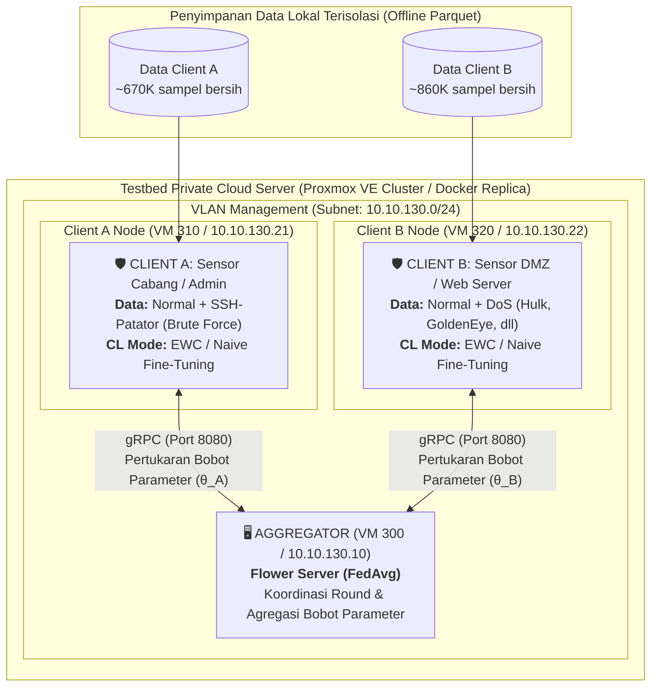
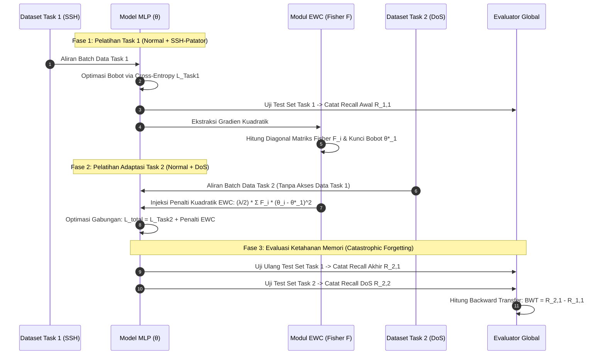
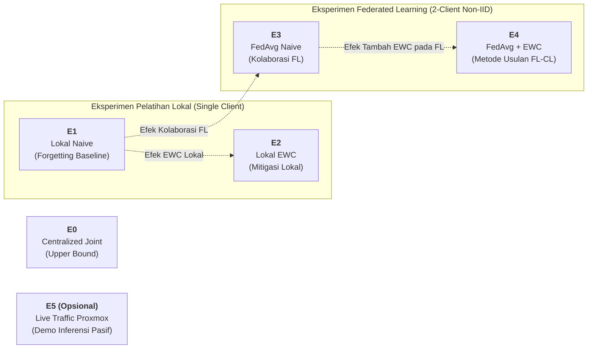

# Briefing Proposal Tugas Akhir: Federated-Continual Learning untuk Deteksi Intrusi

**Judul Penelitian:**  
Analisis Kinerja Deteksi Network Traffic Intrusion Menggunakan Metode Federated-Continual Learning pada Testbed Private Cloud Server  

**Opsi Subjudul:**  
*Studi Pengaruh Elastic Weight Consolidation dan Federated Averaging pada Distribusi Data Non-IID Dua Client*  

**Penyusun:**  
Rafli Alif Ihza Hartono (NRP 5022211233)  
Departemen Teknik Elektro, Fakultas Teknologi Elektro dan Informatika Cerdas (FTEIC)  
Institut Teknologi Sepuluh Nopember (ITS), Surabaya  

---

## 📖 1. Glosarium Akronim & Terminologi Kunci

Untuk memastikan kejelasan komunikasi akademik dan pembelaan skripsi, seluruh singkatan teknis dalam dokumen ini didefinisikan sebagai berikut:

* **TA (Tugas Akhir):** Karya ilmiah mandiri mahasiswa sarjana sebagai syarat kelulusan di Departemen Teknik Elektro FTEIC ITS.
* **IDS / NIDS (Intrusion Detection System / Network Intrusion Detection System):** Sistem pemantau lalu lintas jaringan komputer yang bertugas mendeteksi aktivitas mencurigakan, pelanggaran kebijakan, atau serangan siber.
* **FL (Federated Learning):** Paradigma pembelajaran mesin terdistribusi yang melatih model secara kolaboratif lintas node klien (*client*) tanpa mentransmisikan data mentah lokal, melainkan hanya mempertukarkan bobot parameter model ke server agregator.
* **CL (Continual Learning):** Paradigma pembelajaran mesin yang memungkinkan model beradaptasi mempelajari aliran tugas (*tasks*) baru secara sekuensial tanpa mengalami fenomena lupa ingatan drastis (*catastrophic forgetting*) terhadap tugas yang telah dipelajari sebelumnya.
* **FCL (Federated Continual Learning):** Integrasi sinergis antara Federated Learning dan Continual Learning, di mana model terdistribusi beradaptasi terhadap ancaman baru secara bertahap sekaligus menjaga privasi data lokal.
* **FedAvg (Federated Averaging):** Algoritma agregasi parameter federated standar (McMahan et al., 2017) yang menghitung rata-rata tertimbang bobot model lokal berdasarkan proporsi jumlah data di masing-masing client.
* **EWC (Elastic Weight Consolidation):** Algoritma continual learning berbasis regularisasi kuadratik (Kirkpatrick et al., 2017) yang memperlambat laju pembaruan parameter model yang penting bagi tugas terdahulu dengan memanfaatkan Matriks Informasi Fisher (*Fisher Information Matrix*).
* **Non-IID (Non-Independent and Identically Distributed):** Kondisi distribusi data di mana sebaran kelas atau fitur pada masing-masing client tidak identik dan saling bebas, mencerminkan heterogenitas sensor jaringan di dunia nyata.
* **BWT (Backward Transfer):** Metrik evaluasi continual learning untuk mengukur retensi performa pada tugas lama setelah model menyelesaikan pelatihan tugas baru.
* **MLP (Multi-Layer Perceptron):** Arsitektur jaringan syaraf tiruan tiruan feedforward dengan beberapa lapisan fully-connected layer.
* **CNN (Convolutional Neural Network):** Jaringan syaraf berbasis konvolusi yang mengekstrak fitur spasial.
* **GEM / A-GEM (Averaged - Gradient Episodic Memory):** Metode continual learning berbasis penyimpanan memori sampel masa lalu (*episodic replay buffer*).
* **DoS (Denial of Service):** Serangan siber yang membanjiri kapasitas sumber daya target sehingga layanan lumpuh bagi pengguna yang sah.
* **SSH (Secure Shell):** Protokol administrasi remote terenkripsi; *SSH-Patator* adalah serangan brute-force kamus kredensial terhadap layanan SSH.
* **EDA (Exploratory Data Analysis):** Analisis statistik eksploratif terhadap dataset guna menemukan distribusi, anomali, nilai ekstrem, dan redundansi.
* **CIC / UNB (Canadian Institute for Cybersecurity / University of New Brunswick):** Lembaga riset pembuat dataset benchmark keamanan siber CIC-IDS2017.
* **VM / LXC (Virtual Machine / Linux Container):** Teknologi virtualisasi sistem operasi; Proxmox VE mengelola VM berbasis KVM dan kontainer berbasis LXC.
* **gRPC (Google Remote Procedure Call):** Protokol komunikasi RPC berbasis HTTP/2 yang digunakan framework Flower untuk sinkronisasi parameter bobot model.
* **SMOTE (Synthetic Minority Over-sampling Technique):** Algoritma oversampling berbasis sintesis interpolasi titik data minoritas.

---

## 🎯 2. Latar Belakang & Rumusan Masalah

### 2.1 Konteks Masalah & Paradigma Distributed Learning
1. **Dinamika Ancaman & Catastrophic Forgetting:** Serangan jaringan muncul secara sekuensial di dunia nyata. Ketika model deteksi dilatih ulang pada kelas serangan baru (misal DoS), bobot neural network tertimpa sehingga model melupakan serangan terdahulu (misal Brute Force SSH). Regularisasi EWC membatasi pergeseran bobot krusial tersebut.
2. **Privasi Lalu Lintas Jaringan:** Sentralisasi log trafik mentah melanggar konfidensialitas dan regulasi pelindungan data (UU PDP No. 27/2022). FedAvg memungkinkan pelatihan kolaboratif hanya melalui pertukaran bobot parameter.
3. **Kesenjangan Riset (Research Gap):** Mayoritas riset FL-IDS berasumsi data statis satu waktu, sementara riset CL-IDS berasumsi pelatihan terpusat (*centralized*). Integrasi FCL pada data non-IID trafik jaringan nyata masih sangat minim dievaluasi secara empiris.

  
*Gambar 1: Perbandingan komparatif arsitektur Centralized Machine Learning (mentransmisikan data mentah rentan privasi) versus Federated Learning (hanya mentransmisikan bobot parameter $\theta$ ke server agregasi). Sumber publikasi resmi: Hernandez-Ramos, J. L., Karopoulos, G., & Chatzoglou, E. (2025). "Intrusion Detection Based on Federated Learning: A Systematic Review". ACM Computing Surveys (CSUR), Vol. 57, No. 12, Fig. 3. DOI: [10.1145/3731596](https://doi.org/10.1145/3731596).*

  
*Gambar 2: Siklus protokol Federated Learning terpusat: Server menginisialisasi model global $\theta_0$, klien mengunduh bobot dan melakukan pelatihan lokal pada data privat, kemudian mengirim pembaruan parameter kembali ke server untuk diagregasi menggunakan FedAvg. Sumber: MarcT0K (2023), "Centralized federated learning protocol", Wikimedia Commons, lisensi CC BY-SA 4.0.*

### 2.2 Rumusan Masalah (FINAL & TERKUNCI)
1. **RM 1:** Bagaimana kinerja deteksi intrusi model yang dilatih secara terdistribusi (*Federated Averaging* / FedAvg) dibandingkan dengan model yang dilatih secara lokal pada masing-masing klien dengan distribusi data non-IID?
2. **RM 2:** Bagaimana pengaruh metode *Elastic Weight Consolidation* (EWC) terhadap mitigasi *catastrophic forgetting* saat model mempelajari kelas serangan baru secara sekuensial, baik pada skenario pelatihan lokal maupun terdistribusi (FedAvg + EWC)?

---

## 📊 3. Keputusan Pemilihan Dataset: Mengapa CIC-IDS2017?

Dalam penelitian keamanan siber dan deteksi anomali trafik jaringan, terdapat beberapa dataset publik terkemuka. Berikut adalah perbandingan komparatif dan alasan ilmiah pemilihan **CIC-IDS2017**:

| Dataset | Karakteristik Utama | Alasan Dieliminasi / Ditolak | Status |
|---|---|---|---|
| **KDD Cup 99 / NSL-KDD** | Dibuat tahun 1998/1999 berbasis simulator DARPA. | Sangat usang (hampir 3 dekade), pola trafik tidak mencerminkan protokol modern (SSH/TLS), distribusi paket tidak realistis di jaringan kontemporer. | ❌ Ditolak |
| **UNSW-NB15** | Dibuat tahun 2015 oleh ADFA, mencakup 9 keluarga serangan. | Volume flow Brute Force dan DoS relatif kecil; variasi durasi flow kurang ekstensif dibandingkan CIC; profil attack tools kurang tajam untuk pengujian task sekuensial. | ❌ Ditolak |
| **CSE-CIC-IDS2018** | Dibuat tahun 2018 di AWS, skala sangat masif (>16 GB CSV mentah). | Ukuran data terlampau masif untuk testbed komputasi sarjana, memiliki cacat desinkronisasi label yang serupa dengan versi 2017 tanpa keunggulan metodologis tambahan untuk skenario 2 task. | ❌ Ditolak |
| **TON_IoT / BoT-IoT** | Dirancang khusus untuk protokol IoT (MQTT, CoAP, Modbus). | Fokus pada edge-IoT/smart home, tidak representatif untuk arsitektur private cloud / enterprise network server yang menjadi judul penelitian ini. | ❌ Ditolak |
| **CIC-IDS2017 (Dipilih)** | Rekaman lalu lintas enterprise berdurasi 5 hari kerja (Senin–Jumat) mencakup flow HTTP, SSH, DoS (Hulk, GoldenEye, slowloris). | **Alasan Pemilihan:** Merupakan benchmark de-facto terpopuler di literatur NIDS. Yang paling krusial, **seluruh bug, cacat ekstraksi, dan anomali dataset ini telah dipetakan secara transparan dan tervalidasi peer-reviewed** (*Rosay et al., 2022; Dube et al., 2024*). Hal ini memungkinkan penulis melakukan pembersihan data berbasis bukti ilmiah yang kuat. | ✅ **DIPILIH** |

  
*Gambar 3: Topologi Testbed Jaringan CIC-IDS2017 (Victim-Network dan Attack-Network terisolasi). Sumber publikasi resmi: Sharafaldin, I., Lashkari, A. H., & Ghorbani, A. A. (2018). "Toward Generating a New Intrusion Detection Dataset and Intrusion Traffic Characterization". Proceedings of the 4th International Conference on Information Systems Security and Privacy (ICISSP), SCITEPRESS, Fig. 1. DOI: [10.5220/0006639801080116](https://doi.org/10.5220/0006639801080116).*

### 3.2 Alasan Spesifik Pemilihan Hari: Mengapa Hanya Senin, Selasa, dan Rabu? (Eliminasi Kamis & Jumat)

Dataset resmi CIC-IDS2017 terdiri atas 8 berkas CSV yang merekam aktivitas selama 5 hari kerja (Senin s.d. Jumat) dengan total 2,83 juta baris. Penelitian Tugas Akhir ini **secara spesifik dan eksklusif hanya menggunakan berkas hari Senin, Selasa, dan Rabu** (1.668.530 baris mentah; 1.529.677 baris bersih). Keputusan ini didasarkan pada lima (5) pertimbangan ilmiah yang ketat:

| Hari | File CSV & Karakteristik Trafik | Volume Baris | Status & Peran Ilmiah dalam Penelitian |
|---|---|---|---|
| **Senin (Monday)** | `Monday-WorkingHours.pcap_ISCX.csv` Trafik Normal (BENIGN) 100% murni. | 529.918 | ✅ **DIPAKAI (Baseline Normal)**: Menyediakan distribusi trafik normal murni tanpa kontaminasi serangan sama sekali sebagai representasi aktivitas operasional rutin. |
| **Selasa (Tuesday)** | `Tuesday-WorkingHours.pcap_ISCX.csv` Normal + FTP-Patator + **SSH-Patator**. | 445.909 | ✅ **DIPAKAI (Task 1 / Client A)**: Menyediakan kelas **SSH-Patator** (3.219 flow bersih) sebagai representasi serangan Brute Force autentikasi. *(FTP-Patator dieksklusi karena di luar 3 kelas cakupan).* |
| **Rabu (Wednesday)** | `Wednesday-workingHours.pcap_ISCX.csv` Normal + **DoS (Hulk, GoldenEye, slowloris, slowhttptest)** + Heartbleed. | 692.703 | ✅ **DIPAKAI (Task 2 / Client B)**: Menyediakan kelas **DoS** (193.748 flow bersih) dengan 4 subvarian lengkap sebagai representasi serangan penolakan layanan web. *(Heartbleed dieksklusi karena hanya 11 flow).* |
| **Kamis (Thursday)** | `Thursday-...-WebAttacks.csv` `Thursday-...-Infilteration.csv` Web Attacks & Infiltration. | 458.968 | ❌ **DIELIMINASI (Cacat Sampel & Labeling Parah)**: 1. *Kelangkaan Sampel Ekstrem*: Sql Injection hanya 21 baris, Infiltration hanya 36 baris, XSS 652 baris. Jumlah ini tidak memenuhi syarat daya statistik (*statistical power*) untuk dibagi ke 2 client FL, train/val/test split, dan 5 seeds. 2. *Desinkronisasi Label Parah*: Rosay et al. (2022) membuktikan berkas hari Kamis memiliki cacat desinkronisasi waktu (*timestamp offset*) parah di mana ribuan flow normal salah dilabeli sebagai serangan dan sebaliknya. |
| **Jumat (Friday)** | `Friday-...-Morning.csv` (Botnet) `Friday-...-PortScan.csv` `Friday-...-DDos.csv` (DDoS LOIC) | 703.245 | ❌ **DIELIMINASI (Tidak Relevan & Confounding)**: 1. *PortScan (158K)*: Merupakan aktivitas pemindaian (*reconnaissance*), bukan eksploitasi aktif jaringan. 2. *Botnet ARES (1,9K)*: Mengalami *flow fragmentation bug* pada CICFlowMeter (koneksi terpecah menjadi flow 1-paket kosong). 3. *DDoS LOIC (128K)*: Tumpang tindih secara konseptual dengan DoS hari Rabu, namun membawa fingerprint alat LOIC yang berbeda. Memasukkannya akan menimbulkan bias: apakah model gagal mendeteksi karena *forgetting* atau karena perbedaan signature alat serang. 4. *Overhead Nirfaedah*: Menambah 700K baris tanpa menambah kelas SSH/DoS yang diteliti. |

**Kesimpulan Penegasan:**  
Senin, Selasa, dan Rabu memuat **100% kelas yang menjadi fokus penelitian** (Normal, SSH-Patator, dan DoS) dengan volume 1,53 juta flow bersih. Mengeliminasi hari Kamis dan Jumat melindungi penelitian dari cacat pelabelan pcap, anomali kelas mikro (21 sampel), dan pembengkakan waktu komputasi yang tidak memberikan kontribusi ilmiah terhadap Rumusan Masalah 1 dan 2.

---

## 🔍 4. Audit & Spesifikasi Fitur: Dari 79 Kolom Mentah Menjadi 63 Fitur Unik

Berdasarkan audit empiris pada 3 berkas CSV CIC-IDS2017 (Senin, Selasa, Rabu), dataset mentah memiliki 79 kolom (78 fitur numerik + 1 kolom Label). Dilakukan proses pembersihan berbasis data riil:

### 4.1 Sepuluh (10) Kolom Konstan Dibuang (Variansi Nol)
Kolom-kolom berikut memiliki nilai identik $0$ di seluruh baris data:
1. `Bwd PSH Flags`, 2. `Fwd URG Flags`, 3. `Bwd URG Flags`, 4. `CWE Flag Count`, 5. `Fwd Avg Bytes/Bulk`, 6. `Fwd Avg Packets/Bulk`, 7. `Fwd Avg Bulk Rate`, 8. `Bwd Avg Bytes/Bulk`, 9. `Bwd Avg Packets/Bulk`, 10. `Bwd Avg Bulk Rate`.
* **Justifikasi Ilmiah:** Variansi $\sigma^2 = 0$. Kolom-kolom ini tidak memuat entropi informasi klasifikasi sama sekali. Membiarkannya hanya akan memperbesar dimensi komputasi matriks bobot dan merusak perhitungan matriks Hessian/Fisher EWC.

### 4.2 Lima (5) Kolom Duplikat Dibuang (100% Identik via Hash)
Ditemukan 5 pasang kolom yang memiliki nilai 100% sama persis di seluruh jutaan baris data:
1. `Fwd Header Length.1` (100% identik dengan `Fwd Header Length`)
2. `Subflow Fwd Bytes` (100% identik dengan `Total Length of Fwd Packets`)
3. `Subflow Fwd Packets` (100% identik dengan `Total Fwd Packets`)
4. `Subflow Bwd Packets` (100% identik dengan `Total Backward Packets`)
5. `SYN Flag Count` (100% identik dengan `Fwd PSH Flags`)
* **Justifikasi Ilmiah:** Menimbulkan multikolinearitas sempurna (korelasi Pearson $r = 1.0$), menyebabkan redundansi komputasi dan ketidakstabilan inversi pada estimasi signifikansi parameter Fisher.

### 4.3 Eliminasi Kritis Fitur "Destination Port" (Pencegahan Shortcut Learning)
Fitur nomor port tujuan (`Destination Port`) dieksklusi secara sengaja dari input model:
* **Bukti Empiris:** Pengujian baseline Decision Tree (5 seed) menunjukkan:
  * **Port Saja (1 Fitur):** Menghasilkan Macro-F1 **96,44% ± 0,16%**.
  * **Tanpa Port (62 Fitur):** Menghasilkan Macro-F1 **98,02% ± 0,34%**.
  * **Semua Fitur (63 Fitur):** Menghasilkan Macro-F1 **99,35% ± 0,17%**.
* **Justifikasi Ilmiah:** Nomor port menyebabkan model melakukan **shortcut learning** (menghafal bahwa Port 22 pasti SSH-Patator dan Port 80 pasti DoS/HTTP). Di dunia nyata, penyerang dapat mengubah port layanan (misal SSH pada port non-standar 2222). Model dipaksa mengidentifikasi anomali murni berdasarkan dinamika statistik aliran paket (panjang paket, inter-arrival time, window size, flags), bukan menghafal nomor port.

### 4.4 Rincian 63 Fitur Bersih Tersisa
63 fitur numerik mencakup parameter statistik bidirectional flow:
* **Durasi & Volume:** `Flow Duration`, `Total Fwd Packets`, `Total Backward Packets`, `Total Length of Fwd Packets`, `Total Length of Bwd Packets`.
* **Statistik Panjang Paket:** Mean, Std, Max, Min panjang paket fwd dan bwd.
* **Inter-Arrival Time (IAT):** `Flow IAT Mean/Std/Max/Min`, `Fwd IAT Mean/Std/Max/Min`, `Bwd IAT Mean/Std/Max/Min`.
* **TCP Flags & Overhead:** `Fwd/Bwd PSH Flags`, `FIN Flag Count`, `RST Flag Count`, `ACK Flag Count`, `URG Flag Count`, `ECE Flag Count`, `Fwd/Bwd Header Length`.
* **Karakteristik Segmen & Jendela:** `Init_Win_bytes_forward`, `Init_Win_bytes_backward`, `act_data_pkt_fwd`, `min_seg_size_forward`, `Down/Up Ratio`, `Average Packet Size`.
* **Aktivitas Temporal:** `Active Mean/Std/Max/Min`, `Idle Mean/Std/Max/Min`.

---

## ⚖️ 5. Keputusan Penanganan Imbalance & Retensi Data: Weighted Loss (Keep All Clean Data)

### 5.1 Realitas Data Mentah Pasca-Deduplikasi
Setelah seluruh baris duplikat mentah dibersihkan dari CSV hari Senin, Selasa, dan Rabu (menggunakan 63 fitur unik):
* **Normal (BENIGN):** 1.332.710 flow (87,1%)
* **DoS (Hulk, GoldenEye, slowloris, slowhttptest):** 193.748 flow (12,7%)
* **SSH-Patator (Brute Force):** **Hanya 3.219 flow unik** (0,2%)
* **Total Keseluruhan Data Bersih:** **1.529.677 flow unik** (Rasio ketimpangan ~ 414 : 60 : 1).

### 5.2 Keputusan Bimbingan: Opsi C (Weighted Loss, Keep All Data)
Berdasarkan arahan dosen pembimbing, pemangkasan ekstrem (*undersampling* hingga 3.200 sampel per kelas) dihindari karena akan membuang 99,6% data Normal dan 98% data DoS yang berharga. Keputusan yang dibekukan adalah **Pilihan C: Weighted Loss (Keep All Clean Data)**:

1. **Retensi Data Maksimal:** Seluruh 1,53 juta baris data unik dipertahankan, memastikan model terpapar pada variabilitas trafik riil skala besar.
2. **Formulasi Weighted Cross-Entropy Loss:**
   $$\mathcal{L}_{	ext{CE}}(y, \hat{y}) = - \sum_{c=1}^{C} w_c \cdot y_c \log(\hat{y}_c)$$
   Di mana bobot kelas $w_c$ dihitung berdasarkan kebalikan frekuensi sampel terstandarisasi:
   $$w_c = rac{N}{|C| 	imes N_c}$$
   Dengan demikian, kesalahan prediksi pada kelas minoritas SSH-Patator dikenai penalti gradien yang jauh lebih berat dibanding kelas mayoritas Normal, mencegah model terbias menjadi *majority classifier*.
3. **Pengamanan Gradient Clipping (Norm $\le 1.0$):**
   Untuk mencegah terjadinya lonjakan gradien (*gradient explosion*) saat batch kebetulan memuat banyak sampel SSH, loop optimasi PyTorch wajib menerapkan `torch.nn.utils.clip_grad_norm_(model.parameters(), max_norm=1.0)`.
4. **Profil Ganda (Production vs. Fast Dev Profile):**
   * **Profil Utama (Skripsi):** Pelatihan penuh pada 1,53 juta flow untuk pelaporan hasil akhir.
   * **Profil Cepat (Dev/Debug):** Sub-profil 5.000 sampel per kelas untuk verifikasi cepat alur kode dan pipeline lokal sebelum eksekusi skala penuh.

---

## 🧠 6. Keputusan Pemilihan Model: Mengapa Single MLP?

Perbandingan komprehensif pemilihan arsitektur model deteksi intrusi:

| Model                                      | Keunggulan (*Pros*)                                                                                                                                                                                                                                                                                              | Kelemahan (*Cons*)                                                                                                                                                                                  | Status dalam TA       |
| ------------------------------------------ | ---------------------------------------------------------------------------------------------------------------------------------------------------------------------------------------------------------------------------------------------------------------------------------------------------------------- | --------------------------------------------------------------------------------------------------------------------------------------------------------------------------------------------------- | --------------------- |
| **Multi-Layer Perceptron (MLP) (Dipilih)** | - Komputasi sangat ringan (hanya ~6.500 parameter). - Inferensi berkecepatan tinggi (<1 ms per flow) cocok untuk edge node. - **Perhitungan Matriks Informasi Fisher EWC stabil, deterministik, dan cepat secara analitis.** - Ukuran pertukaran parameter sangat kecil via gRPC FL (<50 KB per round). | - Tidak memodelkan dependensi urutan waktu antar-paket secara eksplisit (namun fitur CIC-IDS2017 sudah berupa ringkasan agregat flow).                                                              | ✅ **DIPILIH TUNGGAL** |
| **1D-CNN**                                 | - Mampu menangkap korelasi pola lokal antar-fitur bertetangga.                                                                                                                                                                                                                                                   | - Fitur tabular tidak memiliki korelasi spasial alami layaknya piksel gambar (urutan kolom arbiter). - Jumlah parameter lebih besar, komputasi Fisher EWC lebih kompleks.                        | ❌ Dieliminasi         |
| **LSTM / GRU**                             | - Sangat baik untuk data runtut waktu (*sequential stream*).                                                                                                                                                                                                                                                     | - Struktur data CIC-IDS2017 adalah ringkasan per-flow (satu baris mewakili satu koneksi penuh), bukan sekuens paket individual. - Waktu training lama, rentan vanishing gradient pada EWC.       | ❌ Dieliminasi         |
| **Tabular Transformer**                    | - Mekanisme self-attention mampu memetakan interaksi non-linear fitur global.                                                                                                                                                                                                                                    | - Memerlukan ratusan ribu parameter kompleks yang rentan overfitting pada data tabular terdistribusi. - Ukuran model besar, membebani bandwidth jaringan Flower FL.                                            | ❌ Dieliminasi         |
| **Random Forest / XGBoost**                | - Sangat akurat dan tahan outlier pada data tabular.                                                                                                                                                                                                                                                             | - **Tidak kompatibel secara alami dengan Federated Averaging (agregasi pohon keputusan tidak sejalan dengan FedAvg)**. - Tidak memiliki fungsi loss diferensiabel untuk perhitungan gradien EWC. | ❌ Dieliminasi         |

**Spesifikasi Arsitektur MLP Baku:**
$$\text{Input}(63) \longrightarrow \text{Linear}(64) + \text{ReLU} + \text{Dropout}(0.2) \longrightarrow \text{Linear}(32) + \text{ReLU} \longrightarrow \text{Linear}(3) + \text{Softmax}$$

  
*Gambar 4a: Topologi Jaringan Syaraf Tiruan Feedforward (Multi-Layer Perceptron) dengan Input Layer (63 fitur), Hidden Layers (64 dan 32 neuron teraktivasi ReLU), dan Output Layer (3 neuron klasifikasi softmax). Sumber: Glosser.ca (2013), "Colored neural network", Wikimedia Commons, lisensi CC BY-SA 3.0.*

  
*Gambar 4b: Graph komputasi arsitektur MLP skripsi (Input: `flow_features_63` $\to$ Gemm/Linear: 64 $\to$ Relu $\to$ Dropout: 0.2 $\to$ Gemm/Linear: 32 $\to$ Relu $\to$ Gemm/Linear: 3 $\to$ `class_logits_3`) yang diekspor dari PyTorch ke format ONNX ([Aset/mlp_intrusion_model.onnx](file:///e:/Projects/thesis/Aset/mlp_intrusion_model.onnx)) dan divisualisasikan melalui [Netron](https://netron.app).*

### 6.2 Protokol Sistematis Hyperparameter Tuning & Penyeimbangan Parameter
Sesuai arahan pembimbing bahwa metode dan parameter harus seimbang bobotnya, proses pencarian parameter (*hyperparameter search*) dirancang terstruktur menggunakan data validasi (15% split terstratifikasi) lintas 5 seed acak:

| Komponen | Hyperparameter | Ruang Pencarian (*Search Space*) | Nilai Baseline Default | Justifikasi & Peran Penyeimbang |
|---|---|---|---|---|
| **Optimasi Lokal** | Learning Rate ($\eta$) | $\{10^{-4}, 5 \times 10^{-4}, 10^{-3}\}$ | $10^{-3}$ (Adam) | Menyeimbangkan kecepatan konvergensi vs stabilitas loss permukaan |
| **Batching** | Batch Size ($B$) | $\{64, 128, 256\}$ | $128$ | Menjaga stabilitas estimasi gradien pada data berbobot |
| **Regularisasi Model**| Dropout Rate ($p$) | $\{0.1, 0.2, 0.3\}$ | $0.2$ | Mencegah overfitting fitur dominan |
| **EWC Regularizer** | Penalti Fisher ($\lambda$) | $\{10^1, 10^2, 10^3, 10^4, 10^5\}$ | $10^3$ | **Kunci Keseimbangan:** $\lambda$ kecil $\to$ forgetting; $\lambda$ besar $\to$ plasticity freeze |
| **Estimasi Fisher** | Ukuran Sampel ($N_{\text{fisher}}$) | $\{500, 1000, 2000\}$ | $1000$ per kelas | Efisiensi memori RAM vs akurasi diagonal Hessian |
| **Federated Learning**| Local Epochs ($E$) | $\{1, 3, 5\}$ | $3$ | Menyeimbangkan beban komputasi lokal klien |
| **Federated Learning**| Communication Rounds ($R$) | $\{10, 20\}$ | $10$ | Konvergensi agregasi parameter global FedAvg |

---

## 🏗️ 7. Metode & Arsitektur Testbed: Perbandingan SCOPED vs. CREEPED

Penelitian ini bertumpu pada infrastruktur private cloud server, namun dengan penyederhanaan operasional yang terukur:

  
*Gambar 5: Diagram Topologi Fisik Testbed Private Cloud Server FL-CL pada Proxmox VE Cluster. Sumber aset lokal: Aset/arsitektur_testbed_fl_cl.png.*

| Dimensi | Desain Awal: CREEPED (`fl-cl`) | Desain Terkunci: SCOPED (`thesis`) | Justifikasi Perubahan |
|---|---|---|---|
| **Penyediaan Data** | *Live Sniffing* via `NFStream` ke RAMDisk `/mnt/ramdisk/flows/` secara real-time. | Pembacaan data tabular *CIC-IDS2017* (parquet/CSV terpartisi) langsung dari disk lokal. | Menghilangkan risiko dropped-packet, overhead sniffing, dan menjamin replikasi data identik di setiap seed. |
| **Injeksi Trafik** | VM 400 (Traffic Gen) aktif menembakkan Hydra, Slowloris, dan raw socket terus menerus. | ❌ **TIDAK DIPERLUKAN (Dieliminasi Penuh)** sesuai arahan resmi pembimbing. | Mengeliminasi interferensi parameter jaringan eksternal (packet loss, timing jitter, buffer overrun) yang mengaburkan riset. |
| **Port Mirroring** | Hookscript Perl (`pve-portmirror-hookscript.pl`) menyalin trafik fisik ke interface TAP defender. | ❌ **Tidak Digunakan (Ditiadakan)**. | Menghilangkan kompleksitas bridging layer-2; data dibaca langsung secara offline tabular. |
| **Staging Eksekusi Testbed** | Ketergantungan absolut pada cluster fisik server Proxmox VE sejak awal. | 💻 **Protokol Dua Tahap (Local First $	o$ Simulasi Server Proxmox):** Tahap 1 realisasi lokal (Docker Compose / isolated venv), Tahap 2 simulasi cluster VM Proxmox VE. | Memastikan stabilitas algoritma 100% bebas bug sebelum dieksekusi di server; mitigasi risiko server lab down. |
| **Komunikasi FL** | Flower via gRPC + MLflow Server port 5000 + Telegram Alerts + Webhook Sheets. | Flower via gRPC murni dengan local metric logging terstruktur. | MLOps kompleks dipangkas agar tidak mengaburkan fokus riset. |

---

## 🔄 8. Alur Kerja Tugas Sekuensial & Partisi Non-IID

### 8.1 Skenario Partisi Non-IID Dua Client
* **Client A (Sensor Jaringan Cabang / Server Administrasi):**
  * Mengamati aliran trafik: **Normal + SSH-Patator (Brute Force)**.
* **Client B (Sensor Jaringan DMZ / Web Server Publik):**
  * Mengamati aliran trafik: **Normal + DoS (Hulk, GoldenEye, slowloris, slowhttptest)**.

### 8.2 Kerangka Konseptual Continual Learning & Mitigasi Catastrophic Forgetting
Dalam sistem deteksi intrusi jaringan (NIDS) yang dinamis, model machine learning menghadapi dua tantangan mendasar saat dihadapkan pada pola serangan baru secara berkelanjutan:
1. **Catastrophic Forgetting (Kelupaan Katastropik):** Jaringan syaraf tiruan standar yang dilatih secara gradien pada tugas baru ($Task\ 2$) cenderung menimpa (*overwrite*) bobot parameter yang sebelumnya krusial untuk mengenali tugas lama ($Task\ 1$). Akibatnya, kemampuan model mendeteksi serangan lama runtuh mendekati 0%.
2. **Stability-Plasticity Dilemma:** Model dituntut memiliki fleksibilitas (*plasticity*) memadai untuk mempelajari distribusi ancaman baru yang belum pernah dilihat, sembari mempertahankan kekokohan (*stability*) representasi pengetahuan lama.

  
*Gambar 6: Kerangka Konseptual Continual Learning: (a) Kebutuhan model beradaptasi terhadap urutan tugas inkremental dengan distribusi data dinamis; (b) Manajemen trade-off antara stabilitas memori (retensi pengetahuan lama) dan plastisitas pembelajaran (akuisisi pengetahuan baru), serta kemampuan generalisasi intra/inter-task; (c) Klasifikasi metodologi mitigasi catastrophic forgetting; (d) Penyesuaian skenario implementasi praktis. Sumber publikasi resmi: Wang, L., Zhang, X., Su, H., & Zhu, J. (2024). "A Comprehensive Survey of Continual Learning: Theory, Method and Application". IEEE Transactions on Pattern Analysis and Machine Intelligence (TPAMI), arXiv:2302.00487. DOI: [10.1109/TPAMI.2024.3367329](https://doi.org/10.1109/TPAMI.2024.3367329).*

  
*Gambar 7: Diagram Pohon Taksonomi Metode Continual Learning: Klasifikasi komprehensif atas metode Replay (berbasis buffer memori), Regularization-based (termasuk EWC pada cabang pendekatan bobot prior-focused), dan Parameter Isolation. Sumber publikasi resmi: De Lange, M. et al. (2022). "A Continual Learning Survey: Defying Forgetting in Classification Tasks". IEEE Transactions on Pattern Analysis and Machine Intelligence (TPAMI), Vol. 44, No. 7, pp. 3366–3385, Fig. 1. DOI: [10.1109/TPAMI.2021.3057446](https://doi.org/10.1109/TPAMI.2021.3057446).*

### 8.3 Intuisi Ruang Parameter EWC (Elastic Weight Consolidation)
Penelitian Kirkpatrick et al. (2017) membuktikan bahwa ruang parameter jaringan syaraf memiliki kelenturan (*overparameterization*). Terdapat konfigurasi bobot parameter yang mampu memuaskan kedua tugas sekaligus, asalkan pembaruan parameter yang krusial bagi tugas lama dilindungi oleh penalti kuadratik berbasis informasi Fisher:

  
*Gambar 8: Ilustrasi skematik ruang parameter EWC. Lintasan tanpa penalti (biru) menyebabkan forgetting total pada Task A; penalti seragam (hijau) terlalu restriktif; sedangkan penalti berbobot Fisher EWC (merah) menuntun model menuju irisan performa optimal untuk Task A dan Task B secara simultan. Sumber publikasi resmi: Kirkpatrick, J. et al. (2017). "Overcoming catastrophic forgetting in neural networks". PNAS, Vol. 114, No. 13, Fig. 1. DOI: [10.1073/pnas.1611835114](https://doi.org/10.1073/pnas.1611835114).*

### 8.4 Diagram Sekuensial Alur Kerja (Workflow Task FL-CL)

---

## 📐 9. Metrik Evaluasi Kinerja Ilmiah & Formulasi Matematis

Evaluasi dihitung berdasarkan Matriks Kontingensi (*Confusion Matrix*) multikelas: $TP_c$ (True Positive), $FP_c$ (False Positive), $TN_c$ (True Negative), dan $FN_c$ (False Negative) untuk masing-masing kelas $c \in \{\text{Normal}, \text{SSH-Patator}, \text{DoS}\}$.

  
*Gambar 9: Visualisasi komparatif antara Presisi (relevansi hasil prediksi) dan Recall (kelengkapan penemuan seluruh anomali sebenarnya). Sumber: Walber (2014), "Precision and Recall Diagram", Wikimedia Commons, lisensi CC BY-SA 4.0.*

  
*Gambar 10: Struktur Komprehensif Matriks Kontingensi (Confusion Matrix) dengan formulasi True Positive (TP), False Positive (FP), True Negative (TN), False Negative (FN), serta metrik turunan Accuracy, Sensitivity/Recall, Specificity, dan Precision. Sumber: Wikimedia Commons, lisensi CC BY-SA 4.0.*

### 1. Akurasi (Accuracy)
Persentase total prediksi yang tepat terhadap seluruh populasi data uji:
$$\text{Accuracy} = \frac{\sum_{c=1}^{|C|} TP_c}{\sum_{c=1}^{|C|} (TP_c + FP_c + FN_c + TN_c)}$$
*Catatan Ilmiah:* Akurasi global tidak sensitif terhadap *catastrophic forgetting* karena didominasi oleh performa kelas Normal dan DoS yang baru saja dipelajari.

### 2. Presisi (Precision per-class $c$)
Kemampuan model menghindari salah deteksi (*False Alarm / False Positive*):
$$\text{Precision}_c = \frac{TP_c}{TP_c + FP_c}$$

### 3. Recall / Sensitivitas (Recall per-class $c$) — *Metrik Kunci Retensi*
Kemampuan model menjaring seluruh serangan yang ada (*Missed Detection Prevention*):
$$\text{Recall}_c = \frac{TP_c}{TP_c + FN_c}$$
*Signifikansi Khusus:* **$Recall_{\text{SSH-Patator}}$ adalah indikator paling sensitif terhadap catastrophic forgetting.** Ketika model lupa ingatan, $Recall_{\text{SSH-Patator}}$ akan runtuh mendekati 0%.

### 4. Macro-Averaged F1-Score ($Macro-F1$)
Rata-rata harmonik antara Presisi dan Recall dengan pembobotan setara antar-kelas:
$$F1_c = 2 \times \frac{\text{Precision}_c \times \text{Recall}_c}{\text{Precision}_c + \text{Recall}_c}$$
$$Macro-F1 = \frac{1}{|C|} \sum_{c=1}^{|C|} F1_c$$
*Signifikansi Khusus:* Memastikan kelas minoritas diperlakukan setara dengan kelas mayoritas tanpa bias volume.

### 5. Backward Transfer (BWT) — *Metrik Inti Continual Learning*
Mengukur secara presisi seberapa besar degradasi retensi memori tugas lama setelah mempelajari tugas baru:
$$BWT = R_{2,1} - R_{1,1}$$
*Interpretasi Ilmiah:*
* **$BWT < 0$:** Mengindikasikan terjadinya *Catastrophic Forgetting* (makin negatif nilainya, makin parah kelupaan model).
* **$BWT \approx 0$:** Mengindikasikan metode EWC berhasil mengunci memori tugas lama dengan sempurna tanpa degradasi.
* **$BWT > 0$:** Mengindikasikan terjadinya transfer pembelajaran positif (*positive backward transfer*).

---

## 💡 10. Poin Tambahan Khusus (Penajaman Ilmiah & Mitigasi Risiko)

Sebagai perancang arsitektur penelitian, tiga poin penting berikut ditambahkan untuk memperkuat sidang dan penulisan skripsi paneer:

### 10.1 Mitigasi Bias Temporal Data Normal (*Temporal Confound Mitigation*)
* **Temuan Empiris:** Pengujian klasifikasi Normal hari Selasa vs Normal hari Rabu (tanpa menyertakan nomor port) menghasilkan akurasi **62,44% ± 0,34%** (signifikan di atas tebakan acak 50%). Ini membuktikan adanya *day-pattern confound* (perubahan latar belakang trafik antar-hari).
* **Keputusan Solutif (Opsi A):** Data Normal dari Senin, Selasa, dan Rabu digabung lalu dibagi secara acak (**Random Split**) ke dalam Task 1 dan Task 2, bukan membagi Normal berdasarkan hari kerja. Hal ini menjamin model mempelajari pola anomali serangan secara murni, bukan menghafal variasi hari rekaman.

### 10.2 Protokol Keterulangan Ilmiah (5 Standardized Random Seeds)
* Seluruh eksperimen matriks (E0 s.d. E4) dijalankan sebanyak 5 kali pengulangan independen dengan seed generator tetap: **42, 43, 44, 45, dan 46**.
* Seluruh tabel dan grafik disajikan dalam format statistik baku:
  $$\text{Nilai Akhir} = \text{Mean} \pm \text{Standard Deviation}$$
* Ini membuktikan kepada dosen penguji bahwa keberhasilan atau kegagalan EWC bukan kebetulan inisialisasi bobot acak.

### 10.3 Posisi Akademik Terhadap Hasil Eksperimen EWC
* Dalam penelitian skripsi sarjana teknik elektro, **hasil eksperimen yang menunjukkan trade-off atau penurunan performa pada skenario tertentu tetap memiliki nilai akademik setinggi hasil positif**.
* Jika EWC pada FL non-IID menunjukkan *stability-plasticity dilemma* (misal: EWC berhasil mempertahankan Recall SSH sebesar 85%, namun memperlambat konvergensi kelas DoS sebesar 3%), temuan ini adalah **kontribusi ilmiah analitis yang sangat berharga**. Tugas akhir ini bertujuan menguji dan menganalisis secara objektif, bukan merekayasa klaim akurasi artifisial 100%.

### 10.4 Prinsip Keseimbangan Bobot Metode dan Parameter (*Balanced Weighting Policy*)
Sesuai arahan pembimbing:
* **Penyeimbangan Loss EWC vs Task:** Parameter $\lambda$ diatur proporsional sehingga kontribusi penalti kuadratik Fisher tidak menenggelamkan loss tugas kedua.
* **Penyeimbangan Bobot Kelas:** Bobot invers frekuensi pada Weighted Cross-Entropy Loss dihaluskan dan dijaga dengan gradient clipping (norm $\le 1.0$) agar kelas minoritas mendapatkan porsi pembaruan bobot yang setara tanpa merusak kestabilan numerik model.

### 10.5 Protokol Eksekusi Bertahap (Local First $\to$ Simulasi Server)
* **Fase 1 (Realisasi Lokal):** Pengembangan seluruh komponen (preprocessing, pipeline PyTorch, EWC loss, Flower client/server) dituntaskan dan divalidasi pada workstation lokal.
* **Fase 2 (Simulasi Server):** Kode yang telah stabil dideploy ke VM Proxmox VE (VM 300, 310, 320) untuk mensimulasikan lingkungan terdistribusi real.

---

## 📊 11. Matriks Pengujian Akhir (E0 s.d. E4)

  
*Gambar 11: Diagram Alur Metode Penelitian Terstruktur dari Praproses hingga Evaluasi BWT. Sumber aset lokal: Aset/alur_metode_penelitian.png.*

| Kode   | Moda FL    | Moda CL | Deskripsi Pengujian                                                         | Target Bukti Ilmiah                                                                  |     |
| ------ | ---------- | ------- | --------------------------------------------------------------------------- | ------------------------------------------------------------------------------------ | --- |
| **E0** | –          | –       | *Centralized Joint Training* (semua kelas dilatih simultan)                 | Batas atas ideal performa (*Upper Bound Benchmark*).                                 |     |
| **E1** | Lokal      | *Naive* | Pelatihan lokal sekuensial Task 1 $\to$ Task 2 tanpa regularisasi           | Membuktikan secara empiris terjadinya *catastrophic forgetting* lokal ($BWT \ll 0$). |     |
| **E2** | Lokal      | **EWC** | Pelatihan lokal sekuensial Task 1 $\to$ Task 2 dengan penalti Fisher        | Mengukur efektivitas EWC mempertahankan memori lokal.                                |     |
| **E3** | **FedAvg** | *Naive* | Pelatihan terdistribusi 2 client non-IID tanpa regularisasi CL              | Mengukur dampak kolaborasi FedAvg murni pada data non-IID.                           |     |
| **E4** | **FedAvg** | **EWC** | **Sistem Usulan (FL-CL):** FedAvg 2-client terdistribusi + regularisasi EWC | Membuktikan integrasi FL-CL mampu menekan forgetting lintas client non-IID.          |     |
| **E5** | –          | –       | ❌ **Dieliminasi dari Target Wajib** (Injeksi live traffic resmi ditiadakan pembimbing) | Pengujian dibatasi murni pada data benchmark offline CIC-IDS2017 (E0 s.d. E4).       |     |

---

## 🟢 KESIMPULAN STATUS RUANG LINGKUP: READY FOR PREPROCESSING DATASETS

Seluruh keputusan metodologis (1 s.d. 8) telah disetujui resmi oleh dosen pembimbing. Tidak ada lagi parameter ambigu atau risiko scope creep. Pipeline ekstraksi dataset (`scripts/preprocess_cicids2017.py`) resmi dinyatakan **READY TO RUN**.