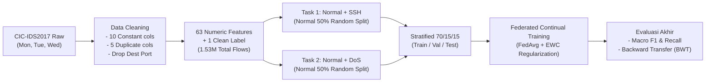

# 🛡️ Federated Continual Learning for Network Intrusion Detection Systems (FL-CL IDS)

[](#-dataset--lingkup-data)
[](#-tinjauan-pustaka--literatur)
[-brightgreen.svg)](#-keputusan-desain--lingkup-penelitian)
[](#-arsitektur-sistem)

Repositori ini memuat seluruh naskah riset, dokumentasi bimbingan, catatan literatur terverifikasi, serta desain metodologi untuk Tugas Akhir / Skripsi:
> **"Analisis Kinerja Deteksi Network Traffic Intrusion Menggunakan Metode Federated-Continual Learning pada Testbed Private Cloud Server"**  
> *(Studi Pengaruh Elastic Weight Consolidation dan Federated Averaging pada Distribusi Data Non-IID Dua Client)*

---

## 📌 Ringkasan Eksekutif & Fokus Riset

Penelitian ini membedah trade-off antara **privasi & desentralisasi data (Federated Learning via FedAvg)** dan **retensi pengetahuan deteksi masa lalu (Continual Learning via EWC)** pada *Intrusion Detection System* (IDS).

### Rumusan Masalah Utama:
1. **RM1 (Efektivitas FL pada Non-IID):** Sejauh mana agregasi federasi (FedAvg) mampu menggeneralisasi model deteksi intrusi saat distribusi lalu lintas jaringan antar-node bersifat non-IID (*label skew*) dibandingkan model lokal mandiri?
2. **RM2 (Mitigasi Catastrophic Forgetting via EWC):** Apakah penambahan penalti kuadratik *Elastic Weight Consolidation* (EWC) pada klien lokal mampu mempertahankan performa deteksi terhadap serangan lama (Task 1: SSH Brute Force) setelah model mempelajari serangan baru (Task 2: DoS) tanpa bertukar data mentah?

---

## 🏛️ Arsitektur Sistem & Alur Metodologi

Sistem dirancang dengan topologi terdistribusi menggunakan framework **Flower** dan backend **PyTorch**:

```
[ PVE FL Server: FedAvg Aggregator ]
               ▲                 ▲
       Weights │                 │ Weights
               ▼                 ▼
  [ Node PVE-01: Client A ]     [ Node PVE-02: Client B ]
   Task 1: Normal + SSH          Task 2: Normal + DoS
   (Local EWC Regularization)    (Local EWC Regularization)
```



---

## 📊 Dataset & Lingkup Data (Locked)

Penelitian ini menggunakan **solely dataset CIC-IDS2017 Original** (file Senin, Selasa, dan Rabu) yang telah melalui audit kurasi saintifik:

| Parameter | Spesifikasi / Keputusan Terkunci | Justifikasi Ilmiah |
|---|---|---|
| **Sumber Data** | CIC-IDS2017 (Senin, Selasa, Rabu) | Menghindari label drift & inkonsistensi pcap Kamis/Jumat. |
| **Total Sampel Bersih** | **1.529.677 flows** (Normal: 1.332.710; DoS: 193.748; SSH: 3.219) | Deduplikasi flow penuh, membuang baris identik non-informatif. |
| **Fitur Final** | **62 Fitur Numerik Unik + 1 Label** | 10 kolom konstan (varian nol) & 5 duplikat identik dibuang. |
| **Pencegahan Shortcut** | **`Destination Port` DIBUANG** | Mencegah shortcut learning buatan (*port-to-label bias*, Engelen et al., 2021). |
| **Partisi Normal** | **Opsi A: Random 50/50 All Days** | Mencegah bias confounder hari (*day-of-week traffic pattern*). |
| **Penanganan Imbalance** | **Opsi C: Weighted Cross-Entropy Loss** | Mempertahankan seluruh 1,53 juta sampel tanpa distorsi undersampling. |

---

## 📂 Struktur Repositori & Navigasi Vault

Repositori ini diorganisasi menggunakan struktur modular yang saling terhubung:

```
thesis/
├── README.md                      # Dokumentasi utama repositori (file ini)
├── README-Structure.md            # Dokumentasi arsitektur 14 folder Obsidian
├── LOCATION-UPDATE.md             # Panduan sinkronisasi lokasi kode & vault
│
├── Dashboard/                     # Pusat navigasi, timeline, dan matriks kerja
│   ├── README.md                  # Pemandu navigasi dashboard
│   ├── Dashboard.md               # Hub utama proyek
│   ├── Checklist-Selesai.md       # Target & definisi selesai
│   ├── Matriks-E0-E5.md           # Desain komparasi baseline (E0-E4)
│   └── Timeline-16-Minggu.md      # Jadwal eksekusi riset mingguan
│
├── Proposal/                      # Naskah briefing & proposal tugas akhir
│   ├── README.md                  # Indeks proposal
│   ├── Briefing-Scope-TA.md       # Dokumen pembekuan scope komprehensif
│   └── Referensi-Skripsi-Hafizh.pdf # Skripsi acuan institusi
│
├── Literatur/                     # Bank telaah literatur & naskah ilmiah
│   ├── README.md                  # Indeks literatur & taksonomi riset
│   ├── Crosscheck.md              # Verifikasi metadata 25 paper (100% verified)
│   ├── Daftar-Pustaka.md          # Daftar pustaka format akademik
│   ├── Inventaris-PDF.md          # Katalog 25 berkas PDF lokal
│   ├── [25 Paper Notes].md        # Catatan ringkasan berbobot per paper
│   └── PDFs/                      # Repositori fisik PDF (13 Inti, 12 Pendukung)
│
├── Metodologi/                    # Desain eksperimen, EDA, & skrip analisis
│   ├── README.md                  # Pemandu metodologi eksperimental
│   ├── EDA-CIC-IDS2017.md         # Analisis lengkap fitur & port leakage
│   ├── EDA-Verifikasi.md          # Verifikasi kolom konstan & duplikat
│   ├── CRITICAL-CIC-IDS2017-Issues.md # Analisis anomali dataset
│   └── DATASET-UNAVAILABLE-LYCOS.md   # Justifikasi tidak digunakannya mirror
│
├── Keputusan/                     # Rekam jejak konsolidasi & persetujuan pembimbing
│   ├── README.md                  # Ringkasan keputusan desain
│   ├── Ringkasan-Untuk-Pembimbing.md # 7 poin konfirmasi pembimbing
│   ├── Keputusan-Untuk-Pembimbing.md # Detail evaluasi opsi teknis
│   ├── Keputusan-Pembekuan-CL.md  # Kunci algoritma CL (EWC)
│   └── Keputusan-Pembekuan-FL.md  # Kunci arsitektur FL (FedAvg 2-client)
│
├── Bimbingan/                     # Materi konsultasi & log bimbingan berkala
│   ├── README.md                  # Log bimbingan
│   ├── Bahan-Paparan-Pembimbing.md # Ringkasan slide eksekutif bimbingan
│   └── Panduan-Tanya-Jawab-Pembimbing.md # Antisipasi pertanyaan & defense dosen
│
├── Aset/                          # Visualisasi non-AI, diagram arsitektur, & model
│   ├── README.md                  # Katalog 16 aset gambar, SVG, dan biner ONNX
│   └── *.png / *.svg / *.onnx    # Diagram alur, topologi testbed, matriks
│
├── Datasets/                      # Penyimpanan data (diabaikan dari Git via .gitignore)
│   ├── CIC-IDS2017/               # CSV mentah (Senin, Selasa, Rabu)
│   ├── interim/                   # Parquet bersih terdeduplikasi (1.53M baris)
│   └── clean/                     # Parquet hasil normalisasi & partisi task (siap training)
│
├── Eksperimen/                    # Log eksekusi eksperimen E0-E4 per seed
├── Hasil/                         # Visualisasi metrik, confusion matrix, & tabel BWT
├── Penulisan/                     # Draf naskah Bab 1 s.d. Bab 5
└── Templates/                     # Format baku Obsidian untuk konsistensi catatan
```

---

## 🔬 Matriks Eksperimen (E0 – E4)

Eksperimen diuji melintasi 5 random seed (42, 43, 44, 45, 46) untuk memastikan signifikansi statistik:

| Kode | Skenario | Paradigma Komputasi | Mitigasi Forgetting | Tujuan Pengujian |
|---|---|---|---|---|
| **E0** | Isolated Local Baseline | Lokal per Client | Tanpa Mitigasi | Mengukur performa murni lokal tanpa kolaborasi. |
| **E1** | Centralized Baseline | Terpusat (Upper Bound) | Joint Retraining | Mengukur batas atas akurasi ideal jika data digabung. |
| **E2** | Pure FedAvg Baseline | Terfederasi (FedAvg) | Tanpa Mitigasi | Mengukur keparahan catastrophic forgetting pada FL standar. |
| **E3** | **FL + Continual Learning (EWC)** | **Terfederasi (FedAvg)** | **Local EWC Penalty** | **Inovasi Inti:** Menguji efektivitas retensi memori Task 1. |
| **E4** | FL + Experience Replay | Terfederasi (FedAvg) | Local Replay Buffer | Pembanding berbasis rehearsal untuk EWC. |

*(Catatan: E5 Live Traffic Injection secara resmi dieliminasi dari lingkup penelitian berdasarkan arahan pembimbing pada 06 Oktober 2026).*

### 📈 Metrik Evaluasi & Profiling Komputasi (Ref. Skripsi Hafizh, 2024):
1. **Metrik Deteksi ML:** Macro-F1, per-class Precision & Recall, dan Backward Transfer (BWT).
2. **Profiling Instance & Efisiensi Komputasi:**
   - **Inference Latency per Flow ($\mu\text{s}$):** Mengukur kecepatan klasifikasi per flow untuk validasi *near real-time* di edge.
   - **Memory Footprint (RAM / Storage):** Membuktikan efisiensi EWC ($\approx$ puluhan KB untuk parameter $\theta^*$ dan matriks Fisher $F_i$) dibanding Experience Replay yang membebani memori dengan buffer paket mentah.
   - **Communication Overhead FL:** Mengukur ukuran payload parameter model (KB/MB per round) antara client dan server Flower ($2 \times \text{Size}(\theta) \times R$).
   - *(Catatan: Parameter QoS jaringan fisik seperti bandwidth link, delay, jitter, dan packet loss ditiadakan sejalan eliminasi live traffic).*
3. **Visualisasi:** Confusion Matrix sebelum vs sesudah Task 2 untuk memvisualisasikan retensi memori deteksi.

---

## 🛠️ Reproduksibilitas & Eksekusi

### Lingkungan Eksekusi:
- **Python:** 3.11+ / 3.13
- **Framework Utama:** PyTorch 2.x, Flower (`flwr`), Avalanche, Scikit-Learn, Pandas, PyArrow
- **Hardware Testbed:** Proxmox VE (Staging lokal VM/LXC terisolasi untuk simulasi federasi)

### Skrip Preprocessing Dataset:
Pipeline pembersihan data dieksekusi melalui skrip otomatis:
```powershell
python Skrip/preprocess_cicids2017.py --input Datasets/CIC-IDS2017 --output Datasets/clean
```

---

## 📜 Lisensi & Etika Penelitian

Penelitian ini mematuhi etika akademik independen. Seluruh diagram visual non-generatif mencantumkan sitasi sumber asli, dan data evaluasi dianalisis secara objektif tanpa manipulasi metrik.
